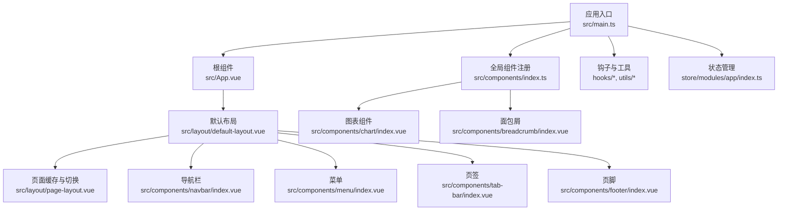
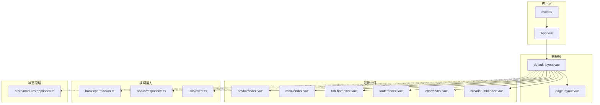
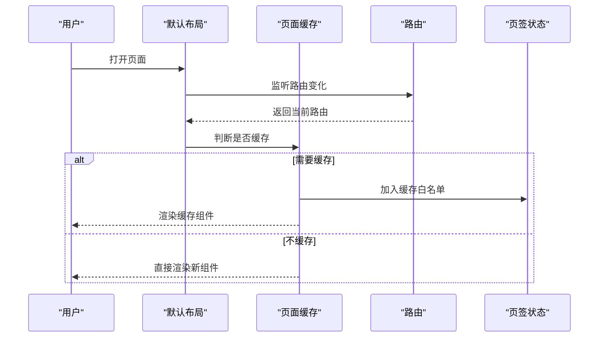
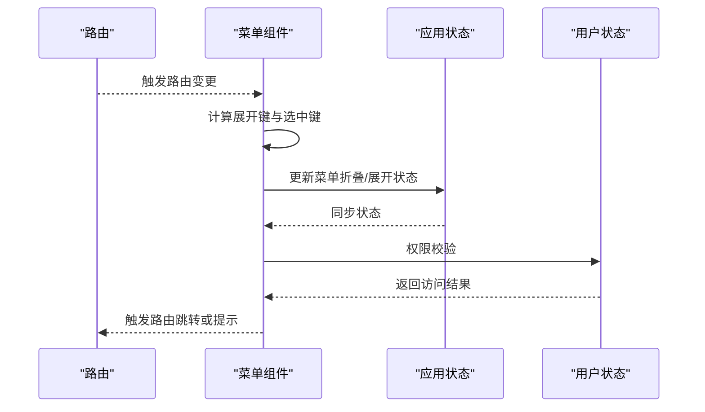
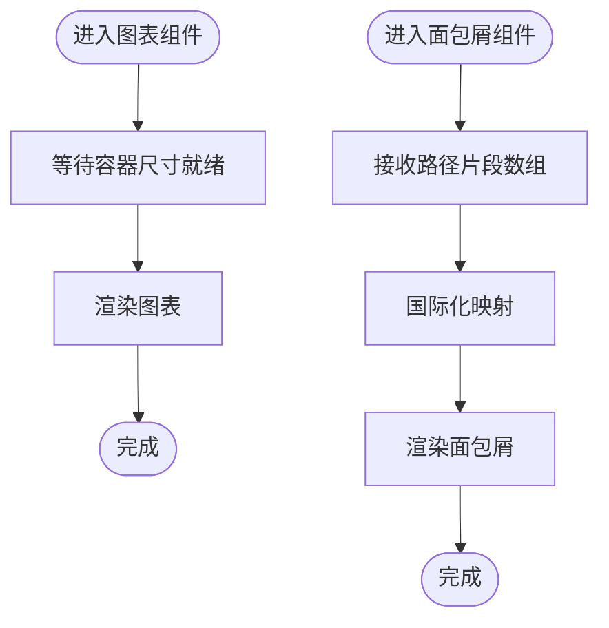
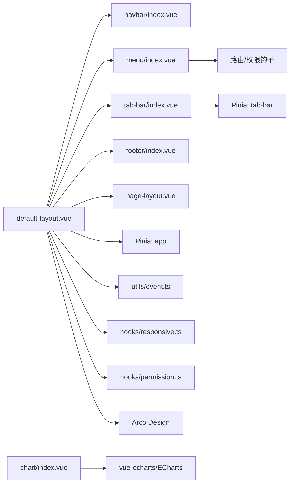

# 组件系统

<cite>
**本文引用的文件**
- [src/main.ts](file://src/main.ts)
- [src/App.vue](file://src/App.vue)
- [src/layout/default-layout.vue](file://src/layout/default-layout.vue)
- [src/layout/page-layout.vue](file://src/layout/page-layout.vue)
- [src/components/index.ts](file://src/components/index.ts)
- [src/components/chart/index.vue](file://src/components/chart/index.vue)
- [src/components/breadcrumb/index.vue](file://src/components/breadcrumb/index.vue)
- [src/components/menu/index.vue](file://src/components/menu/index.vue)
- [src/components/menu/use-menu-tree.ts](file://src/components/menu/use-menu-tree.ts)
- [src/components/navbar/index.vue](file://src/components/navbar/index.vue)
- [src/components/footer/index.vue](file://src/components/footer/index.vue)
- [src/components/tab-bar/index.vue](file://src/components/tab-bar/index.vue)
- [src/components/tab-bar/tab-item.vue](file://src/components/tab-bar/tab-item.vue)
- [src/hooks/permission.ts](file://src/hooks/permission.ts)
- [src/hooks/responsive.ts](file://src/hooks/responsive.ts)
- [src/store/modules/app/index.ts](file://src/store/modules/app/index.ts)
- [src/utils/event.ts](file://src/utils/event.ts)
</cite>

## 目录
1. [简介](#简介)
2. [项目结构](#项目结构)
3. [核心组件](#核心组件)
4. [架构总览](#架构总览)
5. [详细组件分析](#详细组件分析)
6. [依赖关系分析](#依赖关系分析)
7. [性能考量](#性能考量)
8. [故障排查指南](#故障排查指南)
9. [结论](#结论)
10. [附录](#附录)

## 简介
本组件系统以 Vue 3 + TypeScript + Arco Design 为核心，采用组合式 API（Composition API）与 Pinia 状态管理，构建了可配置、可扩展、可复用的通用组件体系。系统通过全局注册机制引入通用组件，并在布局层统一承载导航栏、侧边菜单、页签、内容区与页脚等模块；同时结合路由守卫与权限钩子保障访问控制与响应式布局适配。

## 项目结构
组件系统主要由以下层次构成：
- 应用入口与全局配置：应用挂载、Arco 全局主题与图标、国际化、全局组件注册、指令与拦截器初始化
- 布局层：默认布局容器、页面缓存与切换
- 通用组件：图表、面包屑、菜单、导航栏、页脚、页签等
- 钩子与工具：权限校验、响应式设备检测、事件监听封装
- 状态管理：应用级设置、主题、菜单、页签缓存等

图示来源
- [src/main.ts:1-29](file://src/main.ts#L1-L29)
- [src/App.vue:1-27](file://src/App.vue#L1-L27)
- [src/layout/default-layout.vue:1-179](file://src/layout/default-layout.vue#L1-L179)
- [src/layout/page-layout.vue:1-26](file://src/layout/page-layout.vue#L1-L26)
- [src/components/index.ts:1-36](file://src/components/index.ts#L1-L36)
- [src/components/chart/index.vue:1-48](file://src/components/chart/index.vue#L1-L48)
- [src/components/breadcrumb/index.vue:1-36](file://src/components/breadcrumb/index.vue#L1-L36)
- [src/components/menu/index.vue:1-161](file://src/components/menu/index.vue#L1-L161)
- [src/components/navbar/index.vue:1-324](file://src/components/navbar/index.vue#L1-L324)
- [src/components/footer/index.vue:1-17](file://src/components/footer/index.vue#L1-L17)
- [src/components/tab-bar/index.vue:1-102](file://src/components/tab-bar/index.vue#L1-L102)
- [src/store/modules/app/index.ts:1-78](file://src/store/modules/app/index.ts#L1-L78)

章节来源
- [src/main.ts:1-29](file://src/main.ts#L1-L29)
- [src/App.vue:1-27](file://src/App.vue#L1-L27)
- [src/layout/default-layout.vue:1-179](file://src/layout/default-layout.vue#L1-L179)
- [src/layout/page-layout.vue:1-26](file://src/layout/page-layout.vue#L1-L26)
- [src/components/index.ts:1-36](file://src/components/index.ts#L1-L36)

## 核心组件
- 图表组件：基于 vue-echarts 与按需引入的 ECharts 模块，支持自动尺寸适配与延迟渲染，便于在业务视图中快速接入可视化能力
- 面包屑组件：接收字符串数组作为路径片段，结合国际化文本展示层级导航
- 菜单组件：根据路由树生成菜单节点，支持折叠、选中态与外部链接打开，配合响应式与权限钩子实现多端一致体验
- 导航栏组件：集成语言切换、主题切换、消息弹窗、全屏切换、用户下拉菜单等常用功能，通过 provide/inject 实现与布局抽屉联动
- 页签组件：监听路由变化动态添加标签，支持固定与滚动，结合 Pinia 的页签列表与缓存白名单实现页面复用
- 页脚组件：简洁的页脚展示
- 默认布局：整合导航栏、菜单、页签、内容区与页脚，处理移动端抽屉、菜单折叠与内边距计算

章节来源
- [src/components/chart/index.vue:1-48](file://src/components/chart/index.vue#L1-L48)
- [src/components/breadcrumb/index.vue:1-36](file://src/components/breadcrumb/index.vue#L1-L36)
- [src/components/menu/index.vue:1-161](file://src/components/menu/index.vue#L1-L161)
- [src/components/navbar/index.vue:1-324](file://src/components/navbar/index.vue#L1-L324)
- [src/components/tab-bar/index.vue:1-102](file://src/components/tab-bar/index.vue#L1-L102)
- [src/components/footer/index.vue:1-17](file://src/components/footer/index.vue#L1-L17)
- [src/layout/default-layout.vue:1-179](file://src/layout/default-layout.vue#L1-L179)

## 架构总览
系统采用“布局容器 + 通用组件 + 钩子与工具 + 状态管理”的分层架构。应用启动时完成全局组件注册与 Arco 配置，布局层负责空间组织与交互编排，通用组件提供可复用能力，钩子与工具提供横切关注点，Pinia 提供集中式状态。

图示来源
- [src/main.ts:1-29](file://src/main.ts#L1-L29)
- [src/App.vue:1-27](file://src/App.vue#L1-L27)
- [src/layout/default-layout.vue:1-179](file://src/layout/default-layout.vue#L1-L179)
- [src/layout/page-layout.vue:1-26](file://src/layout/page-layout.vue#L1-L26)
- [src/components/navbar/index.vue:1-324](file://src/components/navbar/index.vue#L1-L324)
- [src/components/menu/index.vue:1-161](file://src/components/menu/index.vue#L1-L161)
- [src/components/tab-bar/index.vue:1-102](file://src/components/tab-bar/index.vue#L1-L102)
- [src/components/footer/index.vue:1-17](file://src/components/footer/index.vue#L1-L17)
- [src/components/chart/index.vue:1-48](file://src/components/chart/index.vue#L1-L48)
- [src/components/breadcrumb/index.vue:1-36](file://src/components/breadcrumb/index.vue#L1-L36)
- [src/hooks/permission.ts:1-34](file://src/hooks/permission.ts#L1-L34)
- [src/hooks/responsive.ts:1-33](file://src/hooks/responsive.ts#L1-L33)
- [src/utils/event.ts:1-28](file://src/utils/event.ts#L1-L28)
- [src/store/modules/app/index.ts:1-78](file://src/store/modules/app/index.ts#L1-L78)

## 详细组件分析

### 布局组件：默认布局与页面缓存
- 默认布局负责整体空间划分与响应式行为，包括导航栏、侧边菜单、移动端抽屉、页签与页脚的协调显示；通过计算属性动态调整内边距与菜单宽度；通过 provide/inject 将抽屉开关暴露给子组件
- 页面缓存通过 keep-alive 结合路由元信息与 Pinia 的缓存白名单实现，避免重复渲染与状态丢失

图示来源
- [src/layout/default-layout.vue:1-179](file://src/layout/default-layout.vue#L1-L179)
- [src/layout/page-layout.vue:1-26](file://src/layout/page-layout.vue#L1-L26)
- [src/components/tab-bar/index.vue:1-102](file://src/components/tab-bar/index.vue#L1-L102)

章节来源
- [src/layout/default-layout.vue:1-179](file://src/layout/default-layout.vue#L1-L179)
- [src/layout/page-layout.vue:1-26](file://src/layout/page-layout.vue#L1-L26)

### 通用组件：菜单与导航
- 菜单组件基于路由树生成，支持横向顶部菜单与纵向侧边菜单；通过 v-model 绑定折叠状态与选中项；监听路由变化自动更新展开与选中状态；支持外部链接打开与本地路由跳转
- 导航栏组件提供语言切换、主题切换、通知弹窗、全屏切换与用户下拉菜单；通过 provide/inject 接收来自布局的抽屉开关回调

图示来源
- [src/components/menu/index.vue:1-161](file://src/components/menu/index.vue#L1-L161)
- [src/hooks/permission.ts:1-34](file://src/hooks/permission.ts#L1-L34)
- [src/store/modules/app/index.ts:1-78](file://src/store/modules/app/index.ts#L1-L78)

章节来源
- [src/components/menu/index.vue:1-161](file://src/components/menu/index.vue#L1-L161)
- [src/components/navbar/index.vue:1-324](file://src/components/navbar/index.vue#L1-L324)
- [src/hooks/permission.ts:1-34](file://src/hooks/permission.ts#L1-L34)
- [src/hooks/responsive.ts:1-33](file://src/hooks/responsive.ts#L1-L33)

### 通用组件：图表与面包屑
- 图表组件基于 vue-echarts，通过 props 接收配置、尺寸与自动适配选项；采用 nextTick 延迟渲染以确保容器尺寸已就绪
- 面包屑组件接收字符串数组作为路径片段，结合国际化文本进行展示

图示来源
- [src/components/chart/index.vue:1-48](file://src/components/chart/index.vue#L1-L48)
- [src/components/breadcrumb/index.vue:1-36](file://src/components/breadcrumb/index.vue#L1-L36)

章节来源
- [src/components/chart/index.vue:1-48](file://src/components/chart/index.vue#L1-L48)
- [src/components/breadcrumb/index.vue:1-36](file://src/components/breadcrumb/index.vue#L1-L36)

### 通用组件：页签与页脚
- 页签组件监听路由变化，自动添加未固定的标签；支持 affix 固定与滚动；通过 Pinia 获取缓存白名单并联动 keep-alive
- 页脚组件提供统一的底部展示区域

章节来源
- [src/components/tab-bar/index.vue:1-102](file://src/components/tab-bar/index.vue#L1-L102)
- [src/components/footer/index.vue:1-17](file://src/components/footer/index.vue#L1-L17)

### 组件通信机制、插槽使用与 props 传递模式
- 组件间通信
  - provide/inject：布局向导航栏注入抽屉开关回调，实现跨层级交互
  - 事件发射与监听：菜单组件通过 emit 抛出折叠事件，布局接收并更新状态
  - 路由与状态：通过路由监听与 Pinia 状态同步，实现页面级联动
- 插槽使用
  - 菜单组件在渲染子菜单时使用 v-slots 传入图标与标题，体现插槽的灵活使用
- Props 传递模式
  - 图表组件通过 props 接收配置对象、尺寸与自动适配布尔值
  - 面包屑组件通过 props 接收路径片段数组

章节来源
- [src/layout/default-layout.vue:100-102](file://src/layout/default-layout.vue#L100-L102)
- [src/components/menu/index.vue:104-118](file://src/components/menu/index.vue#L104-L118)
- [src/components/chart/index.vue:15-34](file://src/components/chart/index.vue#L15-L34)
- [src/components/breadcrumb/index.vue:15-22](file://src/components/breadcrumb/index.vue#L15-L22)

### 生命周期管理、事件处理与状态同步
- 生命周期管理
  - 布局组件在 mounted 后标记初始化完成，避免首次渲染时菜单状态异常
  - 图表组件在 nextTick 后开启渲染，保证容器尺寸可用
- 事件处理
  - 响应式钩子在窗口 resize 时触发去抖处理，更新设备类型与菜单可见性
  - 导航栏通过 @click 触发下拉选择与弹窗显示
- 状态同步
  - 应用状态通过 Pinia 维护主题、设备、菜单等全局设置
  - 菜单与页签状态通过路由监听与状态管理同步

章节来源
- [src/layout/default-layout.vue:103-105](file://src/layout/default-layout.vue#L103-L105)
- [src/components/chart/index.vue:40-44](file://src/components/chart/index.vue#L40-L44)
- [src/hooks/responsive.ts:13-32](file://src/hooks/responsive.ts#L13-L32)
- [src/store/modules/app/index.ts:1-78](file://src/store/modules/app/index.ts#L1-L78)

### 组件复用策略与组合式 API 使用
- 复用策略
  - 全局组件注册：通过统一入口注册图表与面包屑等通用组件，减少重复引入
  - 布局复用：默认布局承担空间组织职责，业务视图仅关注内容
  - 钩子复用：权限与响应式逻辑封装为独立钩子，跨组件共享
- 组合式 API 使用
  - 在布局与通用组件中广泛使用 computed、watch、onMounted、inject 等组合式 API，提升逻辑复用与可测试性

章节来源
- [src/components/index.ts:30-35](file://src/components/index.ts#L30-L35)
- [src/layout/default-layout.vue:47-105](file://src/layout/default-layout.vue#L47-L105)
- [src/hooks/permission.ts:1-34](file://src/hooks/permission.ts#L1-L34)
- [src/hooks/responsive.ts:1-33](file://src/hooks/responsive.ts#L1-L33)

### 与 UI 库的集成与自定义组件开发规范
- UI 库集成
  - Arco Design 通过插件方式全局引入，根组件包裹 a-config-provider 并按语言切换提供对应 locale
  - 图标通过 ArcoVueIcon 注册，菜单与导航等组件直接使用 Arco 组件
- 自定义组件开发规范
  - 统一使用 TypeScript 与组合式 API
  - 通过 props 明确输入约束，使用 emits 定义事件
  - 通过 provide/inject 解耦跨层级交互
  - 通过 Pinia 管理全局状态，避免组件间复杂 props 下钻

章节来源
- [src/main.ts:19-26](file://src/main.ts#L19-L26)
- [src/App.vue:8-26](file://src/App.vue#L8-L26)
- [src/components/menu/index.vue:104-118](file://src/components/menu/index.vue#L104-L118)

## 依赖关系分析
- 组件依赖
  - 默认布局依赖导航栏、菜单、页签、页脚与页面缓存组件
  - 菜单组件依赖路由、国际化与权限钩子
  - 页签组件依赖路由监听与 Pinia 状态
- 外部依赖
  - Arco Design 与 vue-echarts 提供 UI 与可视化能力
  - @vueuse/core 提供响应式与浏览器 API 封装
- 状态依赖
  - 应用状态驱动主题、设备、菜单与服务端菜单配置

图示来源
- [src/layout/default-layout.vue:1-179](file://src/layout/default-layout.vue#L1-L179)
- [src/components/navbar/index.vue:1-324](file://src/components/navbar/index.vue#L1-L324)
- [src/components/menu/index.vue:1-161](file://src/components/menu/index.vue#L1-L161)
- [src/components/tab-bar/index.vue:1-102](file://src/components/tab-bar/index.vue#L1-L102)
- [src/components/footer/index.vue:1-17](file://src/components/footer/index.vue#L1-L17)
- [src/layout/page-layout.vue:1-26](file://src/layout/page-layout.vue#L1-L26)
- [src/hooks/permission.ts:1-34](file://src/hooks/permission.ts#L1-L34)
- [src/hooks/responsive.ts:1-33](file://src/hooks/responsive.ts#L1-L33)
- [src/utils/event.ts:1-28](file://src/utils/event.ts#L1-L28)
- [src/store/modules/app/index.ts:1-78](file://src/store/modules/app/index.ts#L1-L78)
- [src/components/chart/index.vue:1-48](file://src/components/chart/index.vue#L1-L48)

章节来源
- [src/layout/default-layout.vue:1-179](file://src/layout/default-layout.vue#L1-L179)
- [src/components/menu/index.vue:1-161](file://src/components/menu/index.vue#L1-L161)
- [src/components/tab-bar/index.vue:1-102](file://src/components/tab-bar/index.vue#L1-L102)
- [src/hooks/permission.ts:1-34](file://src/hooks/permission.ts#L1-L34)
- [src/hooks/responsive.ts:1-33](file://src/hooks/responsive.ts#L1-L33)
- [src/utils/event.ts:1-28](file://src/utils/event.ts#L1-L28)
- [src/store/modules/app/index.ts:1-78](file://src/store/modules/app/index.ts#L1-L78)
- [src/components/chart/index.vue:1-48](file://src/components/chart/index.vue#L1-L48)

## 性能考量
- 懒加载与按需引入：ECharts 通过手动引入必要模块减小打包体积
- 延迟渲染：图表组件在 nextTick 后渲染，避免首屏闪烁与尺寸计算问题
- 缓存策略：页面缓存结合路由元信息与 Pinia 白名单，减少重复渲染
- 响应式优化：窗口 resize 使用去抖，降低频繁重排带来的性能损耗

章节来源
- [src/components/index.ts:15-28](file://src/components/index.ts#L15-L28)
- [src/components/chart/index.vue:40-44](file://src/components/chart/index.vue#L40-L44)
- [src/layout/page-layout.vue:22-23](file://src/layout/page-layout.vue#L22-L23)
- [src/hooks/responsive.ts:22-22](file://src/hooks/responsive.ts#L22-L22)

## 故障排查指南
- 菜单折叠状态异常
  - 检查布局组件在初始化前是否设置了折叠状态；确认 isInit 标志位生效
  - 参考：[src/layout/default-layout.vue:85-88](file://src/layout/default-layout.vue#L85-L88)
- 路由跳转后菜单未更新
  - 确认路由监听是否正确触发；检查 findMenuOpenKeys 递归查找逻辑
  - 参考：[src/components/menu/index.vue:72-86](file://src/components/menu/index.vue#L72-L86)
- 设备切换导致菜单显示异常
  - 确认响应式钩子是否绑定 window.resize；检查去抖函数是否正确移除
  - 参考：[src/hooks/responsive.ts:26-31](file://src/hooks/responsive.ts#L26-L31)，[src/utils/event.ts:1-28](file://src/utils/event.ts#L1-L28)
- 图表不显示或尺寸异常
  - 确认容器尺寸是否就绪后再渲染；检查 props 传入的宽高与自动适配
  - 参考：[src/components/chart/index.vue:40-44](file://src/components/chart/index.vue#L40-L44)，[src/components/chart/index.vue:15-34](file://src/components/chart/index.vue#L15-L34)
- 页签未更新或缓存失效
  - 检查路由监听是否注册；确认 Pinia 中缓存白名单是否包含目标路由
  - 参考：[src/components/tab-bar/index.vue:48-55](file://src/components/tab-bar/index.vue#L48-L55)，[src/layout/page-layout.vue:22-23](file://src/layout/page-layout.vue#L22-L23)

章节来源
- [src/layout/default-layout.vue:85-88](file://src/layout/default-layout.vue#L85-L88)
- [src/components/menu/index.vue:72-86](file://src/components/menu/index.vue#L72-L86)
- [src/hooks/responsive.ts:26-31](file://src/hooks/responsive.ts#L26-L31)
- [src/utils/event.ts:1-28](file://src/utils/event.ts#L1-L28)
- [src/components/chart/index.vue:40-44](file://src/components/chart/index.vue#L40-L44)
- [src/components/chart/index.vue:15-34](file://src/components/chart/index.vue#L15-L34)
- [src/components/tab-bar/index.vue:48-55](file://src/components/tab-bar/index.vue#L48-L55)
- [src/layout/page-layout.vue:22-23](file://src/layout/page-layout.vue#L22-L23)

## 结论
该组件系统通过清晰的分层与可复用的通用组件，结合组合式 API、Pinia 与 Arco Design，实现了良好的可维护性与扩展性。布局层承担空间组织与交互编排，通用组件提供稳定的 UI 能力，钩子与工具提供横切关注点，整体架构易于在业务场景中快速落地与迭代。

## 附录
- 全局组件注册入口：[src/components/index.ts:30-35](file://src/components/index.ts#L30-L35)
- 应用入口与全局配置：[src/main.ts:17-28](file://src/main.ts#L17-L28)
- 国际化与 Arco 主题：[src/App.vue:8-26](file://src/App.vue#L8-L26)