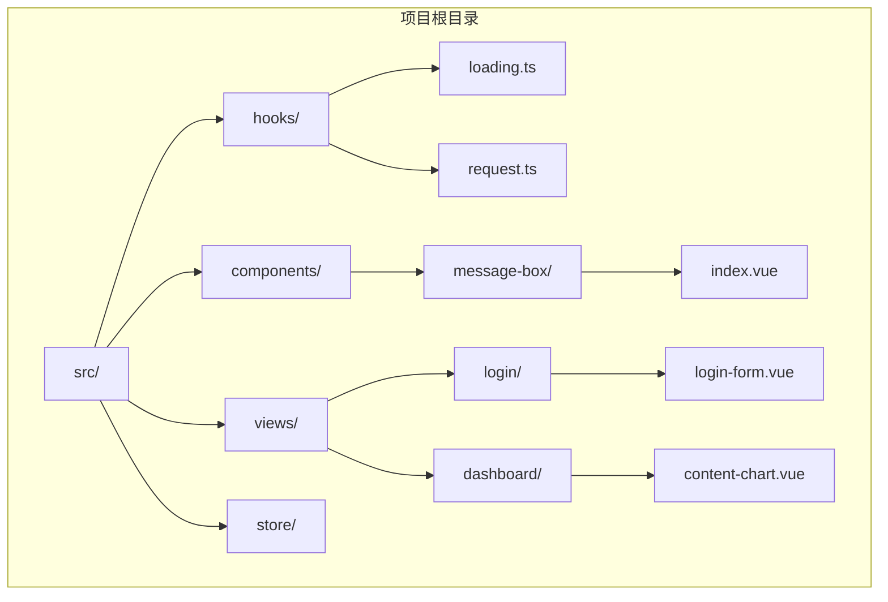
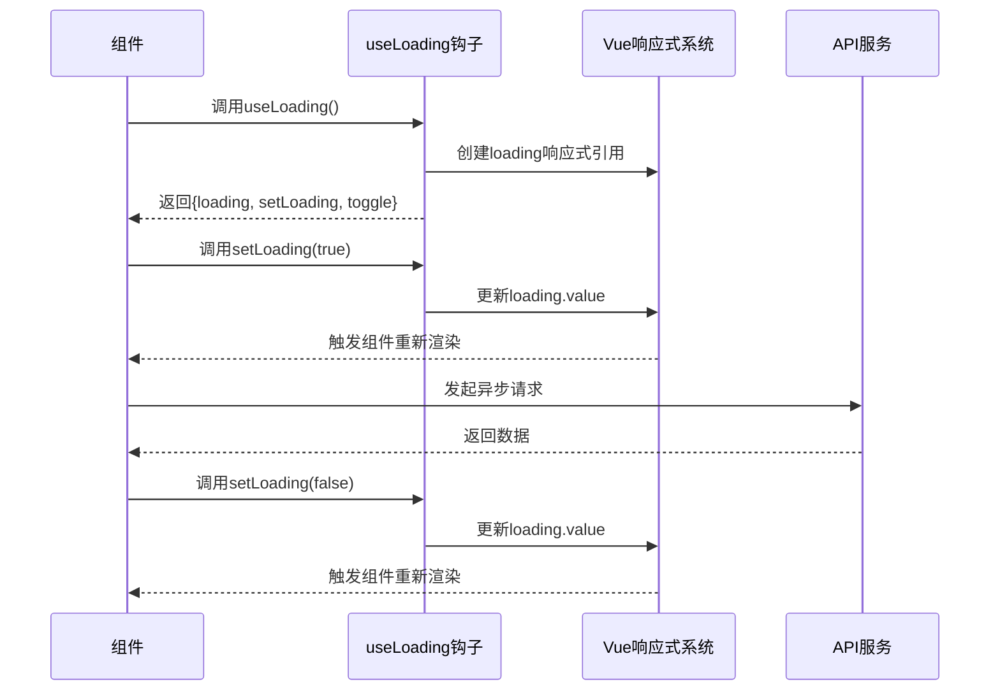
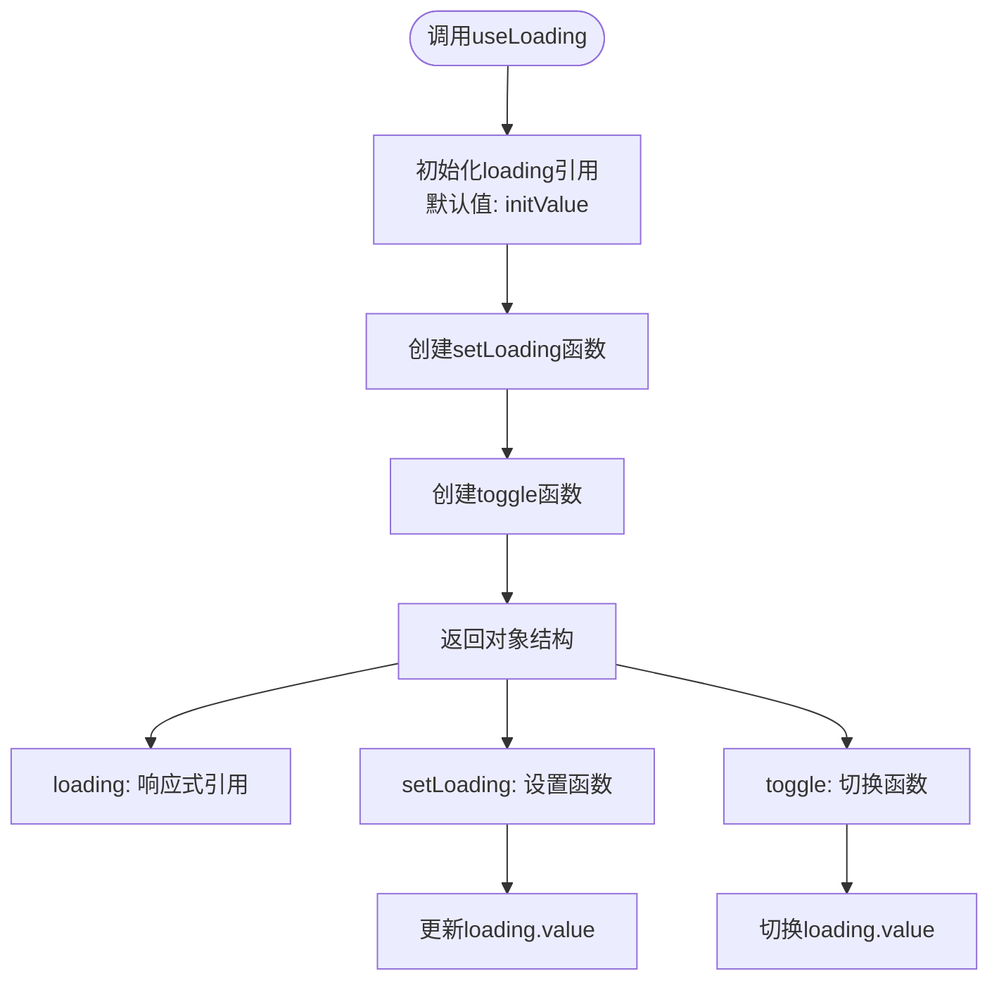
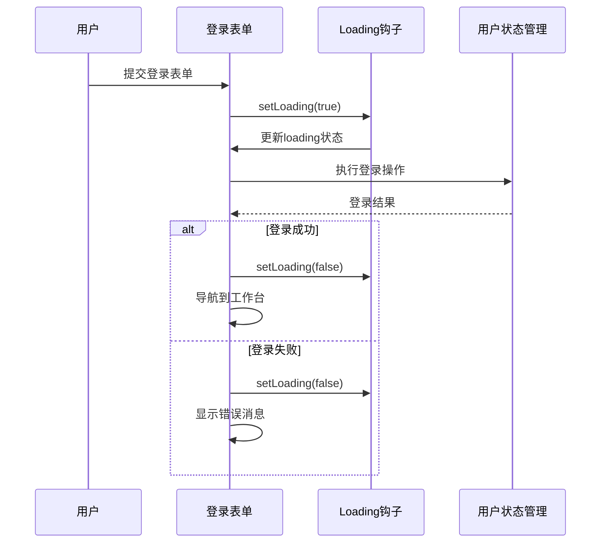
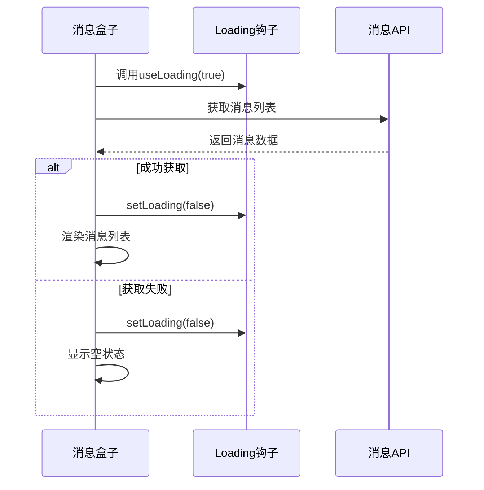
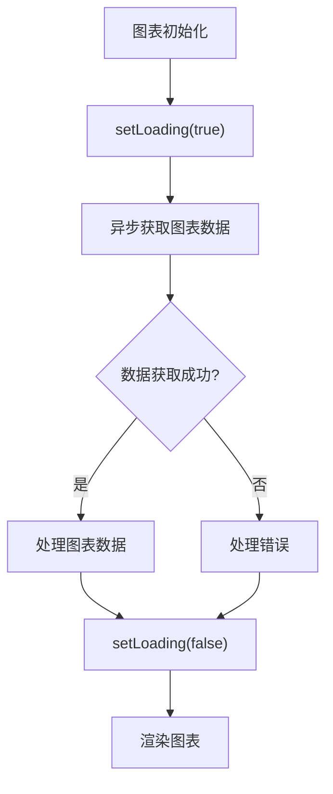
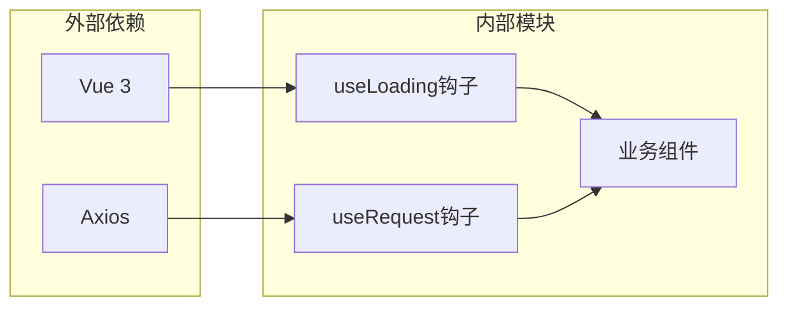

# Loading状态管理钩子

<cite>
**本文档引用的文件**
- [loading.ts](file://src/hooks/loading.ts)
- [request.ts](file://src/hooks/request.ts)
- [index.vue](file://src/components/message-box/index.vue)
- [login-form.vue](file://src/views/login/components/login-form.vue)
- [content-chart.vue](file://src/views/dashboard/workplace/components/content-chart.vue)
- [package.json](file://package.json)
</cite>

## 目录
1. [简介](#简介)
2. [项目结构](#项目结构)
3. [核心组件](#核心组件)
4. [架构概览](#架构概览)
5. [详细组件分析](#详细组件分析)
6. [依赖分析](#依赖分析)
7. [性能考虑](#性能考虑)
8. [故障排除指南](#故障排除指南)
9. [最佳实践](#最佳实践)
10. [结论](#结论)

## 简介

Loading状态管理钩子是本Vue 3项目中的一个轻量级工具，用于统一管理组件中的加载状态。该钩子提供了简洁而强大的API，帮助开发者在各种异步操作场景中优雅地处理加载指示器的状态变化。

本钩子基于Vue 3的响应式系统构建，使用`ref`来创建可响应的loading状态，并提供两个核心方法：`setLoading`用于直接设置状态值，`toggle`用于切换状态。通过这种设计，开发者可以轻松地在组件中实现各种加载场景，如表单提交、数据获取、页面渲染等。

## 项目结构

该项目采用标准的Vue 3单页应用架构，其中Loading钩子位于`src/hooks/`目录下，作为全局可复用的工具模块。项目使用Vite作为构建工具，支持TypeScript开发，并集成了多个现代化的开发工具链。



**图表来源**
- [loading.ts:1-17](file://src/hooks/loading.ts#L1-L17)
- [request.ts:1-27](file://src/hooks/request.ts#L1-L27)

**章节来源**
- [package.json:1-103](file://package.json#L1-L103)

## 核心组件

Loading状态管理钩子是本项目中最基础且重要的响应式工具之一。它实现了以下核心功能：

### 钩子设计原理

该钩子采用了极简主义的设计哲学，通过最少的代码实现最大的功能价值。其核心思想是将loading状态抽象为一个简单的布尔值，但通过组合模式提供丰富的操作能力。

### 返回对象结构

钩子返回一个包含三个关键属性的对象：
- `loading`: 响应式的布尔引用，表示当前是否处于加载状态
- `setLoading`: 函数，用于直接设置loading状态值
- `toggle`: 函数，用于切换loading状态的布尔值

### 初始化机制

钩子支持可选的初始化参数，默认值为`false`，这意味着新创建的loading实例默认处于非加载状态。这种设计符合大多数UI组件的预期行为。

**章节来源**
- [loading.ts:1-17](file://src/hooks/loading.ts#L1-L17)

## 架构概览

Loading钩子在整个应用架构中扮演着桥梁的角色，连接着视图层和数据层。它通过响应式系统与Vue组件紧密集成，同时为其他高级钩子提供基础支撑。



**图表来源**
- [loading.ts:3-16](file://src/hooks/loading.ts#L3-L16)
- [request.ts:11-26](file://src/hooks/request.ts#L11-L26)

## 详细组件分析

### useLoading钩子实现分析

#### 核心实现逻辑



**图表来源**
- [loading.ts:3-16](file://src/hooks/loading.ts#L3-L16)

#### 数据结构复杂度分析

- 时间复杂度：所有操作均为O(1)，包括状态设置、状态切换和响应式更新
- 空间复杂度：O(1)，仅存储单一布尔值和两个函数引用
- 响应式更新：通过Vue的ref系统实现自动依赖追踪

#### 错误处理策略

该钩子本身不包含复杂的错误处理逻辑，因为其职责专注于状态管理。任何异步操作的错误处理应该在调用组件中完成，钩子只负责状态的正确设置。

**章节来源**
- [loading.ts:1-17](file://src/hooks/loading.ts#L1-L17)

### 实际应用场景分析

#### 表单提交场景

在登录表单组件中，Loading钩子被用来控制提交按钮的状态和用户体验：



**图表来源**
- [login-form.vue:93-125](file://src/views/login/components/login-form.vue#L93-L125)

#### 数据加载场景

在消息盒子组件中，Loading钩子用于管理消息列表的数据获取过程：



**图表来源**
- [index.vue:68-108](file://src/components/message-box/index.vue#L68-L108)

#### 图表数据加载场景

在内容图表组件中，Loading钩子用于控制图表数据的异步加载：



**图表来源**
- [content-chart.vue:177-197](file://src/views/dashboard/workplace/components/content-chart.vue#L177-L197)

**章节来源**
- [index.vue:68-108](file://src/components/message-box/index.vue#L68-L108)
- [login-form.vue:93-125](file://src/views/login/components/login-form.vue#L93-L125)
- [content-chart.vue:177-197](file://src/views/dashboard/workplace/components/content-chart.vue#L177-L197)

### 高级集成场景

#### 与useRequest钩子的协作

Loading钩子与useRequest钩子形成了完美的组合，提供了完整的数据获取解决方案：

```mermaid
classDiagram
class useLoading {
+loading : Ref~boolean~
+setLoading(value : boolean) : void
+toggle() : void
}
class useRequest {
+loading : Ref~boolean~
+response : Ref~T~
+api() : Promise~AxiosResponse~
}
class useRequestImplementation {
+useLoading(isLoading : boolean) : {loading, setLoading}
+api() : Promise~AxiosResponse~
+finally() : void
}
useRequest --> useLoading : 使用
useRequestImplementation --> useLoading : 调用
```

**图表来源**
- [request.ts:11-26](file://src/hooks/request.ts#L11-L26)
- [loading.ts:3-16](file://src/hooks/loading.ts#L3-L16)

**章节来源**
- [request.ts:1-27](file://src/hooks/request.ts#L1-L27)

## 依赖分析

Loading钩子的依赖关系相对简单，主要依赖于Vue 3的核心响应式系统。



**图表来源**
- [loading.ts:1-2](file://src/hooks/loading.ts#L1-L2)
- [request.ts:1-4](file://src/hooks/request.ts#L1-L4)

### 外部依赖说明

- **Vue 3**: 提供响应式系统(ref)和组件生命周期管理
- **Axios**: 用于HTTP请求处理(在useRequest钩子中使用)

### 内部依赖关系

- useRequest钩子依赖useLoading钩子来管理数据获取过程中的加载状态
- 各个业务组件通过useLoading钩子实现各自的功能需求

**章节来源**
- [package.json:32-47](file://package.json#L32-L47)

## 性能考虑

### 内存管理

- Loading钩子使用Vue的ref系统，具有良好的内存管理特性
- 当组件卸载时，响应式引用会自动清理，避免内存泄漏
- 单一布尔值的存储开销极小，几乎不影响性能

### 渲染优化

- 由于loading状态是单一布尔值，Vue的响应式系统可以高效地追踪变更
- 在大型组件树中，loading状态的传播开销很小
- 可以与其他Vue 3优化技术(如keep-alive)配合使用

### 并发处理

- 在高并发场景下，建议使用防抖或节流机制避免频繁的状态切换
- 对于长耗时操作，考虑使用超时机制防止UI长时间处于加载状态

## 故障排除指南

### 常见问题及解决方案

#### 问题1: 加载状态无法重置

**症状**: 调用`setLoading(false)`后，UI仍然显示加载状态

**可能原因**:
- 异常处理中忘记调用`setLoading(false)`
- 组件在异步操作完成前已经卸载

**解决方案**:
```typescript
// 确保在finally块中重置状态
try {
  await apiCall();
} catch (error) {
  // 处理错误
} finally {
  setLoading(false); // 关键：确保在finally中调用
}
```

#### 问题2: 状态切换异常

**症状**: `toggle()`函数无法正常切换状态

**可能原因**:
- 在异步操作中重复调用`setLoading(true)`导致状态混乱

**解决方案**:
```typescript
// 在提交前检查状态
if (loading.value) return; // 防止重复提交
setLoading(true);
```

#### 问题3: 内存泄漏

**症状**: 页面切换后，loading状态仍然存在

**解决方案**:
- 确保组件卸载时不会继续修改loading状态
- 使用Vue 3的生命周期钩子正确管理资源

**章节来源**
- [login-form.vue:93-125](file://src/views/login/components/login-form.vue#L93-L125)
- [index.vue:68-108](file://src/components/message-box/index.vue#L68-L108)

## 最佳实践

### 使用模式

#### 1. 表单提交场景

```typescript
const { loading, setLoading } = useLoading();
const handleSubmit = async () => {
  if (loading.value) return; // 防止重复提交
  
  setLoading(true);
  try {
    await submitForm();
    Message.success('提交成功');
  } catch (error) {
    Message.error('提交失败');
  } finally {
    setLoading(false);
  }
};
```

#### 2. 数据加载场景

```typescript
const { loading, setLoading } = useLoading(true);
const fetchData = async () => {
  setLoading(true);
  try {
    const data = await api.getData();
    state.value = data;
  } finally {
    setLoading(false);
  }
};
```

#### 3. 条件加载场景

```typescript
const { loading, setLoading, toggle } = useLoading();
const handleAction = () => {
  if (condition) {
    toggle(); // 切换到相反状态
  } else {
    setLoading(true); // 明确设置状态
  }
};
```

### 性能优化建议

#### 1. 避免不必要的重渲染

- 将loading状态与UI元素分离，避免在loading状态下进行复杂的计算
- 使用`computed`属性缓存派生状态

#### 2. 合理的超时处理

```typescript
const { loading, setLoading } = useLoading();
const timeoutId = setTimeout(() => {
  if (loading.value) {
    setLoading(false); // 防止UI长时间加载
  }
}, 10000); // 10秒超时
```

#### 3. 批量状态管理

对于多个相关操作，考虑使用更高级的状态管理模式：

```typescript
const useMultiLoading = (initialState: Record<string, boolean> = {}) => {
  const states = ref(initialState);
  
  return {
    states,
    setLoading: (key: string, value: boolean) => {
      states.value[key] = value;
    },
    resetAll: () => {
      states.value = initialState;
    }
  };
};
```

### 错误处理最佳实践

#### 1. 完整的异常处理

```typescript
const { loading, setLoading } = useLoading();
try {
  setLoading(true);
  const result = await riskyOperation();
  return result;
} catch (error) {
  handleError(error);
  throw error; // 重新抛出错误供上层处理
} finally {
  setLoading(false);
}
```

#### 2. 用户友好的错误反馈

```typescript
const { loading, setLoading } = useLoading();
try {
  setLoading(true);
  await operation();
} catch (error) {
  Message.error(`操作失败: ${error.message}`);
  throw error;
} finally {
  setLoading(false);
}
```

## 结论

Loading状态管理钩子虽然实现简洁，但在整个应用架构中发挥着重要作用。它通过提供统一的状态管理接口，简化了开发者在各种异步场景中的状态处理工作。

### 主要优势

1. **简洁性**: 极简的API设计，易于理解和使用
2. **灵活性**: 支持多种使用模式，适应不同的业务场景
3. **性能**: 基于Vue响应式系统的高效实现
4. **可扩展性**: 可以与其他钩子和工具无缝集成

### 应用前景

随着项目规模的扩大，这个简单的钩子将继续发挥重要作用。它为更复杂的状态管理需求奠定了基础，也为未来的功能扩展提供了便利。

通过遵循本文档中的最佳实践和设计原则，开发者可以充分利用这个钩子的优势，在保持代码简洁的同时提供优秀的用户体验。