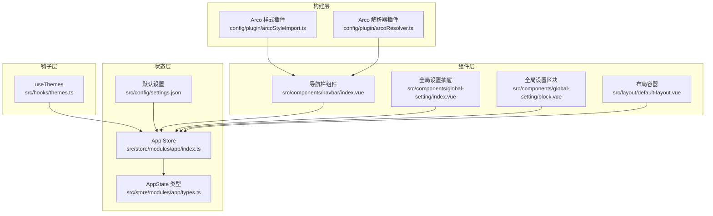
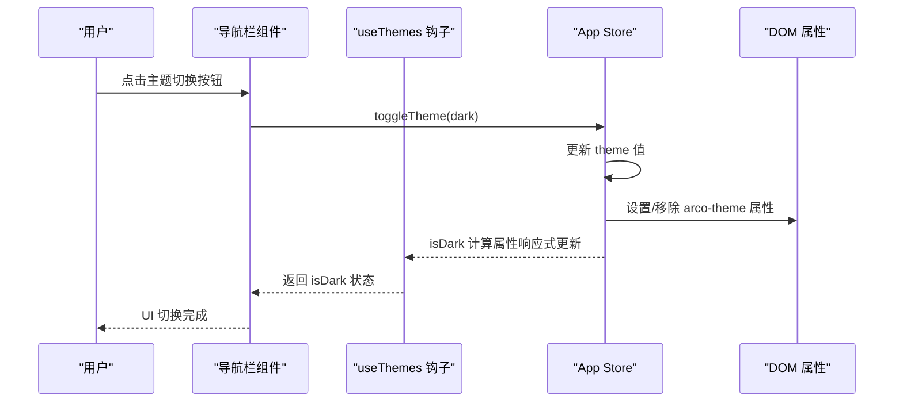
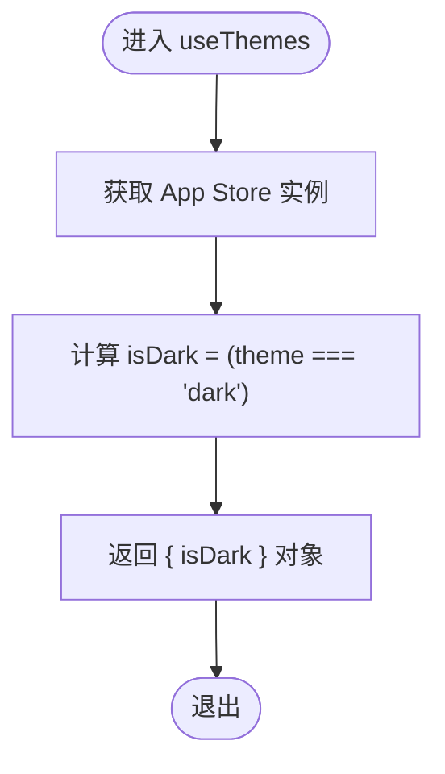
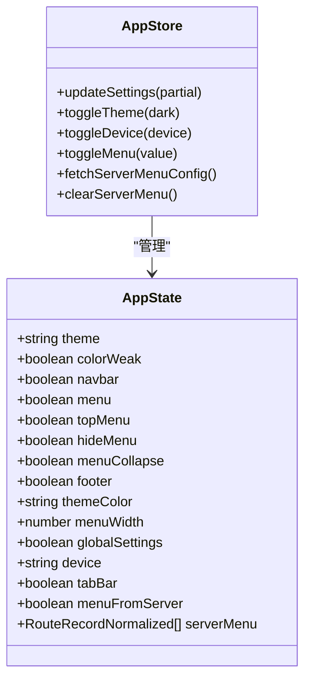
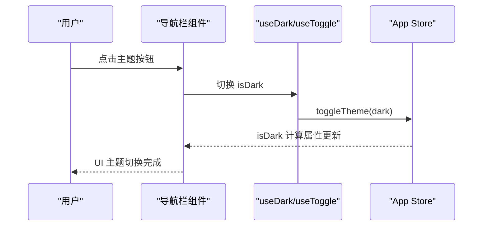
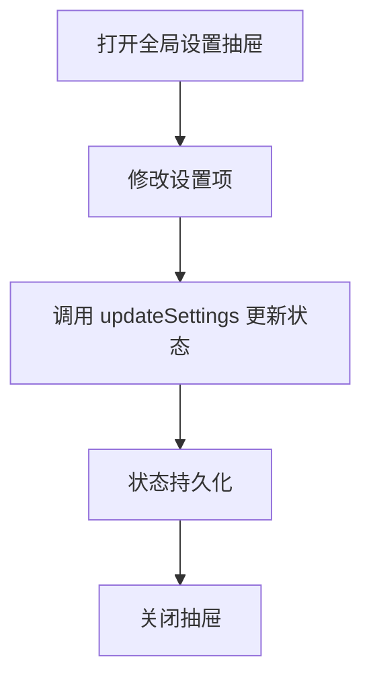
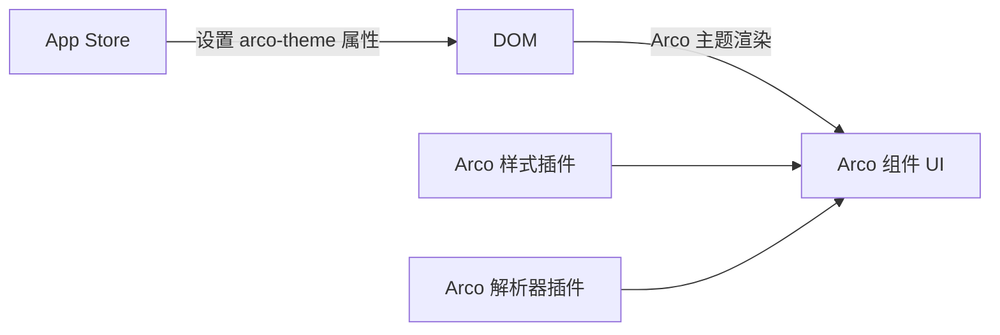
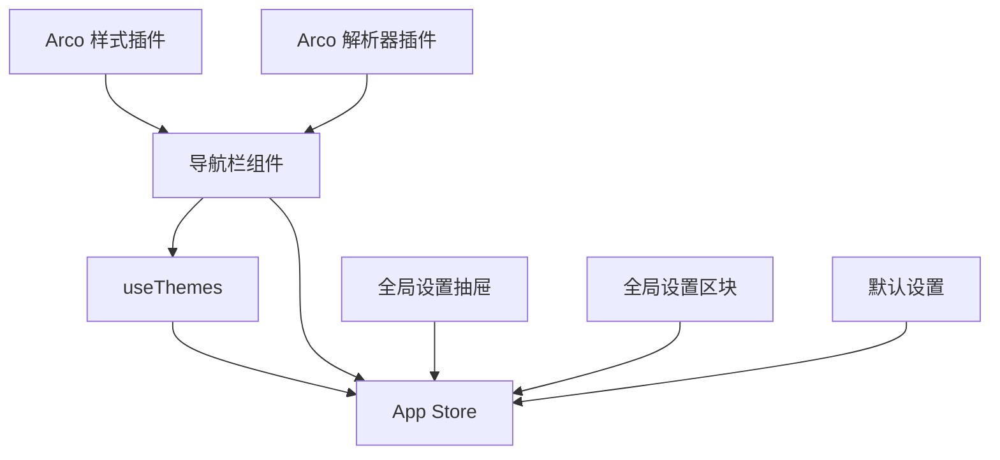

# 主题切换钩子

<cite>
**本文档引用的文件**
- [themes.ts](file://src/hooks/themes.ts)
- [index.ts](file://src/store/modules/app/index.ts)
- [types.ts](file://src/store/modules/app/types.ts)
- [settings.json](file://src/config/settings.json)
- [index.vue](file://src/components/navbar/index.vue)
- [index.vue](file://src/layout/default-layout.vue)
- [index.vue](file://src/components/global-setting/index.vue)
- [block.vue](file://src/components/global-setting/block.vue)
- [arcoStyleImport.ts](file://config/plugin/arcoStyleImport.ts)
- [arcoResolver.ts](file://config/plugin/arcoResolver.ts)
</cite>

## 目录
1. [简介](#简介)
2. [项目结构](#项目结构)
3. [核心组件](#核心组件)
4. [架构总览](#架构总览)
5. [详细组件分析](#详细组件分析)
6. [依赖关系分析](#依赖关系分析)
7. [性能考虑](#性能考虑)
8. [故障排除指南](#故障排除指南)
9. [结论](#结论)
10. [附录](#附录)

## 简介
本文件围绕主题切换钩子 useTheme（仓库中为 useThemes）进行系统性说明，重点阐述其设计理念、主题状态维护机制、主题切换逻辑以及与 Arco Design 主题系统的集成方式。文档同时覆盖主题持久化策略、主题操作方法（当前主题获取、主题切换、主题配置更新）、在组件中的实际使用示例（动态主题切换、主题偏好保存），并提供自定义主题开发指南。

## 项目结构
主题系统由以下关键部分组成：
- 钩子层：useThemes 提供主题状态访问能力
- 状态层：Pinia 应用状态模块维护主题状态与切换动作
- 配置层：默认设置文件定义初始主题值
- 组件层：导航栏、全局设置抽屉等组件负责触发主题切换
- 构建层：Arco 插件按需导入样式，确保主题样式生效

**图表来源**
- [themes.ts:1-13](file://src/hooks/themes.ts#L1-L13)
- [index.ts:1-78](file://src/store/modules/app/index.ts#L1-L78)
- [types.ts:1-21](file://src/store/modules/app/types.ts#L1-L21)
- [settings.json:1-18](file://src/config/settings.json#L1-L18)
- [index.vue:195-263](file://src/components/navbar/index.vue#L195-L263)
- [index.vue:1-99](file://src/components/global-setting/index.vue#L1-L99)
- [block.vue:1-79](file://src/components/global-setting/block.vue#L1-L79)
- [index.vue:1-179](file://src/layout/default-layout.vue#L1-L179)
- [arcoStyleImport.ts:1-12](file://config/plugin/arcoStyleImport.ts#L1-L12)
- [arcoResolver.ts:1-20](file://config/plugin/arcoResolver.ts#L1-L20)

**章节来源**
- [themes.ts:1-13](file://src/hooks/themes.ts#L1-L13)
- [index.ts:1-78](file://src/store/modules/app/index.ts#L1-L78)
- [types.ts:1-21](file://src/store/modules/app/types.ts#L1-L21)
- [settings.json:1-18](file://src/config/settings.json#L1-L18)
- [index.vue:195-263](file://src/components/navbar/index.vue#L195-L263)
- [index.vue:1-99](file://src/components/global-setting/index.vue#L1-L99)
- [block.vue:1-79](file://src/components/global-setting/block.vue#L1-L79)
- [index.vue:1-179](file://src/layout/default-layout.vue#L1-L179)
- [arcoStyleImport.ts:1-12](file://config/plugin/arcoStyleImport.ts#L1-L12)
- [arcoResolver.ts:1-20](file://config/plugin/arcoResolver.ts#L1-L20)

## 核心组件
- useThemes 钩子：提供 isDark 计算属性，用于判断当前主题是否为深色模式
- App Store：集中管理主题状态与切换动作，并通过 DOM 属性同步 Arco 主题
- 默认设置：初始化主题为浅色模式
- 导航栏组件：提供主题切换按钮，调用 App Store 的 toggleTheme 并与浏览器系统主题联动
- 全局设置抽屉与区块：提供主题相关设置项（如颜色弱视等），并通过 App Store 更新状态

**章节来源**
- [themes.ts:1-13](file://src/hooks/themes.ts#L1-L13)
- [index.ts:31-40](file://src/store/modules/app/index.ts#L31-L40)
- [settings.json:2-2](file://src/config/settings.json#L2-L2)
- [index.vue:215-233](file://src/components/navbar/index.vue#L215-L233)
- [index.vue:1-99](file://src/components/global-setting/index.vue#L1-L99)
- [block.vue:40-59](file://src/components/global-setting/block.vue#L40-L59)

## 架构总览
主题系统采用“钩子 + Pinia Store + 组件”的分层设计：
- 钩子层仅暴露只读或受控的计算属性，避免直接修改状态
- Store 层统一管理主题状态与切换逻辑，并通过 DOM 属性驱动 Arco 主题渲染
- 组件层负责用户交互与状态更新，保持 UI 与状态的一致性
- 构建阶段通过 Arco 插件按需加载样式，确保主题切换时样式即时生效

**图表来源**
- [index.vue:215-233](file://src/components/navbar/index.vue#L215-L233)
- [index.ts:31-40](file://src/store/modules/app/index.ts#L31-L40)
- [themes.ts:4-12](file://src/hooks/themes.ts#L4-L12)

## 详细组件分析

### useThemes 钩子
- 设计理念：以最小接口暴露主题状态，避免在组件中直接读取 Store 内部状态
- 实现要点：基于 App Store 的 theme 字段派生 isDark 计算属性，确保响应式更新
- 使用建议：在需要根据主题状态渲染样式的组件中使用，避免直接操作 Store

**图表来源**
- [themes.ts:4-12](file://src/hooks/themes.ts#L4-L12)

**章节来源**
- [themes.ts:1-13](file://src/hooks/themes.ts#L1-L13)

### App Store 主题管理
- 主题状态：theme 字段记录当前主题（light/dark）
- 切换逻辑：toggleTheme 接收布尔值，设置/移除 DOM 属性 arco-theme，同时更新 theme 值
- 默认值：从 settings.json 初始化 theme 为 light
- 类型约束：AppState 定义了 theme 字段类型与可选扩展键

**图表来源**
- [types.ts:3-20](file://src/store/modules/app/types.ts#L3-L20)
- [index.ts:9-78](file://src/store/modules/app/index.ts#L9-L78)

**章节来源**
- [index.ts:31-40](file://src/store/modules/app/index.ts#L31-L40)
- [types.ts:3-20](file://src/store/modules/app/types.ts#L3-L20)
- [settings.json:2-2](file://src/config/settings.json#L2-L2)

### 导航栏主题切换
- 触发方式：点击太阳/月亮图标按钮
- 切换流程：调用 useDark 与 useToggle，内部回调触发 App Store 的 toggleTheme
- DOM 同步：通过 arco-theme 属性与 body 元素绑定，驱动 Arco 主题渲染
- 国际化提示：根据当前主题显示切换提示文案

**图表来源**
- [index.vue:215-233](file://src/components/navbar/index.vue#L215-L233)
- [index.ts:31-40](file://src/store/modules/app/index.ts#L31-L40)

**章节来源**
- [index.vue:64-84](file://src/components/navbar/index.vue#L64-L84)
- [index.vue:215-233](file://src/components/navbar/index.vue#L215-L233)

### 全局设置与主题偏好保存
- 抽屉入口：固定设置按钮打开全局设置抽屉
- 设置项：包含内容设置与其它设置，支持复制当前设置
- 偏好保存：通过 App Store 的 updateSettings 动作更新状态，实现主题偏好的持久化
- 区块处理：block.vue 在选项变更时调用 App Store 更新对应字段

**图表来源**
- [index.vue:1-99](file://src/components/global-setting/index.vue#L1-L99)
- [block.vue:40-59](file://src/components/global-setting/block.vue#L40-L59)
- [index.ts:24-29](file://src/store/modules/app/index.ts#L24-L29)

**章节来源**
- [index.vue:1-99](file://src/components/global-setting/index.vue#L1-L99)
- [block.vue:40-59](file://src/components/global-setting/block.vue#L40-L59)
- [index.ts:24-29](file://src/store/modules/app/index.ts#L24-L29)

### Arco Design 主题系统集成
- 样式按需导入：通过 Arco 样式插件在构建期按需引入组件样式，确保主题切换时样式即时生效
- 组件按需解析：Arco 解析器插件支持组件按需加载，减少打包体积
- DOM 属性驱动：App Store 通过设置/移除 arco-theme 属性，使 Arco 组件自动适配主题

**图表来源**
- [index.ts:31-40](file://src/store/modules/app/index.ts#L31-L40)
- [arcoStyleImport.ts:1-12](file://config/plugin/arcoStyleImport.ts#L1-L12)
- [arcoResolver.ts:1-20](file://config/plugin/arcoResolver.ts#L1-L20)

**章节来源**
- [arcoStyleImport.ts:1-12](file://config/plugin/arcoStyleImport.ts#L1-L12)
- [arcoResolver.ts:1-20](file://config/plugin/arcoResolver.ts#L1-L20)

## 依赖关系分析
- 钩子依赖 Store：useThemes 仅依赖 App Store 的 theme 字段
- 组件依赖钩子与 Store：导航栏组件依赖 useThemes 与 App Store 的 toggleTheme
- 构建依赖 Arco 插件：Arco 样式与解析器插件确保主题样式按需加载
- 配置依赖：默认设置文件提供初始主题值

**图表来源**
- [themes.ts:1-13](file://src/hooks/themes.ts#L1-L13)
- [index.ts:1-78](file://src/store/modules/app/index.ts#L1-L78)
- [settings.json:1-18](file://src/config/settings.json#L1-L18)
- [index.vue:195-263](file://src/components/navbar/index.vue#L195-L263)
- [index.vue:1-99](file://src/components/global-setting/index.vue#L1-L99)
- [block.vue:1-79](file://src/components/global-setting/block.vue#L1-L79)
- [arcoStyleImport.ts:1-12](file://config/plugin/arcoStyleImport.ts#L1-L12)
- [arcoResolver.ts:1-20](file://config/plugin/arcoResolver.ts#L1-L20)

**章节来源**
- [themes.ts:1-13](file://src/hooks/themes.ts#L1-L13)
- [index.ts:1-78](file://src/store/modules/app/index.ts#L1-L78)
- [settings.json:1-18](file://src/config/settings.json#L1-L18)
- [index.vue:195-263](file://src/components/navbar/index.vue#L195-L263)
- [index.vue:1-99](file://src/components/global-setting/index.vue#L1-L99)
- [block.vue:1-79](file://src/components/global-setting/block.vue#L1-L79)
- [arcoStyleImport.ts:1-12](file://config/plugin/arcoStyleImport.ts#L1-L12)
- [arcoResolver.ts:1-20](file://config/plugin/arcoResolver.ts#L1-L20)

## 性能考虑
- 响应式计算：useThemes 通过 computed 派生 isDark，避免重复计算与不必要的重渲染
- 按需加载：Arco 插件按需导入样式，减少初始包体大小，提升主题切换时的渲染效率
- 状态更新：App Store 的 updateSettings 使用 $patch 进行局部更新，降低全局状态抖动
- DOM 操作：toggleTheme 仅设置/移除单个属性，开销极小

## 故障排除指南
- 主题切换无效
  - 检查 App Store 的 toggleTheme 是否被正确调用
  - 确认 DOM 上是否存在 arco-theme 属性
  - 参考路径：[index.ts:31-40](file://src/store/modules/app/index.ts#L31-L40)
- 主题未持久化
  - 确认 updateSettings 是否被调用并传入正确的键值
  - 参考路径：[index.ts:24-29](file://src/store/modules/app/index.ts#L24-L29)
- 样式未生效
  - 检查 Arco 样式与解析器插件是否正确配置
  - 参考路径：[arcoStyleImport.ts:1-12](file://config/plugin/arcoStyleImport.ts#L1-L12)，[arcoResolver.ts:1-20](file://config/plugin/arcoResolver.ts#L1-L20)
- 默认主题不正确
  - 检查 settings.json 中的 theme 初始值
  - 参考路径：[settings.json:2-2](file://src/config/settings.json#L2-L2)

**章节来源**
- [index.ts:31-40](file://src/store/modules/app/index.ts#L31-L40)
- [index.ts:24-29](file://src/store/modules/app/index.ts#L24-L29)
- [arcoStyleImport.ts:1-12](file://config/plugin/arcoStyleImport.ts#L1-L12)
- [arcoResolver.ts:1-20](file://config/plugin/arcoResolver.ts#L1-L20)
- [settings.json:2-2](file://src/config/settings.json#L2-L2)

## 结论
本主题系统通过 useThemes 钩子、App Store 状态管理与 Arco 插件集成，实现了简洁、可维护且高性能的主题切换方案。开发者可通过 App Store 的 toggleTheme 与 updateSettings 快速扩展主题功能，并结合全局设置抽屉实现用户偏好的持久化保存。

## 附录

### 主题操作方法清单
- 当前主题获取
  - 使用 useThemes 的 isDark 计算属性判断当前主题是否为深色
  - 参考路径：[themes.ts:4-12](file://src/hooks/themes.ts#L4-L12)
- 主题切换
  - 调用 App Store 的 toggleTheme(dark: boolean) 切换主题
  - 参考路径：[index.ts:31-40](file://src/store/modules/app/index.ts#L31-L40)
- 主题配置更新
  - 通过 App Store 的 updateSettings(partial) 更新主题相关配置
  - 参考路径：[index.ts:24-29](file://src/store/modules/app/index.ts#L24-L29)

### 在组件中使用主题钩子的实际示例
- 动态主题切换
  - 在导航栏组件中监听按钮点击事件，调用 toggleTheme 切换主题
  - 参考路径：[index.vue:215-233](file://src/components/navbar/index.vue#L215-L233)
- 主题偏好保存
  - 在全局设置抽屉中修改设置项后，调用 updateSettings 保存偏好
  - 参考路径：[index.vue:73-81](file://src/components/global-setting/index.vue#L73-L81)，[block.vue:40-59](file://src/components/global-setting/block.vue#L40-L59)

### 自定义主题开发指南
- 扩展主题状态
  - 在 AppState 中添加新的主题相关字段
  - 参考路径：[types.ts:3-20](file://src/store/modules/app/types.ts#L3-L20)
- 添加主题切换动作
  - 在 App Store 的 actions 中新增 toggleXxx 或 updateXxx 方法
  - 参考路径：[index.ts:24-74](file://src/store/modules/app/index.ts#L24-L74)
- 集成 Arco 主题
  - 通过设置/移除 arco-theme 属性驱动 Arco 主题渲染
  - 参考路径：[index.ts:31-40](file://src/store/modules/app/index.ts#L31-L40)
- 按需加载样式
  - 配置 Arco 样式与解析器插件，确保主题样式按需加载
  - 参考路径：[arcoStyleImport.ts:1-12](file://config/plugin/arcoStyleImport.ts#L1-L12)，[arcoResolver.ts:1-20](file://config/plugin/arcoResolver.ts#L1-L20)