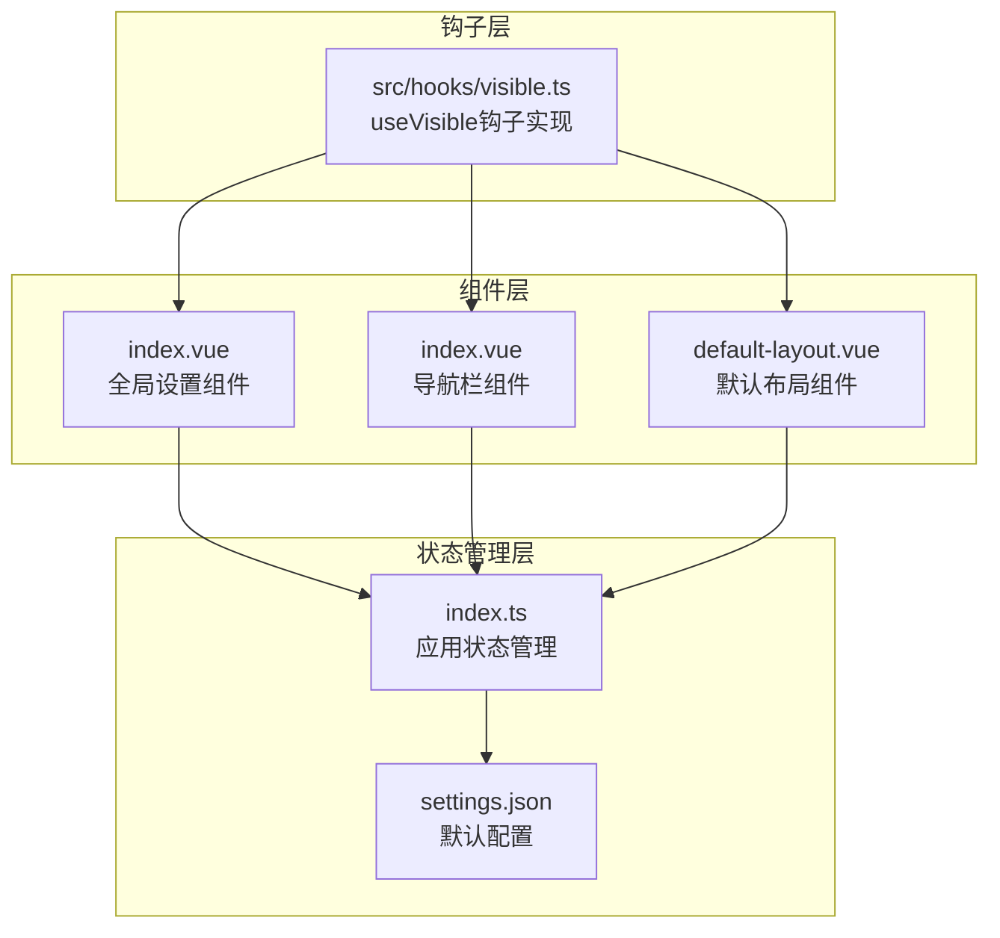
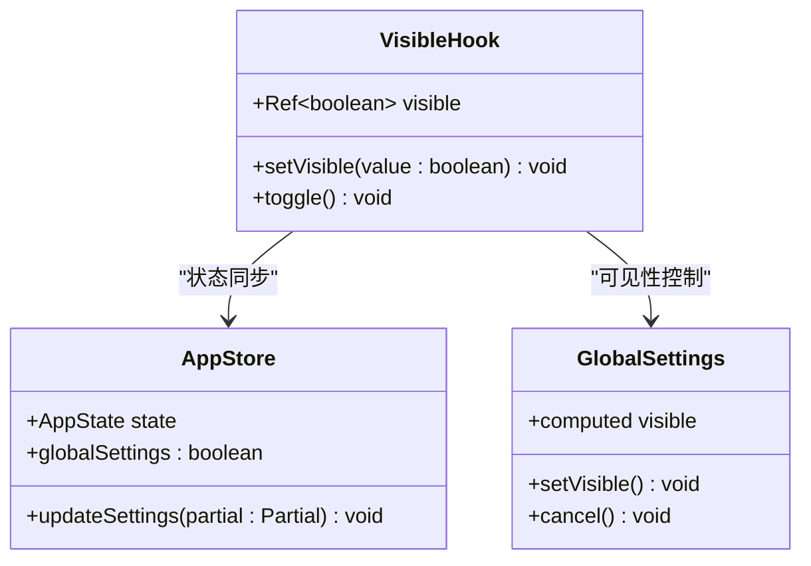
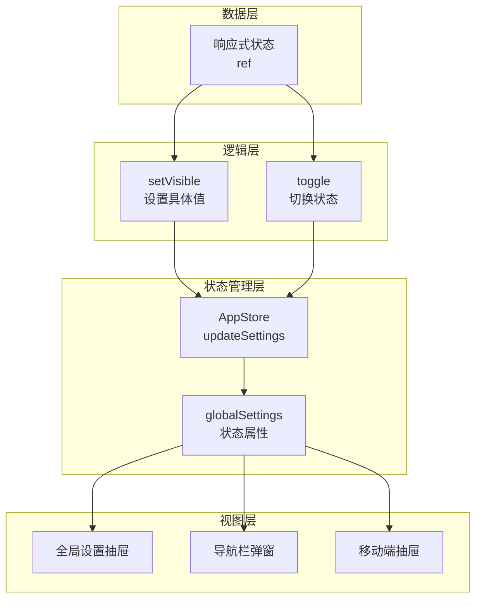
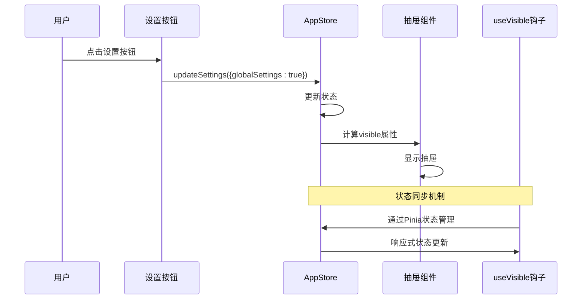
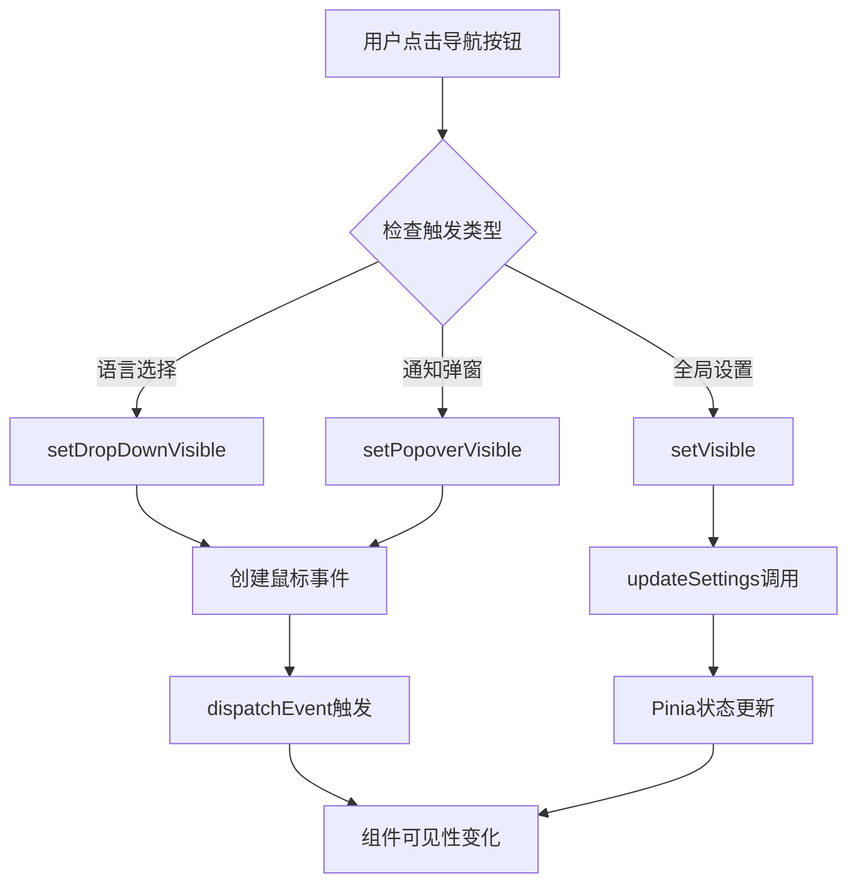
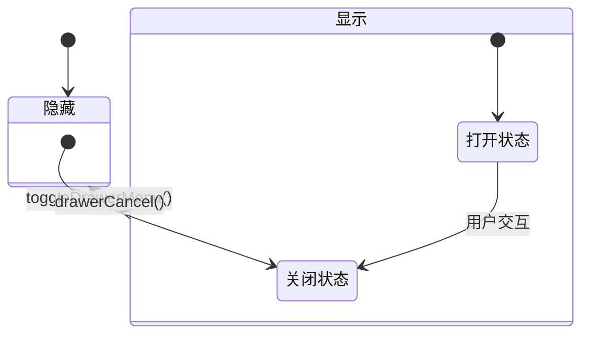
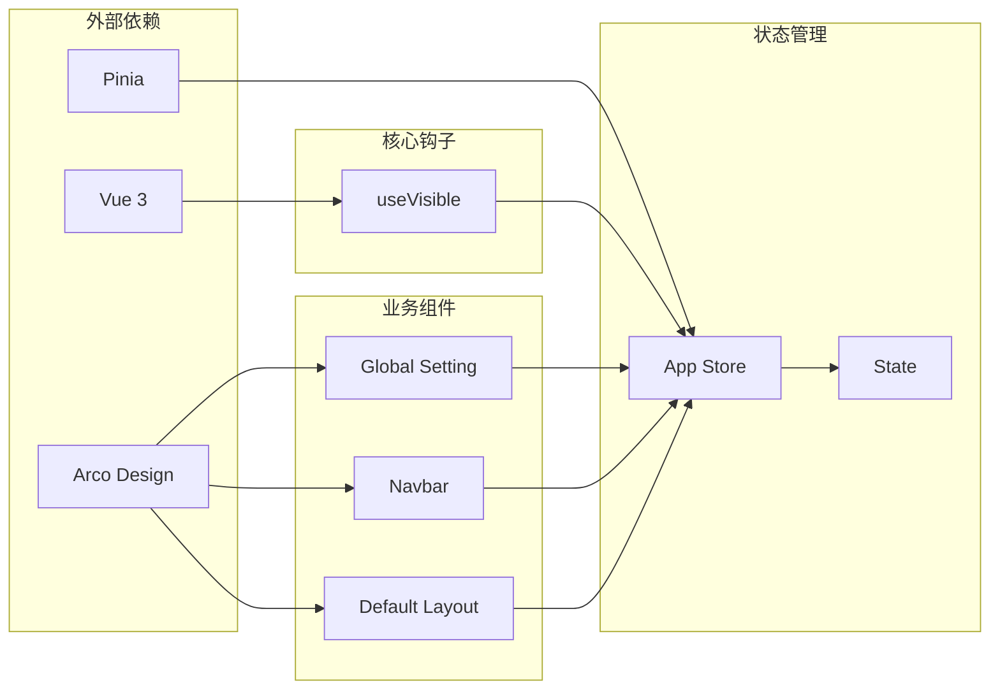

# 可见性控制钩子

<cite>
**本文档引用的文件**
- [visible.ts](file://src/hooks/visible.ts)
- [index.vue](file://src/components/global-setting/index.vue)
- [index.vue](file://src/components/navbar/index.vue)
- [index.ts](file://src/store/modules/app/index.ts)
- [settings.json](file://src/config/settings.json)
- [default-layout.vue](file://src/layout/default-layout.vue)
</cite>

## 目录
1. [简介](#简介)
2. [项目结构](#项目结构)
3. [核心组件](#核心组件)
4. [架构概览](#架构概览)
5. [详细组件分析](#详细组件分析)
6. [依赖关系分析](#依赖关系分析)
7. [性能考虑](#性能考虑)
8. [故障排除指南](#故障排除指南)
9. [结论](#结论)

## 简介

本文档深入解析项目中的可见性控制钩子系统，重点介绍 `useVisible` 钩子的设计原理和元素可见性管理机制。该钩子提供了简洁而强大的可见性控制能力，支持显示状态控制、可见性切换和事件监听功能。

在项目中，可见性控制主要通过以下几种方式实现：
- 全局设置抽屉的显示/隐藏控制
- 导航栏下拉菜单的可见性管理
- 移动端侧边栏抽屉的控制
- 消息框弹窗的显示控制

## 项目结构

项目采用基于功能模块的组织方式，可见性控制相关的核心文件分布如下：

**图表来源**
- [visible.ts:1-17](file://src/hooks/visible.ts#L1-L17)
- [index.vue:1-99](file://src/components/global-setting/index.vue#L1-L99)
- [index.vue:1-324](file://src/components/navbar/index.vue#L1-L324)
- [index.ts:1-78](file://src/store/modules/app/index.ts#L1-L78)

**章节来源**
- [visible.ts:1-17](file://src/hooks/visible.ts#L1-L17)
- [index.vue:1-99](file://src/components/global-setting/index.vue#L1-L99)
- [index.vue:1-324](file://src/components/navbar/index.vue#L1-L324)
- [index.ts:1-78](file://src/store/modules/app/index.ts#L1-L78)

## 核心组件

### useVisible 钩子设计原理

`useVisible` 钩子是一个轻量级的状态管理工具，提供简洁的可见性控制接口：

**图表来源**
- [visible.ts:3-16](file://src/hooks/visible.ts#L3-L16)
- [index.ts:24-29](file://src/store/modules/app/index.ts#L24-L29)

钩子的核心特性：
- **响应式状态管理**：使用 Vue 的 `ref` 创建响应式可见性状态
- **双接口设计**：提供精确控制（`setVisible`）和切换控制（`toggle`）
- **类型安全**：完整的 TypeScript 类型定义确保类型安全
- **轻量级实现**：仅 17 行代码，无外部依赖

**章节来源**
- [visible.ts:1-17](file://src/hooks/visible.ts#L1-L17)

## 架构概览

项目中的可见性控制采用分层架构设计，从底层钩子到上层组件形成清晰的层次结构：

**图表来源**
- [visible.ts:4-15](file://src/hooks/visible.ts#L4-L15)
- [index.ts:26-28](file://src/store/modules/app/index.ts#L26-L28)

## 详细组件分析

### 全局设置组件的可见性控制

全局设置组件是可见性控制的最佳实践示例，展示了完整的可见性管理流程：

**图表来源**
- [index.vue:82-84](file://src/components/global-setting/index.vue#L82-L84)
- [index.ts:26-28](file://src/store/modules/app/index.ts#L26-L28)

关键实现特点：
- **状态绑定**：`visible` 计算属性直接绑定到 `appStore.globalSettings`
- **事件处理**：`setVisible` 方法触发状态更新
- **生命周期管理**：使用 `unmount-on-close` 属性优化性能

**章节来源**
- [index.vue:1-99](file://src/components/global-setting/index.vue#L1-L99)
- [index.ts:12-29](file://src/store/modules/app/index.ts#L12-L29)

### 导航栏组件的可见性管理

导航栏组件展示了多种可见性控制场景：

**图表来源**
- [index.vue:250-257](file://src/components/navbar/index.vue#L250-L257)
- [index.vue:234-236](file://src/components/navbar/index.vue#L234-L236)

**章节来源**
- [index.vue:195-263](file://src/components/navbar/index.vue#L195-L263)

### 移动端抽屉的可见性控制

移动端布局组件展示了响应式可见性控制：

**图表来源**
- [default-layout.vue:96-102](file://src/layout/default-layout.vue#L96-L102)

**章节来源**
- [default-layout.vue:24-44](file://src/layout/default-layout.vue#L24-L44)
- [default-layout.vue:96-102](file://src/layout/default-layout.vue#L96-L102)

## 依赖关系分析

可见性控制系统的依赖关系呈现清晰的单向依赖结构：

**图表来源**
- [visible.ts:1](file://src/hooks/visible.ts#L1)
- [index.ts:1](file://src/store/modules/app/index.ts#L1)

**章节来源**
- [visible.ts:1-17](file://src/hooks/visible.ts#L1-L17)
- [index.ts:1-78](file://src/store/modules/app/index.ts#L1-L78)

## 性能考虑

可见性控制系统在性能方面采用了多项优化策略：

### 响应式优化
- **计算属性缓存**：使用 `computed` 属性避免不必要的重新计算
- **条件渲染**：通过 `v-if` 和 `v-show` 实现高效的条件显示
- **懒加载**：抽屉组件使用 `unmount-on-close` 属性实现按需卸载

### 内存管理
- **事件清理**：组件销毁时自动清理事件监听器
- **状态复用**：通过 Pinia 状态共享避免重复实例化
- **DOM 复用**：使用 Vue 的虚拟 DOM 优化 DOM 操作

### 用户体验优化
- **平滑过渡**：利用 CSS 过渡效果提供流畅的显示/隐藏动画
- **无障碍支持**：正确设置 `aria-*` 属性提升可访问性
- **键盘导航**：支持键盘快捷键操作

## 故障排除指南

### 常见问题及解决方案

**问题1：可见性状态不同步**
- **症状**：UI 状态与实际状态不一致
- **原因**：状态更新未正确触发响应式更新
- **解决**：确保使用 `updateSettings` 方法更新 Pinia 状态

**问题2：事件监听失效**
- **症状**：点击事件无法正常触发
- **原因**：事件处理器绑定错误或作用域问题
- **解决**：检查事件绑定语法和作用域链

**问题3：内存泄漏**
- **症状**：组件卸载后仍占用内存
- **原因**：未正确清理事件监听器或定时器
- **解决**：在 `onUnmounted` 生命周期中清理资源

**章节来源**
- [index.ts:26-28](file://src/store/modules/app/index.ts#L26-L28)
- [index.vue:82-84](file://src/components/global-setting/index.vue#L82-L84)

## 结论

可见性控制钩子系统展现了现代前端开发的最佳实践：

### 设计优势
- **简洁性**：极简的 API 设计，易于理解和使用
- **灵活性**：支持多种可见性控制场景
- **可扩展性**：良好的抽象层次便于功能扩展
- **类型安全**：完整的 TypeScript 支持

### 应用价值
- **统一管理**：集中化的状态管理简化了复杂度
- **用户体验**：流畅的动画和响应式交互提升了用户体验
- **维护性**：清晰的架构和文档降低了维护成本

### 最佳实践建议
1. **合理使用**：根据具体场景选择合适的可见性控制方式
2. **性能监控**：定期检查组件的渲染性能和内存使用情况
3. **测试覆盖**：为关键的可见性控制逻辑编写单元测试
4. **文档维护**：保持文档与代码变更同步更新

该系统为类似项目提供了可复用的可见性控制解决方案，值得在实际开发中广泛应用和参考。