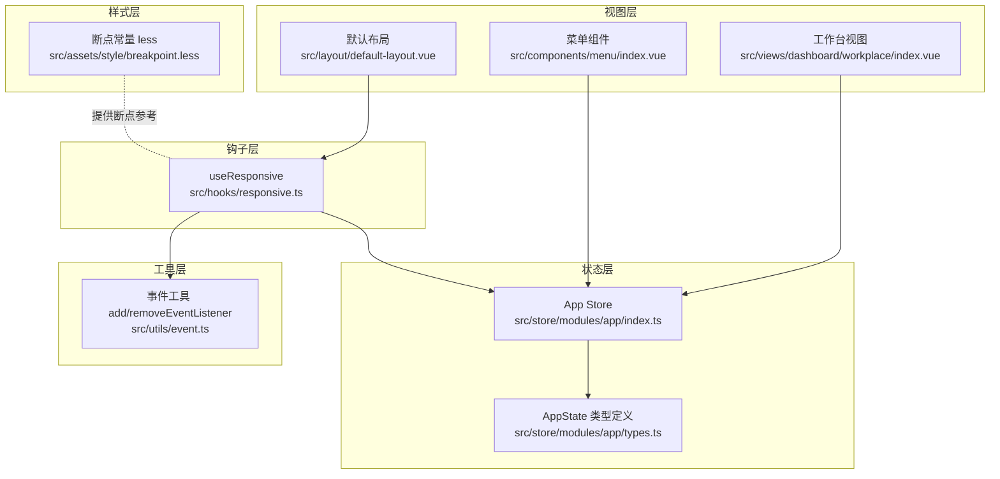
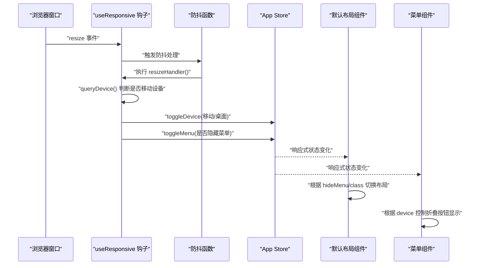
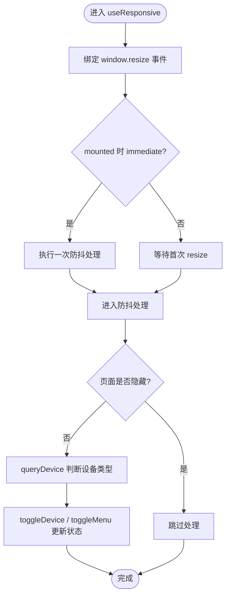
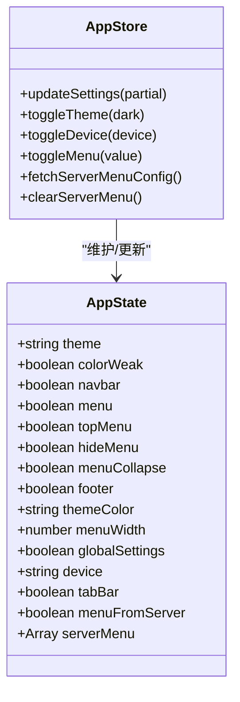
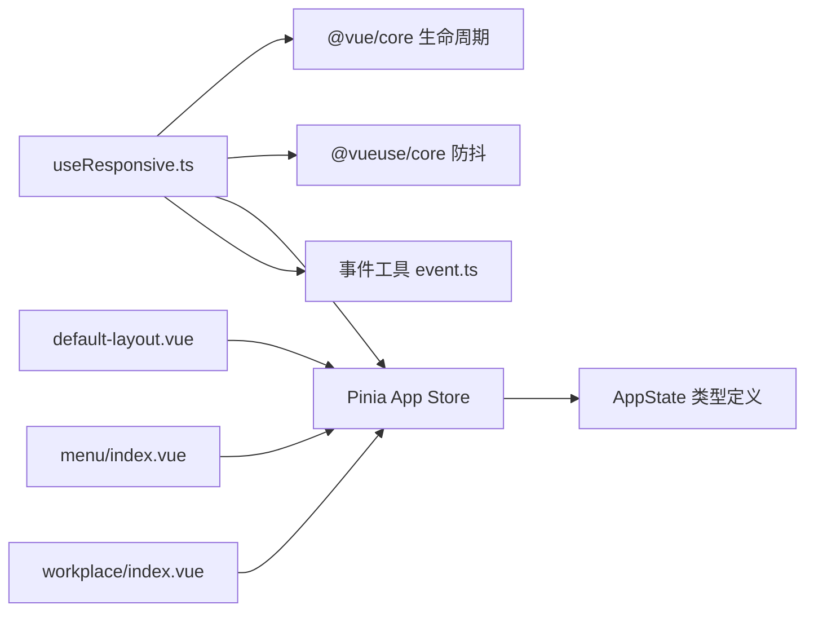

# 响应式设计钩子

<cite>
**本文引用的文件**
- [responsive.ts](file://src/hooks/responsive.ts)
- [index.ts](file://src/store/modules/app/index.ts)
- [types.ts](file://src/store/modules/app/types.ts)
- [event.ts](file://src/utils/event.ts)
- [breakpoint.less](file://src/assets/style/breakpoint.less)
- [default-layout.vue](file://src/layout/default-layout.vue)
- [index.vue](file://src/components/menu/index.vue)
- [workplace/index.vue](file://src/views/dashboard/workplace/index.vue)
</cite>

## 目录
1. [简介](#简介)
2. [项目结构](#项目结构)
3. [核心组件](#核心组件)
4. [架构总览](#架构总览)
5. [详细组件分析](#详细组件分析)
6. [依赖关系分析](#依赖关系分析)
7. [性能考虑](#性能考虑)
8. [故障排查指南](#故障排查指南)
9. [结论](#结论)
10. [附录](#附录)

## 简介
本文件围绕 useResponsive 响应式设计钩子进行系统化说明，重点阐述其设计原理、断点管理机制（以 992px 为阈值）、屏幕尺寸检测逻辑、设备类型判断以及与 Pinia 应用状态的联动方式。同时给出在布局组件与菜单组件中的实际使用示例，并解释如何与 CSS 媒体查询配合实现响应式布局，最后总结性能优化策略。

## 项目结构
与响应式钩子直接相关的模块分布如下：
- 钩子：src/hooks/responsive.ts
- 应用状态：src/store/modules/app/index.ts、src/store/modules/app/types.ts
- 事件封装：src/utils/event.ts
- 断点常量：src/assets/style/breakpoint.less
- 使用示例：src/layout/default-layout.vue、src/components/menu/index.vue、src/views/dashboard/workplace/index.vue

图表来源
- [responsive.ts:1-33](file://src/hooks/responsive.ts#L1-L33)
- [index.ts:1-78](file://src/store/modules/app/index.ts#L1-L78)
- [types.ts:1-21](file://src/store/modules/app/types.ts#L1-L21)
- [event.ts:1-28](file://src/utils/event.ts#L1-L28)
- [breakpoint.less:1-20](file://src/assets/style/breakpoint.less#L1-L20)
- [default-layout.vue:55-106](file://src/layout/default-layout.vue#L55-L106)
- [index.vue:85-161](file://src/components/menu/index.vue#L85-L161)
- [workplace/index.vue:130-149](file://src/views/dashboard/workplace/index.vue#L130-L149)

章节来源
- [responsive.ts:1-33](file://src/hooks/responsive.ts#L1-L33)
- [index.ts:1-78](file://src/store/modules/app/index.ts#L1-L78)
- [types.ts:1-21](file://src/store/modules/app/types.ts#L1-L21)
- [event.ts:1-28](file://src/utils/event.ts#L1-L28)
- [breakpoint.less:1-20](file://src/assets/style/breakpoint.less#L1-L20)
- [default-layout.vue:55-106](file://src/layout/default-layout.vue#L55-L106)
- [index.vue:85-161](file://src/components/menu/index.vue#L85-L161)
- [workplace/index.vue:130-149](file://src/views/dashboard/workplace/index.vue#L130-L149)

## 核心组件
- useResponsive 钩子：负责监听窗口 resize 事件，基于阈值判断设备类型（mobile/desktop），并更新应用状态中的 device 与菜单折叠状态；内部使用防抖函数降低频繁触发带来的性能压力。
- App Store：集中管理主题、菜单、设备类型、全局设置等状态，并提供 toggleDevice、toggleMenu 等动作。
- 事件工具：统一封装 addEventListener/removeEventListener，确保生命周期内正确绑定与解绑。
- 断点常量：LESS 中定义了多级断点，用于 CSS 媒体查询与视觉断点参考。
- 视图组件：在布局与菜单组件中读取 appStore 的 device 状态，动态切换布局行为与样式类名。

章节来源
- [responsive.ts:13-32](file://src/hooks/responsive.ts#L13-L32)
- [index.ts:41-46](file://src/store/modules/app/index.ts#L41-L46)
- [event.ts:1-28](file://src/utils/event.ts#L1-L28)
- [breakpoint.less:1-20](file://src/assets/style/breakpoint.less#L1-L20)
- [default-layout.vue:65](file://src/layout/default-layout.vue#L65)
- [index.vue:87-133](file://src/components/menu/index.vue#L87-L133)

## 架构总览
useResponsive 通过监听窗口 resize 事件，计算当前设备类型并写入 Pinia 状态，其他组件通过计算属性或条件渲染读取该状态，从而实现响应式布局与交互行为的统一控制。

图表来源
- [responsive.ts:13-32](file://src/hooks/responsive.ts#L13-L32)
- [index.ts:41-46](file://src/store/modules/app/index.ts#L41-L46)
- [default-layout.vue:65](file://src/layout/default-layout.vue#L65)
- [index.vue:87-133](file://src/components/menu/index.vue#L87-L133)

## 详细组件分析

### useResponsive 钩子
- 设计要点
  - 使用阈值 992px 进行设备判断，小于该阈值视为移动设备，否则为桌面端。
  - 在 mounted 生命周期中可选择立即执行一次处理逻辑（immediate 参数）。
  - 在 beforeMount 绑定 resize 事件，在 beforeUnmount 解绑，避免内存泄漏。
  - 使用防抖函数降低高频 resize 事件对性能的影响。
- 返回值与副作用
  - 无显式返回值；通过调用 useAppStore 的动作改变全局状态，间接影响布局与菜单行为。
- 关键流程
  - queryDevice：基于 body 区域宽度进行判断。
  - resizeHandler：在非隐藏状态下执行，更新 device 与菜单隐藏状态。
  - 防抖：对 resizeHandler 进行防抖封装，提升性能稳定性。

图表来源
- [responsive.ts:13-32](file://src/hooks/responsive.ts#L13-L32)

章节来源
- [responsive.ts:1-33](file://src/hooks/responsive.ts#L1-L33)

### App Store 与设备状态
- 设备类型字段：device（值为 'mobile' 或 'desktop'）
- 菜单相关字段：hideMenu（是否隐藏菜单）、menuCollapse（菜单折叠状态）
- 动作方法：toggleDevice、toggleMenu
- 类型定义：AppState 接口包含上述字段

图表来源
- [types.ts:3-20](file://src/store/modules/app/types.ts#L3-L20)
- [index.ts:24-74](file://src/store/modules/app/index.ts#L24-L74)

章节来源
- [types.ts:1-21](file://src/store/modules/app/types.ts#L1-L21)
- [index.ts:1-78](file://src/store/modules/app/index.ts#L1-L78)

### 事件工具与生命周期绑定
- addEventListen/removeEventListen 封装原生事件绑定与解绑，确保在组件卸载时清理事件监听器。
- 钩子在 beforeMount 绑定事件，在 beforeUnmount 解绑，避免内存泄漏。

章节来源
- [event.ts:1-28](file://src/utils/event.ts#L1-L28)
- [responsive.ts:26-31](file://src/hooks/responsive.ts#L26-L31)

### 断点常量与 CSS 媒体查询配合
- LESS 断点常量提供了多级断点（如 xs、sm、md、lg、xl、xxl），可用于 CSS 媒体查询与视觉断点参考。
- JS 钩子采用固定阈值 992px 进行设备判断，与 CSS 媒体查询形成互补：JS 决定交互行为（如菜单隐藏/显示、布局切换），CSS 决定样式细节（如栅格、字体大小、间距）。

章节来源
- [breakpoint.less:1-20](file://src/assets/style/breakpoint.less#L1-L20)
- [responsive.ts:6](file://src/hooks/responsive.ts#L6)

### 在布局组件中的使用
- 默认布局组件在初始化时调用 useResponsive(true)，确保页面加载即执行一次响应式处理。
- 布局会根据 appStore.hideMenu 的状态添加或移除 mobile 类名，从而驱动样式切换。
- 布局还根据 appStore.device 与 hideMenu 计算内边距与菜单宽度，实现自适应布局。

章节来源
- [default-layout.vue:65](file://src/layout/default-layout.vue#L65)
- [default-layout.vue:77-84](file://src/layout/default-layout.vue#L77-L84)

### 在菜单组件中的使用
- 菜单组件根据 appStore.device 控制折叠按钮的显示与否。
- 在桌面端才允许菜单折叠状态变更，移动端不提供折叠按钮。
- 菜单组件在 setCollapse 时仅在桌面端更新折叠状态，避免移动端误操作。

章节来源
- [index.vue:87-90](file://src/components/menu/index.vue#L87-L90)
- [index.vue:132-133](file://src/components/menu/index.vue#L132-L133)

### 工作台视图的移动端适配示例
- 工作台视图通过 scoped 样式中的 .mobile 类，针对移动设备调整右侧区域布局（如宽度、间距、位置），实现移动端更合理的展示效果。

章节来源
- [workplace/index.vue:135-148](file://src/views/dashboard/workplace/index.vue#L135-L148)

## 依赖关系分析
- useResponsive 依赖
  - Vue 生命周期钩子：onMounted、onBeforeMount、onBeforeUnmount
  - @vueuse/core 防抖工具：useDebounceFn
  - App Store：useAppStore
  - 事件工具：addEventListen/removeEventListen
- 状态依赖
  - App Store 的 device 与 hideMenu 字段被多个组件读取，形成跨组件的状态共享。
- 样式依赖
  - CSS 通过媒体查询与类名切换实现响应式样式，与 JS 的设备类型判断相辅相成。

图表来源
- [responsive.ts:1-33](file://src/hooks/responsive.ts#L1-L33)
- [index.ts:1-78](file://src/store/modules/app/index.ts#L1-L78)
- [types.ts:1-21](file://src/store/modules/app/types.ts#L1-L21)
- [event.ts:1-28](file://src/utils/event.ts#L1-L28)
- [default-layout.vue:55-106](file://src/layout/default-layout.vue#L55-L106)
- [index.vue:85-161](file://src/components/menu/index.vue#L85-L161)
- [workplace/index.vue:130-149](file://src/views/dashboard/workplace/index.vue#L130-L149)

章节来源
- [responsive.ts:1-33](file://src/hooks/responsive.ts#L1-L33)
- [index.ts:1-78](file://src/store/modules/app/index.ts#L1-L78)
- [types.ts:1-21](file://src/store/modules/app/types.ts#L1-L21)
- [event.ts:1-28](file://src/utils/event.ts#L1-L28)
- [default-layout.vue:55-106](file://src/layout/default-layout.vue#L55-L106)
- [index.vue:85-161](file://src/components/menu/index.vue#L85-L161)
- [workplace/index.vue:130-149](file://src/views/dashboard/workplace/index.vue#L130-L149)

## 性能考虑
- 防抖优化：对 resize 事件处理函数进行防抖，减少高频触发导致的重绘与状态更新次数。
- 条件更新：仅在页面未隐藏时执行设备判断与状态更新，避免后台标签页的无效计算。
- 事件绑定与解绑：在 beforeUnmount 钩子中移除事件监听器，防止内存泄漏与重复绑定。
- 状态最小化：只更新必要的状态字段（device、hideMenu），避免不必要的响应式依赖链路开销。

章节来源
- [responsive.ts:15-21](file://src/hooks/responsive.ts#L15-L21)
- [responsive.ts:22](file://src/hooks/responsive.ts#L22)
- [responsive.ts:29-31](file://src/hooks/responsive.ts#L29-L31)

## 故障排查指南
- 页面加载后布局未按预期切换
  - 检查是否在根组件或布局组件中正确调用 useResponsive(true)。
  - 确认 appStore.hideMenu 是否按预期变化，以及布局组件是否根据该状态切换类名。
- 移动端菜单无法折叠
  - 检查菜单组件是否仅在桌面端允许折叠（device === 'desktop'）。
  - 确认 setCollapse 逻辑是否被调用且传入正确的参数。
- resize 后性能下降或卡顿
  - 确认防抖时间是否合理，避免过短导致仍频繁触发。
  - 检查是否存在其他高频监听器未在 beforeUnmount 中移除。
- 样式与行为不一致
  - JS 设备判断阈值（992px）与 CSS 媒体查询断点可能存在差异，需在业务中保持一致的断点策略。

章节来源
- [default-layout.vue:65](file://src/layout/default-layout.vue#L65)
- [index.vue:87-90](file://src/components/menu/index.vue#L87-L90)
- [responsive.ts:22-31](file://src/hooks/responsive.ts#L22-L31)

## 结论
useResponsive 钩子通过一个简洁的阈值判断与防抖机制，实现了对设备类型的快速识别，并与 Pinia 状态协同，驱动布局与菜单的行为变化。结合 CSS 媒体查询与类名切换，可在不引入复杂响应式库的前提下，构建稳定高效的响应式界面。建议在团队内统一断点策略，明确 JS 与 CSS 的职责边界，以获得最佳的开发体验与运行性能。

## 附录
- 实际使用建议
  - 在应用入口或默认布局组件中尽早调用 useResponsive(true)，确保首屏即具备正确的设备状态。
  - 在需要响应式交互的组件中，优先读取 appStore.device 与 appStore.hideMenu，避免重复计算。
  - 对于复杂视图，可结合 scoped 样式中的 .mobile 类名，实现细粒度的移动端适配。
- 与 CSS 媒体查询的配合
  - 使用 LESS 断点常量作为 CSS 媒体查询的参考，保持 JS 与 CSS 的断点一致性。
  - 对于仅影响样式的场景，优先使用 CSS 媒体查询；对于影响交互与布局结构的场景，使用 JS 钩子与状态联动。