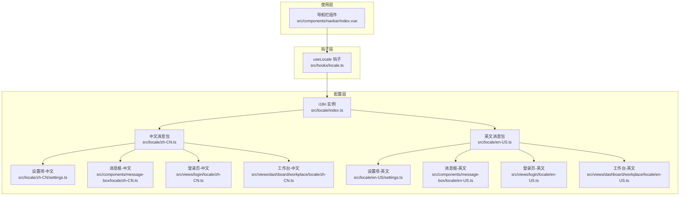
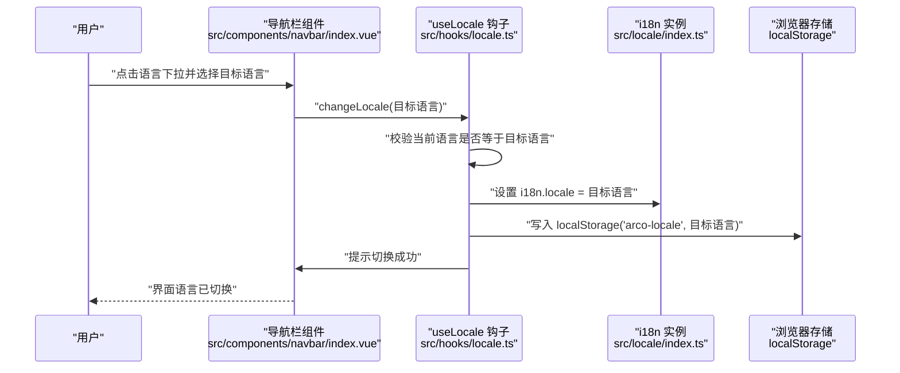
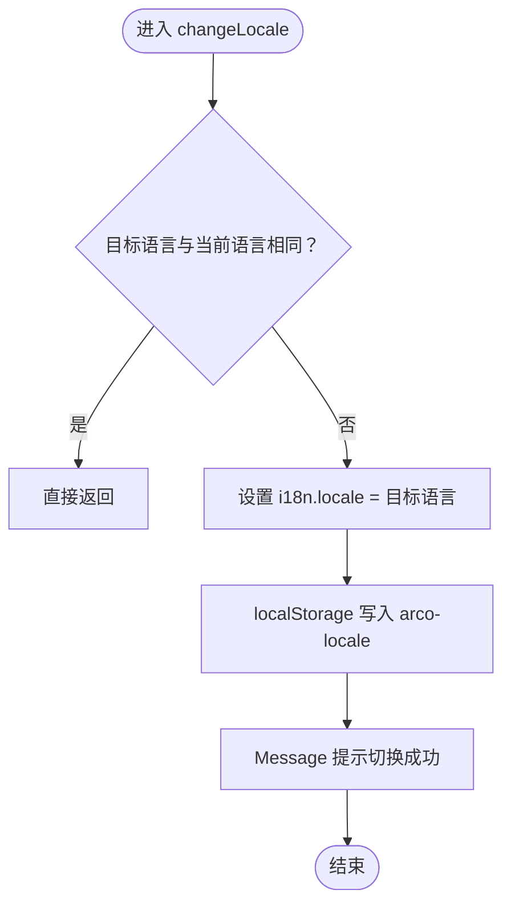
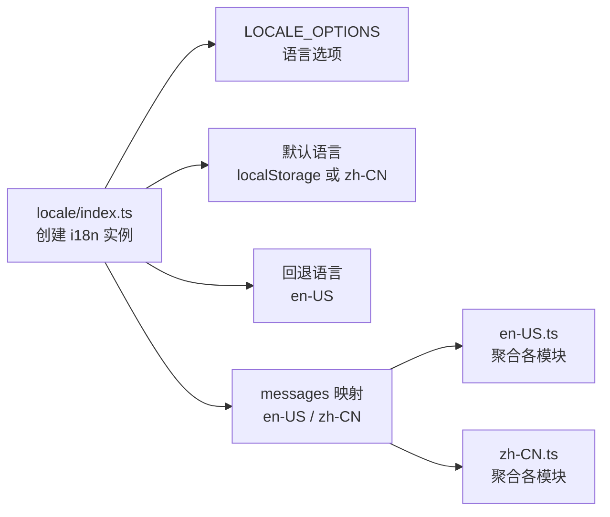
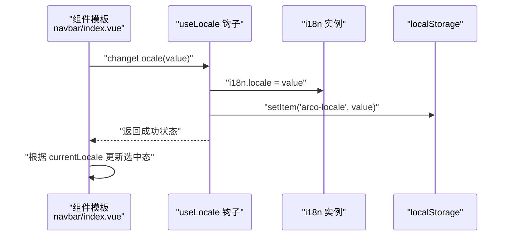
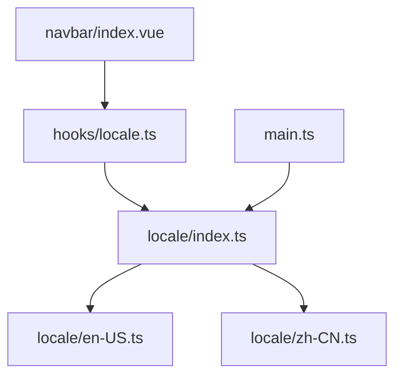

# 国际化钩子

<cite>
**本文引用的文件**
- [src/hooks/locale.ts](file://src/hooks/locale.ts)
- [src/locale/index.ts](file://src/locale/index.ts)
- [src/locale/en-US.ts](file://src/locale/en-US.ts)
- [src/locale/zh-CN.ts](file://src/locale/zh-CN.ts)
- [src/locale/en-US/settings.ts](file://src/locale/en-US/settings.ts)
- [src/locale/zh-CN/settings.ts](file://src/locale/zh-CN/settings.ts)
- [src/components/message-box/locale/en-US.ts](file://src/components/message-box/locale/en-US.ts)
- [src/components/message-box/locale/zh-CN.ts](file://src/components/message-box/locale/zh-CN.ts)
- [src/views/login/locale/en-US.ts](file://src/views/login/locale/en-US.ts)
- [src/views/login/locale/zh-CN.ts](file://src/views/login/locale/zh-CN.ts)
- [src/views/dashboard/workplace/locale/en-US.ts](file://src/views/dashboard/workplace/locale/en-US.ts)
- [src/main.ts](file://src/main.ts)
- [src/components/navbar/index.vue](file://src/components/navbar/index.vue)
</cite>

## 目录
1. [简介](#简介)
2. [项目结构](#项目结构)
3. [核心组件](#核心组件)
4. [架构总览](#架构总览)
5. [详细组件分析](#详细组件分析)
6. [依赖关系分析](#依赖关系分析)
7. [性能考量](#性能考量)
8. [故障排查指南](#故障排查指南)
9. [结论](#结论)
10. [附录](#附录)

## 简介
本文件系统性阐述 useLocale 国际化钩子的设计理念与实现机制，涵盖语言状态维护、语言切换逻辑、本地化资源组织与加载策略，并结合实际组件使用场景说明如何在应用中进行动态语言切换与语言偏好持久化。同时给出与 Vue I18n 的集成方式及多语言项目的最佳实践建议。

## 项目结构
国际化能力由三层组成：
- 配置层：集中定义可用语言、默认语言、回退语言与消息包集合
- 钩子层：封装语言状态与切换逻辑，提供对外 API
- 使用层：在组件中通过钩子与 $t 等能力完成本地化渲染

图表来源
- [src/locale/index.ts:1-23](file://src/locale/index.ts#L1-L23)
- [src/locale/en-US.ts:1-29](file://src/locale/en-US.ts#L1-L29)
- [src/locale/zh-CN.ts:1-29](file://src/locale/zh-CN.ts#L1-L29)
- [src/locale/en-US/settings.ts:1-30](file://src/locale/en-US/settings.ts#L1-L30)
- [src/locale/zh-CN/settings.ts:1-30](file://src/locale/zh-CN/settings.ts#L1-L30)
- [src/components/message-box/locale/en-US.ts:1-14](file://src/components/message-box/locale/en-US.ts#L1-L14)
- [src/components/message-box/locale/zh-CN.ts:1-14](file://src/components/message-box/locale/zh-CN.ts#L1-L14)
- [src/views/login/locale/en-US.ts:1-22](file://src/views/login/locale/en-US.ts#L1-L22)
- [src/views/login/locale/zh-CN.ts:1-20](file://src/views/login/locale/zh-CN.ts#L1-L20)
- [src/views/dashboard/workplace/locale/en-US.ts:1-39](file://src/views/dashboard/workplace/locale/en-US.ts#L1-L39)
- [src/hooks/locale.ts:1-23](file://src/hooks/locale.ts#L1-L23)
- [src/components/navbar/index.vue:195-263](file://src/components/navbar/index.vue#L195-L263)

章节来源
- [src/locale/index.ts:1-23](file://src/locale/index.ts#L1-L23)
- [src/hooks/locale.ts:1-23](file://src/hooks/locale.ts#L1-L23)
- [src/components/navbar/index.vue:195-263](file://src/components/navbar/index.vue#L195-L263)

## 核心组件
- useLocale 钩子：提供当前语言读取与语言切换能力；切换时更新 i18n 语言、持久化用户偏好并提示反馈
- i18n 实例：集中管理语言选项、默认语言、回退语言与消息包映射
- 组件集成：在导航栏等组件中调用钩子，绑定语言下拉选择与当前语言显示

章节来源
- [src/hooks/locale.ts:5-22](file://src/hooks/locale.ts#L5-L22)
- [src/locale/index.ts:5-22](file://src/locale/index.ts#L5-L22)
- [src/components/navbar/index.vue:209-211](file://src/components/navbar/index.vue#L209-L211)

## 架构总览
useLocale 通过 useI18n 获取 i18n 实例，以 computed 包装当前语言，以 changeLocale 方法实现语言切换。切换流程包含：校验目标语言、更新 i18n、持久化到 localStorage、提示反馈。

图表来源
- [src/hooks/locale.ts:10-17](file://src/hooks/locale.ts#L10-L17)
- [src/locale/index.ts:9](file://src/locale/index.ts#L9)
- [src/components/navbar/index.vue:48-62](file://src/components/navbar/index.vue#L48-L62)

## 详细组件分析

### useLocale 钩子设计与实现
- 设计理念
  - 单一职责：仅负责语言状态与切换，不承担消息包加载或路由同步
  - 响应式：基于 computed 导出当前语言，便于模板与逻辑直接消费
  - 可组合：与 useI18n 深度集成，复用其 t、tc、te 等翻译能力
- 关键行为
  - 当前语言：通过 computed 包装 i18n.locale.value
  - 切换逻辑：若目标语言与当前一致则短路；否则更新 i18n.locale 并持久化；最后通过 Message 提示反馈
- 复杂度与性能
  - 切换为 O(1) 操作，主要成本在 DOM 提示与存储写入
  - computed 保证按需响应，避免不必要的重渲染

图表来源
- [src/hooks/locale.ts:10-17](file://src/hooks/locale.ts#L10-L17)

章节来源
- [src/hooks/locale.ts:5-22](file://src/hooks/locale.ts#L5-L22)

### i18n 实例与消息包组织
- 语言选项与默认值
  - LOCALE_OPTIONS 定义下拉可选项
  - 默认语言从 localStorage 读取，未设置时回退为 zh-CN
- 回退策略
  - fallbackLocale 设为 'en-US'，确保缺失翻译时有兜底文案
- 消息包聚合
  - en-US.ts 与 zh-CN.ts 分别聚合各模块的语言条目，包括设置、消息框、登录页、工作台等
  - 通过展开运算符合并多个模块的本地化对象，形成完整消息包
- 集成入口
  - main.ts 中 app.use(i18n) 完成全局注入

图表来源
- [src/locale/index.ts:5-22](file://src/locale/index.ts#L5-L22)
- [src/locale/en-US.ts:1-29](file://src/locale/en-US.ts#L1-L29)
- [src/locale/zh-CN.ts:1-29](file://src/locale/zh-CN.ts#L1-L29)
- [src/main.ts:7](file://src/main.ts#L7)

章节来源
- [src/locale/index.ts:1-23](file://src/locale/index.ts#L1-L23)
- [src/locale/en-US.ts:1-29](file://src/locale/en-US.ts#L1-L29)
- [src/locale/zh-CN.ts:1-29](file://src/locale/zh-CN.ts#L1-L29)
- [src/main.ts:1-29](file://src/main.ts#L1-L29)

### 组件中的使用示例
- 导航栏语言切换
  - 在模板中渲染语言选项并绑定 @select 调用 changeLocale
  - 通过 currentLocale 控制当前选中态
  - 通过 $t 渲染语言切换按钮的提示文案
- 最佳实践
  - 将 LOCALE_OPTIONS 与 useLocale 返回值结合，保持 UI 与逻辑一致
  - 对语言切换事件统一处理，避免在多处重复写入 localStorage
  - 利用 $t 的 tooltip 或按钮内容，提升用户体验

图表来源
- [src/components/navbar/index.vue:48-62](file://src/components/navbar/index.vue#L48-L62)
- [src/components/navbar/index.vue:209-211](file://src/components/navbar/index.vue#L209-L211)
- [src/hooks/locale.ts:10-17](file://src/hooks/locale.ts#L10-L17)

章节来源
- [src/components/navbar/index.vue:195-263](file://src/components/navbar/index.vue#L195-L263)
- [src/hooks/locale.ts:18-21](file://src/hooks/locale.ts#L18-L21)

### 语言包模块化与扩展
- 模块划分
  - 设置页：settings.ts
  - 消息框：components/message-box/locale/*.ts
  - 登录页：views/login/locale/*.ts
  - 工作台：views/dashboard/workplace/locale/*.ts
- 合并与复用
  - en-US.ts 与 zh-CN.ts 通过展开运算符合并各模块导出对象
  - 保证不同模块间 key 不冲突，便于统一管理与查找

章节来源
- [src/locale/en-US.ts:1-29](file://src/locale/en-US.ts#L1-L29)
- [src/locale/zh-CN.ts:1-29](file://src/locale/zh-CN.ts#L1-L29)
- [src/locale/en-US/settings.ts:1-30](file://src/locale/en-US/settings.ts#L1-L30)
- [src/locale/zh-CN/settings.ts:1-30](file://src/locale/zh-CN/settings.ts#L1-L30)
- [src/components/message-box/locale/en-US.ts:1-14](file://src/components/message-box/locale/en-US.ts#L1-L14)
- [src/components/message-box/locale/zh-CN.ts:1-14](file://src/components/message-box/locale/zh-CN.ts#L1-L14)
- [src/views/login/locale/en-US.ts:1-22](file://src/views/login/locale/en-US.ts#L1-L22)
- [src/views/login/locale/zh-CN.ts:1-20](file://src/views/login/locale/zh-CN.ts#L1-L20)
- [src/views/dashboard/workplace/locale/en-US.ts:1-39](file://src/views/dashboard/workplace/locale/en-US.ts#L1-L39)

## 依赖关系分析
- 组件依赖钩子：navbar 依赖 useLocale 获取 currentLocale 与 changeLocale
- 钩子依赖 i18n：useLocale 依赖 useI18n 获取与设置 locale
- i18n 依赖消息包：locale/index.ts 依赖各模块的本地化对象
- 全局注入：main.ts 中 app.use(i18n) 使 $t 等能力在全局可用

图表来源
- [src/components/navbar/index.vue:201](file://src/components/navbar/index.vue#L201)
- [src/hooks/locale.ts:6](file://src/hooks/locale.ts#L6)
- [src/locale/index.ts:1-23](file://src/locale/index.ts#L1-L23)
- [src/main.ts:24](file://src/main.ts#L24)

章节来源
- [src/components/navbar/index.vue:195-263](file://src/components/navbar/index.vue#L195-L263)
- [src/hooks/locale.ts:1-23](file://src/hooks/locale.ts#L1-L23)
- [src/locale/index.ts:1-23](file://src/locale/index.ts#L1-L23)
- [src/main.ts:1-29](file://src/main.ts#L1-L29)

## 性能考量
- 语言切换为 O(1)，涉及 DOM 提示与存储写入，通常可忽略
- computed 包装的 currentLocale 仅在 i18n.locale 变更时更新，避免不必要渲染
- 建议：在大型项目中可考虑按需加载语言包，减少初始体积；当前实现采用静态聚合，简单直接，适合中小型项目

## 故障排查指南
- 语言未切换
  - 检查 changeLocale 是否被正确调用，以及目标语言与当前语言是否一致
  - 确认 localStorage 中 'arco-locale' 是否被正确写入
- 文案未翻译
  - 检查对应语言的消息包中是否存在该 key
  - 确认 i18n 的 fallbackLocale 是否正确，以便在缺失时显示英文
- 初始语言不正确
  - 确认 localStorage 中 'arco-locale' 的值是否符合预期
  - 检查 locale/index.ts 中默认语言回退逻辑

章节来源
- [src/hooks/locale.ts:10-17](file://src/hooks/locale.ts#L10-L17)
- [src/locale/index.ts:9](file://src/locale/index.ts#L9)

## 结论
useLocale 钩子以最小实现提供语言状态与切换能力，配合 i18n 实例与模块化消息包，形成清晰、可扩展的国际化方案。通过在组件中统一使用钩子与 $t，可实现一致的多语言体验，并支持语言偏好的持久化与即时反馈。

## 附录
- 与 Vue I18n 的集成要点
  - 在入口文件中 app.use(i18n) 注入全局实例
  - 在组件模板中使用 $t 进行文本翻译
  - 在逻辑中使用 useI18n 获取 t、locale 等能力
- 多语言项目最佳实践
  - 统一 key 命名规范，避免冲突
  - 将常用文案拆分为独立模块，便于维护与复用
  - 使用回退语言保障缺失翻译时的可用性
  - 在路由与主题等场景中同步语言偏好，保持一致性