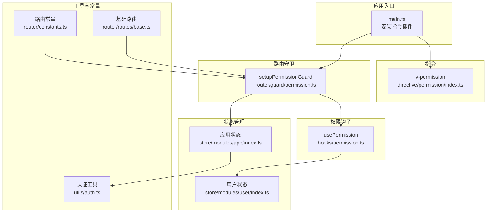
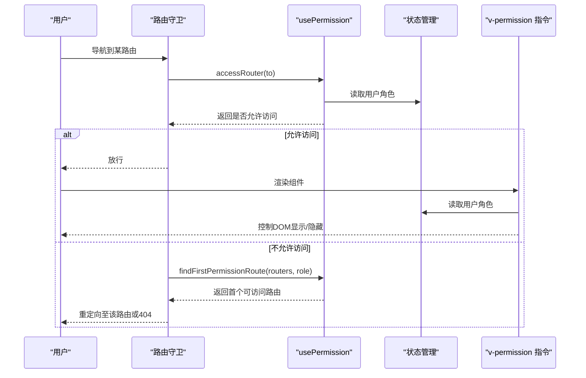
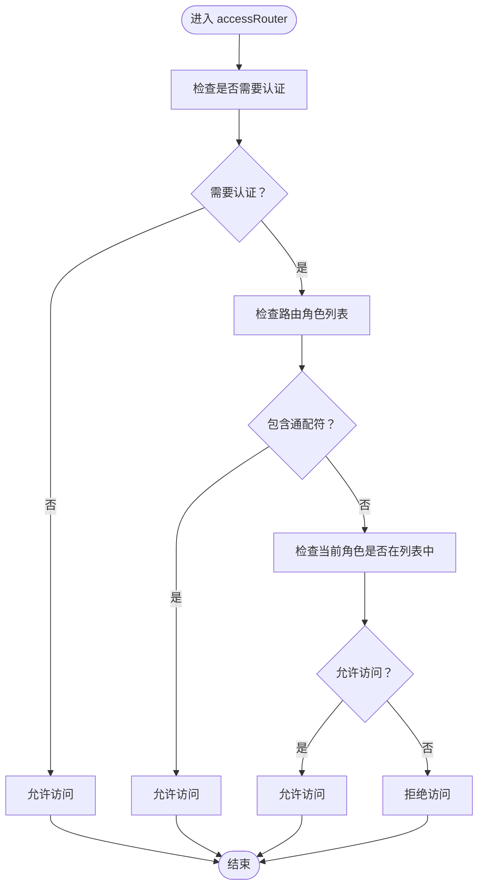
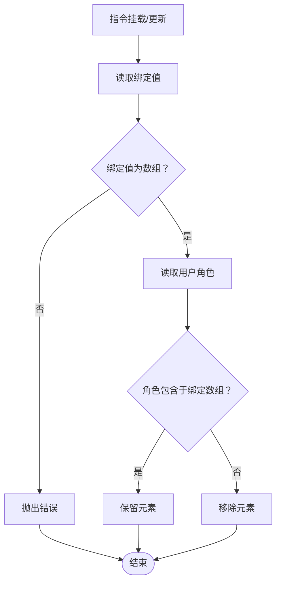
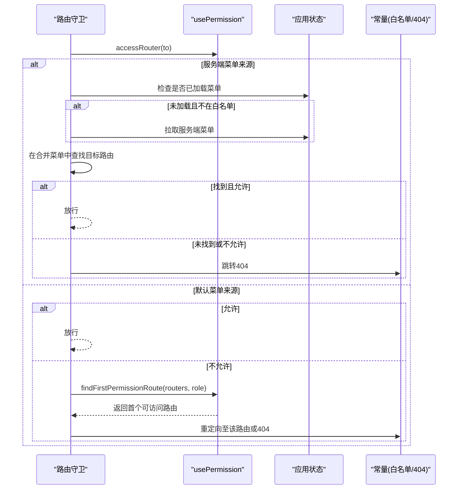
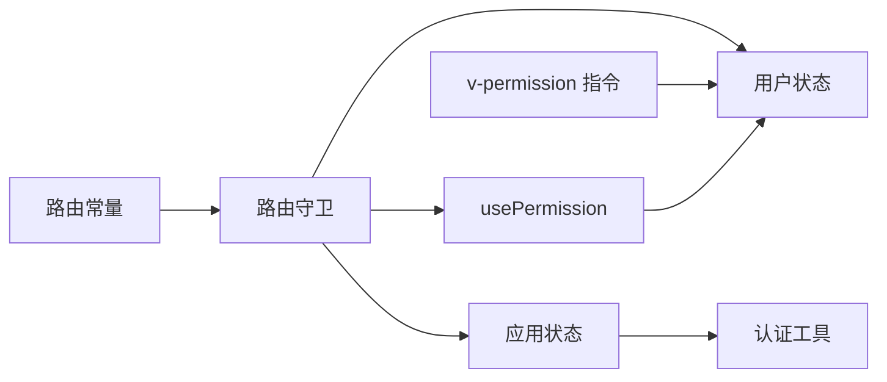

# 权限控制钩子

<cite>
**本文档引用的文件**
- [src/hooks/permission.ts](file://src/hooks/permission.ts)
- [src/directive/permission/index.ts](file://src/directive/permission/index.ts)
- [src/router/guard/permission.ts](file://src/router/guard/permission.ts)
- [src/store/modules/user/index.ts](file://src/store/modules/user/index.ts)
- [src/store/modules/app/index.ts](file://src/store/modules/app/index.ts)
- [src/utils/auth.ts](file://src/utils/auth.ts)
- [src/router/constants.ts](file://src/router/constants.ts)
- [src/router/routes/base.ts](file://src/router/routes/base.ts)
- [src/main.ts](file://src/main.ts)
- [src/directive/index.ts](file://src/directive/index.ts)
</cite>

## 目录
1. [简介](#简介)
2. [项目结构](#项目结构)
3. [核心组件](#核心组件)
4. [架构总览](#架构总览)
5. [详细组件分析](#详细组件分析)
6. [依赖关系分析](#依赖关系分析)
7. [性能考虑](#性能考虑)
8. [故障排除指南](#故障排除指南)
9. [结论](#结论)
10. [附录](#附录)

## 简介
本文件围绕权限控制钩子 usePermission 展开，系统性阐述其设计原理、权限验证机制、状态管理、判断逻辑与缓存策略，并说明权限操作方法（权限检查、权限更新、权限监听）。同时提供在组件中使用权限钩子的实际示例，解释钩子与路由守卫的协作方式以及权限系统的整体架构。

## 项目结构
权限系统由以下关键模块组成：
- 钩子层：usePermission 提供路由权限判断与首条可访问路由查找能力
- 指令层：v-permission 基于用户角色动态控制 DOM 元素可见性
- 路由守卫层：setupPermissionGuard 在导航前执行权限校验与菜单来源分支处理
- 状态管理层：Pinia 用户与应用状态存储，维护用户角色与服务端菜单配置
- 工具层：认证工具负责 Token 存取，常量定义白名单与默认路由

图表来源
- [src/main.ts:1-29](file://src/main.ts#L1-L29)
- [src/hooks/permission.ts:1-34](file://src/hooks/permission.ts#L1-L34)
- [src/directive/permission/index.ts:1-31](file://src/directive/permission/index.ts#L1-L31)
- [src/router/guard/permission.ts:1-56](file://src/router/guard/permission.ts#L1-L56)
- [src/store/modules/user/index.ts:1-92](file://src/store/modules/user/index.ts#L1-L92)
- [src/store/modules/app/index.ts:1-78](file://src/store/modules/app/index.ts#L1-L78)
- [src/utils/auth.ts:1-20](file://src/utils/auth.ts#L1-L20)
- [src/router/constants.ts:1-19](file://src/router/constants.ts#L1-L19)
- [src/router/routes/base.ts:1-32](file://src/router/routes/base.ts#L1-L32)

章节来源
- [src/main.ts:1-29](file://src/main.ts#L1-L29)
- [src/router/guard/permission.ts:1-56](file://src/router/guard/permission.ts#L1-L56)

## 核心组件
- usePermission 钩子：提供 accessRouter 与 findFirstPermissionRoute 两个核心方法，用于路由访问判断与首条可访问路由定位
- v-permission 指令：基于用户角色动态移除无权限元素，支持更新时重新校验
- setupPermissionGuard 路由守卫：在导航前根据路由元信息与用户角色决定放行或重定向
- 用户与应用状态：维护用户角色、服务端菜单配置与应用设置
- 认证工具：提供 Token 的读写与清理能力

章节来源
- [src/hooks/permission.ts:1-34](file://src/hooks/permission.ts#L1-L34)
- [src/directive/permission/index.ts:1-31](file://src/directive/permission/index.ts#L1-L31)
- [src/router/guard/permission.ts:1-56](file://src/router/guard/permission.ts#L1-L56)
- [src/store/modules/user/index.ts:1-92](file://src/store/modules/user/index.ts#L1-L92)
- [src/store/modules/app/index.ts:1-78](file://src/store/modules/app/index.ts#L1-L78)
- [src/utils/auth.ts:1-20](file://src/utils/auth.ts#L1-L20)

## 架构总览
权限系统采用“钩子+指令+路由守卫+状态”的分层架构：
- 钩子层：统一抽象权限判断逻辑，避免重复代码
- 指令层：在组件层面实现细粒度的 DOM 权限控制
- 守卫层：在路由层面实现页面级访问控制与菜单来源分支
- 状态层：集中管理用户角色与菜单配置，支撑判断与缓存

图表来源
- [src/router/guard/permission.ts:9-55](file://src/router/guard/permission.ts#L9-L55)
- [src/hooks/permission.ts:4-33](file://src/hooks/permission.ts#L4-L33)
- [src/directive/permission/index.ts:4-30](file://src/directive/permission/index.ts#L4-L30)
- [src/store/modules/user/index.ts:33-88](file://src/store/modules/user/index.ts#L33-L88)

## 详细组件分析

### usePermission 钩子
- 设计原理
  - 将权限判断逻辑封装为独立函数，便于在路由守卫与组件中复用
  - 通过读取用户角色与路由元信息中的角色数组进行匹配
- 权限状态管理
  - 角色来自用户状态存储，随登录流程更新
  - 首条可访问路由通过广度优先遍历在路由表中查找
- 权限判断逻辑
  - 若路由未声明 requiresAuth 或未声明 roles，则视为允许
  - 若 roles 包含通配符，则视为允许
  - 否则要求当前用户角色包含于 roles 数组
- 权限缓存策略
  - 无显式缓存：每次调用均从用户状态与路由元信息实时计算
  - 可在业务侧结合 Pinia getter 或 computed 进行缓存优化

图表来源
- [src/hooks/permission.ts:7-14](file://src/hooks/permission.ts#L7-L14)

章节来源
- [src/hooks/permission.ts:1-34](file://src/hooks/permission.ts#L1-L34)
- [src/store/modules/user/index.ts:13-36](file://src/store/modules/user/index.ts#L13-L36)

### v-permission 指令
- 功能概述
  - 在组件挂载与更新时，根据绑定值（角色数组）与用户角色进行匹配
  - 若不匹配则移除对应 DOM 元素，达到按钮、菜单项等的细粒度权限控制
- 使用要点
  - 绑定值必须为数组，否则抛出错误提示
  - 指令在 mounted 与 updated 生命周期均执行校验
- 与钩子的关系
  - 指令与钩子共享同一角色来源（用户状态），确保前后端一致

图表来源
- [src/directive/permission/index.ts:4-30](file://src/directive/permission/index.ts#L4-L30)

章节来源
- [src/directive/permission/index.ts:1-31](file://src/directive/permission/index.ts#L1-L31)
- [src/directive/index.ts:1-8](file://src/directive/index.ts#L1-L8)

### 路由守卫与权限系统协作
- 导航前流程
  - 读取用户角色与路由元信息，调用 accessRouter 判断是否允许访问
  - 若允许访问则放行；否则根据菜单来源分支处理
- 服务端菜单分支
  - 当启用服务端菜单时，若菜单未加载且目标路由不在白名单内，则先拉取菜单
  - 在合并后的菜单树中查找目标路由是否存在，存在且满足权限则放行，否则跳转 404
- 默认分支
  - 若不允许访问且非服务端菜单来源，则通过 findFirstPermissionRoute 查找首个可访问路由并重定向

图表来源
- [src/router/guard/permission.ts:9-55](file://src/router/guard/permission.ts#L9-L55)
- [src/hooks/permission.ts:15-30](file://src/hooks/permission.ts#L15-L30)
- [src/router/constants.ts:1-19](file://src/router/constants.ts#L1-L19)
- [src/store/modules/app/index.ts:47-73](file://src/store/modules/app/index.ts#L47-L73)

章节来源
- [src/router/guard/permission.ts:1-56](file://src/router/guard/permission.ts#L1-L56)
- [src/router/constants.ts:1-19](file://src/router/constants.ts#L1-L19)
- [src/store/modules/app/index.ts:1-78](file://src/store/modules/app/index.ts#L1-L78)

### 权限操作方法说明
- 权限检查
  - 路由级：调用 accessRouter 判断当前路由是否允许访问
  - 组件级：使用 v-permission 指令控制元素显示
- 权限更新
  - 用户角色变更：通过用户状态 action 更新角色后，指令与钩子会读取最新角色
  - 服务端菜单更新：通过应用状态 action 拉取新菜单，守卫在下次导航时生效
- 权限监听
  - 指令在 mounted 与 updated 时自动重新校验
  - 路由守卫在 beforeEach 中实时判断，无需额外监听

章节来源
- [src/hooks/permission.ts:7-14](file://src/hooks/permission.ts#L7-L14)
- [src/directive/permission/index.ts:24-29](file://src/directive/permission/index.ts#L24-L29)
- [src/store/modules/user/index.ts:39-88](file://src/store/modules/user/index.ts#L39-L88)
- [src/store/modules/app/index.ts:47-73](file://src/store/modules/app/index.ts#L47-L73)

### 实际使用示例
- 按钮权限控制
  - 在按钮上使用 v-permission 指令，绑定角色数组，如 ['admin', 'user']
  - 当用户角色不在数组中时，按钮将被移除
- 页面访问限制
  - 在路由元信息中设置 roles 与 requiresAuth 字段
  - 导航到该路由时，路由守卫会根据角色与钩子逻辑决定放行或重定向
- 首个可访问路由跳转
  - 当用户无任何页面访问权限时，守卫会查找首个可访问路由并重定向

章节来源
- [src/directive/permission/index.ts:4-30](file://src/directive/permission/index.ts#L4-L30)
- [src/router/guard/permission.ts:40-51](file://src/router/guard/permission.ts#L40-L51)
- [src/hooks/permission.ts:15-30](file://src/hooks/permission.ts#L15-L30)

## 依赖关系分析
- 组件耦合
  - 路由守卫依赖 usePermission 与 Pinia 状态
  - 指令依赖用户状态以获取角色
  - 服务端菜单分支依赖应用状态与常量
- 外部依赖
  - vue-router：提供路由守卫与元信息
  - pinia：提供状态持久化与响应式更新
  - nprogress：进度条（在守卫中使用）

图表来源
- [src/router/guard/permission.ts:4-7](file://src/router/guard/permission.ts#L4-L7)
- [src/hooks/permission.ts:2](file://src/hooks/permission.ts#L2)
- [src/directive/permission/index.ts:2](file://src/directive/permission/index.ts#L2)
- [src/store/modules/app/index.ts:6](file://src/store/modules/app/index.ts#L6)
- [src/utils/auth.ts:1](file://src/utils/auth.ts#L1)
- [src/router/constants.ts:1-19](file://src/router/constants.ts#L1-L19)

章节来源
- [src/router/guard/permission.ts:1-56](file://src/router/guard/permission.ts#L1-L56)
- [src/hooks/permission.ts:1-34](file://src/hooks/permission.ts#L1-L34)
- [src/directive/permission/index.ts:1-31](file://src/directive/permission/index.ts#L1-L31)
- [src/store/modules/app/index.ts:1-78](file://src/store/modules/app/index.ts#L1-L78)
- [src/utils/auth.ts:1-20](file://src/utils/auth.ts#L1-L20)
- [src/router/constants.ts:1-19](file://src/router/constants.ts#L1-L19)

## 性能考虑
- 计算复杂度
  - accessRouter 为 O(1) 判断，基于布尔表达式短路
  - findFirstPermissionRoute 为 O(n) 广度优先遍历，n 为路由数量
- 缓存建议
  - 对频繁使用的路由判断结果可结合响应式缓存（如 computed 或 getter）
  - 服务端菜单拉取后可在应用状态中缓存，避免重复请求
- 渲染优化
  - v-permission 在 updated 时重新校验，建议减少不必要的指令使用
  - 对大量按钮的权限控制，可考虑在父组件聚合判断后批量渲染

## 故障排除指南
- v-permission 报错“缺少角色”
  - 检查指令绑定值是否为数组格式
  - 确保用户状态已正确初始化角色
- 导航到未知路由
  - 检查服务端菜单是否已拉取且包含目标路由
  - 确认白名单配置与 NOT_FOUND 路由设置
- 角色切换后权限未生效
  - 确认用户状态的角色已更新
  - 指令与钩子依赖用户状态，需等待响应式更新完成

章节来源
- [src/directive/permission/index.ts:18-20](file://src/directive/permission/index.ts#L18-L20)
- [src/router/guard/permission.ts:21-42](file://src/router/guard/permission.ts#L21-L42)
- [src/store/modules/user/index.ts:39-88](file://src/store/modules/user/index.ts#L39-L88)

## 结论
usePermission 钩子提供了简洁而强大的权限判断能力，配合 v-permission 指令与路由守卫，构建了覆盖页面级与组件级的完整权限体系。通过 Pinia 状态管理与服务端菜单集成，系统具备良好的扩展性与可维护性。建议在实际项目中结合缓存策略与响应式设计进一步提升性能与用户体验。

## 附录
- 关键路径参考
  - 钩子实现：[src/hooks/permission.ts:1-34](file://src/hooks/permission.ts#L1-L34)
  - 指令实现：[src/directive/permission/index.ts:1-31](file://src/directive/permission/index.ts#L1-L31)
  - 路由守卫：[src/router/guard/permission.ts:1-56](file://src/router/guard/permission.ts#L1-L56)
  - 用户状态：[src/store/modules/user/index.ts:1-92](file://src/store/modules/user/index.ts#L1-L92)
  - 应用状态：[src/store/modules/app/index.ts:1-78](file://src/store/modules/app/index.ts#L1-L78)
  - 认证工具：[src/utils/auth.ts:1-20](file://src/utils/auth.ts#L1-L20)
  - 路由常量：[src/router/constants.ts:1-19](file://src/router/constants.ts#L1-L19)
  - 基础路由：[src/router/routes/base.ts:1-32](file://src/router/routes/base.ts#L1-L32)
  - 应用入口：[src/main.ts:1-29](file://src/main.ts#L1-L29)
  - 指令注册：[src/directive/index.ts:1-8](file://src/directive/index.ts#L1-L8)