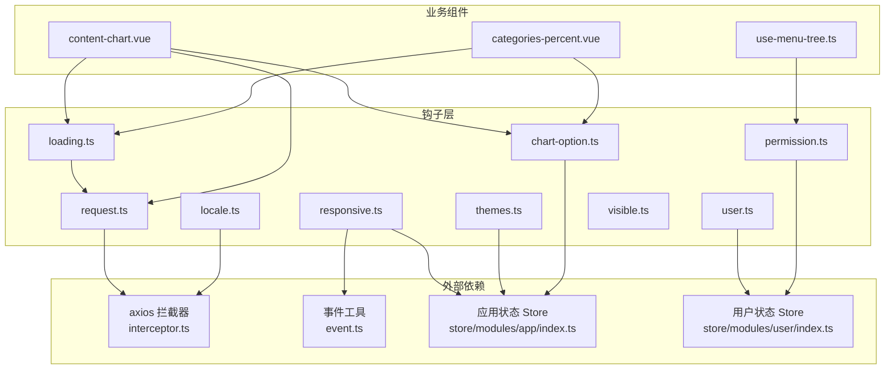
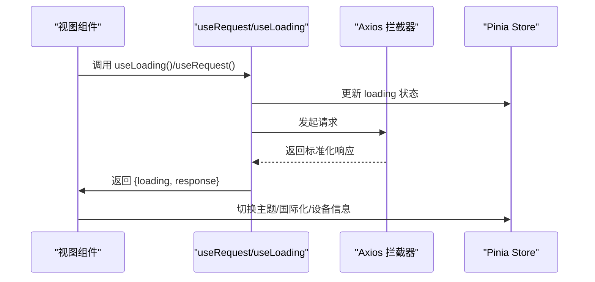
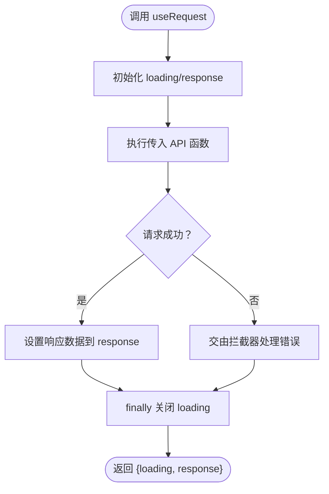
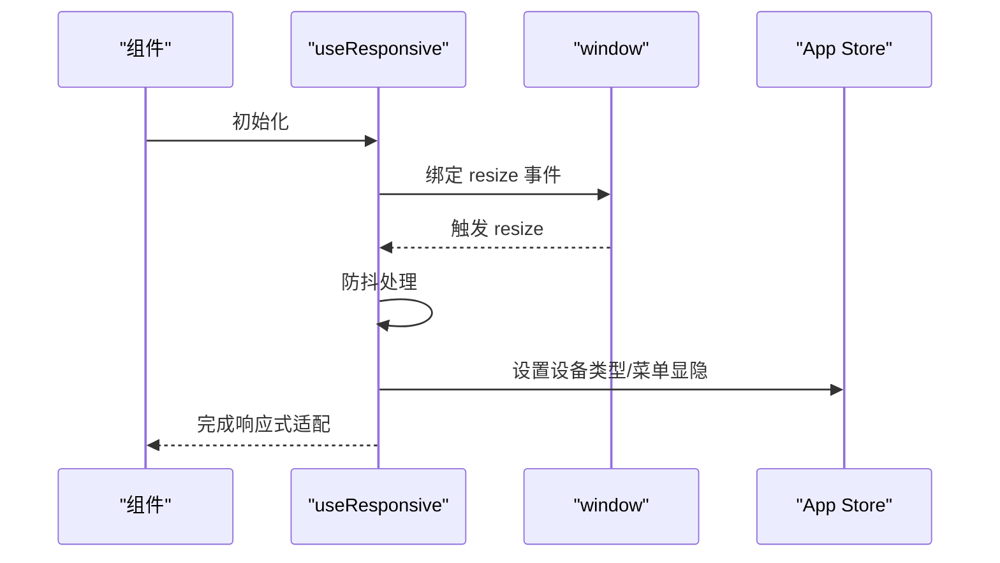
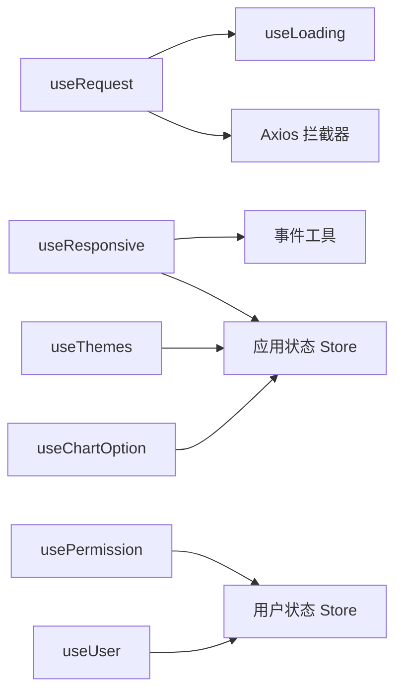

# 自定义钩子

<cite>
**本文引用的文件**
- [loading.ts](file://src/hooks/loading.ts)
- [request.ts](file://src/hooks/request.ts)
- [responsive.ts](file://src/hooks/responsive.ts)
- [themes.ts](file://src/hooks/themes.ts)
- [locale.ts](file://src/hooks/locale.ts)
- [user.ts](file://src/hooks/user.ts)
- [permission.ts](file://src/hooks/permission.ts)
- [chart-option.ts](file://src/hooks/chart-option.ts)
- [visible.ts](file://src/hooks/visible.ts)
- [interceptor.ts](file://src/api/interceptor.ts)
- [event.ts](file://src/utils/event.ts)
- [index.ts（应用状态）](file://src/store/modules/app/index.ts)
- [index.ts（用户状态）](file://src/store/modules/user/index.ts)
- [use-menu-tree.ts](file://src/components/menu/use-menu-tree.ts)
- [content-chart.vue](file://src/views/dashboard/workplace/components/content-chart.vue)
- [categories-percent.vue](file://src/views/dashboard/workplace/components/categories-percent.vue)
</cite>

## 目录
1. [简介](#简介)
2. [项目结构](#项目结构)
3. [核心组件](#核心组件)
4. [架构总览](#架构总览)
5. [详细组件分析](#详细组件分析)
6. [依赖关系分析](#依赖关系分析)
7. [性能考量](#性能考量)
8. [故障排查指南](#故障排查指南)
9. [结论](#结论)
10. [附录](#附录)

## 简介
本文件系统性梳理并说明本项目的自定义钩子体系，覆盖以下主题：
- 钩子设计原则与通用模式
- 常用钩子实现与功能说明
- loading状态管理、请求处理、响应式布局、主题切换、国际化、权限控制、图表配置、可见性控制等钩子的使用与组合方式
- 参数传递与返回值处理规范
- 扩展机制与自定义钩子开发指南
- 在组件中的最佳实践

## 项目结构
钩子集中位于 src/hooks 下，围绕“状态管理 + 外部交互 + UI 行为”三类职责进行拆分，配合 Pinia Store、Axios 拦截器、路由守卫与工具函数共同完成业务闭环。

图示来源
- [loading.ts:1-17](file://src/hooks/loading.ts#L1-L17)
- [request.ts:1-27](file://src/hooks/request.ts#L1-L27)
- [responsive.ts:1-33](file://src/hooks/responsive.ts#L1-L33)
- [themes.ts:1-13](file://src/hooks/themes.ts#L1-L13)
- [locale.ts:1-23](file://src/hooks/locale.ts#L1-L23)
- [user.ts:1-25](file://src/hooks/user.ts#L1-L25)
- [permission.ts:1-34](file://src/hooks/permission.ts#L1-L34)
- [chart-option.ts:1-28](file://src/hooks/chart-option.ts#L1-L28)
- [interceptor.ts:1-78](file://src/api/interceptor.ts#L1-L78)
- [event.ts:1-28](file://src/utils/event.ts#L1-L28)
- [index.ts（应用状态）:1-78](file://src/store/modules/app/index.ts#L1-L78)
- [index.ts（用户状态）:1-92](file://src/store/modules/user/index.ts#L1-L92)
- [content-chart.vue:177-197](file://src/views/dashboard/workplace/components/content-chart.vue#L177-L197)
- [categories-percent.vue:22-74](file://src/views/dashboard/workplace/components/categories-percent.vue#L22-L74)
- [use-menu-tree.ts:1-70](file://src/components/menu/use-menu-tree.ts#L1-L70)

章节来源
- [loading.ts:1-17](file://src/hooks/loading.ts#L1-L17)
- [request.ts:1-27](file://src/hooks/request.ts#L1-L27)
- [responsive.ts:1-33](file://src/hooks/responsive.ts#L1-L33)
- [themes.ts:1-13](file://src/hooks/themes.ts#L1-L13)
- [locale.ts:1-23](file://src/hooks/locale.ts#L1-L23)
- [user.ts:1-25](file://src/hooks/user.ts#L1-L25)
- [permission.ts:1-34](file://src/hooks/permission.ts#L1-L34)
- [chart-option.ts:1-28](file://src/hooks/chart-option.ts#L1-L28)
- [interceptor.ts:1-78](file://src/api/interceptor.ts#L1-L78)
- [event.ts:1-28](file://src/utils/event.ts#L1-L28)
- [index.ts（应用状态）:1-78](file://src/store/modules/app/index.ts#L1-L78)
- [index.ts（用户状态）:1-92](file://src/store/modules/user/index.ts#L1-L92)
- [content-chart.vue:177-197](file://src/views/dashboard/workplace/components/content-chart.vue#L177-L197)
- [categories-percent.vue:22-74](file://src/views/dashboard/workplace/components/categories-percent.vue#L22-L74)
- [use-menu-tree.ts:1-70](file://src/components/menu/use-menu-tree.ts#L1-L70)

## 核心组件
- 加载状态钩子：提供 loading 状态与切换能力，作为其他钩子的基础能力。
- 请求钩子：封装异步请求与响应数据绑定，自动联动 loading 状态。
- 响应式钩子：监听窗口尺寸变化，联动设备类型与菜单显示策略。
- 主题钩子：暴露当前主题状态（深色/浅色），供 UI 组件按需渲染。
- 国际化钩子：读取与切换语言，持久化到本地存储并提示反馈。
- 用户钩子：封装登出流程与路由跳转逻辑。
- 权限钩子：校验路由访问权限与查找首个可访问路由。
- 图表配置钩子：基于主题状态生成 ECharts 配置，确保深浅主题一致的视觉效果。
- 可见性钩子：提供通用的显隐控制与切换能力。

章节来源
- [loading.ts:1-17](file://src/hooks/loading.ts#L1-L17)
- [request.ts:1-27](file://src/hooks/request.ts#L1-L27)
- [responsive.ts:1-33](file://src/hooks/responsive.ts#L1-L33)
- [themes.ts:1-13](file://src/hooks/themes.ts#L1-L13)
- [locale.ts:1-23](file://src/hooks/locale.ts#L1-L23)
- [user.ts:1-25](file://src/hooks/user.ts#L1-L25)
- [permission.ts:1-34](file://src/hooks/permission.ts#L1-L34)
- [chart-option.ts:1-28](file://src/hooks/chart-option.ts#L1-L28)
- [visible.ts:1-17](file://src/hooks/visible.ts#L1-L17)

## 架构总览
下图展示钩子与外部模块的交互关系，以及典型组件调用链路。

图示来源
- [request.ts:11-26](file://src/hooks/request.ts#L11-L26)
- [interceptor.ts:39-68](file://src/api/interceptor.ts#L39-L68)
- [index.ts（应用状态）:32-46](file://src/store/modules/app/index.ts#L32-L46)

## 详细组件分析

### 加载状态钩子 useLoading
- 设计原则：最小状态 + 可组合。仅暴露 loading、setLoading、toggle 三个接口，便于复用。
- 典型用法：在请求前开启，在 finally 中关闭；也可用于任意 UI 动画或加载指示。
- 参数与返回：支持初始化值；返回响应式状态与操作函数。
- 组合场景：与 useRequest 协同，自动管理请求生命周期。

章节来源
- [loading.ts:1-17](file://src/hooks/loading.ts#L1-L17)

### 请求钩子 useRequest
- 设计原则：非异步函数、避免在异步函数中直接使用；通过 bind 注入参数；统一处理响应与错误。
- 数据流：调用 API -> 设置 loading=true -> 成功写入 response -> finally 关闭 loading。
- 类型约束：泛型 T 与默认值 defaultValue，保证类型安全。
- 错误处理：依赖 Axios 拦截器统一处理业务码与网络异常。

图示来源
- [request.ts:11-26](file://src/hooks/request.ts#L11-L26)
- [interceptor.ts:39-68](file://src/api/interceptor.ts#L39-L68)

章节来源
- [request.ts:1-27](file://src/hooks/request.ts#L1-L27)

### 响应式钩子 useResponsive
- 设计原则：节流防抖 + 生命周期绑定 + 与应用状态联动。
- 行为：监听窗口 resize，计算设备类型并联动菜单显示；支持 immediate 立即执行。
- 依赖：事件工具 add/removeEventListen；应用状态 store 控制设备与菜单。

图示来源
- [responsive.ts:13-32](file://src/hooks/responsive.ts#L13-L32)
- [event.ts:1-28](file://src/utils/event.ts#L1-L28)
- [index.ts（应用状态）:41-46](file://src/store/modules/app/index.ts#L41-L46)

章节来源
- [responsive.ts:1-33](file://src/hooks/responsive.ts#L1-L33)

### 主题钩子 useThemes
- 设计原则：轻量封装 + 计算属性 + 与全局主题同步。
- 行为：基于应用状态的主题字段，计算当前是否为深色；供组件按需渲染。

章节来源
- [themes.ts:1-13](file://src/hooks/themes.ts#L1-L13)
- [index.ts（应用状态）:32-40](file://src/store/modules/app/index.ts#L32-L40)

### 国际化钩子 useLocale
- 设计原则：读取当前语言 + 切换语言 + 本地持久化 + 反馈提示。
- 行为：切换语言后写入本地存储，并通过消息组件提示成功。

章节来源
- [locale.ts:1-23](file://src/hooks/locale.ts#L1-L23)

### 用户钩子 useUser
- 设计原则：统一登出流程 + 路由跳转 + 登出后清理。
- 行为：调用用户状态 store 的 logout，推送至登录页并携带重定向参数。

章节来源
- [user.ts:1-25](file://src/hooks/user.ts#L1-L25)
- [index.ts（用户状态）:80-87](file://src/store/modules/user/index.ts#L80-L87)

### 权限钩子 usePermission
- 设计原则：路由级权限校验 + 首个可访问路由查找。
- 行为：支持通配符角色与当前用户角色匹配；广度优先遍历路由树。

章节来源
- [permission.ts:1-34](file://src/hooks/permission.ts#L1-L34)
- [index.ts（用户状态）:13-31](file://src/store/modules/user/index.ts#L13-L31)

### 图表配置钩子 useChartOption
- 设计原则：基于主题状态动态生成 ECharts 配置；保持代码提示与类型安全。
- 行为：接收一个函数，根据 isDark 返回对应配置；返回 computed 的 chartOption。

章节来源
- [chart-option.ts:1-28](file://src/hooks/chart-option.ts#L1-L28)
- [index.ts（应用状态）:32-40](file://src/store/modules/app/index.ts#L32-L40)

### 可见性钩子 useVisible
- 设计原则：与 useLoading 同构的显隐控制，适用于弹窗、抽屉等。
- 行为：提供 visible、setVisible、toggle。

章节来源
- [visible.ts:1-17](file://src/hooks/visible.ts#L1-L17)

### 组件使用示例

#### 使用 useLoading 与 useRequest 获取数据
- 在视图组件中调用 useLoading 初始化加载态，再调用 useRequest 执行请求，最终得到 {loading, response}。
- 示例路径参考：
  - [content-chart.vue:177-197](file://src/views/dashboard/workplace/components/content-chart.vue#L177-L197)

章节来源
- [content-chart.vue:177-197](file://src/views/dashboard/workplace/components/content-chart.vue#L177-L197)

#### 使用 useChartOption 渲染图表
- 在视图组件中调用 useChartOption，传入一个根据 isDark 生成配置的函数，得到 chartOption 并绑定到图表组件。
- 示例路径参考：
  - [categories-percent.vue:22-74](file://src/views/dashboard/workplace/components/categories-percent.vue#L22-L74)

章节来源
- [categories-percent.vue:22-74](file://src/views/dashboard/workplace/components/categories-percent.vue#L22-L74)
- [chart-option.ts:13-26](file://src/hooks/chart-option.ts#L13-L26)

#### 响应式布局与菜单联动
- 在布局组件或页面初始化时调用 useResponsive，即可自动适配移动端/桌面端并联动菜单显示。
- 与菜单树构建结合：
  - [use-menu-tree.ts:8-68](file://src/components/menu/use-menu-tree.ts#L8-L68)

章节来源
- [responsive.ts:13-32](file://src/hooks/responsive.ts#L13-L32)
- [use-menu-tree.ts:8-68](file://src/components/menu/use-menu-tree.ts#L8-L68)

## 依赖关系分析
- 钩子之间的耦合度低，主要通过 Pinia Store 与 Axios 拦截器间接耦合。
- useRequest 依赖 useLoading 与 Axios 拦截器；useResponsive 依赖事件工具与应用状态；useChartOption 依赖应用状态的主题字段。
- 权限钩子与用户状态 store 协作，支撑菜单树构建与路由守卫。

图示来源
- [request.ts:1-27](file://src/hooks/request.ts#L1-L27)
- [interceptor.ts:1-78](file://src/api/interceptor.ts#L1-L78)
- [responsive.ts:1-33](file://src/hooks/responsive.ts#L1-L33)
- [event.ts:1-28](file://src/utils/event.ts#L1-L28)
- [index.ts（应用状态）:1-78](file://src/store/modules/app/index.ts#L1-L78)
- [index.ts（用户状态）:1-92](file://src/store/modules/user/index.ts#L1-L92)
- [chart-option.ts:1-28](file://src/hooks/chart-option.ts#L1-L28)
- [permission.ts:1-34](file://src/hooks/permission.ts#L1-L34)

章节来源
- [request.ts:1-27](file://src/hooks/request.ts#L1-L27)
- [interceptor.ts:1-78](file://src/api/interceptor.ts#L1-L78)
- [responsive.ts:1-33](file://src/hooks/responsive.ts#L1-L33)
- [event.ts:1-28](file://src/utils/event.ts#L1-L28)
- [index.ts（应用状态）:1-78](file://src/store/modules/app/index.ts#L1-L78)
- [index.ts（用户状态）:1-92](file://src/store/modules/user/index.ts#L1-L92)
- [chart-option.ts:1-28](file://src/hooks/chart-option.ts#L1-L28)
- [permission.ts:1-34](file://src/hooks/permission.ts#L1-L34)

## 性能考量
- 防抖优化：useResponsive 对 resize 事件采用防抖，降低频繁重排与状态更新开销。
- 状态粒度：useLoading 与 useVisible 提供细粒度状态，避免不必要的组件重渲染。
- 请求批处理：建议在组件卸载时取消未完成请求，避免内存泄漏与无意义渲染。
- 主题切换：useChartOption 返回 computed，确保仅在主题变化时重新计算配置。

## 故障排查指南
- 请求失败与业务码异常
  - 现象：弹窗提示或消息提示错误。
  - 排查：检查拦截器对 code 的判断与错误分支；确认服务端返回格式一致。
  - 参考文件：
    - [interceptor.ts:39-68](file://src/api/interceptor.ts#L39-L68)
- 登出后仍保留会话
  - 现象：刷新页面后仍处于登录态。
  - 排查：确认用户状态 store 的 logout 流程是否执行清理逻辑与路由监听移除。
  - 参考文件：
    - [index.ts（用户状态）:73-87](file://src/store/modules/user/index.ts#L73-L87)
- 响应式不生效
  - 现象：窗口大小变化后布局未更新。
  - 排查：确认已调用 useResponsive；检查事件绑定与解绑是否正确；确认应用状态的设备字段被更新。
  - 参考文件：
    - [responsive.ts:23-31](file://src/hooks/responsive.ts#L23-L31)
    - [event.ts:1-28](file://src/utils/event.ts#L1-L28)
    - [index.ts（应用状态）:41-46](file://src/store/modules/app/index.ts#L41-L46)
- 图表样式异常
  - 现象：深色模式下文字或背景不可见。
  - 排查：确认 useChartOption 的回调是否根据 isDark 返回正确的颜色；检查应用状态主题字段。
  - 参考文件：
    - [chart-option.ts:13-26](file://src/hooks/chart-option.ts#L13-L26)
    - [index.ts（应用状态）:32-40](file://src/store/modules/app/index.ts#L32-L40)

章节来源
- [interceptor.ts:39-68](file://src/api/interceptor.ts#L39-L68)
- [index.ts（用户状态）:73-87](file://src/store/modules/user/index.ts#L73-L87)
- [responsive.ts:23-31](file://src/hooks/responsive.ts#L23-L31)
- [event.ts:1-28](file://src/utils/event.ts#L1-L28)
- [index.ts（应用状态）:32-46](file://src/store/modules/app/index.ts#L32-L46)
- [chart-option.ts:13-26](file://src/hooks/chart-option.ts#L13-L26)

## 结论
本项目的自定义钩子体系遵循“单一职责 + 可组合 + 与状态/拦截器解耦”的设计原则，覆盖了加载态、请求、响应式、主题、国际化、权限、图表与可见性等常见场景。通过与 Pinia Store 和 Axios 拦截器的协作，实现了清晰的数据流与良好的可维护性。建议在新需求中优先复用现有钩子，必要时按本文扩展指南开发新的钩子。

## 附录

### 钩子组合使用与最佳实践
- 组合 useLoading 与 useRequest：在请求前开启 loading，在 finally 中关闭；在组件模板中根据 loading 显示骨架屏或加载动画。
- 组合 useResponsive 与应用状态：在页面初始化时调用，确保首次渲染即适配正确设备；在组件销毁时解绑事件。
- 组合 useChartOption 与 useThemes：在图表组件中统一使用 chartOption，避免重复判断主题。
- 组合 usePermission 与菜单树：在菜单构建阶段过滤不可访问路由，减少无效渲染。
- 组合 useUser 与路由守卫：在登出后统一跳转并清理状态，避免残留会话。

### 参数传递与返回值处理
- useLoading：initValue（布尔）；返回 {loading, setLoading, toggle}。
- useRequest：api（函数）、defaultValue（泛型 T 默认值）、isLoading（布尔）；返回 {loading, response}。
- useResponsive：immediate（可选布尔）；无返回值，副作用写入应用状态。
- useThemes：无参数；返回 {isDark}。
- useLocale：无参数；返回 {currentLocale, changeLocale}。
- useUser：无参数；返回 {logout}。
- usePermission：无参数；返回 {accessRouter, findFirstPermissionRoute}。
- useChartOption：sourceOption（函数，接收 isDark 返回 EChartsOption）；返回 {chartOption}。
- useVisible：initValue（布尔）；返回 {visible, setVisible, toggle}。

### 扩展机制与自定义钩子开发指南
- 设计原则
  - 单一职责：每个钩子只做一件事。
  - 可组合：尽量依赖已有钩子（如 useLoading）而非重复造轮子。
  - 解耦：通过 Pinia Store 或工具函数间接依赖，避免强耦合。
  - 类型安全：充分利用泛型与接口约束，提升开发体验。
- 开发步骤
  - 明确职责与输入输出。
  - 尽可能复用现有工具（如事件工具、状态 store）。
  - 编写单元测试或在组件中验证行为。
  - 文档化参数、返回值与边界条件。
- 示例参考
  - [loading.ts:1-17](file://src/hooks/loading.ts#L1-L17)
  - [request.ts:1-27](file://src/hooks/request.ts#L1-L27)
  - [responsive.ts:1-33](file://src/hooks/responsive.ts#L1-L33)
  - [chart-option.ts:1-28](file://src/hooks/chart-option.ts#L1-L28)