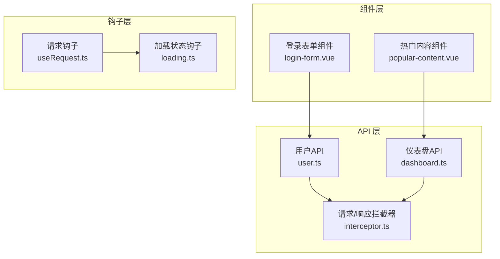
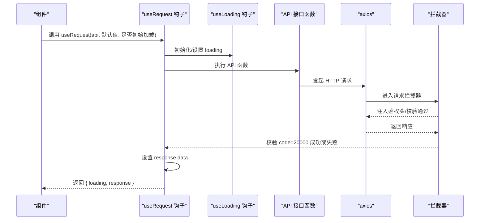
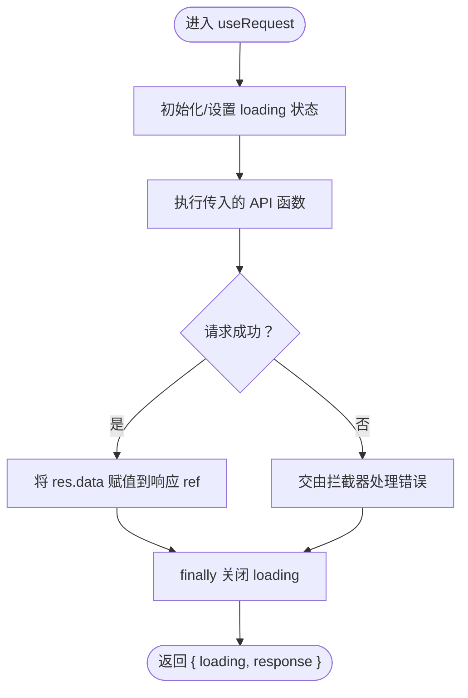
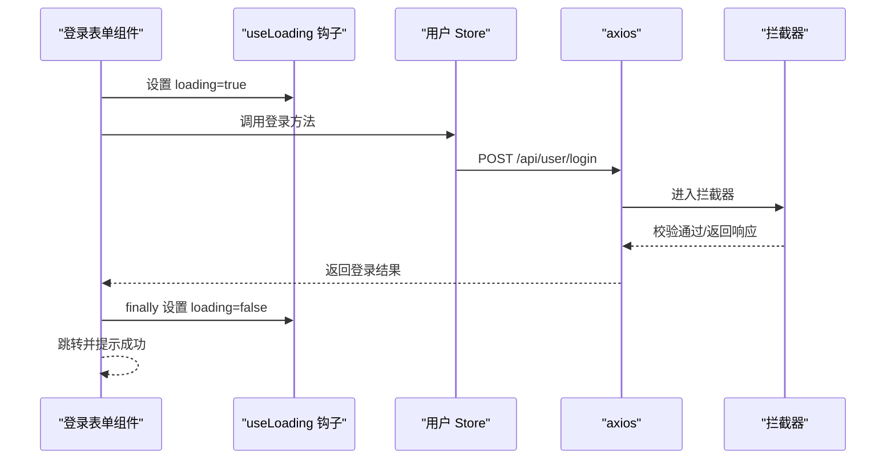
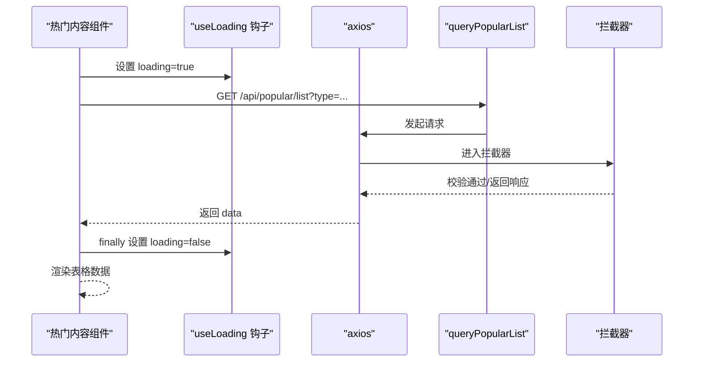
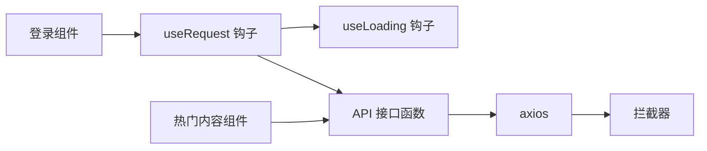

# 请求处理钩子

<cite>
**本文档引用的文件**
- [src/hooks/request.ts](file://src/hooks/request.ts)
- [src/hooks/loading.ts](file://src/hooks/loading.ts)
- [src/api/interceptor.ts](file://src/api/interceptor.ts)
- [src/api/user.ts](file://src/api/user.ts)
- [src/api/dashboard.ts](file://src/api/dashboard.ts)
- [src/views/dashboard/workplace/components/popular-content.vue](file://src/views/dashboard/workplace/components/popular-content.vue)
- [src/views/login/components/login-form.vue](file://src/views/login/components/login-form.vue)
</cite>

## 目录
1. [简介](#简介)
2. [项目结构](#项目结构)
3. [核心组件](#核心组件)
4. [架构总览](#架构总览)
5. [详细组件分析](#详细组件分析)
6. [依赖关系分析](#依赖关系分析)
7. [性能考虑](#性能考虑)
8. [故障排除指南](#故障排除指南)
9. [结论](#结论)
10. [附录](#附录)

## 简介
本文件系统性阐述请求处理钩子 useRequest 的设计理念与实现机制，覆盖请求状态管理、错误处理、数据缓存策略、配置选项、参数传递与返回值结构，并提供在组件中使用该钩子的实际示例（包含 GET、POST 等不同 HTTP 方法）。同时说明钩子与 API 层的集成方式以及最佳实践。

## 项目结构
本项目采用“API 层 + 钩子层 + 组件层”的分层设计：
- API 层：封装 axios 请求，统一导出业务接口函数（如登录、菜单、消息列表等）
- 拦截器层：全局拦截请求与响应，统一注入鉴权头、统一封装响应结构、错误提示与登出逻辑
- 钩子层：提供可复用的请求钩子（如 useRequest、useLoading），负责状态与数据的管理
- 组件层：在视图组件中通过调用 API 或钩子完成数据加载与展示

图表来源
- [src/hooks/request.ts:1-27](file://src/hooks/request.ts#L1-L27)
- [src/hooks/loading.ts:1-17](file://src/hooks/loading.ts#L1-L17)
- [src/api/user.ts:1-28](file://src/api/user.ts#L1-L28)
- [src/api/dashboard.ts:1-23](file://src/api/dashboard.ts#L1-L23)
- [src/api/interceptor.ts:1-78](file://src/api/interceptor.ts#L1-L78)
- [src/views/login/components/login-form.vue:1-166](file://src/views/login/components/login-form.vue#L1-L166)
- [src/views/dashboard/workplace/components/popular-content.vue:1-119](file://src/views/dashboard/workplace/components/popular-content.vue#L1-L119)

章节来源
- [src/hooks/request.ts:1-27](file://src/hooks/request.ts#L1-L27)
- [src/hooks/loading.ts:1-17](file://src/hooks/loading.ts#L1-L17)
- [src/api/interceptor.ts:1-78](file://src/api/interceptor.ts#L1-L78)
- [src/api/user.ts:1-28](file://src/api/user.ts#L1-L28)
- [src/api/dashboard.ts:1-23](file://src/api/dashboard.ts#L1-L23)
- [src/views/login/components/login-form.vue:1-166](file://src/views/login/components/login-form.vue#L1-L166)
- [src/views/dashboard/workplace/components/popular-content.vue:1-119](file://src/views/dashboard/workplace/components/popular-content.vue#L1-L119)

## 核心组件
- useRequest 钩子：接收一个返回 Axios 响应的 API 函数，自动管理 loading 状态与响应数据，支持默认值与初始加载行为控制
- useLoading 钩子：提供 loading 状态、设置与切换能力，供 useRequest 内部使用或组件直接使用
- API 接口：以函数形式封装 axios 请求，遵循统一的响应结构（包含 code、msg、data 等字段）
- 拦截器：全局注入 Authorization 头、统一封装响应结构、错误提示与登出流程

章节来源
- [src/hooks/request.ts:11-26](file://src/hooks/request.ts#L11-L26)
- [src/hooks/loading.ts:3-16](file://src/hooks/loading.ts#L3-L16)
- [src/api/interceptor.ts:7-12](file://src/api/interceptor.ts#L7-L12)
- [src/api/interceptor.ts:18-77](file://src/api/interceptor.ts#L18-L77)

## 架构总览
useRequest 与 API 层的交互路径如下：
- 组件调用 useRequest，传入一个已绑定参数的 API 函数
- useRequest 调用 useLoading 初始化/更新 loading 状态
- 执行 API 函数，axios 发起请求
- 响应经拦截器处理，若 code 不为 20000，则触发错误提示与登出逻辑；否则透传 data
- useRequest 将 data 赋值到响应 ref 中，最终返回 { loading, response }

图表来源
- [src/hooks/request.ts:11-26](file://src/hooks/request.ts#L11-L26)
- [src/hooks/loading.ts:3-16](file://src/hooks/loading.ts#L3-L16)
- [src/api/interceptor.ts:18-77](file://src/api/interceptor.ts#L18-L77)

## 详细组件分析

### useRequest 钩子设计与实现
- 设计理念
  - 专注于“请求执行 + 状态管理 + 数据赋值”，不内置缓存与重试，保持简单与可组合
  - 通过 useLoading 提供统一的加载状态管理
  - 支持传入已绑定参数的 API 函数，便于组件按需调用
- 关键实现点
  - 参数类型：api 为无参异步函数，返回 Axios 响应；T 为响应数据泛型
  - 默认值：当未传入默认值时，使用空数组占位，避免首次渲染空指针
  - 初始加载：isLoading 控制是否在初始化时进入加载态
  - 数据流：成功后将 res.data 赋给响应 ref，finally 中关闭 loading
- 错误处理
  - 由拦截器统一处理：非 20000 状态码时弹出错误提示，并在特定 code 下触发登出确认对话框
  - useRequest 不重复处理错误，避免重复提示与状态污染
- 数据缓存
  - 当前实现未内置缓存；如需缓存，可在组件层自行维护或扩展 useRequest

图表来源
- [src/hooks/request.ts:11-26](file://src/hooks/request.ts#L11-L26)
- [src/hooks/loading.ts:3-16](file://src/hooks/loading.ts#L3-L16)
- [src/api/interceptor.ts:39-77](file://src/api/interceptor.ts#L39-L77)

章节来源
- [src/hooks/request.ts:11-26](file://src/hooks/request.ts#L11-L26)
- [src/hooks/loading.ts:3-16](file://src/hooks/loading.ts#L3-L16)
- [src/api/interceptor.ts:39-77](file://src/api/interceptor.ts#L39-L77)

### useLoading 钩子设计与实现
- 提供 loading 状态、设置与切换能力
- 与 useRequest 解耦，既可用于请求钩子内部，也可用于组件自定义场景
- 适合与 Arco Design 的 Spin、Button 等组件配合使用

章节来源
- [src/hooks/loading.ts:3-16](file://src/hooks/loading.ts#L3-L16)

### API 层与拦截器集成
- 统一响应结构：HttpResponse 包含 status、msg、code、data 字段
- 请求拦截：自动注入 Authorization 头（基于本地 token）
- 响应拦截：校验 code，非 20000 时统一错误提示；对特定 code 触发登出确认对话框
- API 导出：以函数形式暴露 GET/POST 等业务接口，供钩子或组件直接调用

章节来源
- [src/api/interceptor.ts:7-12](file://src/api/interceptor.ts#L7-L12)
- [src/api/interceptor.ts:18-77](file://src/api/interceptor.ts#L18-L77)
- [src/api/user.ts:13-27](file://src/api/user.ts#L13-L27)
- [src/api/dashboard.ts:9-22](file://src/api/dashboard.ts#L9-L22)

### 在组件中的使用示例

#### 示例一：登录组件（POST 请求）
- 使用场景：登录表单提交，展示加载态与错误信息
- 实现要点：
  - 表单提交时设置 loading
  - 调用用户 store 的登录方法（内部使用 axios 发起 POST 请求）
  - 登录成功后跳转页面并提示成功
  - 异常捕获与 finally 中关闭 loading

图表来源
- [src/views/login/components/login-form.vue:93-125](file://src/views/login/components/login-form.vue#L93-L125)
- [src/api/user.ts:13-15](file://src/api/user.ts#L13-L15)
- [src/api/interceptor.ts:18-77](file://src/api/interceptor.ts#L18-L77)

章节来源
- [src/views/login/components/login-form.vue:93-125](file://src/views/login/components/login-form.vue#L93-L125)
- [src/api/user.ts:13-15](file://src/api/user.ts#L13-L15)
- [src/api/interceptor.ts:18-77](file://src/api/interceptor.ts#L18-L77)

#### 示例二：热门内容组件（GET 请求）
- 使用场景：根据内容类型动态查询热门内容列表
- 实现要点：
  - 组件内直接调用 axios GET 接口，手动管理 loading
  - 查询成功后将 data 赋值到 renderList
  - 与 Arco Design 的 Spin 组件结合显示加载态

图表来源
- [src/views/dashboard/workplace/components/popular-content.vue:84-98](file://src/views/dashboard/workplace/components/popular-content.vue#L84-L98)
- [src/api/dashboard.ts:20-22](file://src/api/dashboard.ts#L20-L22)
- [src/api/interceptor.ts:39-77](file://src/api/interceptor.ts#L39-L77)

章节来源
- [src/views/dashboard/workplace/components/popular-content.vue:84-98](file://src/views/dashboard/workplace/components/popular-content.vue#L84-L98)
- [src/api/dashboard.ts:20-22](file://src/api/dashboard.ts#L20-L22)
- [src/api/interceptor.ts:39-77](file://src/api/interceptor.ts#L39-L77)

### 配置选项、参数传递与返回值结构
- 配置选项
  - api：必须，返回 Promise<AxiosResponse<HttpResponse>> 的函数
  - defaultValue：可选，默认值，用于首次渲染避免空指针
  - isLoading：可选，布尔值，控制是否在初始化时进入加载态
- 参数传递
  - 通过函数绑定传参：建议使用函数.bind(null, ...) 方式传入参数
  - 也可在组件内定义箭头函数包裹 API 调用
- 返回值结构
  - { loading, response }：其中 loading 为布尔状态，response 为数据 ref

章节来源
- [src/hooks/request.ts:11-26](file://src/hooks/request.ts#L11-L26)

## 依赖关系分析
- useRequest 依赖 useLoading 提供 loading 状态管理
- API 函数依赖 axios 与拦截器层提供的统一响应结构与错误处理
- 组件层通过 useRequest 或直接调用 API 完成数据加载

图表来源
- [src/hooks/request.ts:11-26](file://src/hooks/request.ts#L11-L26)
- [src/hooks/loading.ts:3-16](file://src/hooks/loading.ts#L3-L16)
- [src/api/interceptor.ts:18-77](file://src/api/interceptor.ts#L18-L77)
- [src/api/user.ts:13-15](file://src/api/user.ts#L13-L15)
- [src/api/dashboard.ts:20-22](file://src/api/dashboard.ts#L20-L22)

章节来源
- [src/hooks/request.ts:11-26](file://src/hooks/request.ts#L11-L26)
- [src/hooks/loading.ts:3-16](file://src/hooks/loading.ts#L3-L16)
- [src/api/interceptor.ts:18-77](file://src/api/interceptor.ts#L18-L77)
- [src/api/user.ts:13-15](file://src/api/user.ts#L13-L15)
- [src/api/dashboard.ts:20-22](file://src/api/dashboard.ts#L20-L22)

## 性能考虑
- 避免不必要的重复请求：在组件内缓存最近一次请求结果，必要时通过 key 或参数变化触发重新请求
- 合理使用 isLoading：仅在关键操作上开启加载态，减少 UI 抖动
- 分页与懒加载：对长列表采用分页或虚拟滚动，降低一次性渲染压力
- 缓存策略：当前钩子未内置缓存，可在组件层或 store 层实现轻量缓存，避免重复拉取相同数据

## 故障排除指南
- 登录后立即退出
  - 现象：收到特定 code 的登出确认对话框
  - 原因：拦截器检测到非法 token 或其他客户端登录
  - 处理：点击“重新登录”后退出当前会话并刷新页面
- 请求报错但无提示
  - 现象：接口返回非 20000，但组件未显示错误
  - 原因：useRequest 未处理错误，错误已在拦截器中统一处理
  - 处理：检查拦截器逻辑与网络状态，确保错误消息可见
- 加载态不关闭
  - 现象：按钮持续处于 loading
  - 原因：finally 未执行或组件提前卸载
  - 处理：确保 finally 中关闭 loading，或在组件卸载时清理副作用

章节来源
- [src/api/interceptor.ts:49-66](file://src/api/interceptor.ts#L49-L66)
- [src/hooks/request.ts:22-24](file://src/hooks/request.ts#L22-L24)

## 结论
useRequest 钩子以简洁的方式实现了请求执行、状态管理与数据赋值，配合拦截器与 API 层，形成清晰的请求处理链路。其设计强调可组合与可扩展，适合在组件中快速接入各类 HTTP 请求场景。对于缓存与重试等高级需求，可在组件层或 store 层进行补充实现。

## 附录
- 最佳实践
  - 使用函数绑定传参，避免在组件内频繁创建新函数
  - 对于复杂请求，优先使用 useRequest；对于简单场景，可直接调用 API 并手动管理 loading
  - 错误处理尽量集中在拦截器层，组件层专注业务逻辑
  - 对高频请求考虑缓存与去抖，提升用户体验与性能