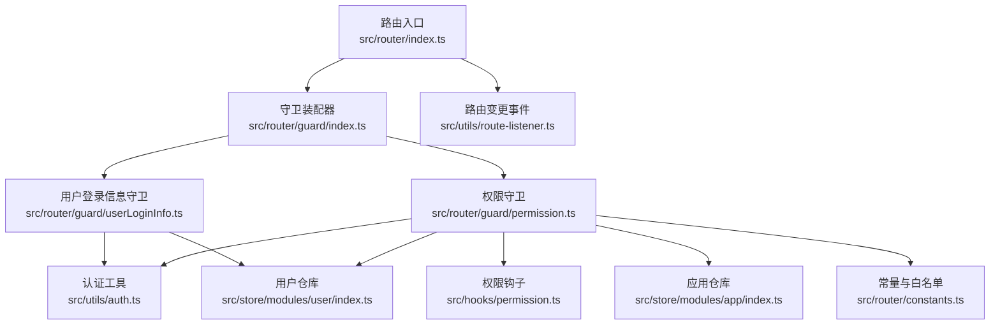
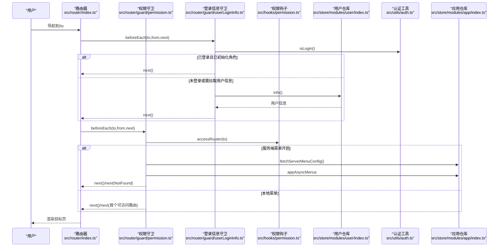
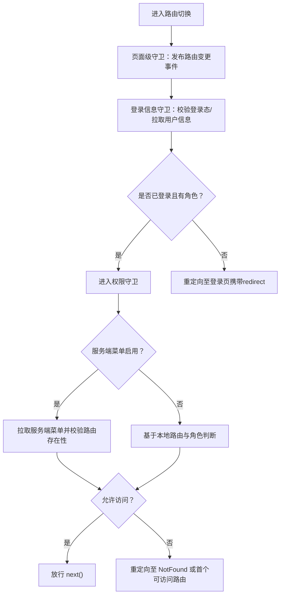
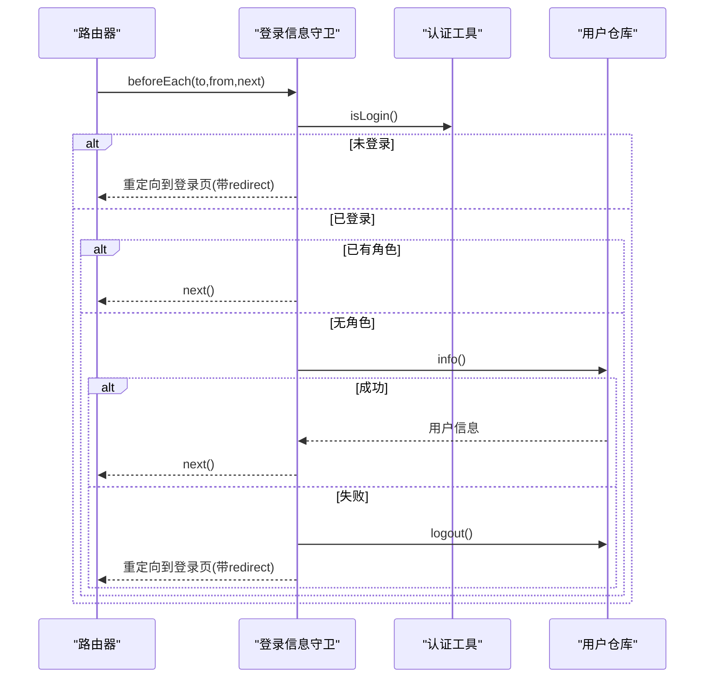
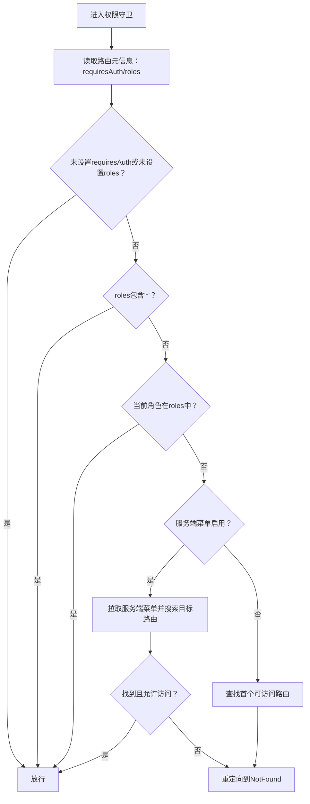
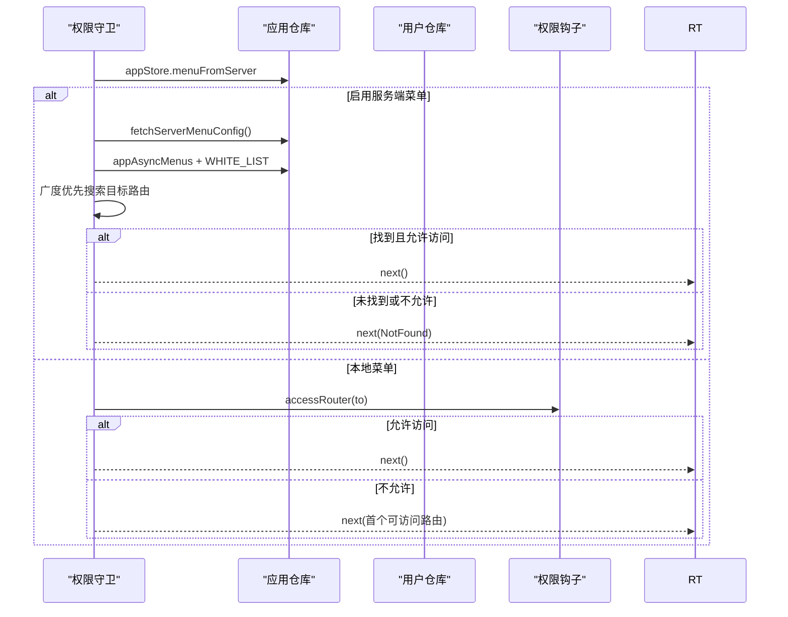
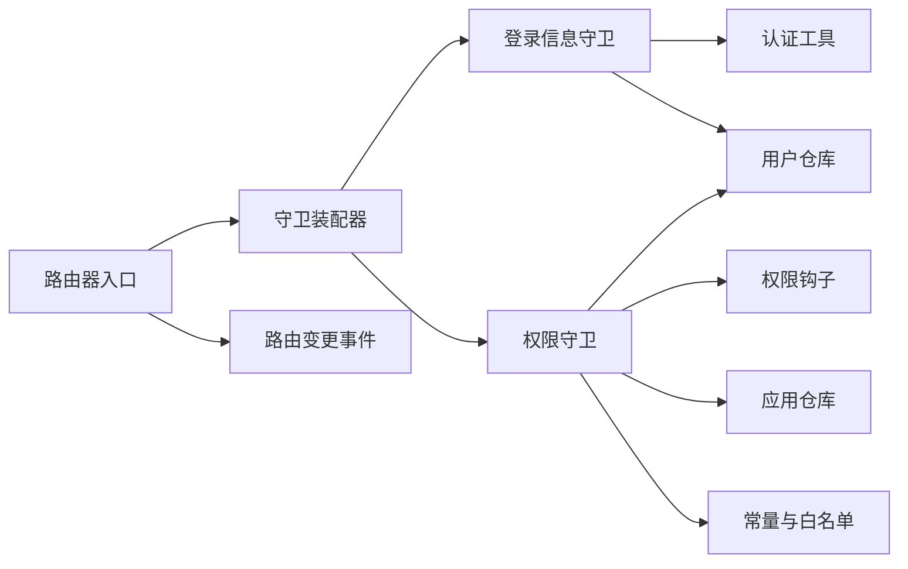

# 权限守卫

<cite>
**本文引用的文件**
- [src/router/guard/index.ts](file://src/router/guard/index.ts)
- [src/router/guard/userLoginInfo.ts](file://src/router/guard/userLoginInfo.ts)
- [src/router/guard/permission.ts](file://src/router/guard/permission.ts)
- [src/router/index.ts](file://src/router/index.ts)
- [src/hooks/permission.ts](file://src/hooks/permission.ts)
- [src/utils/auth.ts](file://src/utils/auth.ts)
- [src/store/modules/user/index.ts](file://src/store/modules/user/index.ts)
- [src/store/modules/app/index.ts](file://src/store/modules/app/index.ts)
- [src/directive/permission/index.ts](file://src/directive/permission/index.ts)
- [src/router/constants.ts](file://src/router/constants.ts)
- [src/router/routes/base.ts](file://src/router/routes/base.ts)
- [src/utils/route-listener.ts](file://src/utils/route-listener.ts)
- [src/store/modules/user/types.ts](file://src/store/modules/user/types.ts)
- [src/store/modules/app/types.ts](file://src/store/modules/app/types.ts)
</cite>

## 目录
1. [简介](#简介)
2. [项目结构](#项目结构)
3. [核心组件](#核心组件)
4. [架构总览](#架构总览)
5. [详细组件分析](#详细组件分析)
6. [依赖关系分析](#依赖关系分析)
7. [性能考量](#性能考量)
8. [故障排查指南](#故障排查指南)
9. [结论](#结论)
10. [附录](#附录)

## 简介
本文件面向权限守卫系统的技术文档，聚焦于路由守卫的工作原理与执行顺序，覆盖全局前置守卫与后置守卫的实现；深入解析权限守卫的三大逻辑：登录状态检查、路由访问权限验证、角色权限匹配；阐述守卫中的异步处理与错误处理策略；提供自定义守卫的开发指南与扩展方法；给出性能优化建议与调试技巧，并说明守卫与路由元信息的配合使用。

## 项目结构
权限守卫由三层组成：
- 路由器入口：创建路由实例并挂载守卫
- 守卫装配器：统一注册多个前置守卫
- 具体守卫：用户登录信息守卫、权限守卫（含服务端菜单场景）

图表来源
- [src/router/index.ts:11-35](file://src/router/index.ts#L11-L35)
- [src/router/guard/index.ts:13-17](file://src/router/guard/index.ts#L13-L17)
- [src/router/guard/userLoginInfo.ts:7-42](file://src/router/guard/userLoginInfo.ts#L7-L42)
- [src/router/guard/permission.ts:9-54](file://src/router/guard/permission.ts#L9-L54)
- [src/utils/auth.ts:1-20](file://src/utils/auth.ts#L1-L20)
- [src/store/modules/user/index.ts:13-92](file://src/store/modules/user/index.ts#L13-L92)
- [src/store/modules/app/index.ts:9-78](file://src/store/modules/app/index.ts#L9-L78)
- [src/hooks/permission.ts:4-33](file://src/hooks/permission.ts#L4-L33)
- [src/router/constants.ts:1-19](file://src/router/constants.ts#L1-L19)
- [src/utils/route-listener.ts:14-27](file://src/utils/route-listener.ts#L14-L27)

章节来源
- [src/router/index.ts:11-35](file://src/router/index.ts#L11-L35)
- [src/router/guard/index.ts:13-17](file://src/router/guard/index.ts#L13-L17)

## 核心组件
- 路由器入口：负责创建路由实例、注入基础路由与守卫
- 守卫装配器：按序注册页面级守卫、用户登录信息守卫、权限守卫
- 用户登录信息守卫：校验登录态、拉取用户信息、处理未授权跳转
- 权限守卫：基于路由元信息与角色判断访问权限，支持服务端动态菜单
- 权限钩子：封装路由访问判断与“首个可访问路由”查找
- 认证工具：基于本地存储的令牌读写与登录态判定
- 应用仓库：管理主题、菜单等应用状态，支持服务端菜单拉取
- 用户仓库：管理用户信息、登录登出、角色切换
- 路由变更事件：通过发布订阅在路由变化时通知组件

章节来源
- [src/router/index.ts:11-35](file://src/router/index.ts#L11-L35)
- [src/router/guard/index.ts:13-17](file://src/router/guard/index.ts#L13-L17)
- [src/router/guard/userLoginInfo.ts:7-42](file://src/router/guard/userLoginInfo.ts#L7-L42)
- [src/router/guard/permission.ts:9-54](file://src/router/guard/permission.ts#L9-L54)
- [src/hooks/permission.ts:4-33](file://src/hooks/permission.ts#L4-L33)
- [src/utils/auth.ts:1-20](file://src/utils/auth.ts#L1-L20)
- [src/store/modules/app/index.ts:9-78](file://src/store/modules/app/index.ts#L9-L78)
- [src/store/modules/user/index.ts:13-92](file://src/store/modules/user/index.ts#L13-L92)
- [src/utils/route-listener.ts:14-27](file://src/utils/route-listener.ts#L14-L27)

## 架构总览
下图展示从导航到最终放行或重定向的关键流程，以及与仓库、工具模块的交互。

图表来源
- [src/router/index.ts:11-35](file://src/router/index.ts#L11-L35)
- [src/router/guard/userLoginInfo.ts:7-42](file://src/router/guard/userLoginInfo.ts#L7-L42)
- [src/router/guard/permission.ts:9-54](file://src/router/guard/permission.ts#L9-L54)
- [src/hooks/permission.ts:4-33](file://src/hooks/permission.ts#L4-L33)
- [src/store/modules/user/index.ts:56-61](file://src/store/modules/user/index.ts#L56-L61)
- [src/store/modules/app/index.ts:47-70](file://src/store/modules/app/index.ts#L47-L70)
- [src/utils/auth.ts:3-5](file://src/utils/auth.ts#L3-L5)

## 详细组件分析

### 执行顺序与控制流
- 页面级守卫：在每次路由切换前触发，用于发布路由变更事件，便于组件订阅更新
- 登录信息守卫：在页面级之后执行，负责登录态校验与用户信息拉取
- 权限守卫：最后执行，综合路由元信息与角色决定是否放行或重定向

图表来源
- [src/router/guard/index.ts:6-11](file://src/router/guard/index.ts#L6-L11)
- [src/router/guard/userLoginInfo.ts:7-42](file://src/router/guard/userLoginInfo.ts#L7-L42)
- [src/router/guard/permission.ts:9-54](file://src/router/guard/permission.ts#L9-L54)
- [src/router/constants.ts:1-19](file://src/router/constants.ts#L1-L19)

章节来源
- [src/router/guard/index.ts:6-11](file://src/router/guard/index.ts#L6-L11)
- [src/router/guard/userLoginInfo.ts:7-42](file://src/router/guard/userLoginInfo.ts#L7-L42)
- [src/router/guard/permission.ts:9-54](file://src/router/guard/permission.ts#L9-L54)

### 登录状态检查与用户信息拉取
- 登录态判定：通过本地存储令牌是否存在判断
- 已登录但未初始化角色：调用用户仓库拉取用户信息
- 拉取失败：清理用户状态与令牌，重定向到登录页并携带当前目标路由名
- 未登录：直接重定向到登录页，携带目标路由名与查询参数

图表来源
- [src/router/guard/userLoginInfo.ts:7-42](file://src/router/guard/userLoginInfo.ts#L7-L42)
- [src/utils/auth.ts:3-5](file://src/utils/auth.ts#L3-L5)
- [src/store/modules/user/index.ts:56-61](file://src/store/modules/user/index.ts#L56-L61)

章节来源
- [src/router/guard/userLoginInfo.ts:7-42](file://src/router/guard/userLoginInfo.ts#L7-L42)
- [src/utils/auth.ts:3-5](file://src/utils/auth.ts#L3-L5)
- [src/store/modules/user/index.ts:56-61](file://src/store/modules/user/index.ts#L56-L61)

### 路由访问权限验证与角色匹配
- 路由元信息字段：
  - requiresAuth：是否要求登录
  - roles：允许访问的角色集合，支持通配符“*”
- 规则：
  - 若路由未设置 requiresAuth 或未设置 roles，则默认放行
  - 若 roles 包含“*”，则放行
  - 否则必须包含当前用户角色
- 未满足时：
  - 服务端菜单模式：若目标路由不在服务端菜单树中，重定向到 NotFound
  - 本地菜单模式：寻找第一个对当前角色可访问的路由并重定向

图表来源
- [src/hooks/permission.ts:7-30](file://src/hooks/permission.ts#L7-L30)
- [src/router/guard/permission.ts:9-54](file://src/router/guard/permission.ts#L9-L54)
- [src/router/constants.ts:1-19](file://src/router/constants.ts#L1-L19)

章节来源
- [src/hooks/permission.ts:7-30](file://src/hooks/permission.ts#L7-L30)
- [src/router/guard/permission.ts:9-54](file://src/router/guard/permission.ts#L9-L54)
- [src/router/constants.ts:1-19](file://src/router/constants.ts#L1-L19)

### 服务端菜单与动态权限
- 当应用仓库标记“菜单来自服务端”时，权限守卫会在必要时拉取服务端菜单配置
- 将服务端菜单与白名单合并后，广度优先搜索目标路由是否存在
- 存在且满足角色条件则放行，否则重定向到 NotFound

图表来源
- [src/router/guard/permission.ts:15-52](file://src/router/guard/permission.ts#L15-L52)
- [src/store/modules/app/index.ts:47-70](file://src/store/modules/app/index.ts#L47-L70)
- [src/router/constants.ts:1-19](file://src/router/constants.ts#L1-L19)

章节来源
- [src/router/guard/permission.ts:15-52](file://src/router/guard/permission.ts#L15-L52)
- [src/store/modules/app/index.ts:47-70](file://src/store/modules/app/index.ts#L47-L70)
- [src/router/constants.ts:1-19](file://src/router/constants.ts#L1-L19)

### 异步处理与错误处理策略
- 异步流程：
  - 登录信息守卫：await 用户信息拉取
  - 服务端菜单：await 拉取菜单配置
- 错误处理：
  - 用户信息拉取失败：调用用户仓库 logout 回调，清理状态与令牌
  - 菜单拉取异常：通过通知组件提示错误，但不影响导航放行逻辑（仍按规则处理）
- 进度条与页面级守卫：
  - 登录信息守卫与权限守卫均在切换开始时启动进度条，在结束时完成进度条
  - 页面级守卫在每次切换前发布路由变更事件，供组件订阅

章节来源
- [src/router/guard/userLoginInfo.ts:15-28](file://src/router/guard/userLoginInfo.ts#L15-L28)
- [src/store/modules/user/index.ts:73-87](file://src/store/modules/user/index.ts#L73-L87)
- [src/store/modules/app/index.ts:47-70](file://src/store/modules/app/index.ts#L47-L70)
- [src/router/guard/index.ts:6-11](file://src/router/guard/index.ts#L6-L11)

### 自定义守卫开发指南与扩展方法
- 新增守卫步骤：
  - 在守卫装配器中注册：参考 [src/router/guard/index.ts:13-17](file://src/router/guard/index.ts#L13-L17)
  - 实现守卫函数：接收 to、from、next 参数，按需进行异步操作
  - 放行：调用 next()；重定向：调用 next({ name, query })；错误：抛出错误或调用 next(NotFound)
- 常见扩展点：
  - 动态权限：结合用户仓库与应用仓库，按需拉取权限列表并缓存
  - 多租户/组织隔离：在守卫中读取当前组织上下文并限制路由范围
  - 白名单扩展：在常量中维护更多免登录路由，避免重复登录
- 注意事项：
  - 保持守卫职责单一，避免在守卫中做过多副作用
  - 对外链或静态资源路由，合理设置 meta 以减少守卫负担

章节来源
- [src/router/guard/index.ts:13-17](file://src/router/guard/index.ts#L13-L17)
- [src/router/constants.ts:1-19](file://src/router/constants.ts#L1-L19)

### 与路由元信息的配合使用
- 常用字段：
  - requiresAuth：布尔值，控制是否需要登录
  - roles：字符串数组，控制角色访问
- 使用建议：
  - 对公共页设置 requiresAuth=false，避免额外校验
  - 对后台管理页设置 roles=['admin'] 或 ['admin','user']
  - 对公开页设置 roles=['*'] 以放行所有角色

章节来源
- [src/hooks/permission.ts:7-14](file://src/hooks/permission.ts#L7-L14)

### 与指令权限的配合
- 指令权限在组件层面进行细粒度控制，适合按钮级权限
- 与守卫配合：守卫保证页面级访问，指令保证元素级可见/可用
- 指令使用：在模板中通过 v-permission="[role1, role2]" 控制元素显示

章节来源
- [src/directive/permission/index.ts:4-21](file://src/directive/permission/index.ts#L4-L21)

## 依赖关系分析
- 组件耦合与内聚：
  - 守卫装配器集中注册多个守卫，内聚性高
  - 权限钩子与仓库解耦，便于复用与测试
- 外部依赖：
  - NProgress：进度条
  - mitt：路由变更事件发布订阅
  - Pinia：用户与应用状态管理
- 可能的循环依赖：
  - 守卫与仓库之间为单向依赖，无循环
- 关键接口契约：
  - 用户仓库提供 info、logout、resetInfo 等动作
  - 应用仓库提供 fetchServerMenuConfig、clearServerMenu 等动作
  - 权限钩子提供 accessRouter、findFirstPermissionRoute

图表来源
- [src/router/guard/userLoginInfo.ts:7-42](file://src/router/guard/userLoginInfo.ts#L7-L42)
- [src/router/guard/permission.ts:9-54](file://src/router/guard/permission.ts#L9-L54)
- [src/hooks/permission.ts:4-33](file://src/hooks/permission.ts#L4-L33)
- [src/store/modules/user/index.ts:13-92](file://src/store/modules/user/index.ts#L13-L92)
- [src/store/modules/app/index.ts:9-78](file://src/store/modules/app/index.ts#L9-L78)
- [src/router/constants.ts:1-19](file://src/router/constants.ts#L1-L19)
- [src/router/guard/index.ts:13-17](file://src/router/guard/index.ts#L13-L17)
- [src/utils/route-listener.ts:14-27](file://src/utils/route-listener.ts#L14-L27)

章节来源
- [src/router/guard/index.ts:13-17](file://src/router/guard/index.ts#L13-L17)
- [src/router/guard/userLoginInfo.ts:7-42](file://src/router/guard/userLoginInfo.ts#L7-L42)
- [src/router/guard/permission.ts:9-54](file://src/router/guard/permission.ts#L9-L54)
- [src/hooks/permission.ts:4-33](file://src/hooks/permission.ts#L4-L33)
- [src/store/modules/user/index.ts:13-92](file://src/store/modules/user/index.ts#L13-L92)
- [src/store/modules/app/index.ts:9-78](file://src/store/modules/app/index.ts#L9-L78)
- [src/router/constants.ts:1-19](file://src/router/constants.ts#L1-L19)
- [src/utils/route-listener.ts:14-27](file://src/utils/route-listener.ts#L14-L27)

## 性能考量
- 减少不必要的守卫逻辑：
  - 对无需登录的页面设置 requiresAuth=false，避免进入用户信息守卫分支
  - 对公开路由设置 roles=['*']，避免逐层查找
- 服务端菜单优化：
  - 缓存服务端菜单结果，避免重复拉取
  - 在应用启动阶段预拉取菜单，降低首次访问延迟
- 进度条与事件：
  - 页面级守卫仅发布事件，不阻塞主线程
  - 登录信息守卫与权限守卫在切换开始时启动进度条，结束时完成，避免阻塞
- 路由查找：
  - 广度优先搜索服务端菜单时，尽量缩短菜单层级，减少遍历成本

## 故障排查指南
- 登录后仍被重定向到登录页
  - 检查令牌是否正确写入本地存储
  - 确认用户信息拉取接口返回的角色是否正确
  - 查看用户仓库 info 动作是否抛错
- 服务端菜单启用后无法访问页面
  - 确认服务端菜单是否包含目标路由名称
  - 检查应用仓库是否成功拉取菜单配置
- 角色变更后权限未生效
  - 确认用户仓库 role 是否更新
  - 检查权限钩子 accessRouter 的角色匹配逻辑
- 调试技巧
  - 在守卫中打印 to、from、next 的调用路径
  - 使用浏览器开发者工具断点定位异步流程
  - 通过路由变更事件订阅器监听最新路由，辅助定位问题

章节来源
- [src/utils/auth.ts:11-17](file://src/utils/auth.ts#L11-L17)
- [src/store/modules/user/index.ts:56-61](file://src/store/modules/user/index.ts#L56-L61)
- [src/store/modules/app/index.ts:47-70](file://src/store/modules/app/index.ts#L47-L70)
- [src/hooks/permission.ts:7-14](file://src/hooks/permission.ts#L7-L14)
- [src/utils/route-listener.ts:19-27](file://src/utils/route-listener.ts#L19-L27)

## 结论
该权限守卫系统通过“页面级守卫 + 登录信息守卫 + 权限守卫”的组合，实现了从登录态到角色权限的多层防护。其设计强调职责分离、可扩展与可维护性：登录信息守卫负责身份与信息，权限守卫负责路由与角色，权限钩子与仓库提供可复用的能力。配合路由元信息与指令权限，可在页面与元素两个维度实现精细化控制。通过合理的性能优化与完善的错误处理，系统在复杂业务场景下仍能保持稳定与高效。

## 附录
- 类型与状态
  - 用户角色类型：支持空串、通配符、admin、user
  - 应用状态：包含主题、菜单、设备、服务端菜单开关等
- 常用常量
  - 白名单：包含登录与 NotFound
  - 重定向与默认路由：用于兜底与引导

章节来源
- [src/store/modules/user/types.ts:1-20](file://src/store/modules/user/types.ts#L1-L20)
- [src/store/modules/app/types.ts:1-21](file://src/store/modules/app/types.ts#L1-L21)
- [src/router/constants.ts:1-19](file://src/router/constants.ts#L1-L19)
- [src/router/routes/base.ts:27-31](file://src/router/routes/base.ts#L27-L31)