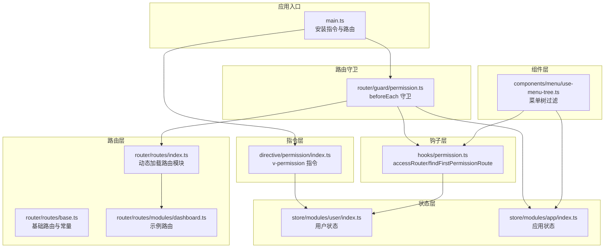
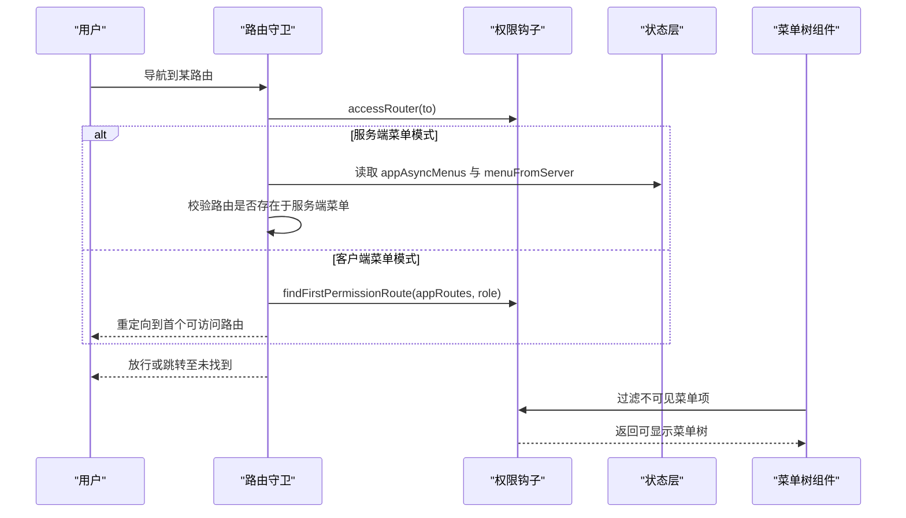
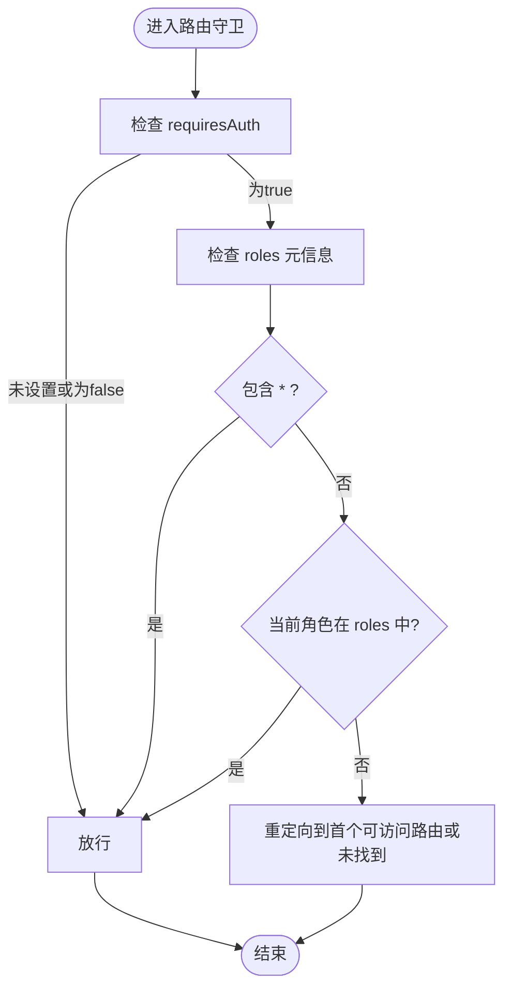
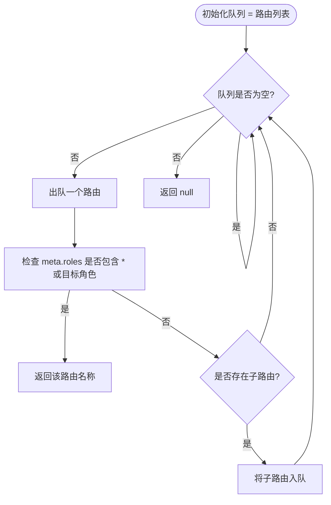
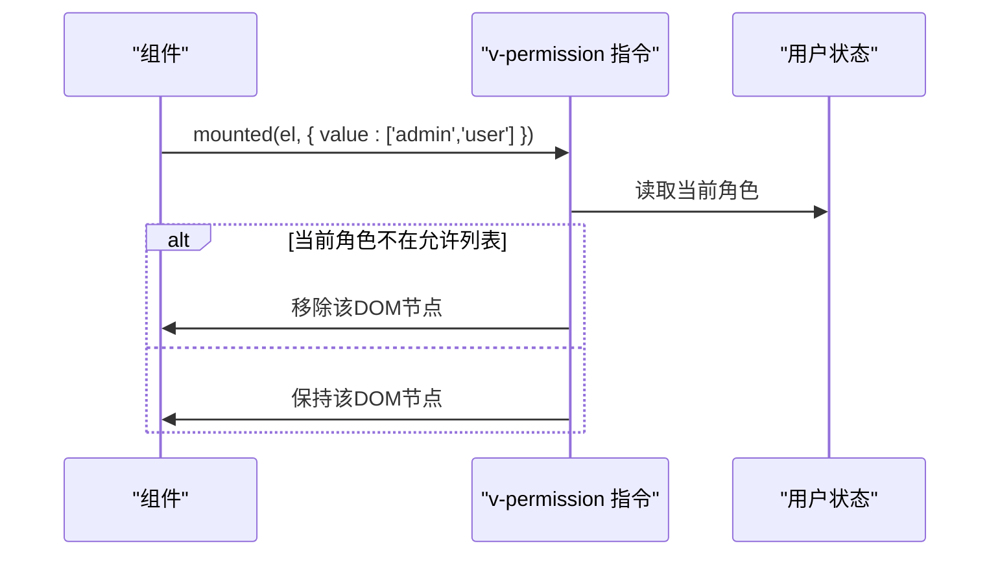
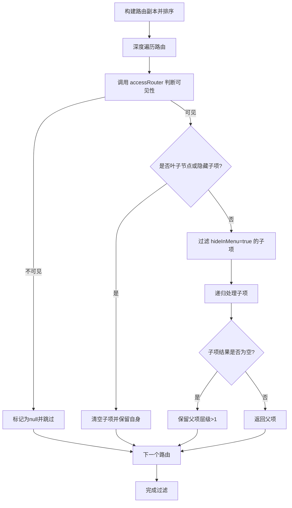
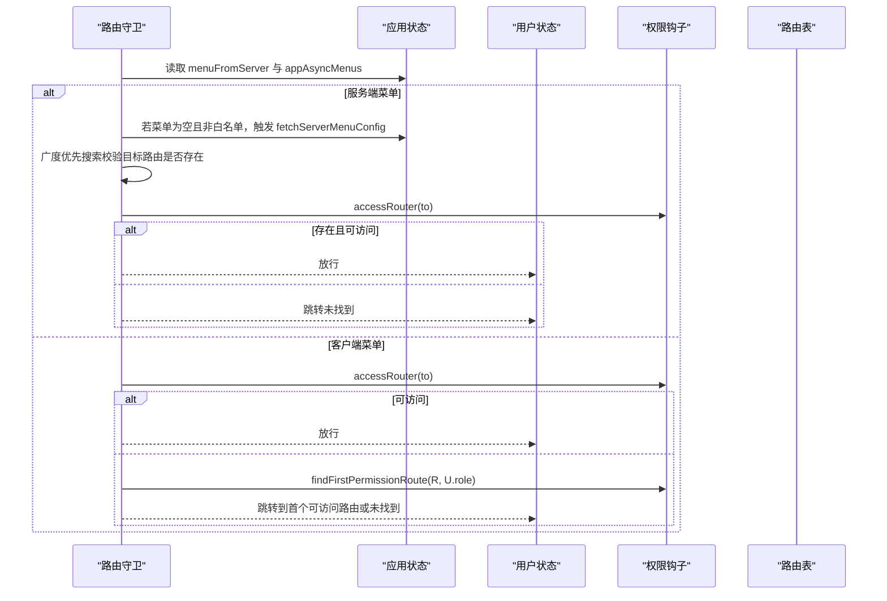
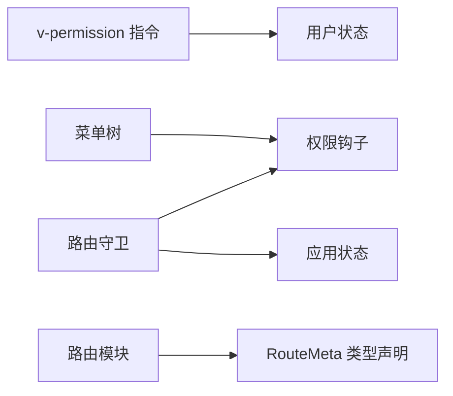

# 权限控制

<cite>
**本文引用的文件**
- [src/directive/permission/index.ts](file://src/directive/permission/index.ts)
- [src/hooks/permission.ts](file://src/hooks/permission.ts)
- [src/router/guard/permission.ts](file://src/router/guard/permission.ts)
- [src/utils/auth.ts](file://src/utils/auth.ts)
- [src/store/modules/user/index.ts](file://src/store/modules/user/index.ts)
- [src/store/modules/user/types.ts](file://src/store/modules/user/types.ts)
- [src/store/modules/app/index.ts](file://src/store/modules/app/index.ts)
- [src/router/routes/base.ts](file://src/router/routes/base.ts)
- [src/router/routes/modules/dashboard.ts](file://src/router/routes/modules/dashboard.ts)
- [src/router/routes/index.ts](file://src/router/routes/index.ts)
- [src/components/menu/use-menu-tree.ts](file://src/components/menu/use-menu-tree.ts)
- [src/router/typings.d.ts](file://src/router/typings.d.ts)
- [src/main.ts](file://src/main.ts)
</cite>

## 目录
1. [引言](#引言)
2. [项目结构](#项目结构)
3. [核心组件](#核心组件)
4. [架构总览](#架构总览)
5. [详细组件分析](#详细组件分析)
6. [依赖关系分析](#依赖关系分析)
7. [性能考虑](#性能考虑)
8. [故障排查指南](#故障排查指南)
9. [结论](#结论)
10. [附录](#附录)

## 引言
本文件围绕权限控制系统进行系统化梳理与说明，重点覆盖以下方面：
- 基于角色的访问控制（RBAC）模型实现：角色定义、权限分配与权限继承机制
- 路由权限控制：requiresAuth 元信息的使用与权限路由的动态加载
- 按钮级权限与数据权限：权限指令的使用与条件渲染逻辑
- 权限验证函数 accessRouter 的详细说明与 findFirstPermissionRoute 的路由查找算法
- 权限缓存策略与权限更新机制

## 项目结构
权限控制相关代码主要分布在如下模块：
- 指令层：按钮级权限指令，用于在模板中按角色条件渲染元素
- 钩子层：权限逻辑封装，提供路由权限判断与首条可访问路由查找
- 路由守卫：全局前置守卫，结合用户角色与路由元信息进行鉴权
- 状态层：用户状态与应用状态，承载角色、菜单与鉴权上下文
- 路由层：路由定义与动态加载，支持客户端与服务端两种菜单来源
- 组件层：菜单树生成，依据权限过滤不可见菜单项



图表来源
- [src/main.ts:17-28](file://src/main.ts#L17-L28)
- [src/directive/permission/index.ts:1-31](file://src/directive/permission/index.ts#L1-L31)
- [src/hooks/permission.ts:1-34](file://src/hooks/permission.ts#L1-L34)
- [src/router/guard/permission.ts:1-56](file://src/router/guard/permission.ts#L1-L56)
- [src/store/modules/user/index.ts:1-92](file://src/store/modules/user/index.ts#L1-L92)
- [src/store/modules/app/index.ts:1-78](file://src/store/modules/app/index.ts#L1-L78)
- [src/router/routes/index.ts:1-26](file://src/router/routes/index.ts#L1-L26)
- [src/router/routes/base.ts:1-32](file://src/router/routes/base.ts#L1-L32)
- [src/router/routes/modules/dashboard.ts:1-29](file://src/router/routes/modules/dashboard.ts#L1-L29)
- [src/components/menu/use-menu-tree.ts:1-70](file://src/components/menu/use-menu-tree.ts#L1-L70)

章节来源
- [src/main.ts:17-28](file://src/main.ts#L17-L28)
- [src/router/routes/index.ts:1-26](file://src/router/routes/index.ts#L1-L26)

## 核心组件
- 指令层：v-permission 指令，基于用户角色动态移除 DOM 节点，实现按钮级权限控制
- 钩子层：usePermission 提供 accessRouter 与 findFirstPermissionRoute，支撑路由与菜单权限判断
- 路由守卫：setupPermissionGuard 在导航前根据 requiresAuth 与 roles 元信息决定放行或重定向
- 状态层：用户状态管理角色与个人信息；应用状态管理服务端菜单与异步菜单列表
- 路由层：客户端路由模块与服务端菜单配置，支持动态加载与白名单跳过
- 组件层：菜单树生成时使用权限钩子过滤不可见节点

章节来源
- [src/directive/permission/index.ts:1-31](file://src/directive/permission/index.ts#L1-L31)
- [src/hooks/permission.ts:1-34](file://src/hooks/permission.ts#L1-L34)
- [src/router/guard/permission.ts:1-56](file://src/router/guard/permission.ts#L1-L56)
- [src/store/modules/user/index.ts:1-92](file://src/store/modules/user/index.ts#L1-L92)
- [src/store/modules/app/index.ts:1-78](file://src/store/modules/app/index.ts#L1-L78)
- [src/components/menu/use-menu-tree.ts:1-70](file://src/components/menu/use-menu-tree.ts#L1-L70)

## 架构总览
权限控制采用“指令 + 钩子 + 守卫 + 状态 + 路由”的分层设计：
- 指令层负责页面级按钮/元素的即时权限校验
- 钩子层提供通用的权限判断与路由查找能力
- 路由守卫在导航阶段统一拦截与放行
- 状态层持久化用户角色与菜单配置
- 路由层以模块化方式组织路由，支持客户端与服务端两种菜单来源



图表来源
- [src/router/guard/permission.ts:9-55](file://src/router/guard/permission.ts#L9-L55)
- [src/hooks/permission.ts:4-33](file://src/hooks/permission.ts#L4-L33)
- [src/store/modules/app/index.ts:19-21](file://src/store/modules/app/index.ts#L19-L21)
- [src/components/menu/use-menu-tree.ts:8-64](file://src/components/menu/use-menu-tree.ts#L8-L64)

## 详细组件分析

### RBAC 模型与角色定义
- 角色类型：RoleType 支持空字符串、通配符与具体角色（如 admin、user）
- 用户状态：UserState 中包含 role 字段，作为权限判断的核心依据
- 角色切换：提供 switchRoles 动作，便于演示与测试

```mermaid
classDiagram
class UserState {
+string name
+string avatar
+string job
+string organization
+string location
+string email
+string introduction
+string personalWebsite
+string jobName
+string organizationName
+string locationName
+string phone
+string registrationDate
+string accountId
+number certification
+RoleType role
}
class RoleType {
<<enumeration>>
""
"*"
"admin"
"user"
}
UserState --> RoleType : "使用"
```

图表来源
- [src/store/modules/user/types.ts:1-20](file://src/store/modules/user/types.ts#L1-L20)
- [src/store/modules/user/index.ts:14-31](file://src/store/modules/user/index.ts#L14-L31)

章节来源
- [src/store/modules/user/types.ts:1-20](file://src/store/modules/user/types.ts#L1-L20)
- [src/store/modules/user/index.ts:39-45](file://src/store/modules/user/index.ts#L39-L45)

### 路由权限控制与元信息
- requiresAuth：每个路由必须声明，表示是否需要登录才能访问
- roles：数组形式定义允许访问的角色集合，支持通配符 *
- 路由模块化：通过动态导入加载路由模块，支持外部模块扩展



图表来源
- [src/hooks/permission.ts:7-14](file://src/hooks/permission.ts#L7-L14)
- [src/router/typings.d.ts:4-15](file://src/router/typings.d.ts#L4-L15)
- [src/router/routes/modules/dashboard.ts:19-24](file://src/router/routes/modules/dashboard.ts#L19-L24)

章节来源
- [src/router/typings.d.ts:3-16](file://src/router/typings.d.ts#L3-L16)
- [src/router/routes/modules/dashboard.ts:1-29](file://src/router/routes/modules/dashboard.ts#L1-L29)
- [src/router/routes/index.ts:1-26](file://src/router/routes/index.ts#L1-L26)

### 权限验证函数 accessRouter
- 功能：判断目标路由是否对当前用户可见
- 规则：
  - 若未设置 requiresAuth 或未设置 roles，则默认放行
  - 若 roles 包含通配符 *，则放行
  - 否则要求当前用户角色包含在 roles 中

章节来源
- [src/hooks/permission.ts:7-14](file://src/hooks/permission.ts#L7-L14)

### findFirstPermissionRoute 路由查找算法
- 功能：在路由表中查找第一个对指定角色可见的路由
- 算法：广度优先搜索（BFS），遍历路由及其子路由，遇到满足条件的首个路由即返回其名称
- 复杂度：时间复杂度 O(N)，空间复杂度 O(W)，N 为节点总数，W 为最大宽度



图表来源
- [src/hooks/permission.ts:15-30](file://src/hooks/permission.ts#L15-L30)

章节来源
- [src/hooks/permission.ts:15-30](file://src/hooks/permission.ts#L15-L30)

### 按钮级权限与数据权限
- 按钮级权限：v-permission 指令通过绑定值（角色数组）与用户角色比较，不匹配则移除对应 DOM 节点
- 数据权限：当前实现未提供专门的数据权限指令，可在业务组件中复用用户角色与权限钩子进行条件渲染



图表来源
- [src/directive/permission/index.ts:4-21](file://src/directive/permission/index.ts#L4-L21)
- [src/store/modules/user/index.ts:30](file://src/store/modules/user/index.ts#L30)

章节来源
- [src/directive/permission/index.ts:1-31](file://src/directive/permission/index.ts#L1-L31)
- [src/store/modules/user/index.ts:14-31](file://src/store/modules/user/index.ts#L14-L31)

### 菜单树过滤与权限继承
- 菜单树生成：useMenuTree 基于当前路由源（客户端或服务端）构建菜单树
- 过滤规则：使用 accessRouter 判断路由是否可见；支持 hideInMenu、hideChildrenInMenu 等元信息
- 权限继承：子路由继承父路由的权限策略，若父路由不可见则子路由通常也不显示



图表来源
- [src/components/menu/use-menu-tree.ts:11-64](file://src/components/menu/use-menu-tree.ts#L11-L64)
- [src/hooks/permission.ts:7-14](file://src/hooks/permission.ts#L7-L14)

章节来源
- [src/components/menu/use-menu-tree.ts:1-70](file://src/components/menu/use-menu-tree.ts#L1-L70)
- [src/hooks/permission.ts:7-14](file://src/hooks/permission.ts#L7-L14)

### 路由守卫与动态菜单加载
- 白名单：WHITE_LIST 中的路由（如登录、未找到）不受权限限制
- 服务端菜单模式：当 menuFromServer 为真时，从服务端拉取菜单配置并校验目标路由是否存在
- 客户端菜单模式：若权限不足，使用 findFirstPermissionRoute 获取首个可访问路由并跳转



图表来源
- [src/router/guard/permission.ts:9-55](file://src/router/guard/permission.ts#L9-L55)
- [src/store/modules/app/index.ts:47-70](file://src/store/modules/app/index.ts#L47-L70)
- [src/router/constants.ts:1-19](file://src/router/constants.ts#L1-L19)
- [src/hooks/permission.ts:15-30](file://src/hooks/permission.ts#L15-L30)

章节来源
- [src/router/guard/permission.ts:1-56](file://src/router/guard/permission.ts#L1-L56)
- [src/store/modules/app/index.ts:19-21](file://src/store/modules/app/index.ts#L19-L21)
- [src/router/constants.ts:1-19](file://src/router/constants.ts#L1-L19)

### 登录态与令牌管理
- 令牌存储：使用本地存储保存 token，提供 isLogin/getToken/setToken/clearToken 方法
- 登录流程：登录成功后写入 token；登出时清理 token 并清除应用状态与路由监听

章节来源
- [src/utils/auth.ts:1-20](file://src/utils/auth.ts#L1-L20)
- [src/store/modules/user/index.ts:64-87](file://src/store/modules/user/index.ts#L64-L87)

## 依赖关系分析
- 指令依赖用户状态：v-permission 读取用户角色进行判定
- 守卫依赖钩子与状态：beforeEach 使用 accessRouter 与 findFirstPermissionRoute，并读取应用状态中的菜单配置
- 菜单树依赖钩子：useMenuTree 使用 accessRouter 过滤菜单
- 路由模块依赖类型声明：RouteMeta 扩展确保路由元信息类型安全



图表来源
- [src/directive/permission/index.ts:6](file://src/directive/permission/index.ts#L6)
- [src/router/guard/permission.ts:13](file://src/router/guard/permission.ts#L13)
- [src/components/menu/use-menu-tree.ts:9](file://src/components/menu/use-menu-tree.ts#L9)
- [src/router/typings.d.ts:3-16](file://src/router/typings.d.ts#L3-L16)

章节来源
- [src/directive/permission/index.ts:1-31](file://src/directive/permission/index.ts#L1-L31)
- [src/router/guard/permission.ts:1-56](file://src/router/guard/permission.ts#L1-L56)
- [src/components/menu/use-menu-tree.ts:1-70](file://src/components/menu/use-menu-tree.ts#L1-L70)
- [src/router/typings.d.ts:1-17](file://src/router/typings.d.ts#L1-L17)

## 性能考虑
- 路由查找：findFirstPermissionRoute 使用 BFS，时间复杂度 O(N)，适合中等规模路由表
- 菜单过滤：useMenuTree 对路由进行一次遍历并过滤，建议避免频繁重建路由副本
- 服务端菜单：fetchServerMenuConfig 仅在首次缺失时触发，减少不必要的请求
- 指令执行：v-permission 在 mounted 与 updated 钩子中执行，应避免在大量节点上重复绑定

## 故障排查指南
- 路由无法访问
  - 检查路由 meta.roles 是否包含当前角色或通配符 *
  - 确认 requiresAuth 已正确设置
  - 在服务端菜单模式下，确认目标路由存在于 appAsyncMenus
- 按钮不显示
  - 检查 v-permission 绑定值是否为角色数组
  - 确认用户角色已正确设置
- 菜单异常
  - 检查 hideInMenu、hideChildrenInMenu 等元信息
  - 确认排序字段 order 的合理性
- 登录后仍提示无权限
  - 确认登录成功后 token 已写入本地存储
  - 检查用户信息拉取是否成功并更新了用户状态

章节来源
- [src/hooks/permission.ts:7-14](file://src/hooks/permission.ts#L7-L14)
- [src/router/guard/permission.ts:15-52](file://src/router/guard/permission.ts#L15-L52)
- [src/directive/permission/index.ts:9-21](file://src/directive/permission/index.ts#L9-L21)
- [src/store/modules/app/index.ts:47-70](file://src/store/modules/app/index.ts#L47-L70)

## 结论
本权限控制系统以简洁清晰的方式实现了 RBAC 模型，结合指令、钩子、守卫与状态层形成完整的权限闭环。通过 requiresAuth 与 roles 元信息，配合 findFirstPermissionRoute 与 BFS 菜单过滤，既保证了路由层面的访问控制，也兼顾了界面元素与菜单的精细化权限管理。服务端菜单模式进一步增强了权限策略的灵活性与可维护性。

## 附录
- 示例路由：仪表盘路由 workplace 设置 roles 为通配符，确保任意角色可见
- 路由模块：通过动态导入加载模块化路由，便于扩展与维护

章节来源
- [src/router/routes/modules/dashboard.ts:19-24](file://src/router/routes/modules/dashboard.ts#L19-L24)
- [src/router/routes/index.ts:3-18](file://src/router/routes/index.ts#L3-L18)