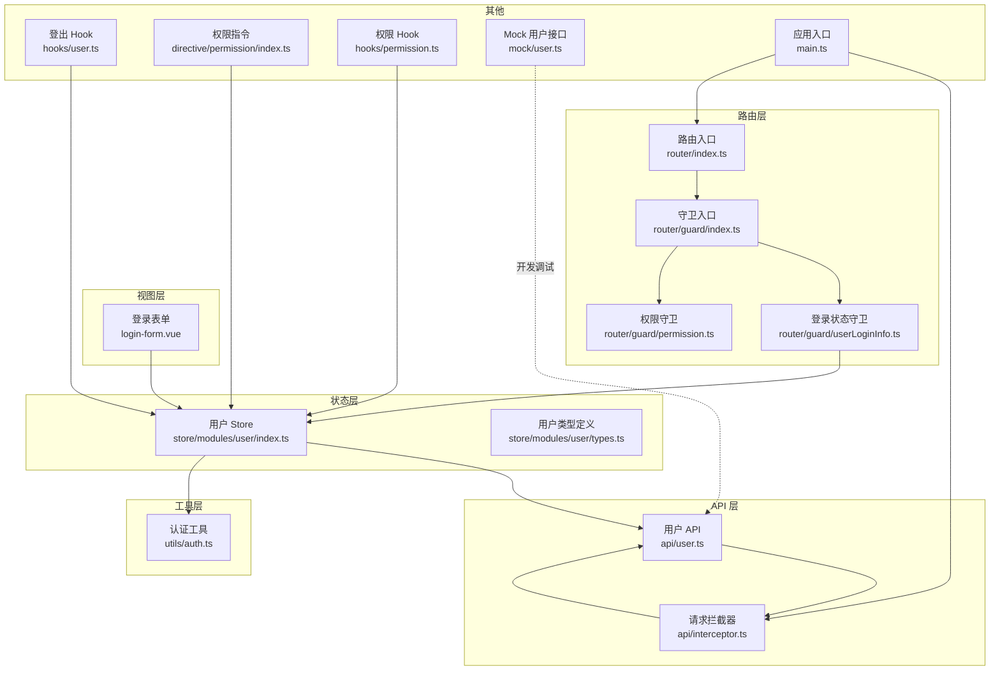
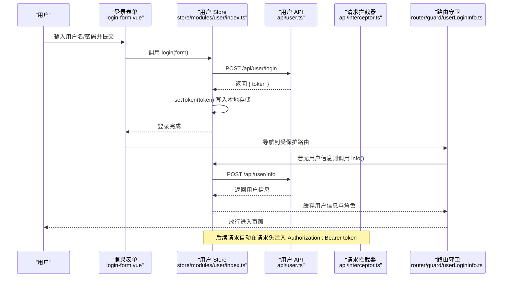
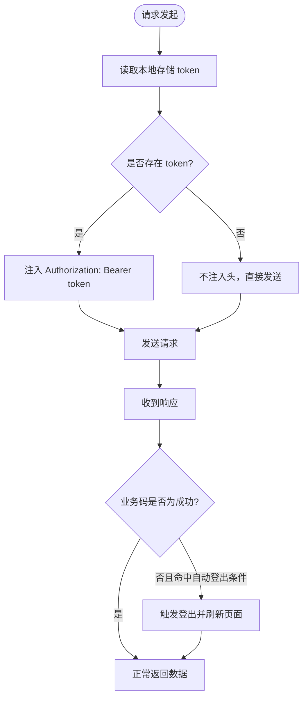
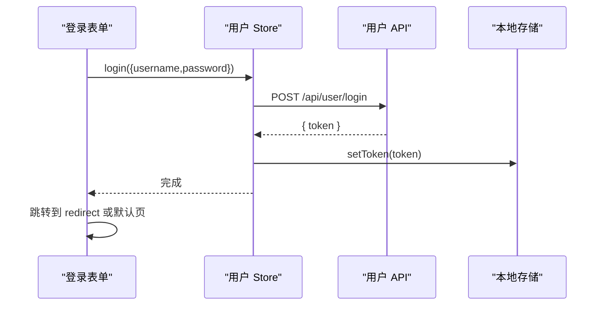
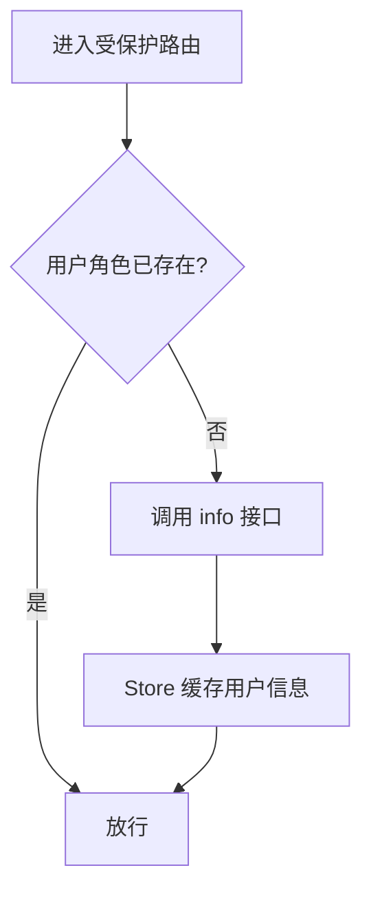
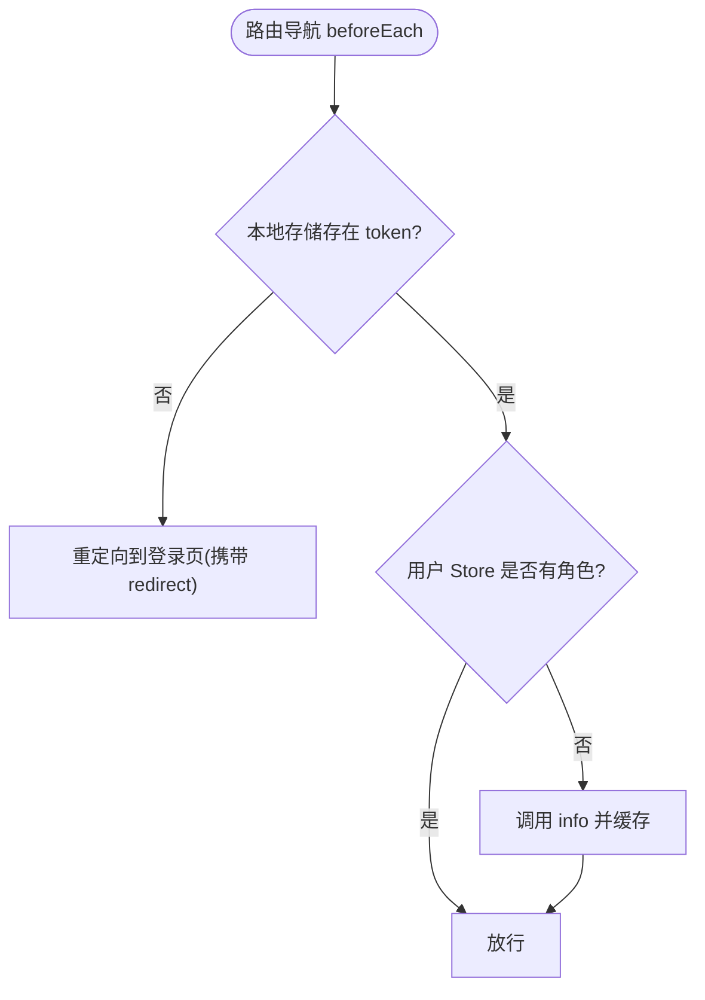
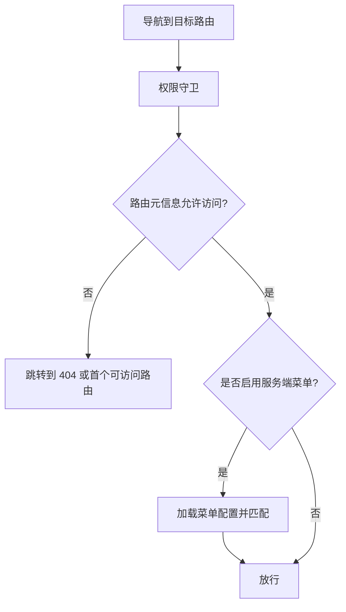
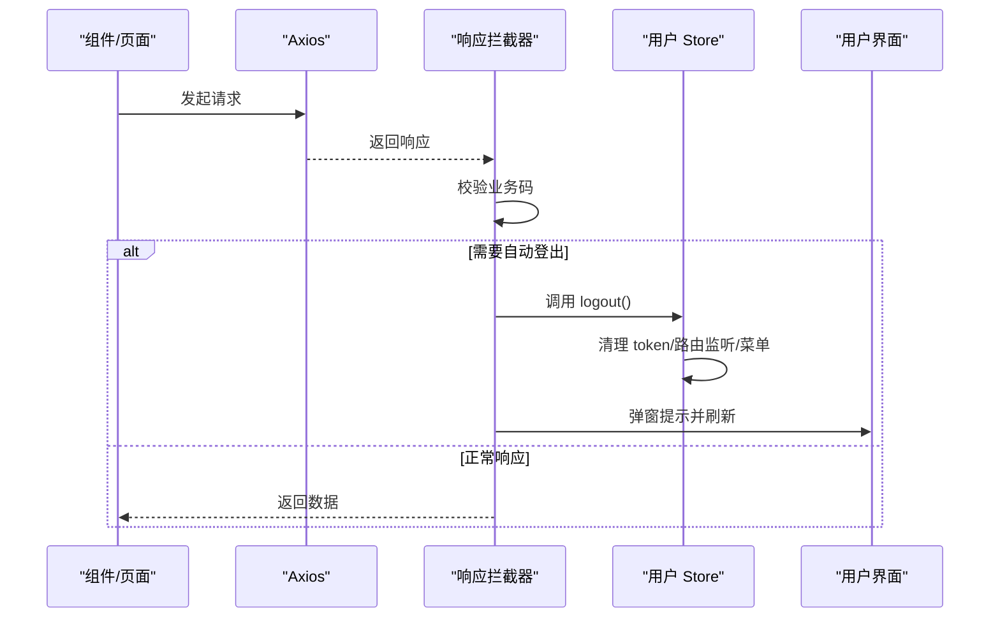
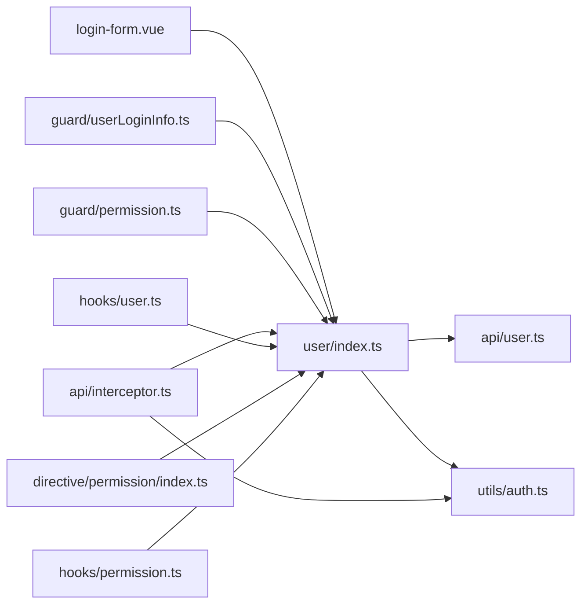

# 用户认证

<cite>
**本文引用的文件**
- [src/utils/auth.ts](file://src/utils/auth.ts)
- [src/api/user.ts](file://src/api/user.ts)
- [src/store/modules/user/index.ts](file://src/store/modules/user/index.ts)
- [src/store/modules/user/types.ts](file://src/store/modules/user/types.ts)
- [src/views/login/components/login-form.vue](file://src/views/login/components/login-form.vue)
- [src/router/guard/userLoginInfo.ts](file://src/router/guard/userLoginInfo.ts)
- [src/router/guard/permission.ts](file://src/router/guard/permission.ts)
- [src/router/guard/index.ts](file://src/router/guard/index.ts)
- [src/router/index.ts](file://src/router/index.ts)
- [src/api/interceptor.ts](file://src/api/interceptor.ts)
- [src/hooks/user.ts](file://src/hooks/user.ts)
- [src/directive/permission/index.ts](file://src/directive/permission/index.ts)
- [src/hooks/permission.ts](file://src/hooks/permission.ts)
- [src/mock/user.ts](file://src/mock/user.ts)
- [src/main.ts](file://src/main.ts)
</cite>

## 目录
1. [简介](#简介)
2. [项目结构](#项目结构)
3. [核心组件](#核心组件)
4. [架构总览](#架构总览)
5. [详细组件分析](#详细组件分析)
6. [依赖关系分析](#依赖关系分析)
7. [性能考虑](#性能考虑)
8. [故障排查指南](#故障排查指南)
9. [结论](#结论)
10. [附录](#附录)

## 简介
本文件面向“用户认证系统”的实现与使用，围绕以下目标展开：  
- JWT Token 的生成、存储与携带（请求头中以 Bearer 方式携带）  
- 登录流程：用户名/密码校验、登录状态管理、会话保持  
- 用户信息获取、缓存与更新策略  
- 认证状态检测与登录守卫（路由前置守卫）  
- 自动登出与错误恢复机制（基于响应拦截器中的业务码判断）  
- 权限控制与登录后的页面访问控制  

说明：当前实现采用本地存储保存 token，未在前端实现 token 刷新；路由守卫会在进入受保护路由时拉取用户信息并缓存到 Pinia Store 中。

## 项目结构
认证相关模块主要分布在如下位置：
- 工具层：token 存取工具
- API 层：登录、登出、获取用户信息、菜单接口
- 状态层：Pinia 用户 Store（用户信息、角色、登录动作）
- 视图层：登录表单组件
- 路由层：路由守卫（登录状态与权限）
- 请求拦截层：统一注入 Authorization 头、错误处理与自动登出
- 指令与 Hook：权限指令、登出 Hook

图表来源
- [src/views/login/components/login-form.vue:1-166](file://src/views/login/components/login-form.vue#L1-L166)
- [src/store/modules/user/index.ts:1-92](file://src/store/modules/user/index.ts#L1-L92)
- [src/store/modules/user/types.ts:1-20](file://src/store/modules/user/types.ts#L1-L20)
- [src/api/user.ts:1-28](file://src/api/user.ts#L1-L28)
- [src/api/interceptor.ts:1-78](file://src/api/interceptor.ts#L1-L78)
- [src/router/index.ts:1-37](file://src/router/index.ts#L1-L37)
- [src/router/guard/index.ts:1-18](file://src/router/guard/index.ts#L1-L18)
- [src/router/guard/userLoginInfo.ts:1-44](file://src/router/guard/userLoginInfo.ts#L1-L44)
- [src/router/guard/permission.ts:1-56](file://src/router/guard/permission.ts#L1-L56)
- [src/utils/auth.ts:1-20](file://src/utils/auth.ts#L1-L20)
- [src/hooks/user.ts:1-25](file://src/hooks/user.ts#L1-L25)
- [src/directive/permission/index.ts:1-31](file://src/directive/permission/index.ts#L1-L31)
- [src/hooks/permission.ts:1-34](file://src/hooks/permission.ts#L1-L34)
- [src/mock/user.ts:1-106](file://src/mock/user.ts#L1-L106)
- [src/main.ts:1-29](file://src/main.ts#L1-L29)

章节来源
- [src/main.ts:1-29](file://src/main.ts#L1-L29)
- [src/router/index.ts:1-37](file://src/router/index.ts#L1-L37)
- [src/router/guard/index.ts:1-18](file://src/router/guard/index.ts#L1-L18)

## 核心组件
- 认证工具（token 存取）：封装了本地存储的 token 读写与存在性判断，供拦截器与 Store 使用
- 用户 Store：负责登录、登出、拉取用户信息、设置/重置用户信息、角色切换等
- 用户 API：封装登录、登出、获取用户信息、菜单等接口
- 登录表单：收集用户名/密码，触发 Store 登录，跳转至重定向地址或默认页
- 路由守卫：登录状态守卫（进入受保护路由时拉取用户信息并缓存）、权限守卫（根据角色与路由元信息控制访问）
- 请求拦截器：统一注入 Authorization 头，按业务码处理错误并触发自动登出
- 权限指令与 Hook：用于 DOM 层面的权限控制与路由权限判定

章节来源
- [src/utils/auth.ts:1-20](file://src/utils/auth.ts#L1-L20)
- [src/store/modules/user/index.ts:1-92](file://src/store/modules/user/index.ts#L1-L92)
- [src/api/user.ts:1-28](file://src/api/user.ts#L1-L28)
- [src/views/login/components/login-form.vue:1-166](file://src/views/login/components/login-form.vue#L1-L166)
- [src/router/guard/userLoginInfo.ts:1-44](file://src/router/guard/userLoginInfo.ts#L1-L44)
- [src/router/guard/permission.ts:1-56](file://src/router/guard/permission.ts#L1-L56)
- [src/api/interceptor.ts:1-78](file://src/api/interceptor.ts#L1-L78)
- [src/directive/permission/index.ts:1-31](file://src/directive/permission/index.ts#L1-L31)
- [src/hooks/permission.ts:1-34](file://src/hooks/permission.ts#L1-L34)

## 架构总览
下图展示了从用户提交登录到路由守卫拉取用户信息、再到请求拦截器统一注入 token 的整体流程。

图表来源
- [src/views/login/components/login-form.vue:93-125](file://src/views/login/components/login-form.vue#L93-L125)
- [src/store/modules/user/index.ts:64-87](file://src/store/modules/user/index.ts#L64-L87)
- [src/api/user.ts:13-23](file://src/api/user.ts#L13-L23)
- [src/api/interceptor.ts:18-37](file://src/api/interceptor.ts#L18-L37)
- [src/router/guard/userLoginInfo.ts:8-28](file://src/router/guard/userLoginInfo.ts#L8-L28)

## 详细组件分析

### JWT Token 的生成、存储与验证机制
- 生成与存储
  - 登录成功后，后端返回 token，前端通过 Store 将 token 写入本地存储
  - 工具函数提供读取与清除能力，便于拦截器与登出流程使用
- 携带与验证
  - 请求拦截器在每次请求前读取本地存储的 token，并将其放入请求头 Authorization: Bearer ...
  - 响应拦截器根据业务码判断是否需要自动登出（如非法 token、其他客户端登录、token 过期等）

图表来源
- [src/utils/auth.ts:7-17](file://src/utils/auth.ts#L7-L17)
- [src/api/interceptor.ts:18-68](file://src/api/interceptor.ts#L18-L68)

章节来源
- [src/utils/auth.ts:1-20](file://src/utils/auth.ts#L1-L20)
- [src/api/interceptor.ts:1-78](file://src/api/interceptor.ts#L1-L78)
- [src/store/modules/user/index.ts:64-87](file://src/store/modules/user/index.ts#L64-L87)

### 登录流程实现（用户名/密码验证、登录状态管理、会话保持）
- 表单层
  - 登录表单收集用户名/密码，调用 Store 的 login 方法
  - 成功后根据查询参数 redirect 或默认 Workplace 跳转
  - 可选记住密码，实际生产建议加密存储
- Store 层
  - login：调用登录 API，成功后写入 token
  - info：调用获取用户信息 API，将结果合并到 Store
  - logout：调用登出 API，最终清理 token、路由监听与菜单
- 会话保持
  - 通过本地存储 token 实现跨页面会话保持
  - 路由守卫在进入受保护路由时若发现无用户信息，则主动拉取并缓存

图表来源
- [src/views/login/components/login-form.vue:93-125](file://src/views/login/components/login-form.vue#L93-L125)
- [src/store/modules/user/index.ts:64-87](file://src/store/modules/user/index.ts#L64-L87)
- [src/api/user.ts:13-15](file://src/api/user.ts#L13-L15)

章节来源
- [src/views/login/components/login-form.vue:1-166](file://src/views/login/components/login-form.vue#L1-L166)
- [src/store/modules/user/index.ts:1-92](file://src/store/modules/user/index.ts#L1-L92)
- [src/api/user.ts:1-28](file://src/api/user.ts#L1-L28)

### 用户信息的获取、缓存与更新策略
- 获取与缓存
  - 首次进入受保护路由时，若用户 Store 中无角色信息，守卫会调用 info 接口拉取用户信息并缓存
  - 用户信息包含基础资料、角色等，Store 提供 setInfo/resetInfo 动作用于更新与重置
- 更新策略
  - 当前实现未提供定时刷新或后台轮询；建议在需要实时信息的场景引入轮询或 WebSocket
  - 登出时统一清理用户信息与本地 token

图表来源
- [src/router/guard/userLoginInfo.ts:11-28](file://src/router/guard/userLoginInfo.ts#L11-L28)
- [src/store/modules/user/index.ts:57-61](file://src/store/modules/user/index.ts#L57-L61)

章节来源
- [src/router/guard/userLoginInfo.ts:1-44](file://src/router/guard/userLoginInfo.ts#L1-L44)
- [src/store/modules/user/index.ts:1-92](file://src/store/modules/user/index.ts#L1-L92)

### 认证状态检测与登录守卫
- 认证状态检测
  - 通过工具函数检测本地存储是否存在 token，作为“是否已登录”的依据
- 登录守卫
  - 若已登录但无用户信息：拉取并缓存
  - 若已登录且有用户信息：直接放行
  - 若未登录：重定向到登录页，并携带当前路由名作为 redirect 参数
  - 守卫在路由导航 beforeEach 中执行，确保所有受保护路由均经过校验

图表来源
- [src/router/guard/userLoginInfo.ts:8-42](file://src/router/guard/userLoginInfo.ts#L8-L42)
- [src/utils/auth.ts:3-5](file://src/utils/auth.ts#L3-L5)

章节来源
- [src/router/guard/userLoginInfo.ts:1-44](file://src/router/guard/userLoginInfo.ts#L1-L44)
- [src/utils/auth.ts:1-20](file://src/utils/auth.ts#L1-L20)

### 权限控制与登录后的页面访问控制
- 权限守卫
  - 根据路由元信息中的 requiresAuth 与 roles 控制访问
  - 支持服务端动态菜单场景：当启用服务端菜单时，先加载菜单配置再匹配目标路由
- 权限指令
  - v-permission 指令用于在 DOM 层面隐藏/显示元素，基于用户角色判断
- 权限 Hook
  - 提供 accessRouter 与 findFirstPermissionRoute 等方法，辅助路由与页面的权限判定

图表来源
- [src/router/guard/permission.ts:9-54](file://src/router/guard/permission.ts#L9-L54)
- [src/directive/permission/index.ts:4-30](file://src/directive/permission/index.ts#L4-L30)
- [src/hooks/permission.ts:7-32](file://src/hooks/permission.ts#L7-L32)

章节来源
- [src/router/guard/permission.ts:1-56](file://src/router/guard/permission.ts#L1-L56)
- [src/directive/permission/index.ts:1-31](file://src/directive/permission/index.ts#L1-L31)
- [src/hooks/permission.ts:1-34](file://src/hooks/permission.ts#L1-L34)

### 自动登出与错误恢复机制
- 错误恢复
  - 响应拦截器根据业务码判断是否触发自动登出（如非法 token、其他客户端登录、token 过期）
  - 弹窗提示后，清空用户状态、token，并刷新页面
- 登出 Hook
  - 提供统一的登出入口，登出后推送回登录页并携带当前路由名

图表来源
- [src/api/interceptor.ts:39-77](file://src/api/interceptor.ts#L39-L77)
- [src/store/modules/user/index.ts:73-87](file://src/store/modules/user/index.ts#L73-L87)
- [src/hooks/user.ts:9-20](file://src/hooks/user.ts#L9-L20)

章节来源
- [src/api/interceptor.ts:1-78](file://src/api/interceptor.ts#L1-L78)
- [src/store/modules/user/index.ts:1-92](file://src/store/modules/user/index.ts#L1-L92)
- [src/hooks/user.ts:1-25](file://src/hooks/user.ts#L1-L25)

## 依赖关系分析
- 组件耦合
  - 登录表单依赖用户 Store；用户 Store 依赖用户 API 与认证工具
  - 路由守卫依赖用户 Store 与认证工具；权限守卫依赖用户 Store 与路由配置
  - 请求拦截器依赖认证工具与用户 Store，用于自动登出
- 外部依赖
  - axios 用于网络请求
  - vue-router 用于路由与守卫
  - pinia 用于状态管理
  - @arco-design/web-vue 用于 UI 与消息/模态框

图表来源
- [src/views/login/components/login-form.vue:73-104](file://src/views/login/components/login-form.vue#L73-L104)
- [src/store/modules/user/index.ts:1-92](file://src/store/modules/user/index.ts#L1-L92)
- [src/api/user.ts:1-28](file://src/api/user.ts#L1-L28)
- [src/utils/auth.ts:1-20](file://src/utils/auth.ts#L1-L20)
- [src/router/guard/userLoginInfo.ts:1-44](file://src/router/guard/userLoginInfo.ts#L1-L44)
- [src/router/guard/permission.ts:1-56](file://src/router/guard/permission.ts#L1-L56)
- [src/api/interceptor.ts:1-78](file://src/api/interceptor.ts#L1-L78)
- [src/hooks/user.ts:1-25](file://src/hooks/user.ts#L1-L25)
- [src/directive/permission/index.ts:1-31](file://src/directive/permission/index.ts#L1-L31)
- [src/hooks/permission.ts:1-34](file://src/hooks/permission.ts#L1-L34)

章节来源
- [src/main.ts:1-29](file://src/main.ts#L1-L29)
- [src/router/index.ts:1-37](file://src/router/index.ts#L1-L37)
- [src/router/guard/index.ts:1-18](file://src/router/guard/index.ts#L1-L18)

## 性能考虑
- 减少重复请求：路由守卫仅在首次进入受保护路由时拉取用户信息，后续复用 Store 中缓存
- 请求头注入开销小：仅在存在 token 时注入，避免不必要的头部处理
- 权限判定：路由守卫与指令均基于用户角色快速判断，复杂度低
- 建议优化
  - 对频繁变更的信息引入轮询或长连接，避免强依赖页面刷新
  - 在高并发场景下，考虑对登录接口增加防抖与幂等设计

## 故障排查指南
- 登录后仍被重定向到登录页
  - 检查登录接口是否正确返回 token
  - 确认 Store 是否成功写入 token
  - 查看路由守卫是否抛错导致回退
- 进入受保护路由报错或立即登出
  - 检查响应拦截器业务码映射，确认是否命中自动登出条件
  - 确认 token 是否被正确注入到请求头
- 权限页面无法访问
  - 检查路由元信息中的 roles 配置与用户角色是否匹配
  - 若启用服务端菜单，确认菜单加载顺序与匹配逻辑
- 登出后页面未刷新
  - 确认自动登出流程是否执行（弹窗与 reload）
  - 检查 Store 的清理逻辑是否完整

章节来源
- [src/api/interceptor.ts:39-77](file://src/api/interceptor.ts#L39-L77)
- [src/router/guard/userLoginInfo.ts:11-28](file://src/router/guard/userLoginInfo.ts#L11-L28)
- [src/router/guard/permission.ts:9-54](file://src/router/guard/permission.ts#L9-L54)
- [src/store/modules/user/index.ts:73-87](file://src/store/modules/user/index.ts#L73-L87)

## 结论
该认证系统采用“本地存储 token + 请求拦截器注入 + 路由守卫校验”的轻量方案，具备以下特点：
- 易于理解与扩展：职责清晰，模块边界明确
- 基础功能完备：登录、登出、用户信息缓存、权限控制、自动登出
- 可维护性强：统一的拦截器与守卫入口，便于集中治理

建议在生产环境中补充：
- token 刷新策略（短期 token + 刷新令牌）
- 更严格的错误分类与用户提示
- 会话超时与心跳保活机制
- 更细粒度的权限控制与审计日志

## 附录
- 开发调试：Mock 用户接口提供登录、登出、用户信息与菜单的模拟数据，便于本地联调
- 应用入口：主应用挂载时注册路由、状态、国际化、指令与拦截器，确保认证链路生效

章节来源
- [src/mock/user.ts:1-106](file://src/mock/user.ts#L1-L106)
- [src/main.ts:1-29](file://src/main.ts#L1-L29)