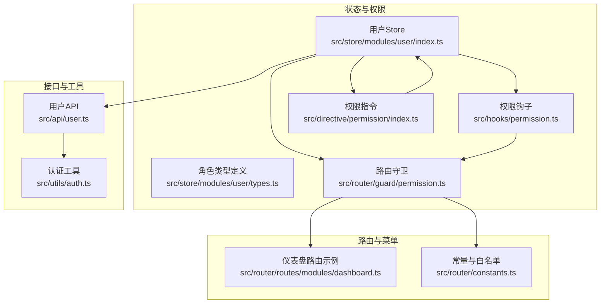
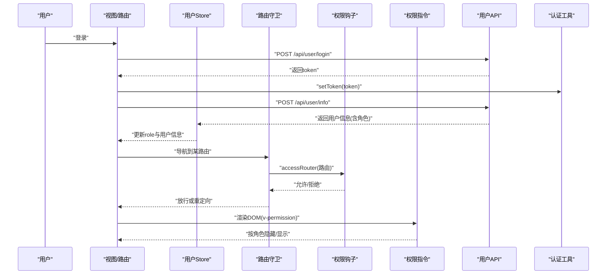
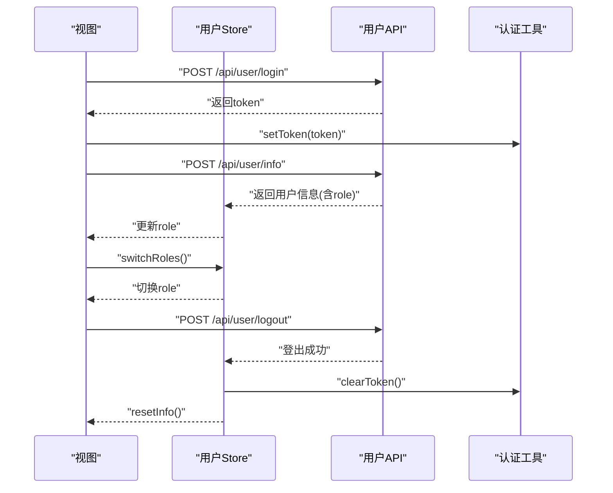
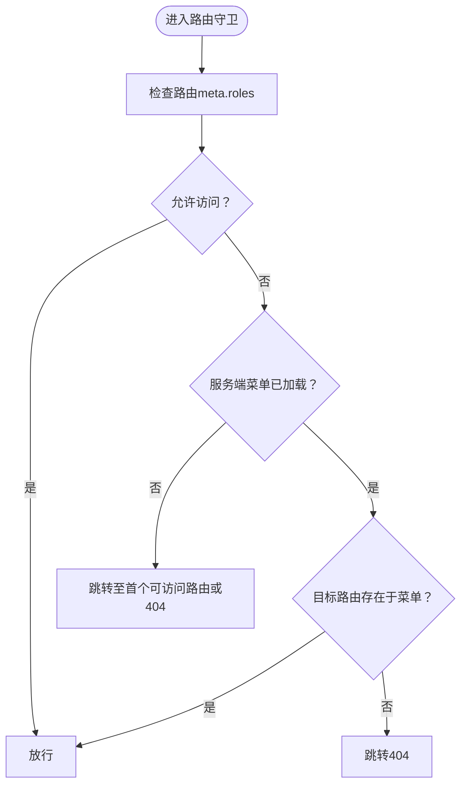
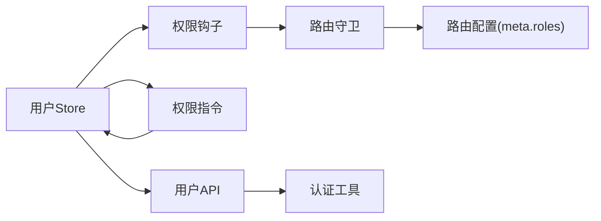

# 角色管理

<cite>
**本文引用的文件**
- [src/store/modules/user/index.ts](file://src/store/modules/user/index.ts)
- [src/store/modules/user/types.ts](file://src/store/modules/user/types.ts)
- [src/hooks/permission.ts](file://src/hooks/permission.ts)
- [src/directive/permission/index.ts](file://src/directive/permission/index.ts)
- [src/router/guard/permission.ts](file://src/router/guard/permission.ts)
- [src/api/user.ts](file://src/api/user.ts)
- [src/utils/auth.ts](file://src/utils/auth.ts)
- [src/router/routes/modules/dashboard.ts](file://src/router/routes/modules/dashboard.ts)
- [src/hooks/user.ts](file://src/hooks/user.ts)
- [src/router/constants.ts](file://src/router/constants.ts)
</cite>

## 目录
1. [简介](#简介)
2. [项目结构](#项目结构)
3. [核心组件](#核心组件)
4. [架构总览](#架构总览)
5. [详细组件分析](#详细组件分析)
6. [依赖分析](#依赖分析)
7. [性能考虑](#性能考虑)
8. [故障排查指南](#故障排查指南)
9. [结论](#结论)
10. [附录](#附录)

## 简介
本文件围绕前端角色管理系统进行深入解析，重点覆盖以下方面：
- 角色模型设计：角色类型定义、角色属性与状态管理
- 角色层级与多角色支持：当前实现为单角色模型，支持角色切换
- 权限分配与管理：基于路由元信息的角色访问控制与指令级权限控制
- 权限继承与通配符规则：使用通配符“*”实现超级权限
- admin 超级管理员角色：特殊权限与限制说明
- 角色变更处理与权限同步：登录态、路由守卫与菜单动态加载
- 数据结构与状态管理策略：Pinia Store、用户信息与令牌持久化

## 项目结构
该角色管理能力由多个模块协同完成：
- 用户状态管理：Pinia Store 中的用户模块负责角色状态与用户信息
- 权限钩子：提供路由访问判断与首个可访问路由查找
- 权限指令：在模板层面按角色隐藏/显示元素
- 路由守卫：根据角色与路由元信息决定是否放行
- API 层：登录、登出、获取用户信息与菜单
- 工具层：令牌存储与读取
- 路由配置：通过 meta.roles 定义角色可见性



图表来源
- [src/store/modules/user/index.ts:1-92](file://src/store/modules/user/index.ts#L1-L92)
- [src/store/modules/user/types.ts:1-20](file://src/store/modules/user/types.ts#L1-L20)
- [src/hooks/permission.ts:1-34](file://src/hooks/permission.ts#L1-L34)
- [src/directive/permission/index.ts:1-31](file://src/directive/permission/index.ts#L1-L31)
- [src/router/guard/permission.ts:1-56](file://src/router/guard/permission.ts#L1-L56)
- [src/api/user.ts:1-28](file://src/api/user.ts#L1-L28)
- [src/utils/auth.ts:1-20](file://src/utils/auth.ts#L1-L20)
- [src/router/routes/modules/dashboard.ts:1-29](file://src/router/routes/modules/dashboard.ts#L1-L29)
- [src/router/constants.ts:1-19](file://src/router/constants.ts#L1-L19)

章节来源
- [src/store/modules/user/index.ts:1-92](file://src/store/modules/user/index.ts#L1-L92)
- [src/store/modules/user/types.ts:1-20](file://src/store/modules/user/types.ts#L1-L20)
- [src/hooks/permission.ts:1-34](file://src/hooks/permission.ts#L1-L34)
- [src/directive/permission/index.ts:1-31](file://src/directive/permission/index.ts#L1-L31)
- [src/router/guard/permission.ts:1-56](file://src/router/guard/permission.ts#L1-L56)
- [src/api/user.ts:1-28](file://src/api/user.ts#L1-L28)
- [src/utils/auth.ts:1-20](file://src/utils/auth.ts#L1-L20)
- [src/router/routes/modules/dashboard.ts:1-29](file://src/router/routes/modules/dashboard.ts#L1-L29)
- [src/router/constants.ts:1-19](file://src/router/constants.ts#L1-L19)

## 核心组件
- 用户状态与角色
  - 用户 Store 提供角色字段与角色切换动作；用户信息通过 API 获取并持久化到 Store
  - 角色类型支持空串、通配符、admin 与 user 四种值
- 权限钩子
  - 判断路由是否允许当前角色访问；提供首个可访问路由查找能力
- 权限指令
  - 在模板中按角色隐藏 DOM 元素，未授权时直接移除节点
- 路由守卫
  - 结合权限钩子与服务端菜单配置，决定放行或跳转至无权限目标
- API 与认证
  - 登录设置令牌，登出清理令牌与路由监听；用户信息与菜单通过 API 拉取
- 路由与菜单
  - 通过 meta.roles 控制路由可见性；通配符“*”代表所有角色可访问

章节来源
- [src/store/modules/user/index.ts:39-45](file://src/store/modules/user/index.ts#L39-L45)
- [src/store/modules/user/types.ts:1-20](file://src/store/modules/user/types.ts#L1-L20)
- [src/hooks/permission.ts:7-14](file://src/hooks/permission.ts#L7-L14)
- [src/directive/permission/index.ts:4-21](file://src/directive/permission/index.ts#L4-L21)
- [src/router/guard/permission.ts:9-55](file://src/router/guard/permission.ts#L9-L55)
- [src/api/user.ts:13-27](file://src/api/user.ts#L13-L27)
- [src/utils/auth.ts:11-17](file://src/utils/auth.ts#L11-L17)
- [src/router/routes/modules/dashboard.ts:22](file://src/router/routes/modules/dashboard.ts#L22)

## 架构总览
下图展示从用户操作到权限生效的关键流程：登录设置令牌 → 获取用户信息 → 设置角色 → 路由守卫与权限指令生效。



图表来源
- [src/store/modules/user/index.ts:64-87](file://src/store/modules/user/index.ts#L64-L87)
- [src/hooks/permission.ts:7-14](file://src/hooks/permission.ts#L7-L14)
- [src/directive/permission/index.ts:24-30](file://src/directive/permission/index.ts#L24-L30)
- [src/router/guard/permission.ts:10-54](file://src/router/guard/permission.ts#L10-L54)
- [src/api/user.ts:13-23](file://src/api/user.ts#L13-L23)
- [src/utils/auth.ts:11-17](file://src/utils/auth.ts#L11-L17)

## 详细组件分析

### 角色模型与数据结构
- 角色类型
  - 支持空串、通配符、admin、user 四个值，用于表示未登录、超级权限与两类普通角色
- 用户状态
  - 包含基础用户信息与 role 字段；role 默认为空串
- 角色切换
  - 提供 switchRoles 动作，在 user 与 admin 之间切换
- 多角色支持
  - 当前 Store 的 role 为单一值；如需多角色，建议扩展为数组并在权限判断处统一处理

```mermaid
classDiagram
class RoleType {
"+'' | '*' | 'admin' | 'user'"
}
class UserState {
"+name? : string"
"+avatar? : string"
"+job? : string"
"+organization? : string"
"+location? : string"
"+email? : string"
"+introduction? : string"
"+personalWebsite? : string"
"+jobName? : string"
"+organizationName? : string"
"+locationName? : string"
"+phone? : string"
"+registrationDate? : string"
"+accountId? : string"
"+certification? : number"
"+role : RoleType"
}
class UserStore {
"+state : UserState"
"+switchRoles() : Promise<string>"
"+setInfo(partial)"
"+resetInfo()"
"+info()"
"+login(loginForm)"
"+logout()"
}
UserStore --> UserState : "管理"
UserState --> RoleType : "使用"
```

图表来源
- [src/store/modules/user/types.ts:1-20](file://src/store/modules/user/types.ts#L1-L20)
- [src/store/modules/user/index.ts:14-31](file://src/store/modules/user/index.ts#L14-L31)
- [src/store/modules/user/index.ts:40-45](file://src/store/modules/user/index.ts#L40-L45)

章节来源
- [src/store/modules/user/types.ts:1-20](file://src/store/modules/user/types.ts#L1-L20)
- [src/store/modules/user/index.ts:14-31](file://src/store/modules/user/index.ts#L14-L31)
- [src/store/modules/user/index.ts:40-45](file://src/store/modules/user/index.ts#L40-L45)

### 角色与用户关联关系
- 登录后通过 API 获取用户信息，其中包含角色字段；随后更新 Store 中的 role
- 登出时清理令牌与路由监听，重置用户信息
- 角色切换仅在前端切换当前角色，不涉及后端角色变更



图表来源
- [src/store/modules/user/index.ts:64-87](file://src/store/modules/user/index.ts#L64-L87)
- [src/api/user.ts:13-23](file://src/api/user.ts#L13-L23)
- [src/utils/auth.ts:11-17](file://src/utils/auth.ts#L11-L17)

章节来源
- [src/store/modules/user/index.ts:57-61](file://src/store/modules/user/index.ts#L57-L61)
- [src/store/modules/user/index.ts:73-87](file://src/store/modules/user/index.ts#L73-L87)
- [src/api/user.ts:21-23](file://src/api/user.ts#L21-L23)
- [src/utils/auth.ts:11-17](file://src/utils/auth.ts#L11-L17)

### 权限分配与管理（路由与指令）
- 路由元信息控制
  - 路由 meta.roles 定义允许访问的角色列表；通配符“*”表示所有角色可访问
- 权限钩子
  - accessRouter 判断当前路由是否允许当前角色访问
  - findFirstPermissionRoute 查找第一个对指定角色开放的路由
- 权限指令
  - v-permission 接收角色数组，若当前角色不在数组内则移除对应 DOM 节点
- 路由守卫
  - 结合权限钩子与服务端菜单配置，决定放行或跳转至无权限目标



图表来源
- [src/hooks/permission.ts:7-14](file://src/hooks/permission.ts#L7-L14)
- [src/router/guard/permission.ts:10-54](file://src/router/guard/permission.ts#L10-L54)
- [src/router/routes/modules/dashboard.ts:22](file://src/router/routes/modules/dashboard.ts#L22)

章节来源
- [src/hooks/permission.ts:7-14](file://src/hooks/permission.ts#L7-L14)
- [src/directive/permission/index.ts:4-21](file://src/directive/permission/index.ts#L4-L21)
- [src/router/guard/permission.ts:10-54](file://src/router/guard/permission.ts#L10-L54)
- [src/router/routes/modules/dashboard.ts:22](file://src/router/routes/modules/dashboard.ts#L22)

### admin 超级管理员角色
- 通配符“*”
  - 在路由 meta.roles 中使用“*”可使该路由对所有角色开放
- 角色切换
  - 当前实现中，admin 与 user 可通过 switchRoles 在前端切换
- 实践建议
  - 若需更强的 admin 权限控制，可在业务层引入更细粒度的权限点并通过指令或钩子进行二次校验

章节来源
- [src/store/modules/user/types.ts:1](file://src/store/modules/user/types.ts#L1)
- [src/hooks/permission.ts:11](file://src/hooks/permission.ts#L11)
- [src/store/modules/user/index.ts:40-45](file://src/store/modules/user/index.ts#L40-L45)

### 角色变更处理与权限同步
- 登录流程
  - 登录成功设置令牌，随后拉取用户信息并更新角色
- 角色切换
  - 前端切换角色后，后续路由守卫与指令会立即反映新角色
- 登出流程
  - 清理令牌、路由监听与用户信息，避免角色泄露

章节来源
- [src/store/modules/user/index.ts:64-87](file://src/store/modules/user/index.ts#L64-L87)
- [src/utils/auth.ts:11-17](file://src/utils/auth.ts#L11-L17)
- [src/hooks/user.ts:9-20](file://src/hooks/user.ts#L9-L20)

## 依赖分析
- 组件耦合
  - 用户 Store 是权限体系的核心，被权限钩子、权限指令与路由守卫共同依赖
  - 路由守卫依赖权限钩子与服务端菜单配置
  - 权限指令依赖用户 Store 的 role
- 外部依赖
  - API 层提供登录、登出、用户信息与菜单接口
  - 认证工具提供令牌的本地存储与读取



图表来源
- [src/store/modules/user/index.ts:1-92](file://src/store/modules/user/index.ts#L1-L92)
- [src/hooks/permission.ts:1-34](file://src/hooks/permission.ts#L1-L34)
- [src/directive/permission/index.ts:1-31](file://src/directive/permission/index.ts#L1-L31)
- [src/router/guard/permission.ts:1-56](file://src/router/guard/permission.ts#L1-L56)
- [src/router/routes/modules/dashboard.ts:1-29](file://src/router/routes/modules/dashboard.ts#L1-L29)
- [src/api/user.ts:1-28](file://src/api/user.ts#L1-L28)
- [src/utils/auth.ts:1-20](file://src/utils/auth.ts#L1-L20)

章节来源
- [src/store/modules/user/index.ts:1-92](file://src/store/modules/user/index.ts#L1-L92)
- [src/hooks/permission.ts:1-34](file://src/hooks/permission.ts#L1-L34)
- [src/directive/permission/index.ts:1-31](file://src/directive/permission/index.ts#L1-L31)
- [src/router/guard/permission.ts:1-56](file://src/router/guard/permission.ts#L1-L56)
- [src/router/routes/modules/dashboard.ts:1-29](file://src/router/routes/modules/dashboard.ts#L1-L29)
- [src/api/user.ts:1-28](file://src/api/user.ts#L1-L28)
- [src/utils/auth.ts:1-20](file://src/utils/auth.ts#L1-L20)

## 性能考虑
- 权限判断复杂度
  - 路由访问判断为 O(1)，指令判断为 O(n)（n 为传入角色数组长度），通常数组较小，影响有限
- 菜单动态加载
  - 服务端菜单配置首次加载后缓存于 Store，避免重复请求
- 建议
  - 对频繁使用的权限判断可做轻量缓存；对大型菜单可考虑懒加载与分页

## 故障排查指南
- 登录后仍提示无权限
  - 检查用户信息接口是否正确返回角色字段
  - 确认路由 meta.roles 是否包含当前角色或“*”
- 指令无效或元素未隐藏
  - 确认 v-permission 传入的是角色数组且当前角色在数组中
- 登出后仍可访问受限页面
  - 检查登出回调是否执行了令牌清理与路由监听移除
- 路由守卫未生效
  - 确认路由守卫已注册且权限钩子逻辑正常

章节来源
- [src/store/modules/user/index.ts:73-87](file://src/store/modules/user/index.ts#L73-L87)
- [src/directive/permission/index.ts:4-21](file://src/directive/permission/index.ts#L4-L21)
- [src/router/guard/permission.ts:10-54](file://src/router/guard/permission.ts#L10-L54)

## 结论
本系统采用“单角色 + 通配符”的简洁权限模型：通过路由 meta.roles 与权限钩子实现全局访问控制，通过 v-permission 指令实现局部 UI 控制。admin 与 user 两角色在前端可切换，配合“*”可灵活控制公共页面与私有页面。若需更复杂的权限体系（如多角色、权限点矩阵、继承规则），可在现有基础上扩展角色数组、引入细粒度权限点与权限树结构，并在权限钩子与指令中统一处理。

## 附录
- 角色类型定义参考：[RoleType](file://src/store/modules/user/types.ts#L1)
- 用户状态与角色切换参考：[UserStore:14-45](file://src/store/modules/user/index.ts#L14-L45)
- 路由权限判断参考：[accessRouter:7-14](file://src/hooks/permission.ts#L7-L14)
- 指令权限判断参考：[v-permission:4-21](file://src/directive/permission/index.ts#L4-L21)
- 路由守卫参考：[setupPermissionGuard:9-55](file://src/router/guard/permission.ts#L9-L55)
- 登录/登出/用户信息/菜单接口参考：[user API:13-27](file://src/api/user.ts#L13-L27)
- 令牌存储参考：[auth utils:11-17](file://src/utils/auth.ts#L11-L17)
- 路由示例（通配符）参考：[dashboard 路由](file://src/router/routes/modules/dashboard.ts#L22)
- 白名单与默认路由参考：[constants:1-19](file://src/router/constants.ts#L1-L19)