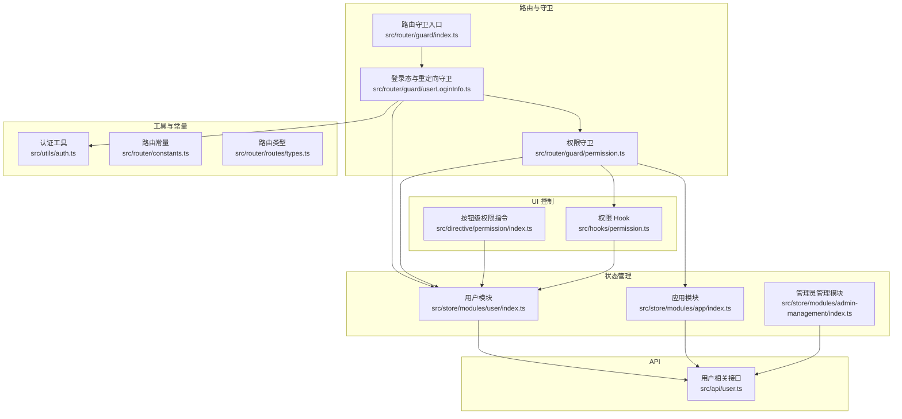
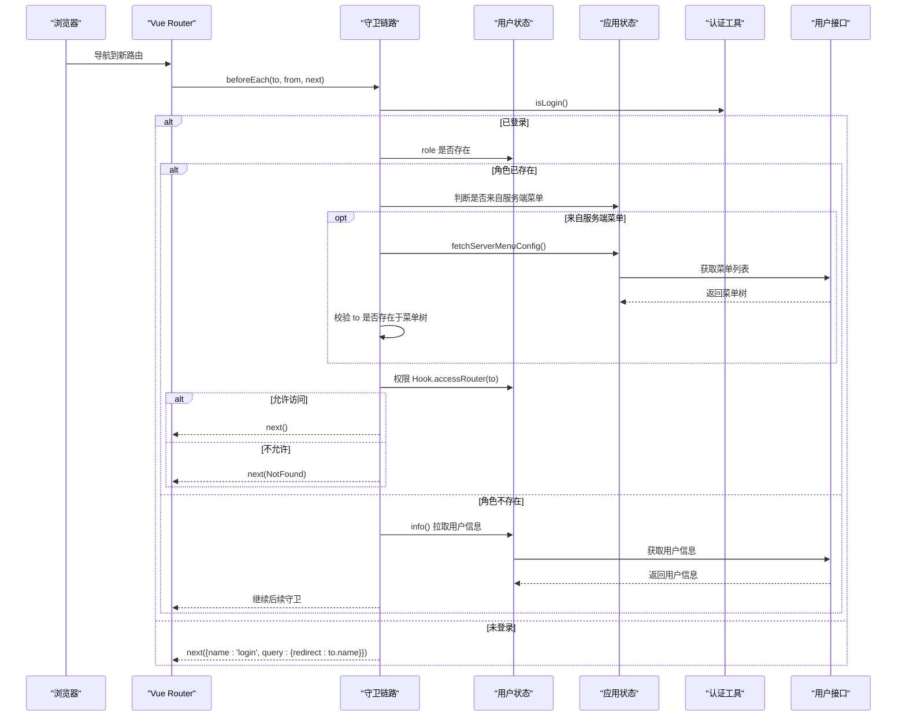
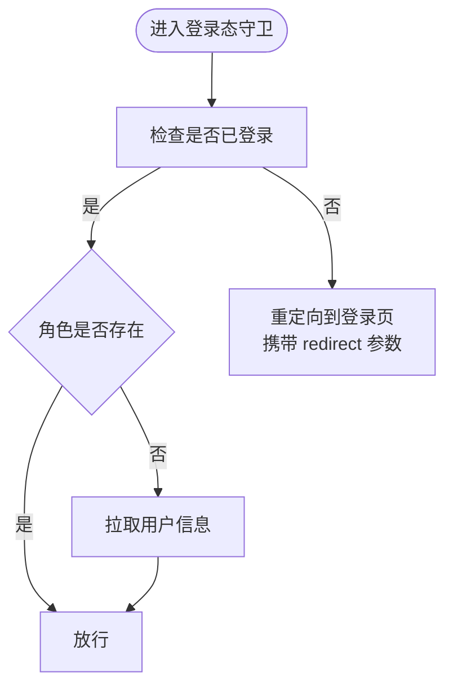
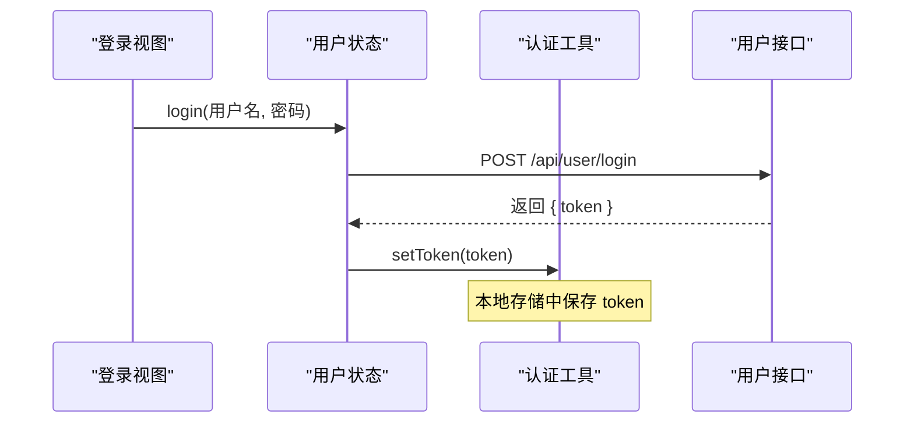
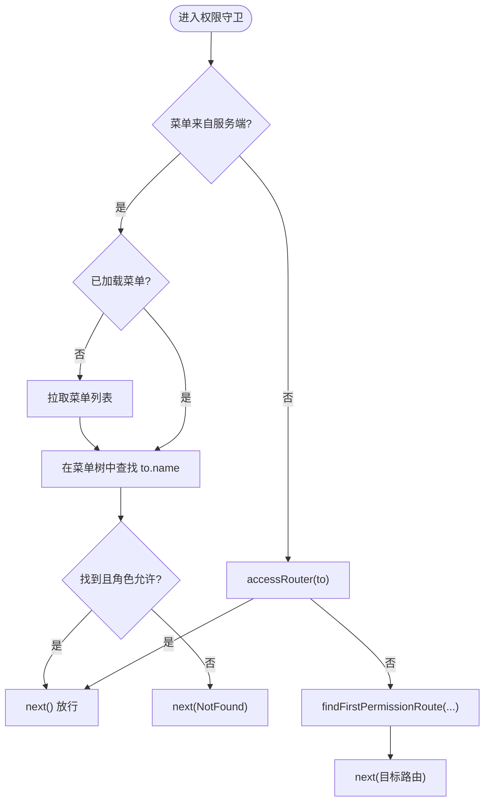
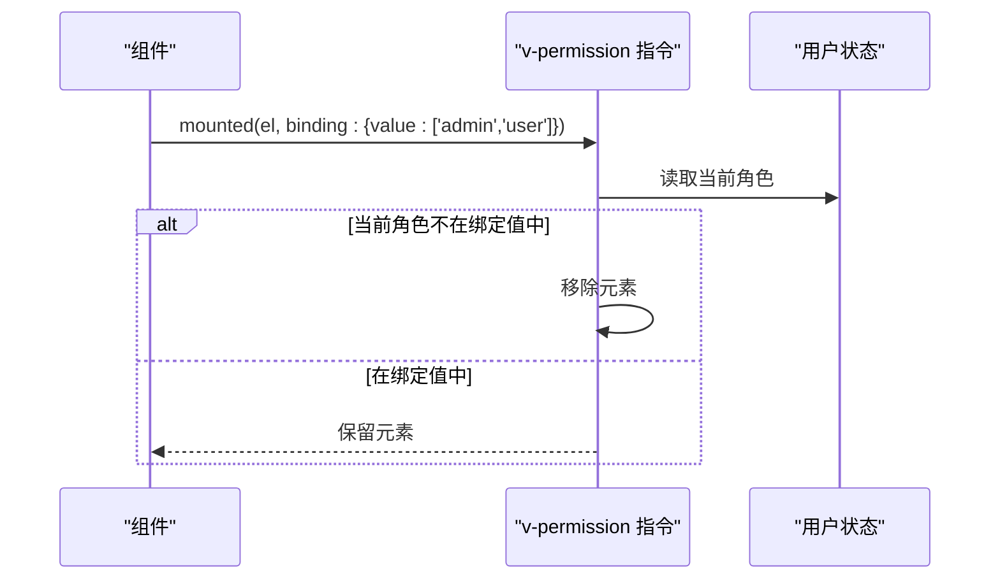
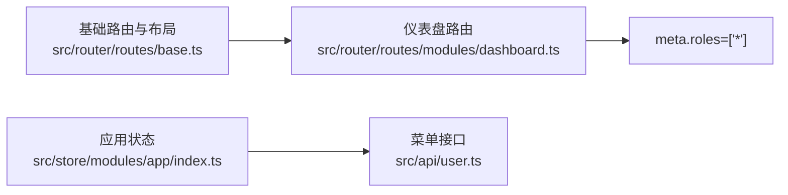
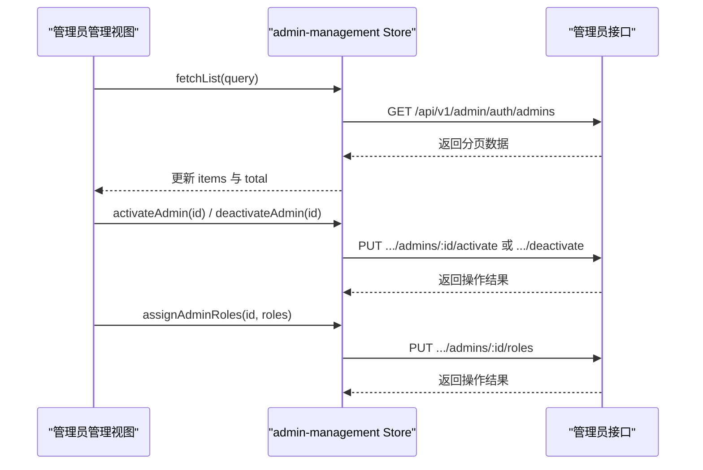
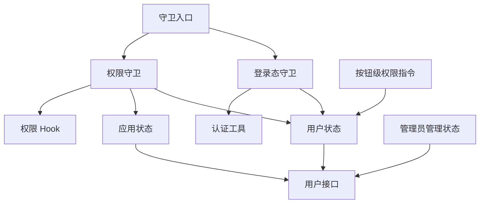

# 认证与权限

<cite>
**本文引用的文件**
- [src/router/guard/index.ts](file://src/router/guard/index.ts)
- [src/router/guard/permission.ts](file://src/router/guard/permission.ts)
- [src/router/guard/userLoginInfo.ts](file://src/router/guard/userLoginInfo.ts)
- [src/directive/permission/index.ts](file://src/directive/permission/index.ts)
- [src/hooks/permission.ts](file://src/hooks/permission.ts)
- [src/store/modules/user/index.ts](file://src/store/modules/user/index.ts)
- [src/utils/auth.ts](file://src/utils/auth.ts)
- [src/router/constants.ts](file://src/router/constants.ts)
- [src/router/routes/base.ts](file://src/router/routes/base.ts)
- [src/router/routes/types.ts](file://src/router/routes/types.ts)
- [src/store/modules/app/index.ts](file://src/store/modules/app/index.ts)
- [src/router/routes/modules/dashboard.ts](file://src/router/routes/modules/dashboard.ts)
- [src/store/modules/user/types.ts](file://src/store/modules/user/types.ts)
- [src/store/modules/app/types.ts](file://src/store/modules/app/types.ts)
- [src/api/user.ts](file://src/api/user.ts)
- [src/store/modules/admin-management/index.ts](file://src/store/modules/admin-management/index.ts)
</cite>

## 目录
1. [简介](#简介)
2. [项目结构](#项目结构)
3. [核心组件](#核心组件)
4. [架构总览](#架构总览)
5. [详细组件分析](#详细组件分析)
6. [依赖关系分析](#依赖关系分析)
7. [性能考量](#性能考量)
8. [故障排查指南](#故障排查指南)
9. [结论](#结论)
10. [附录](#附录)

## 简介
本文件面向认证与权限系统，围绕以下目标展开：认证流程设计、权限模型与角色管理、JWT Token 管理与会话保持、权限验证逻辑、路由权限控制、按钮级权限与数据权限实现、权限守卫使用示例与自定义扩展方法、多角色权限体系设计以及权限缓存策略。系统支持**双认证体系**：普通用户认证与管理后台管理员认证，两者拥有独立的登录流程和权限管理模块。文档以仓库中的实际代码为依据，通过分层讲解与图示帮助读者快速掌握系统设计与实现要点。

## 项目结构
该系统采用前端单页应用（SPA）架构，基于 Vue Router 进行路由与导航守卫控制，Pinia 管理全局状态（用户信息、应用设置、管理员管理），指令与 Hook 提供 UI 层权限控制能力，API 层对接后端认证与菜单接口。管理员管理模块作为独立的状态分支，封装了管理员 CRUD、状态管理及角色分配等操作。



图表来源
- [src/router/guard/index.ts:1-18](file://src/router/guard/index.ts#L1-L18)
- [src/router/guard/userLoginInfo.ts:1-44](file://src/router/guard/userLoginInfo.ts#L1-L44)
- [src/router/guard/permission.ts:1-56](file://src/router/guard/permission.ts#L1-L56)
- [src/store/modules/user/index.ts:1-92](file://src/store/modules/user/index.ts#L1-L92)
- [src/store/modules/app/index.ts:1-78](file://src/store/modules/app/index.ts#L1-L78)
- [src/utils/auth.ts:1-20](file://src/utils/auth.ts#L1-L20)
- [src/router/constants.ts:1-19](file://src/router/constants.ts#L1-L19)
- [src/router/routes/types.ts:1-21](file://src/router/routes/types.ts#L1-L21)
- [src/directive/permission/index.ts:1-31](file://src/directive/permission/index.ts#L1-L31)
- [src/hooks/permission.ts:1-34](file://src/hooks/permission.ts#L1-L34)
- [src/api/user.ts:1-28](file://src/api/user.ts#L1-L28)
- [src/store/modules/admin-management/index.ts:1-121](file://src/store/modules/admin-management/index.ts#L1-L121)

章节来源
- [src/router/guard/index.ts:1-18](file://src/router/guard/index.ts#L1-L18)
- [src/router/guard/userLoginInfo.ts:1-44](file://src/router/guard/userLoginInfo.ts#L1-L44)
- [src/router/guard/permission.ts:1-56](file://src/router/guard/permission.ts#L1-L56)
- [src/store/modules/user/index.ts:1-92](file://src/store/modules/user/index.ts#L1-L92)
- [src/store/modules/app/index.ts:1-78](file://src/store/modules/app/index.ts#L1-L78)
- [src/utils/auth.ts:1-20](file://src/utils/auth.ts#L1-L20)
- [src/router/constants.ts:1-19](file://src/router/constants.ts#L1-L19)
- [src/router/routes/types.ts:1-21](file://src/router/routes/types.ts#L1-L21)
- [src/directive/permission/index.ts:1-31](file://src/directive/permission/index.ts#L1-L31)
- [src/hooks/permission.ts:1-34](file://src/hooks/permission.ts#L1-L34)
- [src/api/user.ts:1-28](file://src/api/user.ts#L1-L28)
- [src/store/modules/admin-management/index.ts:1-121](file://src/store/modules/admin-management/index.ts#L1-L121)

## 核心组件
- 路由守卫链路：页面变更守卫负责通知路由变化；登录态守卫负责校验 Token 与拉取用户信息；权限守卫负责根据角色与菜单配置判断是否放行。
- 用户状态：封装登录、登出、信息拉取、角色切换等操作，并持久化 Token。
- 应用状态：支持从服务端动态加载菜单，维护菜单树与白名单。
- 管理员管理状态：封装管理员列表查询、详情获取、创建、更新、删除、激活/停用及角色分配等操作，用于后台管理员管理页面。
- 权限 Hook：提供路由访问判断与首个可访问路由查找能力。
- 按钮级权限指令：基于角色值在挂载时移除无权限元素。
- 认证工具：统一管理本地 Token 的存储与读取。

章节来源
- [src/router/guard/index.ts:1-18](file://src/router/guard/index.ts#L1-L18)
- [src/router/guard/userLoginInfo.ts:1-44](file://src/router/guard/userLoginInfo.ts#L1-L44)
- [src/router/guard/permission.ts:1-56](file://src/router/guard/permission.ts#L1-L56)
- [src/store/modules/user/index.ts:1-92](file://src/store/modules/user/index.ts#L1-L92)
- [src/store/modules/app/index.ts:1-78](file://src/store/modules/app/index.ts#L1-L78)
- [src/hooks/permission.ts:1-34](file://src/hooks/permission.ts#L1-L34)
- [src/directive/permission/index.ts:1-31](file://src/directive/permission/index.ts#L1-L31)
- [src/utils/auth.ts:1-20](file://src/utils/auth.ts#L1-L20)
- [src/store/modules/admin-management/index.ts:1-121](file://src/store/modules/admin-management/index.ts#L1-L121)

## 架构总览
下图展示从用户访问到权限放行的关键交互路径，包括 Token 校验、用户信息拉取、菜单加载与路由权限判断。



图表来源
- [src/router/guard/userLoginInfo.ts:1-44](file://src/router/guard/userLoginInfo.ts#L1-L44)
- [src/router/guard/permission.ts:1-56](file://src/router/guard/permission.ts#L1-L56)
- [src/store/modules/user/index.ts:1-92](file://src/store/modules/user/index.ts#L1-L92)
- [src/store/modules/app/index.ts:1-78](file://src/store/modules/app/index.ts#L1-L78)
- [src/utils/auth.ts:1-20](file://src/utils/auth.ts#L1-L20)
- [src/api/user.ts:1-28](file://src/api/user.ts#L1-L28)

## 详细组件分析

### 认证流程设计
- 登录态判定：通过本地存储的 Token 判断是否已登录。
- 登录成功：调用登录接口，成功后将 Token 写入本地存储。
- 登录后初始化：若用户角色为空，则拉取用户信息填充状态。
- 登出：调用登出接口，清理用户信息、Token、路由监听与服务端菜单缓存。



图表来源
- [src/router/guard/userLoginInfo.ts:1-44](file://src/router/guard/userLoginInfo.ts#L1-L44)
- [src/store/modules/user/index.ts:1-92](file://src/store/modules/user/index.ts#L1-L92)
- [src/utils/auth.ts:1-20](file://src/utils/auth.ts#L1-L20)

章节来源
- [src/router/guard/userLoginInfo.ts:1-44](file://src/router/guard/userLoginInfo.ts#L1-L44)
- [src/store/modules/user/index.ts:1-92](file://src/store/modules/user/index.ts#L1-L92)
- [src/utils/auth.ts:1-20](file://src/utils/auth.ts#L1-L20)

### 权限模型与角色管理
- 角色类型：支持空串、通配符与具体角色（如 admin、user）。
- 路由元信息：通过 meta.roles 定义路由所需角色集合；支持通配符“*”表示任意角色。
- 权限 Hook：提供 accessRouter 判断当前路由是否对当前角色开放；findFirstPermissionRoute 查找角色可访问的第一个路由。
- 多角色切换：提供切换角色的方法，便于演示与调试。

```mermaid
classDiagram
class UserState {
+string role
+...其他用户字段
}
class RoleType {
<<enumeration>>
""
"*"
"admin"
"user"
}
class PermissionHook {
+accessRouter(route) bool
+findFirstPermissionRoute(routers, role) Route
}
UserState --> RoleType : "role 值域"
PermissionHook --> UserState : "读取当前角色"
```

图表来源
- [src/store/modules/user/types.ts:1-20](file://src/store/modules/user/types.ts#L1-L20)
- [src/hooks/permission.ts:1-34](file://src/hooks/permission.ts#L1-L34)

章节来源
- [src/store/modules/user/types.ts:1-20](file://src/store/modules/user/types.ts#L1-L20)
- [src/hooks/permission.ts:1-34](file://src/hooks/permission.ts#L1-L34)

### JWT Token 管理与会话保持
- Token 存储：使用本地存储保存 Token 键值，提供读写与清除方法。
- 登录流程：登录成功后写入 Token；登出时清除 Token。
- 会话保持：登录态守卫在每次导航前检查 Token 并在必要时拉取用户信息。



图表来源
- [src/store/modules/user/index.ts:1-92](file://src/store/modules/user/index.ts#L1-L92)
- [src/utils/auth.ts:1-20](file://src/utils/auth.ts#L1-L20)
- [src/api/user.ts:1-28](file://src/api/user.ts#L1-L28)

章节来源
- [src/store/modules/user/index.ts:1-92](file://src/store/modules/user/index.ts#L1-L92)
- [src/utils/auth.ts:1-20](file://src/utils/auth.ts#L1-L20)
- [src/api/user.ts:1-28](file://src/api/user.ts#L1-L28)

### 权限验证逻辑与路由守卫
- 白名单：登录与“未找到”路由始终放行。
- 服务端菜单模式：若开启从服务端加载菜单，需先拉取菜单树，再在菜单树中查找目标路由；同时仍需满足路由元信息的角色条件。
- 客户端菜单模式：直接根据路由元信息与角色判断；若无权限，跳转到角色可访问的第一个路由或“未找到”。



图表来源
- [src/router/guard/permission.ts:1-56](file://src/router/guard/permission.ts#L1-L56)
- [src/hooks/permission.ts:1-34](file://src/hooks/permission.ts#L1-L34)
- [src/store/modules/app/index.ts:1-78](file://src/store/modules/app/index.ts#L1-L78)
- [src/router/constants.ts:1-19](file://src/router/constants.ts#L1-L19)

章节来源
- [src/router/guard/permission.ts:1-56](file://src/router/guard/permission.ts#L1-L56)
- [src/hooks/permission.ts:1-34](file://src/hooks/permission.ts#L1-L34)
- [src/store/modules/app/index.ts:1-78](file://src/store/modules/app/index.ts#L1-L78)
- [src/router/constants.ts:1-19](file://src/router/constants.ts#L1-L19)

### 按钮级权限与数据权限
- 按钮级权限：通过指令在挂载与更新时检查绑定值（角色数组）与当前用户角色，若不匹配则移除 DOM 节点。
- 数据权限：可通过 Hook 或 Store 中的权限判断函数扩展，结合业务数据的资源标识与用户权限集合进行过滤。



图表来源
- [src/directive/permission/index.ts:1-31](file://src/directive/permission/index.ts#L1-L31)
- [src/store/modules/user/index.ts:1-92](file://src/store/modules/user/index.ts#L1-L92)

章节来源
- [src/directive/permission/index.ts:1-31](file://src/directive/permission/index.ts#L1-L31)
- [src/store/modules/user/index.ts:1-92](file://src/store/modules/user/index.ts#L1-L92)

### 路由权限控制与菜单加载
- 默认布局与重定向：提供默认布局与重定向子路由，确保刷新与外部跳转场景可用。
- 路由元信息：通过 meta.roles 控制角色访问；通过 meta.requiresAuth 控制是否需要登录。
- 服务端菜单：应用状态支持异步加载菜单并缓存，避免重复请求；错误时提供通知提示。



图表来源
- [src/router/routes/base.ts:1-32](file://src/router/routes/base.ts#L1-L32)
- [src/router/routes/modules/dashboard.ts:1-29](file://src/router/routes/modules/dashboard.ts#L1-L29)
- [src/store/modules/app/index.ts:1-78](file://src/store/modules/app/index.ts#L1-L78)
- [src/api/user.ts:1-28](file://src/api/user.ts#L1-L28)

章节来源
- [src/router/routes/base.ts:1-32](file://src/router/routes/base.ts#L1-L32)
- [src/router/routes/modules/dashboard.ts:1-29](file://src/router/routes/modules/dashboard.ts#L1-L29)
- [src/store/modules/app/index.ts:1-78](file://src/store/modules/app/index.ts#L1-L78)
- [src/api/user.ts:1-28](file://src/api/user.ts#L1-L28)

### 权限守卫使用示例与自定义扩展
- 使用示例：在路由元信息中添加 meta.roles 与 meta.requiresAuth；在组件中使用 v-permission 指令绑定角色数组。
- 自定义扩展：在权限 Hook 中新增规则函数（例如按资源 ID 过滤数据权限），并在需要的地方调用。

章节来源
- [src/hooks/permission.ts:1-34](file://src/hooks/permission.ts#L1-L34)
- [src/directive/permission/index.ts:1-31](file://src/directive/permission/index.ts#L1-L31)

### 多角色权限体系设计
- 角色枚举与状态：明确角色取值范围，保证路由与指令判断的一致性。
- 通配符策略：meta.roles 包含“*”时对所有角色放行，简化公共路由配置。
- 动态切换：提供角色切换方法，便于测试与演示不同角色下的界面与功能。

章节来源
- [src/store/modules/user/types.ts:1-20](file://src/store/modules/user/types.ts#L1-L20)
- [src/hooks/permission.ts:1-34](file://src/hooks/permission.ts#L1-L34)
- [src/store/modules/user/index.ts:1-92](file://src/store/modules/user/index.ts#L1-L92)

### 权限缓存策略
- 服务端菜单缓存：应用状态在首次拉取后缓存菜单树，避免重复请求；登出时清空缓存。
- 白名单与进度条：白名单路由无需权限判断；守卫中使用进度条提升用户体验。

章节来源
- [src/store/modules/app/index.ts:1-78](file://src/store/modules/app/index.ts#L1-L78)
- [src/router/constants.ts:1-19](file://src/router/constants.ts#L1-L19)
- [src/router/guard/permission.ts:1-56](file://src/router/guard/permission.ts#L1-L56)

### 管理员认证与管理
系统提供独立的管理员认证与管理模块，与普通用户认证流程相互独立。该模块覆盖管理员登录认证、CRUD 操作、状态管理及角色分配，用于后台管理员管理页面。

- **管理员认证流程**：管理员通过独立的 `adminLogin()` 接口（`POST /api/v1/admin/public/login`）完成登录，使用 `adminRefreshToken()` 刷新令牌，通过 `adminLogout()` 登出。当前登录管理员信息通过 `getCurrentAdmin()` 获取，`updateCurrentAdmin()` 和 `changeAdminPassword()` 分别用于更新信息和修改密码。
- **管理员 CRUD**：通过 `getAdmins()` 获取分页列表，`getAdminDetail(uid)` 查看详情，`createAdmin()` 创建新管理员，`updateAdmin()` 更新信息，`deleteAdmin()` 删除管理员。
- **管理员状态管理**：`activateAdmin()` 与 `deactivateAdmin()` 分别用于激活和停用管理员账号，控制其登录权限。
- **管理员角色分配**：`getAdminRoles()` 获取指定管理员的角色列表，`assignAdminRoles()` 为其分配角色，实现细粒度的后台权限控制。
- **admin-management Store 职责**：封装在 `src/store/modules/admin-management/index.ts` 中，通过 Pinia 管理管理员列表（`items`）、总数（`total`）、当前详情（`currentItem`）及加载状态（`loading`）。提供 `fetchList`、`createAdmin`、`fetchDetail`、`activateAdmin`、`deactivateAdmin`、`deleteAdmin`、`fetchAdminRoles`、`assignAdminRoles` 等 actions，视图层直接调用 Store 方法即可完成全部管理操作。



图表来源
- [src/api/user.ts:244-341](file://src/api/user.ts#L244-L341)
- [src/store/modules/admin-management/index.ts:1-121](file://src/store/modules/admin-management/index.ts#L1-L121)

章节来源
- [src/api/user.ts:244-341](file://src/api/user.ts#L244-L341)
- [src/store/modules/admin-management/index.ts:1-121](file://src/store/modules/admin-management/index.ts#L1-L121)

## 依赖关系分析
- 路由守卫依赖：用户状态用于角色与用户信息；应用状态用于服务端菜单；认证工具用于 Token 判断；权限 Hook 用于路由访问判断。
- 指令依赖：按钮级权限指令依赖用户状态中的角色值。
- 管理员管理状态依赖：管理员管理模块依赖管理员接口实现数据操作，视图层依赖 Store 完成页面交互。
- API 依赖：用户登录、登出、信息与菜单接口为认证与权限提供数据支撑；管理员接口为后台管理员管理提供完整的数据操作能力。



图表来源
- [src/router/guard/index.ts:1-18](file://src/router/guard/index.ts#L1-L18)
- [src/router/guard/userLoginInfo.ts:1-44](file://src/router/guard/userLoginInfo.ts#L1-L44)
- [src/router/guard/permission.ts:1-56](file://src/router/guard/permission.ts#L1-L56)
- [src/store/modules/user/index.ts:1-92](file://src/store/modules/user/index.ts#L1-L92)
- [src/store/modules/app/index.ts:1-78](file://src/store/modules/app/index.ts#L1-L78)
- [src/hooks/permission.ts:1-34](file://src/hooks/permission.ts#L1-L34)
- [src/directive/permission/index.ts:1-31](file://src/directive/permission/index.ts#L1-L31)
- [src/api/user.ts:1-28](file://src/api/user.ts#L1-L28)
- [src/store/modules/admin-management/index.ts:1-121](file://src/store/modules/admin-management/index.ts#L1-L121)

章节来源
- [src/router/guard/index.ts:1-18](file://src/router/guard/index.ts#L1-L18)
- [src/router/guard/userLoginInfo.ts:1-44](file://src/router/guard/userLoginInfo.ts#L1-L44)
- [src/router/guard/permission.ts:1-56](file://src/router/guard/permission.ts#L1-L56)
- [src/store/modules/user/index.ts:1-92](file://src/store/modules/user/index.ts#L1-L92)
- [src/store/modules/app/index.ts:1-78](file://src/store/modules/app/index.ts#L1-L78)
- [src/hooks/permission.ts:1-34](file://src/hooks/permission.ts#L1-L34)
- [src/directive/permission/index.ts:1-31](file://src/directive/permission/index.ts#L1-L31)
- [src/api/user.ts:1-28](file://src/api/user.ts#L1-L28)
- [src/store/modules/admin-management/index.ts:1-121](file://src/store/modules/admin-management/index.ts#L1-L121)

## 性能考量
- 菜单缓存：服务端菜单仅在首次加载时请求，后续复用缓存，减少网络开销。
- 白名单放行：登录与“未找到”路由不参与复杂判断，降低守卫处理时间。
- 进度条：在守卫中启用进度条，改善用户感知。
- 指令优化：按钮级权限在挂载与更新时执行，避免不必要的重复渲染。

## 故障排查指南
- 登录后无法进入受保护页面
  - 检查 Token 是否正确写入本地存储。
  - 确认用户信息拉取成功，角色已填充。
  - 若使用服务端菜单，确认菜单树已加载且目标路由存在。
- 按钮不显示或显示异常
  - 检查 v-permission 指令绑定值是否为数组且包含当前角色。
- 路由跳转到“未找到”
  - 检查 meta.roles 配置是否正确；确认角色具备访问权限。
  - 若使用服务端菜单，确认菜单树中包含目标路由名称。

章节来源
- [src/utils/auth.ts:1-20](file://src/utils/auth.ts#L1-L20)
- [src/store/modules/user/index.ts:1-92](file://src/store/modules/user/index.ts#L1-L92)
- [src/store/modules/app/index.ts:1-78](file://src/store/modules/app/index.ts#L1-L78)
- [src/directive/permission/index.ts:1-31](file://src/directive/permission/index.ts#L1-L31)
- [src/router/guard/permission.ts:1-56](file://src/router/guard/permission.ts#L1-L56)

## 结论
本系统通过“守卫链路 + 状态管理 + 权限 Hook + 指令”的组合，实现了从登录态校验到路由与 UI 层权限控制的完整闭环。服务端菜单模式支持灵活的权限配置，角色与通配符策略简化了路由权限声明。建议在生产环境中进一步完善权限 Hook 的扩展能力与菜单加载的错误处理，以增强可维护性与用户体验。

## 附录
- 路由类型定义：用于约束路由记录结构，确保 meta 字段的可预期性。
- 路由常量：定义白名单、未找到路由与默认路由，保障导航一致性。

章节来源
- [src/router/routes/types.ts:1-21](file://src/router/routes/types.ts#L1-L21)
- [src/router/constants.ts:1-19](file://src/router/constants.ts#L1-L19)