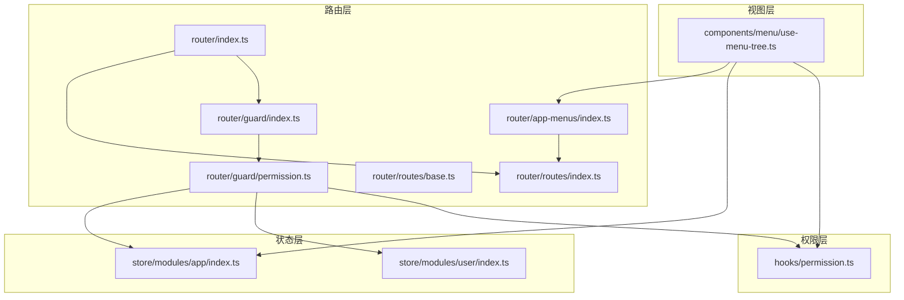
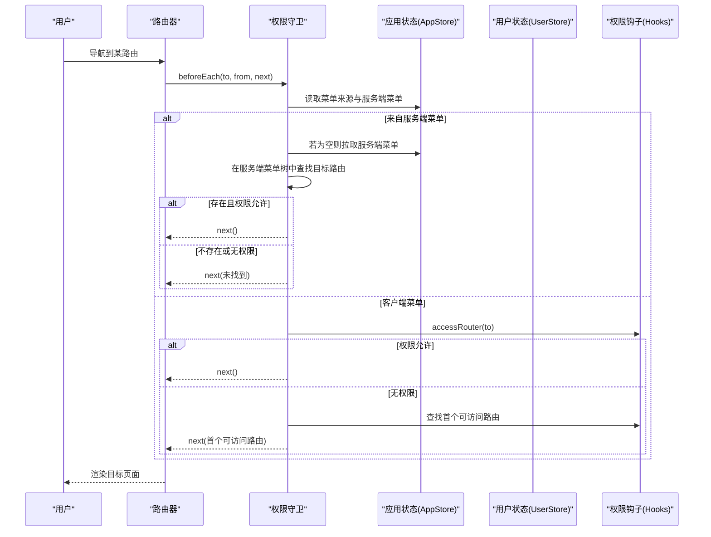
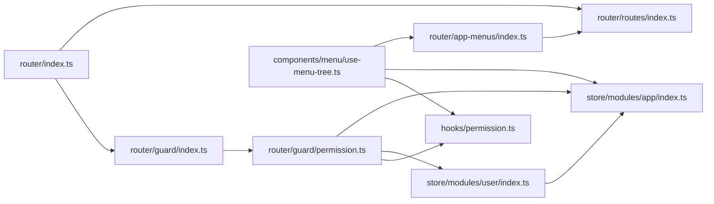
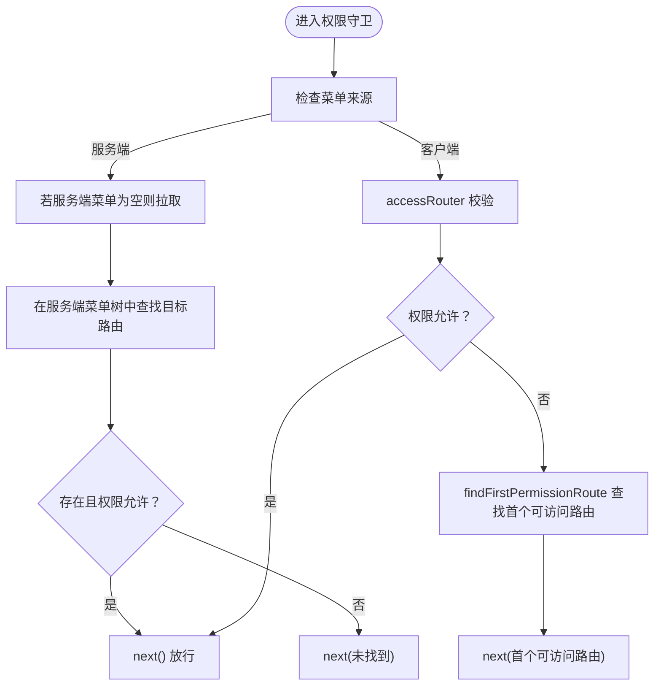

# 动态路由

<cite>
**本文引用的文件**
- [src/router/index.ts](file://src/router/index.ts)
- [src/router/routes/index.ts](file://src/router/routes/index.ts)
- [src/router/app-menus/index.ts](file://src/router/app-menus/index.ts)
- [src/router/guard/permission.ts](file://src/router/guard/permission.ts)
- [src/router/guard/index.ts](file://src/router/guard/index.ts)
- [src/hooks/permission.ts](file://src/hooks/permission.ts)
- [src/store/modules/app/index.ts](file://src/store/modules/app/index.ts)
- [src/store/modules/user/index.ts](file://src/store/modules/user/index.ts)
- [src/store/modules/app/types.ts](file://src/store/modules/app/types.ts)
- [src/store/modules/user/types.ts](file://src/store/modules/user/types.ts)
- [src/router/constants.ts](file://src/router/constants.ts)
- [src/router/routes/base.ts](file://src/router/routes/base.ts)
- [src/router/routes/modules/dashboard.ts](file://src/router/routes/modules/dashboard.ts)
- [src/router/routes/types.ts](file://src/router/routes/types.ts)
- [src/components/menu/use-menu-tree.ts](file://src/components/menu/use-menu-tree.ts)
</cite>

## 目录
1. [引言](#引言)
2. [项目结构](#项目结构)
3. [核心组件](#核心组件)
4. [架构总览](#架构总览)
5. [详细组件分析](#详细组件分析)
6. [依赖关系分析](#依赖关系分析)
7. [性能考量](#性能考量)
8. [故障排查指南](#故障排查指南)
9. [结论](#结论)
10. [附录](#附录)

## 引言
本技术文档围绕动态路由模块展开，系统性阐述以下内容：
- 动态路由的实现原理与加载机制
- 菜单驱动的路由生成流程（客户端与服务端两种模式）
- 权限控制与路由校验的集成方式
- 用户菜单到路由的转换过程
- 动态路由的添加与删除逻辑
- 路由权限验证、菜单权限控制与路由状态同步机制
- 使用示例与配置方法
- 动态路由与权限系统的协作模式

## 项目结构
动态路由相关代码主要分布在 router、store、hooks 与 components 四个目录中：
- 路由注册与守卫：router/index.ts、router/guard/*
- 路由模块聚合：router/routes/*
- 客户端菜单映射：router/app-menus/index.ts
- 权限钩子：hooks/permission.ts
- 应用状态与用户状态：store/modules/app/*、store/modules/user/*
- 菜单树构建：components/menu/use-menu-tree.ts
- 常量与基础路由：router/constants.ts、router/routes/base.ts

图表来源
- [src/router/index.ts:1-38](file://src/router/index.ts#L1-L38)
- [src/router/guard/index.ts:1-18](file://src/router/guard/index.ts#L1-L18)
- [src/router/guard/permission.ts:1-56](file://src/router/guard/permission.ts#L1-L56)
- [src/router/routes/base.ts:1-32](file://src/router/routes/base.ts#L1-L32)
- [src/router/routes/index.ts:1-26](file://src/router/routes/index.ts#L1-L26)
- [src/router/app-menus/index.ts:1-17](file://src/router/app-menus/index.ts#L1-L17)
- [src/store/modules/app/index.ts:1-78](file://src/store/modules/app/index.ts#L1-L78)
- [src/store/modules/user/index.ts:1-92](file://src/store/modules/user/index.ts#L1-L92)
- [src/hooks/permission.ts:1-34](file://src/hooks/permission.ts#L1-L34)
- [src/components/menu/use-menu-tree.ts:1-70](file://src/components/menu/use-menu-tree.ts#L1-L70)

章节来源
- [src/router/index.ts:1-38](file://src/router/index.ts#L1-L38)
- [src/router/routes/index.ts:1-26](file://src/router/routes/index.ts#L1-L26)
- [src/router/app-menus/index.ts:1-17](file://src/router/app-menus/index.ts#L1-L17)
- [src/router/guard/index.ts:1-18](file://src/router/guard/index.ts#L1-L18)
- [src/router/guard/permission.ts:1-56](file://src/router/guard/permission.ts#L1-L56)
- [src/hooks/permission.ts:1-34](file://src/hooks/permission.ts#L1-L34)
- [src/store/modules/app/index.ts:1-78](file://src/store/modules/app/index.ts#L1-L78)
- [src/store/modules/user/index.ts:1-92](file://src/store/modules/user/index.ts#L1-L92)
- [src/components/menu/use-menu-tree.ts:1-70](file://src/components/menu/use-menu-tree.ts#L1-L70)

## 核心组件
- 路由注册器：负责创建路由实例、注入基础路由与业务路由模块，并挂载全局守卫。
- 路由模块聚合器：通过 Vite 的 import.meta.glob 按模块自动收集路由定义。
- 客户端菜单映射器：将已注册的路由转换为前端可渲染的菜单数据。
- 权限钩子：提供路由访问判断与首条可访问路由查找能力。
- 应用状态管理：维护“菜单来源”、“服务端菜单列表”等状态，支持动态菜单拉取与清理。
- 用户状态管理：维护用户角色等信息，作为权限判断依据。
- 菜单树构建器：根据权限与隐藏策略过滤并生成最终菜单树。

章节来源
- [src/router/index.ts:1-38](file://src/router/index.ts#L1-L38)
- [src/router/routes/index.ts:1-26](file://src/router/routes/index.ts#L1-L26)
- [src/router/app-menus/index.ts:1-17](file://src/router/app-menus/index.ts#L1-L17)
- [src/hooks/permission.ts:1-34](file://src/hooks/permission.ts#L1-L34)
- [src/store/modules/app/index.ts:1-78](file://src/store/modules/app/index.ts#L1-L78)
- [src/store/modules/user/index.ts:1-92](file://src/store/modules/user/index.ts#L1-L92)
- [src/components/menu/use-menu-tree.ts:1-70](file://src/components/menu/use-menu-tree.ts#L1-L70)

## 架构总览
动态路由的整体工作流如下：
- 启动时加载所有路由模块并注册到路由器
- 全局前置守卫根据“菜单来源”决定采用客户端或服务端菜单策略
- 服务端模式下，若目标路由不在已加载的服务端菜单中，则重定向至未找到页面
- 客户端模式下，基于用户角色与路由元信息进行权限校验，必要时重定向到首个可访问路由
- 菜单树构建器根据权限与隐藏策略生成最终菜单

图表来源
- [src/router/guard/permission.ts:9-55](file://src/router/guard/permission.ts#L9-L55)
- [src/store/modules/app/index.ts:47-70](file://src/store/modules/app/index.ts#L47-L70)
- [src/hooks/permission.ts:7-30](file://src/hooks/permission.ts#L7-L30)

章节来源
- [src/router/guard/permission.ts:1-56](file://src/router/guard/permission.ts#L1-L56)
- [src/store/modules/app/index.ts:1-78](file://src/store/modules/app/index.ts#L1-L78)
- [src/hooks/permission.ts:1-34](file://src/hooks/permission.ts#L1-L34)

## 详细组件分析

### 路由注册与基础路由
- 创建路由实例，设置历史模式与滚动行为
- 注入登录页、重定向与未找到路由等基础路由
- 将聚合后的业务路由模块插入到基础路由之后
- 初始化全局路由守卫

章节来源
- [src/router/index.ts:11-35](file://src/router/index.ts#L11-L35)
- [src/router/routes/base.ts:6-31](file://src/router/routes/base.ts#L6-L31)

### 路由模块聚合与加载
- 使用 import.meta.glob 按模块自动扫描并加载路由定义
- 支持内部模块与外部模块两类路由集合
- 统一格式化为 RouteRecordNormalized 数组供后续使用

章节来源
- [src/router/routes/index.ts:3-25](file://src/router/routes/index.ts#L3-L25)

### 客户端菜单映射
- 将 appRoutes 与 appExternalRoutes 合并后映射为前端可用的菜单结构
- 保留路由名称、路径、元信息、重定向与子路由字段

章节来源
- [src/router/app-menus/index.ts:3-16](file://src/router/app-menus/index.ts#L3-L16)

### 权限钩子与路由校验
- accessRouter：根据路由元信息中的 roles 字段与用户角色进行匹配
- findFirstPermissionRoute：广度优先遍历路由树，返回首个满足权限条件的路由名称
- 通配符 * 可代表任意角色

章节来源
- [src/hooks/permission.ts:7-30](file://src/hooks/permission.ts#L7-L30)
- [src/store/modules/user/types.ts:1-20](file://src/store/modules/user/types.ts#L1-L20)

### 应用状态与服务端菜单
- menuFromServer：控制是否启用服务端菜单模式
- serverMenu：存储从服务端拉取的菜单列表
- fetchServerMenuConfig：异步拉取菜单并带通知反馈
- clearServerMenu：登出或切换时清空服务端菜单

章节来源
- [src/store/modules/app/types.ts:17-18](file://src/store/modules/app/types.ts#L17-L18)
- [src/store/modules/app/index.ts:47-73](file://src/store/modules/app/index.ts#L47-L73)

### 用户状态与登出回调
- 登出时清理用户信息、令牌与路由监听
- 清空服务端菜单，确保下次进入需重新拉取

章节来源
- [src/store/modules/user/index.ts:73-87](file://src/store/modules/user/index.ts#L73-L87)
- [src/store/modules/app/index.ts:71-73](file://src/store/modules/app/index.ts#L71-L73)

### 菜单树构建与过滤
- 根据菜单来源选择客户端或服务端菜单源
- 按 meta.order 排序
- 过滤无权限项、隐藏子项、按 hideInMenu 控制显示
- 递归处理子节点，生成最终菜单树

章节来源
- [src/components/menu/use-menu-tree.ts:11-68](file://src/components/menu/use-menu-tree.ts#L11-L68)

### 路由守卫策略
- 页面级守卫：每次导航前发射路由变更事件
- 用户登录信息守卫：维持登录态一致性
- 权限守卫：根据菜单来源执行不同策略
  - 服务端模式：若目标路由不在服务端菜单树中则跳转未找到
  - 客户端模式：若无权限则跳转到首个可访问路由

章节来源
- [src/router/guard/index.ts:6-17](file://src/router/guard/index.ts#L6-L17)
- [src/router/guard/permission.ts:9-55](file://src/router/guard/permission.ts#L9-L55)

### 基础路由与常量
- REDIRECT_MAIN：用于统一处理重定向
- NOT_FOUND_ROUTE：兜底未匹配路由
- WHITE_LIST：白名单路由（如登录、未找到）

章节来源
- [src/router/routes/base.ts:6-31](file://src/router/routes/base.ts#L6-L31)
- [src/router/constants.ts:1-19](file://src/router/constants.ts#L1-L19)

### 示例路由模块
- 仪表盘模块演示了布局组件、子路由与权限元信息配置

章节来源
- [src/router/routes/modules/dashboard.ts:4-28](file://src/router/routes/modules/dashboard.ts#L4-L28)

### 类型定义
- AppRouteRecordRaw：路由记录的标准接口
- AppState/UserState：状态接口，包含菜单来源与角色等关键字段

章节来源
- [src/router/routes/types.ts:9-20](file://src/router/routes/types.ts#L9-L20)
- [src/store/modules/app/types.ts:3-20](file://src/store/modules/app/types.ts#L3-L20)
- [src/store/modules/user/types.ts:1-20](file://src/store/modules/user/types.ts#L1-L20)

## 依赖关系分析
动态路由模块的关键依赖关系如下：
- 路由注册器依赖路由模块聚合器与基础路由
- 权限守卫依赖应用状态、用户状态与权限钩子
- 菜单树构建器依赖应用状态、权限钩子与客户端菜单映射
- 登出回调依赖应用状态与路由监听清理

图表来源
- [src/router/index.ts:5-7](file://src/router/index.ts#L5-L7)
- [src/router/guard/index.ts:3-4](file://src/router/guard/index.ts#L3-L4)
- [src/router/guard/permission.ts:4-6](file://src/router/guard/permission.ts#L4-L6)
- [src/store/modules/user/index.ts:77-78](file://src/store/modules/user/index.ts#L77-L78)

章节来源
- [src/router/index.ts:1-38](file://src/router/index.ts#L1-L38)
- [src/router/guard/index.ts:1-18](file://src/router/guard/index.ts#L1-L18)
- [src/router/guard/permission.ts:1-56](file://src/router/guard/permission.ts#L1-L56)
- [src/store/modules/user/index.ts:1-92](file://src/store/modules/user/index.ts#L1-L92)

## 性能考量
- 路由模块懒加载：通过 import.meta.glob 的 eager 加载已提升性能；如需进一步优化可考虑按需加载
- 菜单树构建：排序与过滤操作在计算属性中完成，避免重复计算；建议在菜单规模较大时增加缓存策略
- 服务端菜单拉取：使用通知反馈提示加载状态，避免阻塞交互；可在网络层增加重试与超时控制
- 权限判断：accessRouter 与 findFirstPermissionRoute 采用浅层遍历，复杂度与路由树深度线性相关

## 故障排查指南
- 无法访问路由
  - 检查路由元信息中的 roles 是否包含当前用户角色
  - 确认是否启用了服务端菜单模式，目标路由是否在服务端菜单树中
- 菜单不显示
  - 检查 hideInMenu 与 hideChildrenInMenu 的配置
  - 确认 meta.order 排序是否影响可见性
- 登录后仍被重定向到未找到
  - 确认服务端菜单拉取成功且 serverMenu 已更新
  - 检查 WHITE_LIST 中的路由名称是否正确
- 切换角色后路由不变
  - 确认用户角色已更新，且权限钩子能正确识别新角色
  - 如使用服务端菜单，确认已重新拉取菜单

章节来源
- [src/hooks/permission.ts:7-30](file://src/hooks/permission.ts#L7-L30)
- [src/router/guard/permission.ts:19-52](file://src/router/guard/permission.ts#L19-L52)
- [src/components/menu/use-menu-tree.ts:17-63](file://src/components/menu/use-menu-tree.ts#L17-L63)

## 结论
该动态路由模块通过“菜单驱动”的方式实现了灵活的路由生成与权限控制：
- 客户端模式适合静态路由与简单权限控制
- 服务端模式适合多角色、动态菜单场景
- 权限钩子与状态管理共同保证了路由访问的一致性
- 菜单树构建器提供了强大的过滤与排序能力
- 全局守卫确保了路由安全与用户体验

## 附录

### 动态路由添加与删除逻辑
- 添加
  - 在路由模块目录新增模块文件，导出路由记录
  - 若为服务端模式，确保服务端菜单包含对应条目
- 删除
  - 移除对应模块文件或注释掉导出
  - 清理服务端菜单中对应的条目（服务端模式）

章节来源
- [src/router/routes/index.ts:3-18](file://src/router/routes/index.ts#L3-L18)
- [src/store/modules/app/index.ts:71-73](file://src/store/modules/app/index.ts#L71-L73)

### 路由权限验证流程

图表来源
- [src/router/guard/permission.ts:9-55](file://src/router/guard/permission.ts#L9-L55)
- [src/hooks/permission.ts:7-30](file://src/hooks/permission.ts#L7-L30)

### 菜单权限控制与路由状态同步
- 菜单权限控制：use-menu-tree 根据权限与隐藏策略过滤菜单
- 路由状态同步：应用状态维护 serverMenu 与 menuFromServer，配合守卫与菜单树保持一致

章节来源
- [src/components/menu/use-menu-tree.ts:17-63](file://src/components/menu/use-menu-tree.ts#L17-L63)
- [src/store/modules/app/index.ts:19-21](file://src/store/modules/app/index.ts#L19-L21)

### 使用示例与配置方法
- 客户端模式
  - 在路由模块中配置 meta.roles 与 meta.requiresAuth
  - 在用户状态中设置角色
- 服务端模式
  - 启用 menuFromServer 并调用 fetchServerMenuConfig 拉取菜单
  - 登出时调用 clearServerMenu 清空菜单
- 菜单渲染
  - 使用 use-menu-tree 计算菜单树，结合 UI 组件渲染

章节来源
- [src/router/routes/modules/dashboard.ts:8-24](file://src/router/routes/modules/dashboard.ts#L8-L24)
- [src/store/modules/app/index.ts:47-73](file://src/store/modules/app/index.ts#L47-L73)
- [src/store/modules/user/index.ts:73-87](file://src/store/modules/user/index.ts#L73-L87)
- [src/components/menu/use-menu-tree.ts:11-68](file://src/components/menu/use-menu-tree.ts#L11-L68)