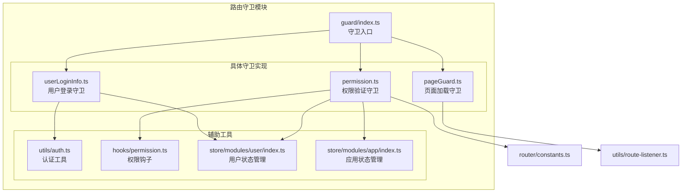
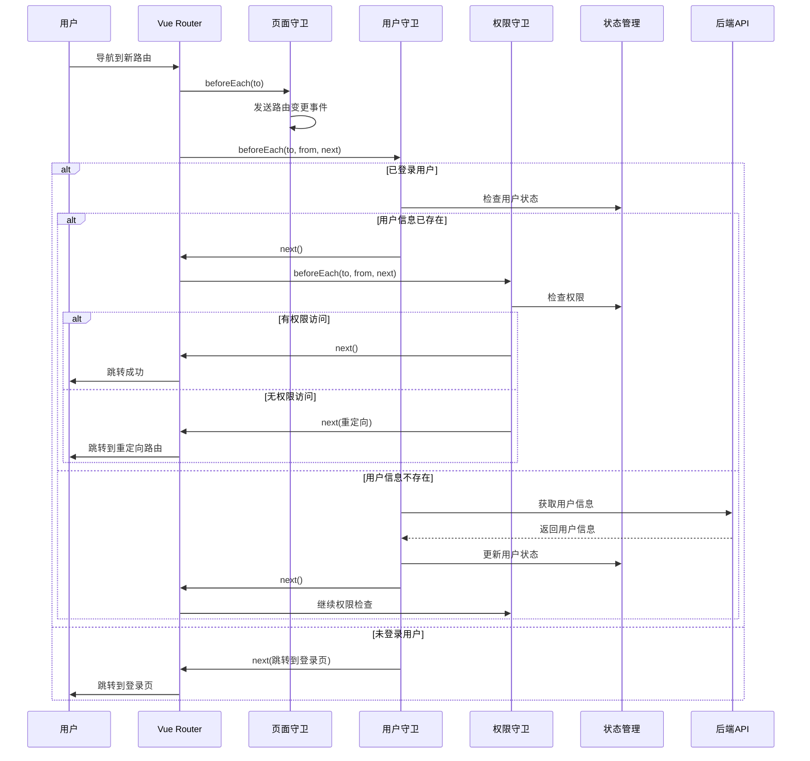
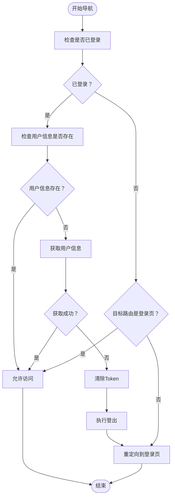
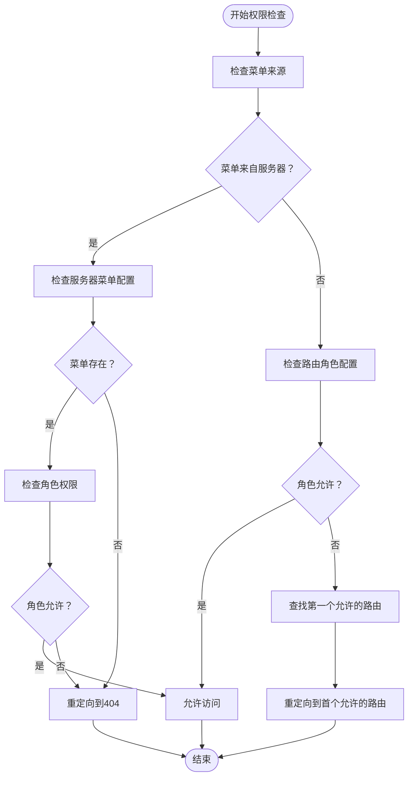
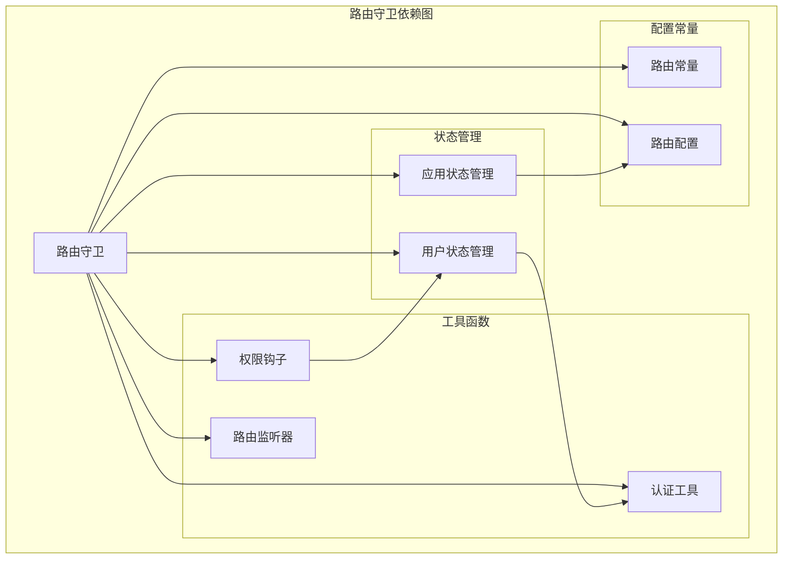

# 路由守卫

<cite>
**本文档引用的文件**
- [src/router/guard/index.ts](file://src/router/guard/index.ts)
- [src/router/guard/permission.ts](file://src/router/guard/permission.ts)
- [src/router/guard/userLoginInfo.ts](file://src/router/guard/userLoginInfo.ts)
- [src/router/index.ts](file://src/router/index.ts)
- [src/hooks/permission.ts](file://src/hooks/permission.ts)
- [src/utils/auth.ts](file://src/utils/auth.ts)
- [src/store/modules/user/index.ts](file://src/store/modules/user/index.ts)
- [src/store/modules/app/index.ts](file://src/store/modules/app/index.ts)
- [src/router/constants.ts](file://src/router/constants.ts)
- [src/router/routes/index.ts](file://src/router/routes/index.ts)
- [src/router/routes/base.ts](file://src/router/routes/base.ts)
- [src/router/routes/modules/dashboard.ts](file://src/router/routes/modules/dashboard.ts)
- [src/directive/permission/index.ts](file://src/directive/permission/index.ts)
</cite>

## 目录
1. [简介](#简介)
2. [项目结构](#项目结构)
3. [核心组件](#核心组件)
4. [架构概览](#架构概览)
5. [详细组件分析](#详细组件分析)
6. [依赖关系分析](#依赖关系分析)
7. [性能考虑](#性能考虑)
8. [故障排除指南](#故障排除指南)
9. [结论](#结论)

## 简介

本项目采用 Vue Router 的全局前置守卫机制实现完整的路由权限控制体系。路由守卫模块通过三个核心守卫实现多层次的安全控制：用户登录状态守卫、权限验证守卫和页面加载守卫。该系统支持基于角色的访问控制（RBAC），动态菜单加载，以及优雅的错误处理机制。

## 项目结构

路由守卫模块位于 `src/router/guard/` 目录下，采用分层设计模式：

**图表来源**
- [src/router/guard/index.ts:1-18](file://src/router/guard/index.ts#L1-L18)
- [src/router/guard/userLoginInfo.ts:1-44](file://src/router/guard/userLoginInfo.ts#L1-L44)
- [src/router/guard/permission.ts:1-56](file://src/router/guard/permission.ts#L1-L56)

**章节来源**
- [src/router/guard/index.ts:1-18](file://src/router/guard/index.ts#L1-L18)
- [src/router/index.ts:1-38](file://src/router/index.ts#L1-L38)

## 核心组件

### 全局前置守卫系统

系统采用 Vue Router 的 `beforeEach` 守卫实现全局拦截，按执行顺序分为三个层次：

1. **页面加载守卫**：负责路由变更事件的监听和进度条控制
2. **用户登录守卫**：验证用户身份认证状态
3. **权限验证守卫**：检查路由访问权限和菜单配置

### 认证状态管理

用户认证状态通过 Pinia store 管理，支持：
- Token 存储和验证
- 用户信息获取和缓存
- 登出清理机制

**章节来源**
- [src/router/guard/index.ts:6-17](file://src/router/guard/index.ts#L6-L17)
- [src/utils/auth.ts:1-20](file://src/utils/auth.ts#L1-L20)
- [src/store/modules/user/index.ts:1-92](file://src/store/modules/user/index.ts#L1-L92)

## 架构概览

**图表来源**
- [src/router/guard/userLoginInfo.ts:8-42](file://src/router/guard/userLoginInfo.ts#L8-L42)
- [src/router/guard/permission.ts:10-54](file://src/router/guard/permission.ts#L10-L54)

## 详细组件分析

### 用户登录状态守卫

用户登录守卫负责验证用户的认证状态，确保只有已登录用户才能访问受保护的路由。

#### 执行流程

**图表来源**
- [src/router/guard/userLoginInfo.ts:8-42](file://src/router/guard/userLoginInfo.ts#L8-L42)

#### 关键特性

- **Token 验证**：通过本地存储的 token 判断用户登录状态
- **用户信息缓存**：避免重复请求用户信息
- **自动重定向**：未登录用户自动跳转到登录页
- **错误处理**：用户信息获取失败时执行安全登出

**章节来源**
- [src/router/guard/userLoginInfo.ts:1-44](file://src/router/guard/userLoginInfo.ts#L1-L44)
- [src/utils/auth.ts:1-20](file://src/utils/auth.ts#L1-L20)
- [src/store/modules/user/index.ts:56-87](file://src/store/modules/user/index.ts#L56-L87)

### 权限验证守卫

权限验证守卫实现基于角色的访问控制，支持静态路由和动态菜单两种模式。

#### 权限检查算法

**图表来源**
- [src/router/guard/permission.ts:9-54](file://src/router/guard/permission.ts#L9-L54)
- [src/hooks/permission.ts:7-30](file://src/hooks/permission.ts#L7-L30)

#### 权限模型

系统支持三种权限控制模式：

1. **公开访问**：无需认证即可访问
2. **角色限制**：仅特定角色可访问
3. **通配符权限**：所有角色均可访问

**章节来源**
- [src/router/guard/permission.ts:1-56](file://src/router/guard/permission.ts#L1-L56)
- [src/hooks/permission.ts:1-34](file://src/hooks/permission.ts#L1-L34)

### 页面加载守卫

页面加载守卫负责路由变更事件的监听和进度条控制，提供良好的用户体验。

#### 功能特性

- **路由事件监听**：通过自定义事件系统通知其他组件路由变化
- **进度条控制**：统一的进度条显示和隐藏机制
- **性能优化**：避免重复的路由变更事件

**章节来源**
- [src/router/guard/index.ts:6-11](file://src/router/guard/index.ts#L6-L11)

## 依赖关系分析

**图表来源**
- [src/router/guard/index.ts:1-18](file://src/router/guard/index.ts#L1-L18)
- [src/router/guard/permission.ts:1-8](file://src/router/guard/permission.ts#L1-L8)
- [src/router/guard/userLoginInfo.ts:1-6](file://src/router/guard/userLoginInfo.ts#L1-L6)

### 外部依赖

系统依赖以下外部库：

- **NProgress**：进度条显示
- **Pinia**：状态管理
- **Arco Design**：UI 组件库（用于通知提示）

**章节来源**
- [src/router/guard/permission.ts:1-2](file://src/router/guard/permission.ts#L1-L2)
- [src/router/guard/userLoginInfo.ts:1-2](file://src/router/guard/userLoginInfo.ts#L1-L2)

## 性能考虑

### 异步处理优化

1. **用户信息缓存**：避免重复的用户信息请求
2. **菜单懒加载**：动态菜单按需加载
3. **权限预检查**：在路由切换前进行权限验证

### 内存管理

- **自动清理**：登出时自动清理用户状态和路由监听器
- **事件解绑**：组件卸载时自动移除路由监听

## 故障排除指南

### 常见问题及解决方案

#### 1. 登录后无法访问受保护路由

**症状**：用户登录后仍然被重定向到登录页

**可能原因**：
- Token 未正确存储
- 用户信息获取失败
- 角色信息缺失

**解决步骤**：
1. 检查浏览器本地存储中是否存在 token
2. 验证用户信息 API 是否正常返回
3. 确认用户角色字段是否正确设置

#### 2. 权限验证失败

**症状**：用户有权限却无法访问对应路由

**可能原因**：
- 路由元信息配置错误
- 角色权限不匹配
- 动态菜单配置问题

**解决步骤**：
1. 检查路由的 `meta.roles` 配置
2. 验证用户实际角色与配置的角色列表
3. 确认动态菜单是否正确加载

#### 3. 进度条显示异常

**症状**：页面加载进度条不显示或卡住

**可能原因**：
- NProgress 初始化问题
- 异步操作未正确调用 `next()`

**解决步骤**：
1. 确认 NProgress 在每个守卫中都正确调用
2. 检查异步操作的错误处理
3. 验证 `next()` 调用时机

**章节来源**
- [src/router/guard/userLoginInfo.ts:15-28](file://src/router/guard/userLoginInfo.ts#L15-L28)
- [src/router/guard/permission.ts:40-52](file://src/router/guard/permission.ts#L40-L52)

## 结论

本路由守卫模块通过三层防护机制实现了完整的权限控制体系：

1. **安全性**：多层验证确保只有授权用户才能访问受保护资源
2. **灵活性**：支持静态和动态两种菜单模式，适应不同业务需求
3. **可维护性**：清晰的代码结构和完善的错误处理机制
4. **用户体验**：流畅的导航体验和友好的错误提示

该系统为后续的功能扩展提供了良好的基础，包括但不限于：
- 更细粒度的权限控制
- 动态权限更新
- 权限审计日志
- 多租户支持

通过合理配置路由元信息和用户角色，可以轻松实现复杂的权限管理需求。