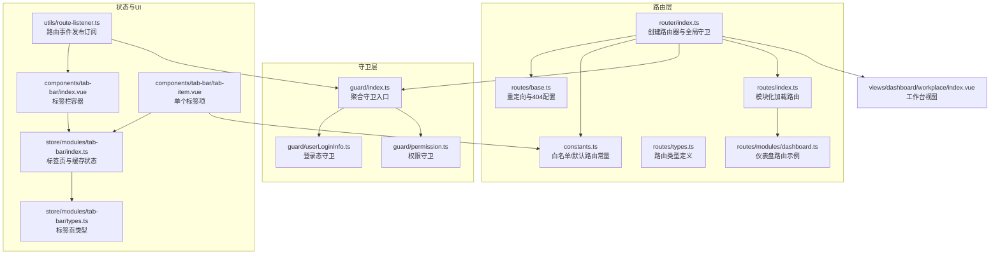
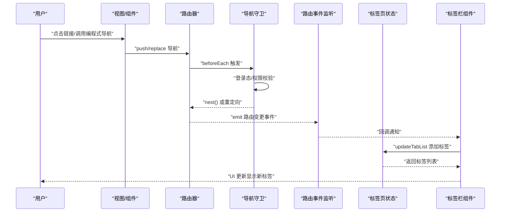
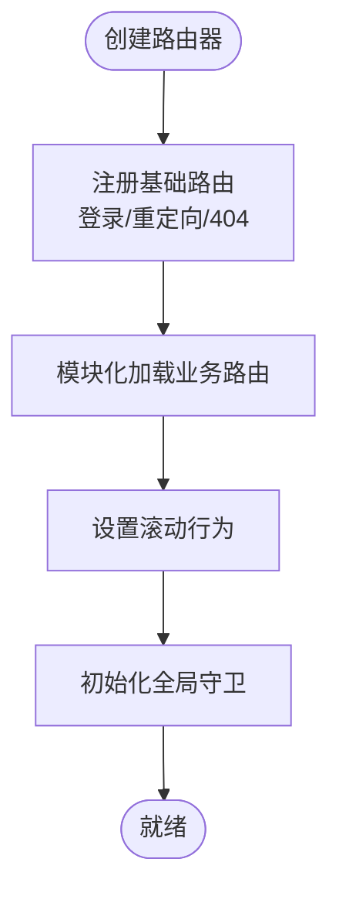
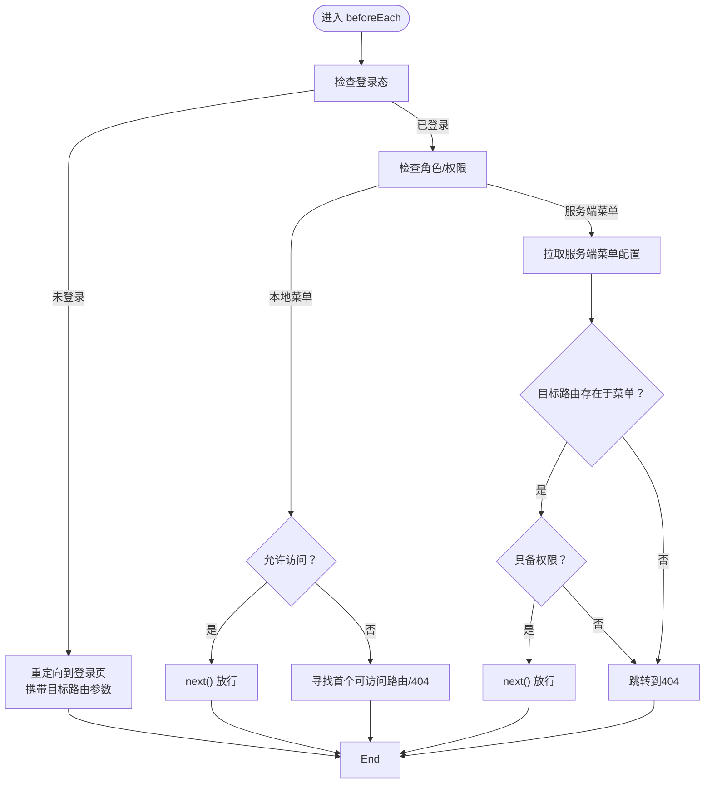
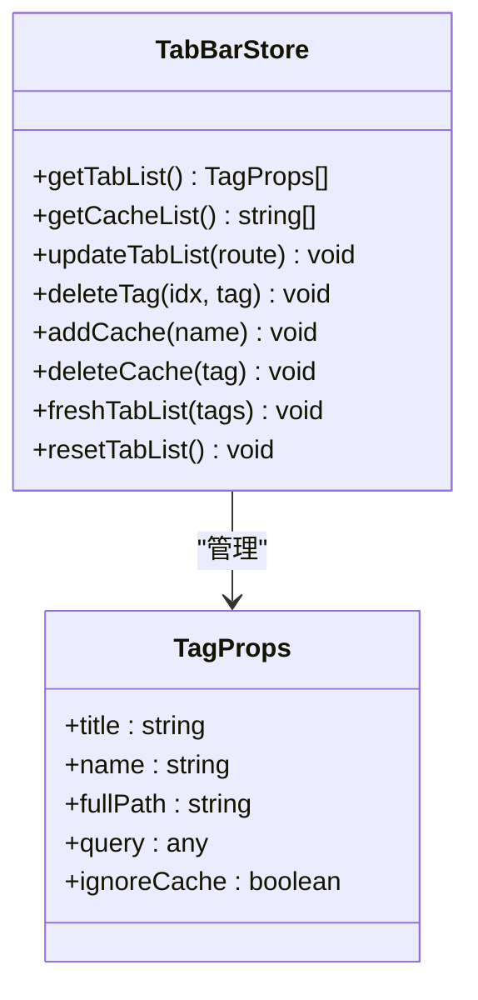
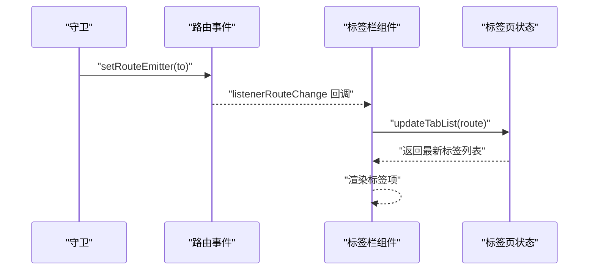
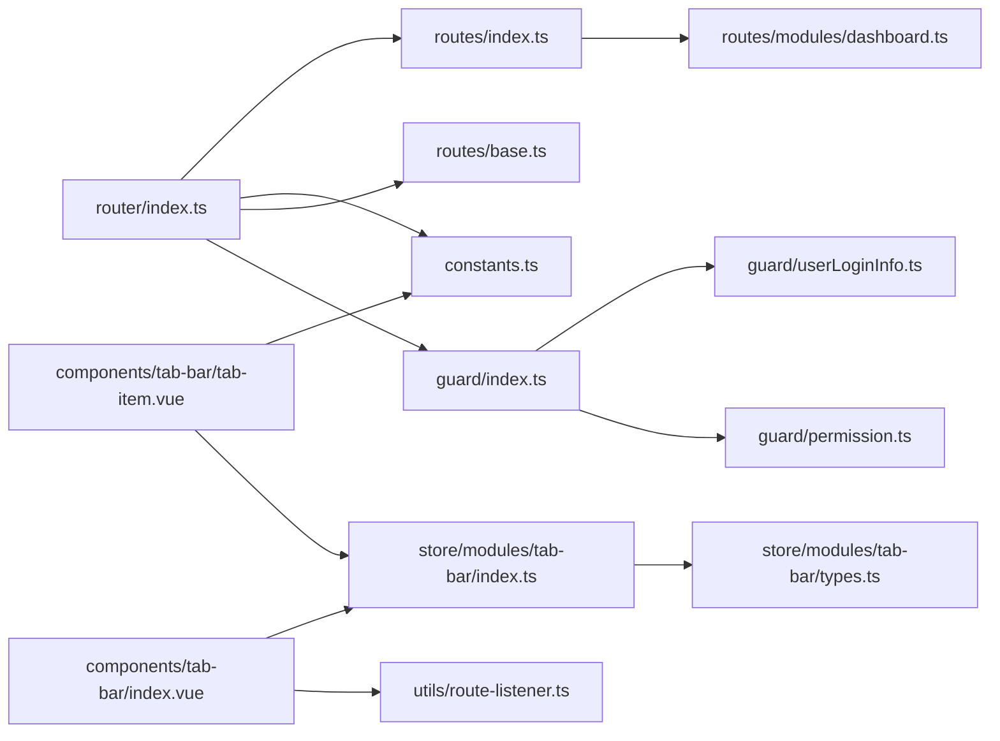

# 路由导航

<cite>
**本文引用的文件**
- [src/router/index.ts](file://src/router/index.ts)
- [src/router/guard/index.ts](file://src/router/guard/index.ts)
- [src/router/guard/permission.ts](file://src/router/guard/permission.ts)
- [src/router/guard/userLoginInfo.ts](file://src/router/guard/userLoginInfo.ts)
- [src/router/routes/index.ts](file://src/router/routes/index.ts)
- [src/router/routes/base.ts](file://src/router/routes/base.ts)
- [src/router/routes/modules/dashboard.ts](file://src/router/routes/modules/dashboard.ts)
- [src/router/routes/types.ts](file://src/router/routes/types.ts)
- [src/router/constants.ts](file://src/router/constants.ts)
- [src/store/modules/tab-bar/index.ts](file://src/store/modules/tab-bar/index.ts)
- [src/store/modules/tab-bar/types.ts](file://src/store/modules/tab-bar/types.ts)
- [src/components/tab-bar/index.vue](file://src/components/tab-bar/index.vue)
- [src/components/tab-bar/tab-item.vue](file://src/components/tab-bar/tab-item.vue)
- [src/utils/route-listener.ts](file://src/utils/route-listener.ts)
- [src/views/dashboard/workplace/index.vue](file://src/views/dashboard/workplace/index.vue)
</cite>

## 目录
1. [简介](#简介)
2. [项目结构](#项目结构)
3. [核心组件](#核心组件)
4. [架构总览](#架构总览)
5. [详细组件分析](#详细组件分析)
6. [依赖关系分析](#依赖关系分析)
7. [性能考量](#性能考量)
8. [故障排查指南](#故障排查指南)
9. [结论](#结论)
10. [附录](#附录)

## 简介
本技术文档围绕路由导航模块展开，系统性阐述以下主题：
- 路由导航机制与控制流：从路由注册、导航守卫到页面滚动行为。
- 标签页管理：标签生成、禁用固定、缓存策略与多标签页操作（关闭、刷新）。
- 页面缓存策略：基于 keep-alive 的缓存集合与路由元信息的配合。
- 导航方式：编程式导航与声明式导航的使用场景与实现要点。
- 导航守卫：登录态校验、权限校验与服务端菜单联动的最佳实践。
- 路由与标签页系统的集成：通过发布订阅模型在路由变化时更新标签页与缓存。

## 项目结构
路由相关代码主要分布在以下目录：
- 路由注册与基础配置：src/router/index.ts、src/router/routes/base.ts、src/router/constants.ts
- 路由模块化加载：src/router/routes/index.ts、src/router/routes/modules/*
- 导航守卫：src/router/guard/*
- 标签页状态与缓存：src/store/modules/tab-bar/*
- 标签页 UI 组件：src/components/tab-bar/*
- 路由事件监听工具：src/utils/route-listener.ts
- 示例视图：src/views/dashboard/workplace/index.vue

**图表来源**
- [src/router/index.ts:1-38](file://src/router/index.ts#L1-L38)
- [src/router/routes/base.ts:1-32](file://src/router/routes/base.ts#L1-L32)
- [src/router/constants.ts:1-19](file://src/router/constants.ts#L1-L19)
- [src/router/routes/types.ts:1-21](file://src/router/routes/types.ts#L1-L21)
- [src/router/routes/index.ts:1-26](file://src/router/routes/index.ts#L1-L26)
- [src/router/routes/modules/dashboard.ts:1-29](file://src/router/routes/modules/dashboard.ts#L1-L29)
- [src/router/guard/index.ts:1-18](file://src/router/guard/index.ts#L1-L18)
- [src/router/guard/userLoginInfo.ts:1-44](file://src/router/guard/userLoginInfo.ts#L1-L44)
- [src/router/guard/permission.ts:1-56](file://src/router/guard/permission.ts#L1-L56)
- [src/store/modules/tab-bar/index.ts:1-75](file://src/store/modules/tab-bar/index.ts#L1-L75)
- [src/store/modules/tab-bar/types.ts:1-13](file://src/store/modules/tab-bar/types.ts#L1-L13)
- [src/components/tab-bar/index.vue:1-102](file://src/components/tab-bar/index.vue#L1-L102)
- [src/components/tab-bar/tab-item.vue:1-201](file://src/components/tab-bar/tab-item.vue#L1-L201)
- [src/utils/route-listener.ts:1-32](file://src/utils/route-listener.ts#L1-L32)
- [src/views/dashboard/workplace/index.vue:1-149](file://src/views/dashboard/workplace/index.vue#L1-L149)

**章节来源**
- [src/router/index.ts:1-38](file://src/router/index.ts#L1-L38)
- [src/router/routes/index.ts:1-26](file://src/router/routes/index.ts#L1-L26)
- [src/router/routes/base.ts:1-32](file://src/router/routes/base.ts#L1-L32)
- [src/router/constants.ts:1-19](file://src/router/constants.ts#L1-L19)

## 核心组件
- 路由器与全局配置：创建带历史记录模式的路由器，注册登录页、业务路由、重定向与404，并设置滚动行为回到顶部；初始化全局导航守卫。
- 导航守卫体系：页面变更通知、用户登录态守卫、权限守卫（支持服务端菜单动态拉取与白名单）。
- 标签页与缓存状态：Pinia Store 管理标签列表与缓存集合，支持新增、删除、刷新、重置等操作。
- 标签栏组件：监听路由变化，按需添加标签；提供右键菜单进行标签页关闭与刷新。
- 路由事件工具：基于发布订阅模式在路由变化时广播最新路由，避免重复监听导致的性能问题。

**章节来源**
- [src/router/index.ts:11-35](file://src/router/index.ts#L11-L35)
- [src/router/guard/index.ts:6-17](file://src/router/guard/index.ts#L6-L17)
- [src/store/modules/tab-bar/index.ts:24-71](file://src/store/modules/tab-bar/index.ts#L24-L71)
- [src/components/tab-bar/index.vue:42-59](file://src/components/tab-bar/index.vue#L42-L59)
- [src/utils/route-listener.ts:14-31](file://src/utils/route-listener.ts#L14-L31)

## 架构总览
下图展示从用户触发导航到标签页更新与缓存生效的关键流程：

**图表来源**
- [src/router/guard/index.ts:7-10](file://src/router/guard/index.ts#L7-L10)
- [src/utils/route-listener.ts:14-26](file://src/utils/route-listener.ts#L14-L26)
- [src/components/tab-bar/index.vue:48-55](file://src/components/tab-bar/index.vue#L48-L55)
- [src/store/modules/tab-bar/index.ts:40-46](file://src/store/modules/tab-bar/index.ts#L40-L46)

## 详细组件分析

### 路由器与路由注册
- 历史模式与滚动行为：使用浏览器历史记录模式，滚动行为统一回到顶部，提升用户体验一致性。
- 全局重定向与兜底：注册重定向子路由与通配符404页面，确保异常路径有明确落点。
- 登录页与业务路由：登录页不需鉴权；业务路由通过守卫控制访问。
- 模块化路由：通过模块化加载自动收集 routes/modules 与 externalModules 下的路由定义，便于功能解耦。

**图表来源**
- [src/router/index.ts:11-35](file://src/router/index.ts#L11-L35)
- [src/router/routes/index.ts:3-25](file://src/router/routes/index.ts#L3-L25)
- [src/router/routes/base.ts:6-31](file://src/router/routes/base.ts#L6-L31)

**章节来源**
- [src/router/index.ts:11-35](file://src/router/index.ts#L11-L35)
- [src/router/routes/index.ts:3-25](file://src/router/routes/index.ts#L3-L25)
- [src/router/routes/base.ts:6-31](file://src/router/routes/base.ts#L6-L31)

### 导航守卫体系
- 页面变更通知：每次路由切换都会通过发布订阅广播最新路由，供标签栏等组件订阅。
- 用户登录态守卫：检查登录状态，若未登录则重定向至登录页并携带目标路由参数；已登录但角色缺失时尝试拉取用户信息后再放行。
- 权限守卫：支持两种模式：
  - 本地菜单：根据用户角色与路由权限匹配决定放行或跳转到首个可访问路由。
  - 服务端菜单：若启用服务端菜单，优先拉取菜单配置，再在菜单树中查找目标路由，存在且具备权限才放行，否则跳转到404。

**图表来源**
- [src/router/guard/userLoginInfo.ts:8-42](file://src/router/guard/userLoginInfo.ts#L8-L42)
- [src/router/guard/permission.ts:9-54](file://src/router/guard/permission.ts#L9-L54)

**章节来源**
- [src/router/guard/index.ts:6-17](file://src/router/guard/index.ts#L6-L17)
- [src/router/guard/userLoginInfo.ts:8-42](file://src/router/guard/userLoginInfo.ts#L8-L42)
- [src/router/guard/permission.ts:9-54](file://src/router/guard/permission.ts#L9-L54)

### 标签页管理与页面缓存
- 标签生成：监听路由变化，若非禁用固定且标签列表中不存在该路由，则添加为新标签；标题来自路由元信息的本地化键。
- 缓存策略：当路由元信息未忽略缓存时，将路由名称加入缓存集合；刷新时移除对应缓存后通过“重定向包装”实现强制刷新。
- 多标签操作：右键菜单支持关闭当前、关闭左侧、关闭右侧、关闭其它、关闭全部；刷新时删除缓存并经由重定向子路由完成刷新。
- 默认标签与白名单：默认标签始终固定；重定向路由不在标签栏显示。

**图表来源**
- [src/store/modules/tab-bar/index.ts:24-71](file://src/store/modules/tab-bar/index.ts#L24-L71)
- [src/store/modules/tab-bar/types.ts:1-13](file://src/store/modules/tab-bar/types.ts#L1-L13)

**章节来源**
- [src/store/modules/tab-bar/index.ts:11-20](file://src/store/modules/tab-bar/index.ts#L11-L20)
- [src/store/modules/tab-bar/index.ts:40-71](file://src/store/modules/tab-bar/index.ts#L40-L71)
- [src/components/tab-bar/index.vue:48-55](file://src/components/tab-bar/index.vue#L48-L55)
- [src/components/tab-bar/tab-item.vue:116-167](file://src/components/tab-bar/tab-item.vue#L116-L167)

### 路由与标签页的集成
- 发布订阅：守卫中通过 setRouteEmitter 广播路由变更；标签栏组件通过 listenerRouteChange 订阅并在即时模式下回放最新路由。
- 标签栏渲染：标签栏容器组件计算偏移、监听布局变化并更新固定定位；仅在非禁用固定且标签不存在时添加。
- 刷新机制：通过重定向子路由（Redirect 子路由）实现强制刷新，同时配合缓存集合删除与恢复。

**图表来源**
- [src/router/guard/index.ts:7-10](file://src/router/guard/index.ts#L7-L10)
- [src/utils/route-listener.ts:14-26](file://src/utils/route-listener.ts#L14-L26)
- [src/components/tab-bar/index.vue:48-55](file://src/components/tab-bar/index.vue#L48-L55)
- [src/store/modules/tab-bar/index.ts:40-46](file://src/store/modules/tab-bar/index.ts#L40-L46)

**章节来源**
- [src/utils/route-listener.ts:14-31](file://src/utils/route-listener.ts#L14-L31)
- [src/components/tab-bar/index.vue:42-59](file://src/components/tab-bar/index.vue#L42-L59)

### 页面缓存优化策略
- 路由元信息控制：通过 ignoreCache 字段决定是否加入缓存集合，避免不必要的 keep-alive 占用。
- 强制刷新：利用重定向包装路由实现“先删缓存、再跳转”的刷新流程，确保刷新后恢复缓存。
- 默认缓存：默认标签始终加入缓存集合，保证初始页面不被频繁销毁重建。

**章节来源**
- [src/store/modules/tab-bar/index.ts:43-45](file://src/store/modules/tab-bar/index.ts#L43-L45)
- [src/components/tab-bar/tab-item.vue:154-162](file://src/components/tab-bar/tab-item.vue#L154-L162)
- [src/store/modules/tab-bar/index.ts:26](file://src/store/modules/tab-bar/index.ts#L26)

### 导航方式与使用示例
- 声明式导航：在模板中使用路由链接组件进行跳转，适合静态或简单场景。
- 编程式导航：在组件脚本中通过路由器实例 push/replace 进行跳转，适合动态或条件跳转。
- 标签项跳转：标签项组件内部通过 router.push 将标签的完整路径信息作为参数进行跳转。
- 刷新与重定向：刷新通过重定向子路由实现，重定向包装用于强制刷新当前页面。

**章节来源**
- [src/components/tab-bar/tab-item.vue:93-95](file://src/components/tab-bar/tab-item.vue#L93-L95)
- [src/components/tab-bar/tab-item.vue:154-162](file://src/components/tab-bar/tab-item.vue#L154-L162)

## 依赖关系分析
- 路由器依赖守卫模块与基础路由配置；守卫模块依赖状态存储与权限钩子。
- 标签栏组件依赖路由事件监听与标签页状态；标签项组件依赖标签页状态与常量。
- 页面缓存依赖路由元信息与标签页状态；重定向子路由提供刷新能力。

**图表来源**
- [src/router/index.ts:1-38](file://src/router/index.ts#L1-L38)
- [src/router/guard/index.ts:1-18](file://src/router/guard/index.ts#L1-L18)
- [src/router/guard/permission.ts:1-56](file://src/router/guard/permission.ts#L1-L56)
- [src/router/guard/userLoginInfo.ts:1-44](file://src/router/guard/userLoginInfo.ts#L1-L44)
- [src/router/routes/base.ts:1-32](file://src/router/routes/base.ts#L1-L32)
- [src/router/constants.ts:1-19](file://src/router/constants.ts#L1-L19)
- [src/router/routes/index.ts:1-26](file://src/router/routes/index.ts#L1-L26)
- [src/router/routes/modules/dashboard.ts:1-29](file://src/router/routes/modules/dashboard.ts#L1-L29)
- [src/components/tab-bar/index.vue:1-102](file://src/components/tab-bar/index.vue#L1-L102)
- [src/components/tab-bar/tab-item.vue:1-201](file://src/components/tab-bar/tab-item.vue#L1-L201)
- [src/utils/route-listener.ts:1-32](file://src/utils/route-listener.ts#L1-L32)
- [src/store/modules/tab-bar/index.ts:1-75](file://src/store/modules/tab-bar/index.ts#L1-L75)
- [src/store/modules/tab-bar/types.ts:1-13](file://src/store/modules/tab-bar/types.ts#L1-L13)

**章节来源**
- [src/router/index.ts:1-38](file://src/router/index.ts#L1-L38)
- [src/components/tab-bar/index.vue:1-102](file://src/components/tab-bar/index.vue#L1-L102)
- [src/components/tab-bar/tab-item.vue:1-201](file://src/components/tab-bar/tab-item.vue#L1-L201)

## 性能考量
- 路由事件监听：采用发布订阅模式，避免每个组件单独监听路由导致的重复渲染与内存占用。
- 标签生成节流：仅在非禁用固定且标签不存在时添加，减少无意义的标签创建。
- 缓存粒度控制：通过 ignoreCache 精准控制缓存集合大小，降低 keep-alive 压力。
- 滚动行为：统一滚动到顶部，避免页面滚动状态影响后续页面体验。

[本节为通用性能建议，无需特定文件引用]

## 故障排查指南
- 登录态异常：确认登录态工具函数与用户信息拉取流程；检查守卫中的重定向参数是否正确传递。
- 权限拒绝：检查权限钩子与角色匹配逻辑；若使用服务端菜单，确认菜单拉取与路由树查找流程。
- 标签不更新：确认守卫是否正确广播路由事件；检查标签栏组件订阅是否生效。
- 刷新无效：确认重定向子路由是否正确配置；检查刷新流程中缓存删除与恢复顺序。
- 默认标签异常：确认默认路由常量与默认标签集合初始化逻辑。

**章节来源**
- [src/router/guard/userLoginInfo.ts:8-42](file://src/router/guard/userLoginInfo.ts#L8-L42)
- [src/router/guard/permission.ts:9-54](file://src/router/guard/permission.ts#L9-L54)
- [src/utils/route-listener.ts:14-31](file://src/utils/route-listener.ts#L14-L31)
- [src/components/tab-bar/tab-item.vue:154-162](file://src/components/tab-bar/tab-item.vue#L154-L162)
- [src/store/modules/tab-bar/index.ts:26](file://src/store/modules/tab-bar/index.ts#L26)

## 结论
该路由导航模块通过清晰的分层设计实现了：
- 可扩展的路由注册与模块化组织；
- 完整的导航守卫链路（登录态、权限、服务端菜单）；
- 高效的标签页管理与页面缓存策略；
- 良好的性能与可维护性。

建议在实际项目中：
- 明确各路由的元信息（如 ignoreCache、locale、roles），以获得更精准的标签与缓存行为；
- 在服务端菜单场景下，确保菜单拉取与路由树构建的稳定性；
- 对复杂页面采用合理的缓存策略，避免 keep-alive 过度占用。

[本节为总结性内容，无需特定文件引用]

## 附录
- 示例视图：工作台页面作为默认首页，展示了布局与组件组合方式，有助于理解路由与页面的关系。

**章节来源**
- [src/views/dashboard/workplace/index.vue:1-149](file://src/views/dashboard/workplace/index.vue#L1-L149)