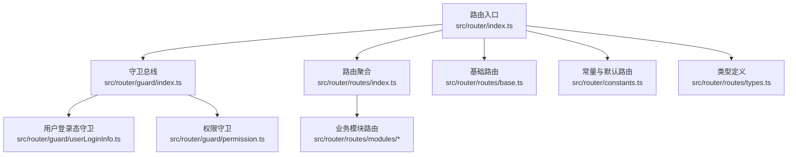
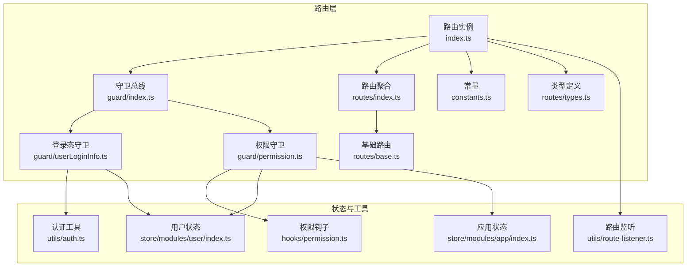
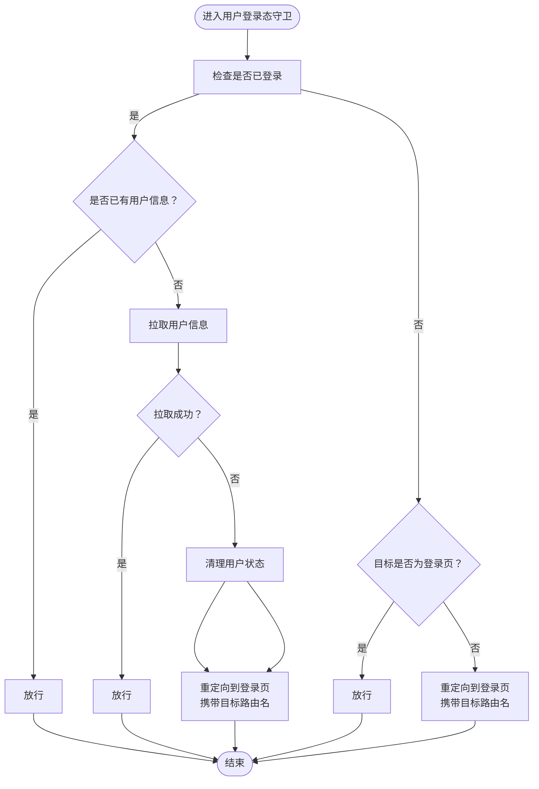
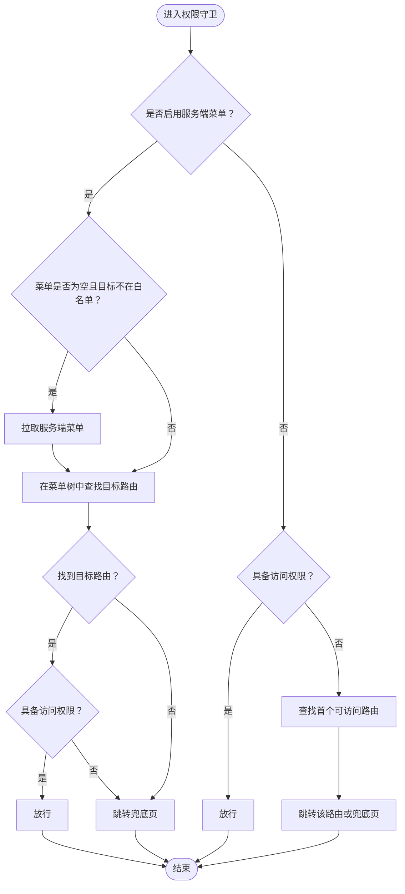
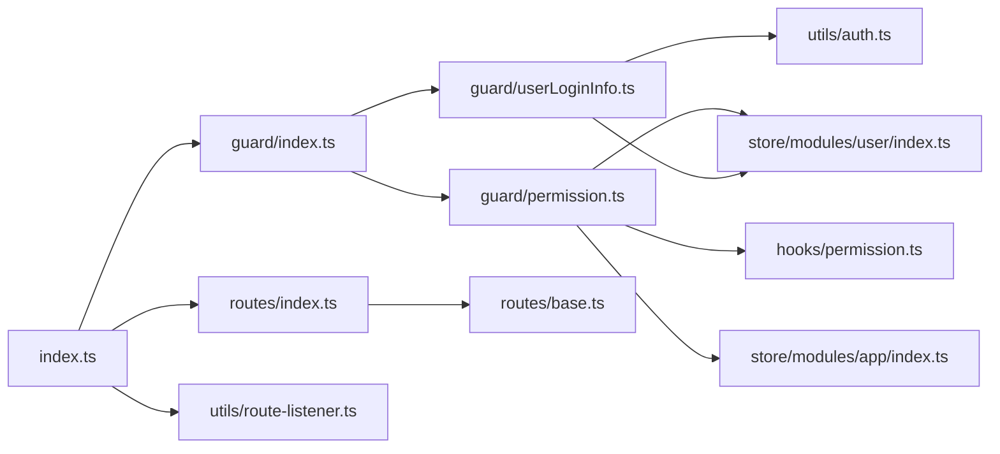

# 路由系统

<cite>
**本文引用的文件**
- [src/router/index.ts](file://src/router/index.ts)
- [src/router/guard/index.ts](file://src/router/guard/index.ts)
- [src/router/guard/permission.ts](file://src/router/guard/permission.ts)
- [src/router/guard/userLoginInfo.ts](file://src/router/guard/userLoginInfo.ts)
- [src/router/routes/index.ts](file://src/router/routes/index.ts)
- [src/router/routes/base.ts](file://src/router/routes/base.ts)
- [src/router/routes/types.ts](file://src/router/routes/types.ts)
- [src/router/constants.ts](file://src/router/constants.ts)
- [src/hooks/permission.ts](file://src/hooks/permission.ts)
- [src/store/modules/user/index.ts](file://src/store/modules/user/index.ts)
- [src/store/modules/app/index.ts](file://src/store/modules/app/index.ts)
- [src/utils/auth.ts](file://src/utils/auth.ts)
- [src/utils/route-listener.ts](file://src/utils/route-listener.ts)
- [src/directive/permission/index.ts](file://src/directive/permission/index.ts)
- [src/router/routes/modules/dashboard.ts](file://src/router/routes/modules/dashboard.ts)
</cite>

## 目录
1. [简介](#简介)
2. [项目结构](#项目结构)
3. [核心组件](#核心组件)
4. [架构总览](#架构总览)
5. [详细组件分析](#详细组件分析)
6. [依赖关系分析](#依赖关系分析)
7. [性能考量](#性能考量)
8. [故障排查指南](#故障排查指南)
9. [结论](#结论)
10. [附录](#附录)

## 简介
本文件系统性梳理该前端工程的路由体系，覆盖路由配置结构、动态路由与懒加载、路由守卫机制、权限控制策略、导航拦截逻辑、路由元信息与嵌套路由设计，以及与权限系统的集成方式。文档以代码为依据，通过图示与路径引用帮助读者快速理解并正确使用路由功能。

## 项目结构
路由系统主要位于 src/router 目录下，采用模块化组织：
- 入口与历史模式：在入口中创建路由实例，设置滚动行为与基础重定向规则。
- 守卫体系：按职责拆分为页面变更监听、用户登录态校验、权限校验三类守卫。
- 路由聚合：通过模块化导入收集业务路由与外部模块路由。
- 基础路由：统一定义重定向与兜底页。
- 类型约束：对路由记录与元信息进行类型约束，确保可维护性。
- 常量与默认路由：白名单、兜底路由、默认路由等常量集中管理。

图表来源
- [src/router/index.ts:1-38](file://src/router/index.ts#L1-L38)
- [src/router/guard/index.ts:1-18](file://src/router/guard/index.ts#L1-L18)
- [src/router/guard/userLoginInfo.ts:1-44](file://src/router/guard/userLoginInfo.ts#L1-L44)
- [src/router/guard/permission.ts:1-56](file://src/router/guard/permission.ts#L1-L56)
- [src/router/routes/index.ts:1-26](file://src/router/routes/index.ts#L1-L26)
- [src/router/routes/base.ts:1-32](file://src/router/routes/base.ts#L1-L32)
- [src/router/constants.ts:1-19](file://src/router/constants.ts#L1-L19)
- [src/router/routes/types.ts:1-21](file://src/router/routes/types.ts#L1-L21)

章节来源
- [src/router/index.ts:1-38](file://src/router/index.ts#L1-L38)
- [src/router/routes/index.ts:1-26](file://src/router/routes/index.ts#L1-L26)
- [src/router/routes/base.ts:1-32](file://src/router/routes/base.ts#L1-L32)
- [src/router/routes/types.ts:1-21](file://src/router/routes/types.ts#L1-L21)
- [src/router/constants.ts:1-19](file://src/router/constants.ts#L1-L19)

## 核心组件
- 路由实例与历史模式：使用浏览器历史模式创建路由实例，设置滚动行为为回到顶部；根路径重定向至登录页；引入进度条与基础路由集合（含重定向与兜底页）。
- 守卫总线：在守卫总线中注册页面变更事件、用户登录态守卫与权限守卫。
- 权限钩子：提供访问判断与首个可访问路由查找能力，支持通配角色与指定角色匹配。
- 用户与应用状态：用户状态用于角色与个人信息；应用状态用于服务端菜单拉取与缓存。
- 认证工具：基于本地存储的令牌读写与登录态判断。
- 路由监听：发布订阅式路由变更通知，避免逐处监听导致的性能问题。

章节来源
- [src/router/index.ts:11-38](file://src/router/index.ts#L11-L38)
- [src/router/guard/index.ts:13-18](file://src/router/guard/index.ts#L13-L18)
- [src/hooks/permission.ts:4-34](file://src/hooks/permission.ts#L4-L34)
- [src/store/modules/user/index.ts:13-92](file://src/store/modules/user/index.ts#L13-L92)
- [src/store/modules/app/index.ts:9-78](file://src/store/modules/app/index.ts#L9-L78)
- [src/utils/auth.ts:1-20](file://src/utils/auth.ts#L1-L20)
- [src/utils/route-listener.ts:1-32](file://src/utils/route-listener.ts#L1-L32)

## 架构总览
路由系统围绕“入口 -> 守卫 -> 路由聚合 -> 基础路由”的主干展开，配合状态管理与认证工具完成权限控制与导航拦截。

图表来源
- [src/router/index.ts:1-38](file://src/router/index.ts#L1-L38)
- [src/router/guard/index.ts:1-18](file://src/router/guard/index.ts#L1-L18)
- [src/router/guard/permission.ts:1-56](file://src/router/guard/permission.ts#L1-L56)
- [src/router/guard/userLoginInfo.ts:1-44](file://src/router/guard/userLoginInfo.ts#L1-L44)
- [src/router/routes/index.ts:1-26](file://src/router/routes/index.ts#L1-L26)
- [src/router/routes/base.ts:1-32](file://src/router/routes/base.ts#L1-L32)
- [src/router/routes/types.ts:1-21](file://src/router/routes/types.ts#L1-L21)
- [src/router/constants.ts:1-19](file://src/router/constants.ts#L1-L19)
- [src/store/modules/user/index.ts:1-92](file://src/store/modules/user/index.ts#L1-L92)
- [src/store/modules/app/index.ts:1-78](file://src/store/modules/app/index.ts#L1-L78)
- [src/utils/auth.ts:1-20](file://src/utils/auth.ts#L1-L20)
- [src/utils/route-listener.ts:1-32](file://src/utils/route-listener.ts#L1-L32)
- [src/hooks/permission.ts:1-34](file://src/hooks/permission.ts#L1-L34)

## 详细组件分析

### 路由入口与基础配置
- 历史模式与滚动行为：使用浏览器历史模式，滚动行为统一返回顶部，提升用户体验。
- 根路径与登录页：根路径重定向到登录页；登录页组件采用懒加载，meta 中声明不需要鉴权。
- 基础路由：引入重定向与兜底页，保证异常路径与内部跳转的可用性。
- 进度条：全局启用进度条，配置为不显示旋转指示器。

章节来源
- [src/router/index.ts:11-38](file://src/router/index.ts#L11-L38)

### 守卫总线与页面变更监听
- 页面变更监听：在每次导航前触发路由变更事件，供其他模块订阅使用，避免多处重复监听带来的性能损耗。
- 守卫顺序：先执行页面变更监听，再依次执行用户登录态守卫与权限守卫。

章节来源
- [src/router/guard/index.ts:6-17](file://src/router/guard/index.ts#L6-L17)
- [src/utils/route-listener.ts:14-27](file://src/utils/route-listener.ts#L14-L27)

### 用户登录态守卫
- 登录态检查：通过认证工具判断是否已登录；若已登录且用户信息存在则放行。
- 用户信息拉取：若未拉取过用户信息，则尝试拉取并缓存；失败则清空状态并重定向到登录页，携带当前目标路由名作为重定向参数。
- 未登录处理：非登录页时统一重定向到登录页，并透传查询参数。
- 进度条：在守卫开始时启动进度条，在权限守卫结束时关闭。

图表来源
- [src/router/guard/userLoginInfo.ts:8-43](file://src/router/guard/userLoginInfo.ts#L8-L43)
- [src/utils/auth.ts:3-5](file://src/utils/auth.ts#L3-L5)
- [src/store/modules/user/index.ts:57-87](file://src/store/modules/user/index.ts#L57-L87)

章节来源
- [src/router/guard/userLoginInfo.ts:1-44](file://src/router/guard/userLoginInfo.ts#L1-L44)
- [src/utils/auth.ts:1-20](file://src/utils/auth.ts#L1-L20)
- [src/store/modules/user/index.ts:1-92](file://src/store/modules/user/index.ts#L1-L92)

### 权限守卫
- 权限判断：通过权限钩子判断当前路由是否允许访问，支持通配符与具体角色匹配。
- 服务端菜单模式：当开启从服务端拉取菜单时，若菜单尚未初始化且目标不在白名单内，则优先拉取菜单；随后在菜单树中查找目标路由，存在且具备访问权限则放行，否则跳转兜底页。
- 客户端菜单模式：直接根据路由元信息的角色列表与用户角色进行匹配，若无权限则寻找第一个可访问的路由作为目的地，否则跳转兜底页。
- 进度条：在权限守卫结束时关闭进度条。

图表来源
- [src/router/guard/permission.ts:9-55](file://src/router/guard/permission.ts#L9-L55)
- [src/hooks/permission.ts:7-30](file://src/hooks/permission.ts#L7-L30)
- [src/store/modules/app/index.ts:47-73](file://src/store/modules/app/index.ts#L47-L73)
- [src/router/constants.ts:1-19](file://src/router/constants.ts#L1-L19)

章节来源
- [src/router/guard/permission.ts:1-56](file://src/router/guard/permission.ts#L1-L56)
- [src/hooks/permission.ts:1-34](file://src/hooks/permission.ts#L1-L34)
- [src/store/modules/app/index.ts:1-78](file://src/store/modules/app/index.ts#L1-L78)
- [src/router/constants.ts:1-19](file://src/router/constants.ts#L1-L19)

### 路由聚合与懒加载
- 模块化导入：通过 Vite 的 import.meta.glob 动态收集业务路由模块与外部模块路由，支持热更新与按需加载。
- 组件懒加载：业务组件普遍采用函数式懒加载，减少首屏体积。
- 聚合输出：将收集到的路由数组导出供路由入口使用。

章节来源
- [src/router/routes/index.ts:3-26](file://src/router/routes/index.ts#L3-L26)
- [src/router/routes/modules/dashboard.ts:18-24](file://src/router/routes/modules/dashboard.ts#L18-L24)

### 嵌套路由与布局
- 默认布局：通过常量导出默认布局组件，便于在父级路由中复用。
- 嵌套结构：父级路由使用默认布局，子路由指向具体视图组件，形成清晰的层级关系。
- 元信息：父级与子级均可设置元信息，如国际化键、图标、排序、权限角色等。

章节来源
- [src/router/routes/base.ts:4](file://src/router/routes/base.ts#L4)
- [src/router/routes/modules/dashboard.ts:4-26](file://src/router/routes/modules/dashboard.ts#L4-L26)

### 路由元信息与类型约束
- 元信息字段：包括国际化键、权限要求、角色列表、图标、排序、隐藏菜单标记等。
- 类型约束：通过 AppRouteRecordRaw 对路由记录进行强类型约束，确保扩展与维护的一致性。

章节来源
- [src/router/routes/types.ts:9-20](file://src/router/routes/types.ts#L9-L20)
- [src/router/routes/modules/dashboard.ts:8-23](file://src/router/routes/modules/dashboard.ts#L8-L23)

### 白名单与兜底路由
- 白名单：包含登录页与兜底页名称，用于绕过权限校验。
- 兜底路由：捕获未匹配路径，统一跳转至兜底页，保证导航健壮性。
- 重定向：提供通用重定向容器与子路由，支持内部跳转。

章节来源
- [src/router/constants.ts:1-19](file://src/router/constants.ts#L1-L19)
- [src/router/routes/base.ts:6-31](file://src/router/routes/base.ts#L6-L31)

### 权限钩子与指令
- 权限钩子：提供访问判断与首个可访问路由查找能力，支持通配符与具体角色匹配。
- 权限指令：在模板层面基于角色进行元素可见性控制，简化界面权限处理。

章节来源
- [src/hooks/permission.ts:4-34](file://src/hooks/permission.ts#L4-L34)
- [src/directive/permission/index.ts:1-31](file://src/directive/permission/index.ts#L1-L31)

## 依赖关系分析
- 路由入口依赖守卫总线与路由聚合；守卫总线进一步依赖用户状态与应用状态。
- 权限守卫依赖权限钩子、用户状态与应用状态；用户登录态守卫依赖认证工具与用户状态。
- 路由监听为跨模块通信提供解耦通道，避免各模块直接监听路由实例。

图表来源
- [src/router/index.ts:1-38](file://src/router/index.ts#L1-L38)
- [src/router/guard/index.ts:1-18](file://src/router/guard/index.ts#L1-L18)
- [src/router/guard/userLoginInfo.ts:1-44](file://src/router/guard/userLoginInfo.ts#L1-L44)
- [src/router/guard/permission.ts:1-56](file://src/router/guard/permission.ts#L1-L56)
- [src/router/routes/index.ts:1-26](file://src/router/routes/index.ts#L1-L26)
- [src/router/routes/base.ts:1-32](file://src/router/routes/base.ts#L1-L32)
- [src/hooks/permission.ts:1-34](file://src/hooks/permission.ts#L1-L34)
- [src/store/modules/user/index.ts:1-92](file://src/store/modules/user/index.ts#L1-L92)
- [src/store/modules/app/index.ts:1-78](file://src/store/modules/app/index.ts#L1-L78)
- [src/utils/auth.ts:1-20](file://src/utils/auth.ts#L1-L20)
- [src/utils/route-listener.ts:1-32](file://src/utils/route-listener.ts#L1-L32)

章节来源
- [src/router/index.ts:1-38](file://src/router/index.ts#L1-L38)
- [src/router/guard/index.ts:1-18](file://src/router/guard/index.ts#L1-L18)
- [src/router/guard/permission.ts:1-56](file://src/router/guard/permission.ts#L1-L56)
- [src/router/guard/userLoginInfo.ts:1-44](file://src/router/guard/userLoginInfo.ts#L1-L44)
- [src/hooks/permission.ts:1-34](file://src/hooks/permission.ts#L1-L34)
- [src/store/modules/user/index.ts:1-92](file://src/store/modules/user/index.ts#L1-L92)
- [src/store/modules/app/index.ts:1-78](file://src/store/modules/app/index.ts#L1-L78)
- [src/utils/auth.ts:1-20](file://src/utils/auth.ts#L1-L20)
- [src/utils/route-listener.ts:1-32](file://src/utils/route-listener.ts#L1-L32)

## 性能考量
- 懒加载与按需加载：业务组件普遍采用懒加载，结合 import.meta.glob 的模块化导入，有效降低首屏体积与初次渲染压力。
- 进度条：在守卫链路中合理启停进度条，避免不必要的 UI 更新。
- 路由监听：采用发布订阅模式统一派发路由变更，避免多处监听造成的重复渲染。
- 服务端菜单：仅在必要时拉取菜单并缓存，减少重复请求与解析成本。

## 故障排查指南
- 登录后被重定向到登录页
  - 可能原因：用户信息拉取失败或令牌失效。
  - 处理建议：检查认证工具中的令牌状态与用户信息接口；确认用户状态的拉取流程与错误分支。
  - 参考路径
    - [src/router/guard/userLoginInfo.ts:15-28](file://src/router/guard/userLoginInfo.ts#L15-L28)
    - [src/utils/auth.ts:3-5](file://src/utils/auth.ts#L3-L5)
    - [src/store/modules/user/index.ts:57-87](file://src/store/modules/user/index.ts#L57-L87)
- 无权限访问某路由
  - 可能原因：目标路由角色限制与用户角色不匹配；或服务端菜单未初始化。
  - 处理建议：检查权限钩子的角色匹配逻辑；确认应用状态中服务端菜单是否已拉取；核对路由元信息中的角色配置。
  - 参考路径
    - [src/hooks/permission.ts:7-14](file://src/hooks/permission.ts#L7-L14)
    - [src/router/guard/permission.ts:15-52](file://src/router/guard/permission.ts#L15-L52)
    - [src/store/modules/app/index.ts:47-73](file://src/store/modules/app/index.ts#L47-L73)
- 路由跳转后页面未更新
  - 可能原因：未正确监听路由变更或监听器未移除。
  - 处理建议：确认路由监听器的注册与移除逻辑；确保在组件卸载时调用移除方法。
  - 参考路径
    - [src/utils/route-listener.ts:14-31](file://src/utils/route-listener.ts#L14-L31)
    - [src/store/modules/user/index.ts:77](file://src/store/modules/user/index.ts#L77)

章节来源
- [src/router/guard/userLoginInfo.ts:15-28](file://src/router/guard/userLoginInfo.ts#L15-L28)
- [src/hooks/permission.ts:7-14](file://src/hooks/permission.ts#L7-L14)
- [src/router/guard/permission.ts:15-52](file://src/router/guard/permission.ts#L15-L52)
- [src/store/modules/app/index.ts:47-73](file://src/store/modules/app/index.ts#L47-L73)
- [src/utils/route-listener.ts:14-31](file://src/utils/route-listener.ts#L14-L31)
- [src/store/modules/user/index.ts:77](file://src/store/modules/user/index.ts#L77)

## 结论
该路由系统通过模块化、守卫链路与状态管理实现了清晰的权限控制与导航拦截。结合懒加载与发布订阅式的路由监听，兼顾了可维护性与性能。建议在复杂权限场景中充分利用服务端菜单与角色通配符，并在路由元信息中明确标注权限与国际化键，以获得更好的扩展性与一致性。

## 附录
- 最佳实践
  - 在路由元信息中明确声明 requiresAuth 与 roles 字段，确保权限守卫可正确识别。
  - 使用服务端菜单模式时，务必在权限守卫中处理菜单未初始化的情况。
  - 对于复杂权限场景，优先使用权限钩子提供的角色匹配与首个可访问路由查找能力。
  - 在组件中使用权限指令进行界面级权限控制，减少重复逻辑。
- 使用示例（路径指引）
  - 登录页路由配置与懒加载：[src/router/index.ts:19-25](file://src/router/index.ts#L19-L25)
  - 嵌套路由与默认布局：[src/router/routes/base.ts:4](file://src/router/routes/base.ts#L4), [src/router/routes/modules/dashboard.ts:4-26](file://src/router/routes/modules/dashboard.ts#L4-L26)
  - 权限守卫核心逻辑：[src/router/guard/permission.ts:9-55](file://src/router/guard/permission.ts#L9-L55)
  - 用户登录态守卫核心逻辑：[src/router/guard/userLoginInfo.ts:7-43](file://src/router/guard/userLoginInfo.ts#L7-L43)
  - 权限钩子与指令：[src/hooks/permission.ts:4-34](file://src/hooks/permission.ts#L4-L34), [src/directive/permission/index.ts:1-31](file://src/directive/permission/index.ts#L1-L31)