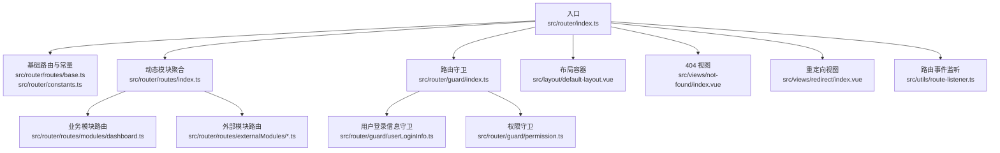
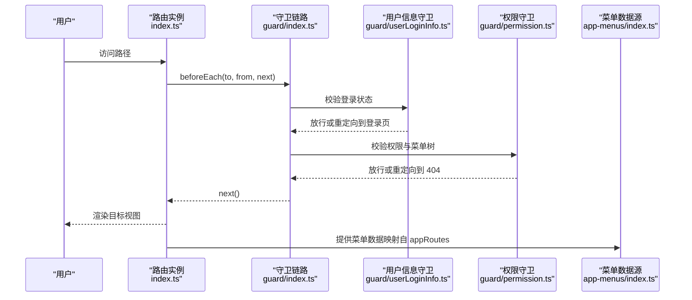
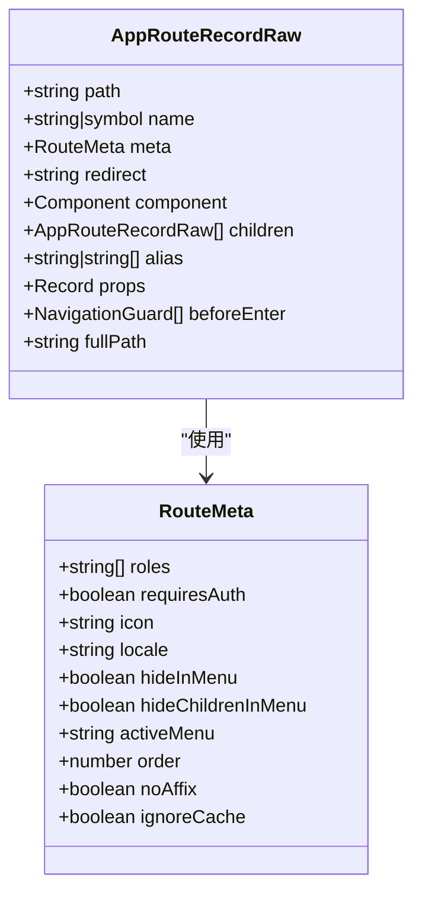
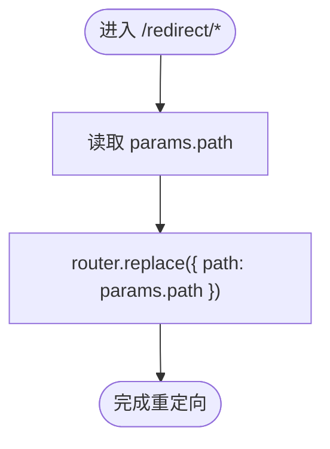
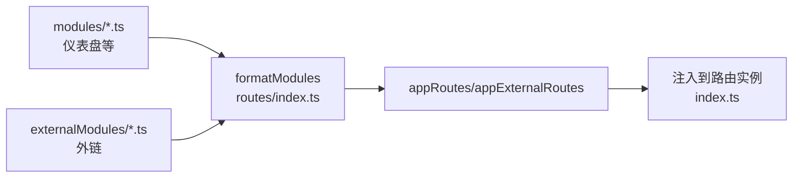
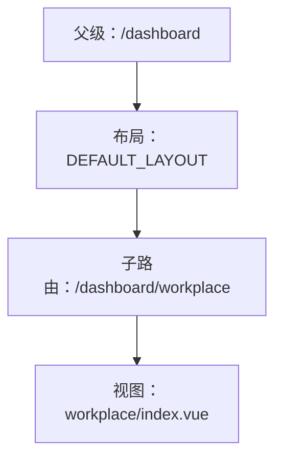
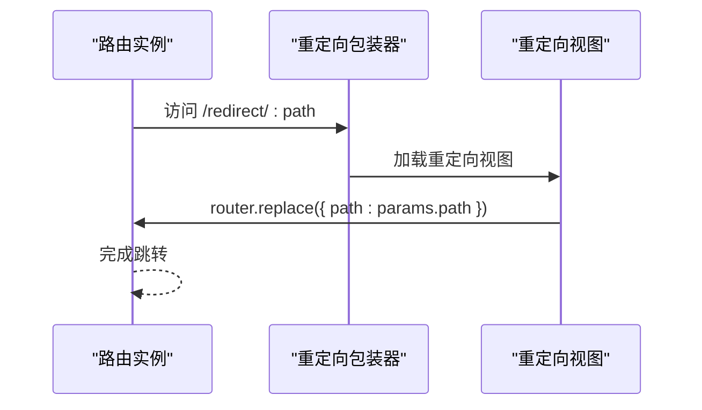
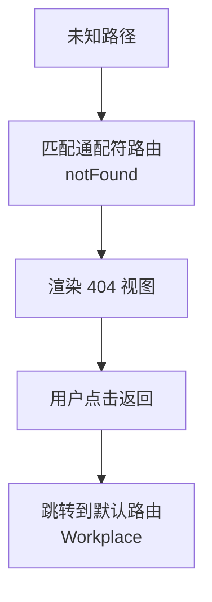
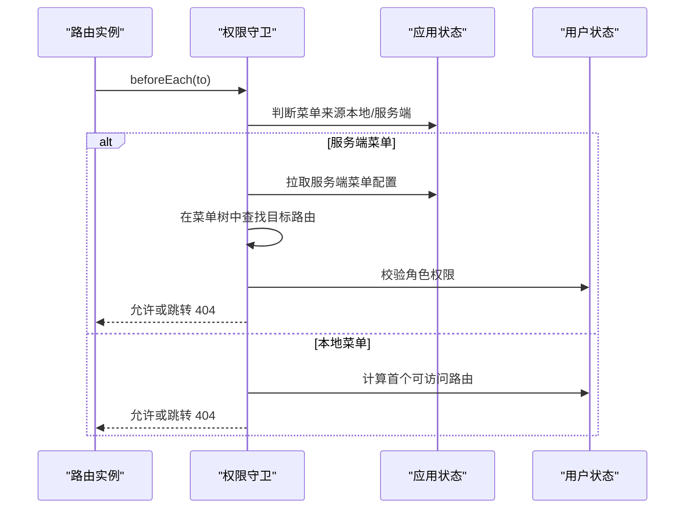
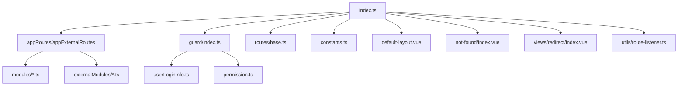

# 路由配置

<cite>
**本文引用的文件**
- [src/router/index.ts](file://src/router/index.ts)
- [src/router/constants.ts](file://src/router/constants.ts)
- [src/router/typings.d.ts](file://src/router/typings.d.ts)
- [src/router/routes/types.ts](file://src/router/routes/types.ts)
- [src/router/routes/base.ts](file://src/router/routes/base.ts)
- [src/router/routes/index.ts](file://src/router/routes/index.ts)
- [src/router/routes/modules/dashboard.ts](file://src/router/routes/modules/dashboard.ts)
- [src/router/app-menus/index.ts](file://src/router/app-menus/index.ts)
- [src/router/guard/index.ts](file://src/router/guard/index.ts)
- [src/router/guard/permission.ts](file://src/router/guard/permission.ts)
- [src/router/guard/userLoginInfo.ts](file://src/router/guard/userLoginInfo.ts)
- [src/router/routes/externalModules/arco.ts](file://src/router/routes/externalModules/arco.ts)
- [src/router/routes/externalModules/faq.ts](file://src/router/routes/externalModules/faq.ts)
- [src/layout/default-layout.vue](file://src/layout/default-layout.vue)
- [src/views/not-found/index.vue](file://src/views/not-found/index.vue)
- [src/views/redirect/index.vue](file://src/views/redirect/index.vue)
- [src/utils/route-listener.ts](file://src/utils/route-listener.ts)
</cite>

## 目录
1. [简介](#简介)
2. [项目结构](#项目结构)
3. [核心组件](#核心组件)
4. [架构总览](#架构总览)
5. [详细组件分析](#详细组件分析)
6. [依赖关系分析](#依赖关系分析)
7. [性能考量](#性能考量)
8. [故障排查指南](#故障排查指南)
9. [结论](#结论)
10. [附录](#附录)

## 简介
本文件聚焦于前端路由配置模块，系统性阐述路由配置结构、基础路由定义与路由类型系统；详解静态路由配置、路由元信息（meta）设置与路由参数传递机制；覆盖路由嵌套设计、路由重定向配置与 404 页面处理；给出路由常量定义与类型约束的作用说明，并总结最佳实践与常见使用场景。

## 项目结构
路由相关代码主要位于 src/router 目录下，采用“按功能模块化 + 类型约束 + 守卫体系”的组织方式：
- 入口与全局配置：index.ts
- 常量与默认路由：constants.ts
- 类型声明与路由记录类型：typings.d.ts、routes/types.ts
- 基础路由与布局：routes/base.ts、layout/default-layout.vue
- 动态模块加载：routes/index.ts、routes/modules/*.ts、routes/externalModules/*.ts
- 菜单数据来源：app-menus/index.ts
- 路由守卫：guard/index.ts、guard/userLoginInfo.ts、guard/permission.ts
- 视图组件：views/not-found/index.vue、views/redirect/index.vue
- 路由事件监听：utils/route-listener.ts

图表来源
- [src/router/index.ts:1-38](file://src/router/index.ts#L1-L38)
- [src/router/routes/base.ts:1-32](file://src/router/routes/base.ts#L1-L32)
- [src/router/routes/index.ts:1-26](file://src/router/routes/index.ts#L1-L26)
- [src/router/routes/modules/dashboard.ts:1-29](file://src/router/routes/modules/dashboard.ts#L1-L29)
- [src/router/guard/index.ts:1-18](file://src/router/guard/index.ts#L1-L18)
- [src/router/guard/userLoginInfo.ts:1-44](file://src/router/guard/userLoginInfo.ts#L1-L44)
- [src/router/guard/permission.ts:1-56](file://src/router/guard/permission.ts#L1-L56)
- [src/layout/default-layout.vue:1-179](file://src/layout/default-layout.vue#L1-L179)
- [src/views/not-found/index.vue:1-31](file://src/views/not-found/index.vue#L1-L31)
- [src/views/redirect/index.vue:1-17](file://src/views/redirect/index.vue#L1-L17)
- [src/utils/route-listener.ts:1-32](file://src/utils/route-listener.ts#L1-L32)

章节来源
- [src/router/index.ts:1-38](file://src/router/index.ts#L1-L38)
- [src/router/routes/index.ts:1-26](file://src/router/routes/index.ts#L1-L26)

## 核心组件
- 路由实例与历史模式：通过 createRouter 与 createWebHistory 创建，设置滚动行为与全局重定向规则。
- 基础路由与常量：包含默认布局、重定向包装器、404 路由以及白名单、默认路由等常量。
- 类型系统：AppRouteRecordRaw 定义路由记录的完整结构；RouteMeta 扩展元信息字段，确保每个路由声明必需的访问控制字段。
- 动态模块加载：通过 import.meta.glob 按目录扫描聚合模块路由，支持内部模块与外部模块两类。
- 路由守卫：页面级守卫、用户登录信息守卫、权限守卫三段式，分别负责路由变更通知、登录状态校验与权限判定。
- 视图组件：默认布局容器承载菜单、面包屑、标签页与内容区；重定向与 404 视图分别处理跳转与兜底。

章节来源
- [src/router/index.ts:11-33](file://src/router/index.ts#L11-L33)
- [src/router/constants.ts:1-19](file://src/router/constants.ts#L1-L19)
- [src/router/typings.d.ts:3-16](file://src/router/typings.d.ts#L3-L16)
- [src/router/routes/types.ts:9-20](file://src/router/routes/types.ts#L9-L20)
- [src/router/routes/base.ts:4-31](file://src/router/routes/base.ts#L4-L31)
- [src/router/routes/index.ts:3-25](file://src/router/routes/index.ts#L3-L25)
- [src/router/guard/index.ts:13-17](file://src/router/guard/index.ts#L13-L17)
- [src/layout/default-layout.vue:1-179](file://src/layout/default-layout.vue#L1-L179)
- [src/views/not-found/index.vue:1-31](file://src/views/not-found/index.vue#L1-L31)
- [src/views/redirect/index.vue:1-17](file://src/views/redirect/index.vue#L1-L17)

## 架构总览
路由系统以“入口装配 + 类型约束 + 守卫体系 + 动态模块”为核心，形成可扩展、可维护的路由配置框架。

图表来源
- [src/router/index.ts:35-35](file://src/router/index.ts#L35-L35)
- [src/router/guard/index.ts:13-17](file://src/router/guard/index.ts#L13-L17)
- [src/router/guard/userLoginInfo.ts:7-43](file://src/router/guard/userLoginInfo.ts#L7-L43)
- [src/router/guard/permission.ts:9-55](file://src/router/guard/permission.ts#L9-L55)
- [src/router/app-menus/index.ts:1-17](file://src/router/app-menus/index.ts#L1-L17)

## 详细组件分析

### 路由类型系统与元信息
- AppRouteRecordRaw：统一定义路由路径、名称、组件、重定向、子路由、别名、参数传递、前置守卫与全路径等字段，保证路由结构一致性。
- RouteMeta：扩展了角色访问控制、是否需要登录、菜单图标、国际化键、菜单隐藏策略、高亮菜单、排序、标签固定与缓存策略等元信息，确保每个路由都明确声明访问控制与展示属性。

图表来源
- [src/router/routes/types.ts:9-20](file://src/router/routes/types.ts#L9-L20)
- [src/router/typings.d.ts:4-15](file://src/router/typings.d.ts#L4-L15)

章节来源
- [src/router/routes/types.ts:1-21](file://src/router/routes/types.ts#L1-L21)
- [src/router/typings.d.ts:1-17](file://src/router/typings.d.ts#L1-L17)

### 基础路由与默认布局
- 默认布局：通过 DEFAULT_LAYOUT 引入统一布局容器，承载导航、侧边栏、内容区与页脚。
- 重定向包装器：以嵌套路由形式提供 /redirect/* 的包装层，内部组件根据 params.path 进行替换跳转。
- 404 路由：使用通配符路径匹配未命中路由，统一跳转至 404 视图。

图表来源
- [src/router/routes/base.ts:6-25](file://src/router/routes/base.ts#L6-L25)
- [src/views/redirect/index.vue:11-13](file://src/views/redirect/index.vue#L11-L13)

章节来源
- [src/router/routes/base.ts:1-32](file://src/router/routes/base.ts#L1-L32)
- [src/layout/default-layout.vue:1-179](file://src/layout/default-layout.vue#L1-L179)
- [src/views/redirect/index.vue:1-17](file://src/views/redirect/index.vue#L1-L17)
- [src/views/not-found/index.vue:1-31](file://src/views/not-found/index.vue#L1-L31)

### 动态模块加载与静态路由
- 动态聚合：通过 import.meta.glob 按目录扫描模块导出，默认导出可为单个路由对象或数组，统一格式化后注入主路由表。
- 内部模块：routes/modules 下的业务路由（如仪表盘）。
- 外部模块：routes/externalModules 下的外链路由（如官网、FAQ），用于菜单中直接打开外部链接。
- 菜单数据：app-menus/index.ts 将 appRoutes 与 appExternalRoutes 合并并映射为菜单项结构，便于菜单渲染。

图表来源
- [src/router/routes/index.ts:3-25](file://src/router/routes/index.ts#L3-L25)
- [src/router/routes/modules/dashboard.ts:1-29](file://src/router/routes/modules/dashboard.ts#L1-L29)
- [src/router/routes/externalModules/arco.ts:1-11](file://src/router/routes/externalModules/arco.ts#L1-L11)
- [src/router/routes/externalModules/faq.ts:1-11](file://src/router/routes/externalModules/faq.ts#L1-L11)
- [src/router/app-menus/index.ts:1-17](file://src/router/app-menus/index.ts#L1-L17)
- [src/router/index.ts:26-26](file://src/router/index.ts#L26-L26)

章节来源
- [src/router/routes/index.ts:1-26](file://src/router/routes/index.ts#L1-L26)
- [src/router/app-menus/index.ts:1-17](file://src/router/app-menus/index.ts#L1-L17)
- [src/router/routes/modules/dashboard.ts:1-29](file://src/router/routes/modules/dashboard.ts#L1-L29)
- [src/router/routes/externalModules/arco.ts:1-11](file://src/router/routes/externalModules/arco.ts#L1-L11)
- [src/router/routes/externalModules/faq.ts:1-11](file://src/router/routes/externalModules/faq.ts#L1-L11)

### 路由嵌套设计
- 嵌套层级：以 DEFAULT_LAYOUT 作为父级容器，子路由在其中渲染，实现“布局-页面”的层次化结构。
- 示例：仪表盘模块以 /dashboard 为父路径，子路由 workplace 在其内部渲染，meta 中声明国际化键、图标与排序等。

图表来源
- [src/router/routes/modules/dashboard.ts:4-26](file://src/router/routes/modules/dashboard.ts#L4-L26)
- [src/router/routes/base.ts:4-4](file://src/router/routes/base.ts#L4-L4)

章节来源
- [src/router/routes/modules/dashboard.ts:1-29](file://src/router/routes/modules/dashboard.ts#L1-L29)
- [src/router/routes/base.ts:1-32](file://src/router/routes/base.ts#L1-L32)

### 路由重定向配置
- 登录页重定向：根路径 / 重定向到 /login。
- 通用重定向：/redirect/* 包装器，内部根据 params.path 替换跳转，用于安全地在新窗口或当前窗口打开目标路径。
- 权限兜底：当无权限或菜单不存在时，重定向到 404。

图表来源
- [src/router/index.ts:14-25](file://src/router/index.ts#L14-L25)
- [src/router/routes/base.ts:6-25](file://src/router/routes/base.ts#L6-L25)
- [src/views/redirect/index.vue:8-13](file://src/views/redirect/index.vue#L8-L13)

章节来源
- [src/router/index.ts:11-33](file://src/router/index.ts#L11-L33)
- [src/router/routes/base.ts:1-32](file://src/router/routes/base.ts#L1-L32)
- [src/views/redirect/index.vue:1-17](file://src/views/redirect/index.vue#L1-L17)

### 404 页面处理
- 通配符路由：使用通配符路径捕获未匹配路由，统一指向 notFound 视图。
- 视图交互：点击返回按钮跳转到默认工作台路由（Workplace）。

图表来源
- [src/router/routes/base.ts:27-31](file://src/router/routes/base.ts#L27-L31)
- [src/views/not-found/index.vue:14-17](file://src/views/not-found/index.vue#L14-L17)
- [src/router/constants.ts:14-18](file://src/router/constants.ts#L14-L18)

章节来源
- [src/router/routes/base.ts:1-32](file://src/router/routes/base.ts#L1-L32)
- [src/views/not-found/index.vue:1-31](file://src/views/not-found/index.vue#L1-L31)
- [src/router/constants.ts:1-19](file://src/router/constants.ts#L1-L19)

### 路由参数传递机制
- 路由记录中的 props 字段：可在路由记录上声明 props，用于向组件传递静态或动态参数。
- 参数解析：在视图组件中通过 useRoute 获取 params、query、fullPath 等，结合 meta 与 props 实现灵活的数据绑定。
- 注意：props 通常用于将路由参数映射为组件 props，避免在组件内直接操作路由对象。

章节来源
- [src/router/routes/types.ts:17-17](file://src/router/routes/types.ts#L17-L17)
- [src/router/routes/base.ts:16-16](file://src/router/routes/base.ts#L16-L16)

### 路由常量与类型约束的作用
- 常量定义：WHITE_LIST、NOT_FOUND、REDIRECT_ROUTE_NAME、DEFAULT_ROUTE_NAME、DEFAULT_ROUTE 等，统一管理白名单、默认路由与重定向标识，降低硬编码风险。
- 类型约束：通过 AppRouteRecordRaw 与 RouteMeta 约束路由结构与元信息，确保每个路由声明具备必要的访问控制与展示属性，提升可维护性与安全性。

章节来源
- [src/router/constants.ts:1-19](file://src/router/constants.ts#L1-L19)
- [src/router/routes/types.ts:9-20](file://src/router/routes/types.ts#L9-L20)
- [src/router/typings.d.ts:4-15](file://src/router/typings.d.ts#L4-L15)

### 路由守卫与权限控制
- 页面级守卫：在 beforeEach 中发布路由变更事件，便于组件订阅最新路由状态。
- 用户登录信息守卫：校验登录状态，若未登录则重定向到登录页并携带目标路由参数；登录后拉取用户信息。
- 权限守卫：支持两种菜单来源：
  - 本地菜单：基于 appRoutes 与用户角色计算首个可访问路由，否则跳转 404。
  - 服务端菜单：异步拉取菜单配置，构建白名单与菜单树，逐层查找目标路由是否存在且具备权限，否则跳转 404。

图表来源
- [src/router/guard/index.ts:13-17](file://src/router/guard/index.ts#L13-L17)
- [src/router/guard/permission.ts:9-55](file://src/router/guard/permission.ts#L9-L55)
- [src/router/constants.ts:1-4](file://src/router/constants.ts#L1-L4)

章节来源
- [src/router/guard/index.ts:1-18](file://src/router/guard/index.ts#L1-L18)
- [src/router/guard/userLoginInfo.ts:1-44](file://src/router/guard/userLoginInfo.ts#L1-L44)
- [src/router/guard/permission.ts:1-56](file://src/router/guard/permission.ts#L1-L56)

## 依赖关系分析
- 入口依赖：index.ts 依赖 appRoutes（动态聚合）、基础常量与守卫。
- 动态聚合：routes/index.ts 依赖 modules 与 externalModules 的导出。
- 守卫依赖：permission 与 userLoginInfo 依赖状态存储与工具函数。
- 菜单依赖：app-menus/index.ts 依赖 appRoutes 与 appExternalRoutes。

图表来源
- [src/router/index.ts:5-7](file://src/router/index.ts#L5-L7)
- [src/router/routes/index.ts:3-25](file://src/router/routes/index.ts#L3-L25)
- [src/router/guard/index.ts:3-4](file://src/router/guard/index.ts#L3-L4)
- [src/router/guard/permission.ts:6-7](file://src/router/guard/permission.ts#L6-L7)
- [src/router/guard/userLoginInfo.ts:4-5](file://src/router/guard/userLoginInfo.ts#L4-L5)
- [src/router/routes/base.ts:1-32](file://src/router/routes/base.ts#L1-L32)
- [src/router/constants.ts:1-19](file://src/router/constants.ts#L1-L19)
- [src/layout/default-layout.vue:1-179](file://src/layout/default-layout.vue#L1-L179)
- [src/views/not-found/index.vue:1-31](file://src/views/not-found/index.vue#L1-L31)
- [src/views/redirect/index.vue:1-17](file://src/views/redirect/index.vue#L1-L17)
- [src/utils/route-listener.ts:1-32](file://src/utils/route-listener.ts#L1-L32)

章节来源
- [src/router/index.ts:1-38](file://src/router/index.ts#L1-L38)
- [src/router/routes/index.ts:1-26](file://src/router/routes/index.ts#L1-L26)
- [src/router/guard/index.ts:1-18](file://src/router/guard/index.ts#L1-L18)

## 性能考量
- 路由事件监听：采用发布订阅模型分发路由变更，避免组件各自监听导致的重复渲染开销。
- 模块懒加载：通过动态导入与 import.meta.glob 按需加载模块路由，减少初始包体。
- 守卫链路：在 beforeEach 中仅做必要判断与状态更新，避免阻塞渲染。
- 缓存策略：通过 meta.ignoreCache 控制页面缓存，合理利用 keep-alive 与路由缓存策略。

章节来源
- [src/utils/route-listener.ts:1-32](file://src/utils/route-listener.ts#L1-L32)
- [src/router/routes/index.ts:3-6](file://src/router/routes/index.ts#L3-L6)
- [src/router/typings.d.ts:14-14](file://src/router/typings.d.ts#L14-L14)

## 故障排查指南
- 无法访问页面
  - 检查 requiresAuth 与角色权限是否满足；确认权限守卫是否正确识别目标路由。
  - 若使用服务端菜单，确认已拉取菜单配置且目标路由存在于菜单树中。
- 登录后未跳转回原页面
  - 检查用户信息守卫是否正确传递 redirect 参数；确认登录页路由与查询参数拼接逻辑。
- 404 页面频繁出现
  - 检查通配符路由是否被提前拦截；确认菜单与路由命名一致；核对 DEFAULT_ROUTE 是否正确。
- 重定向异常
  - 检查 /redirect/* 包装器与视图组件是否正确解析 params.path 并执行 replace。

章节来源
- [src/router/guard/permission.ts:15-52](file://src/router/guard/permission.ts#L15-L52)
- [src/router/guard/userLoginInfo.ts:20-41](file://src/router/guard/userLoginInfo.ts#L20-L41)
- [src/router/routes/base.ts:27-31](file://src/router/routes/base.ts#L27-L31)
- [src/views/redirect/index.vue:11-13](file://src/views/redirect/index.vue#L11-L13)

## 结论
该路由配置模块通过类型约束、动态聚合与三段式守卫，实现了清晰、可扩展且安全的路由体系。基础路由与布局、嵌套设计、重定向与 404 处理均以统一规范落地，配合常量与元信息，使路由配置具备良好的可维护性与可演进性。

## 附录

### 最佳实践
- 明确声明每个路由的 meta 字段，尤其是 requiresAuth、roles、locale、order 等，确保权限与菜单渲染一致。
- 使用 AppRouteRecordRaw 统一结构，避免混用不同字段组合。
- 将外链路由放入 externalModules，便于菜单中直接打开外部链接。
- 优先使用命名路由（name）进行跳转，减少硬编码路径。
- 对需要权限控制的页面，确保权限守卫与角色体系协同工作。

### 常见使用场景
- 新增业务模块：在 routes/modules 下新增模块路由，自动被动态聚合注入。
- 添加外链菜单：在 routes/externalModules 下新增外链路由，参与菜单渲染。
- 自定义重定向：通过 /redirect/* 包装器实现安全跳转。
- 404 兜底：确保通配符路由存在并指向 notFound 视图。