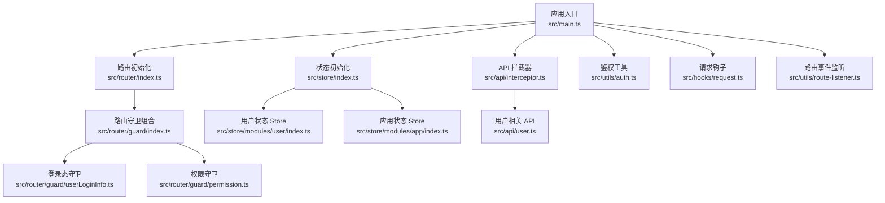
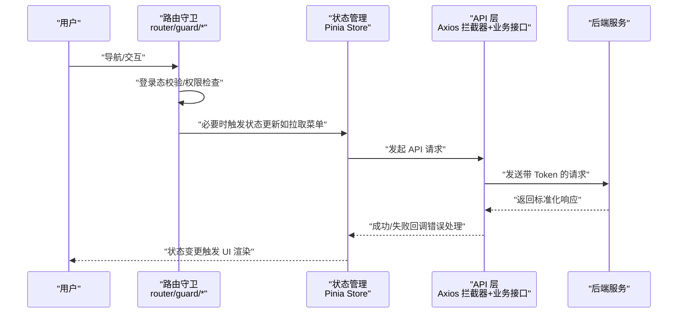
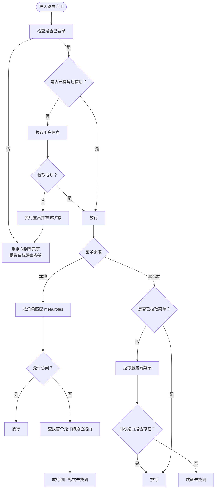
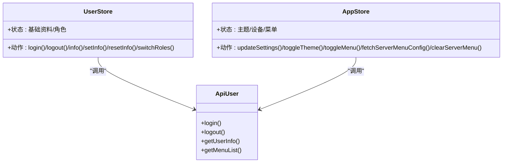
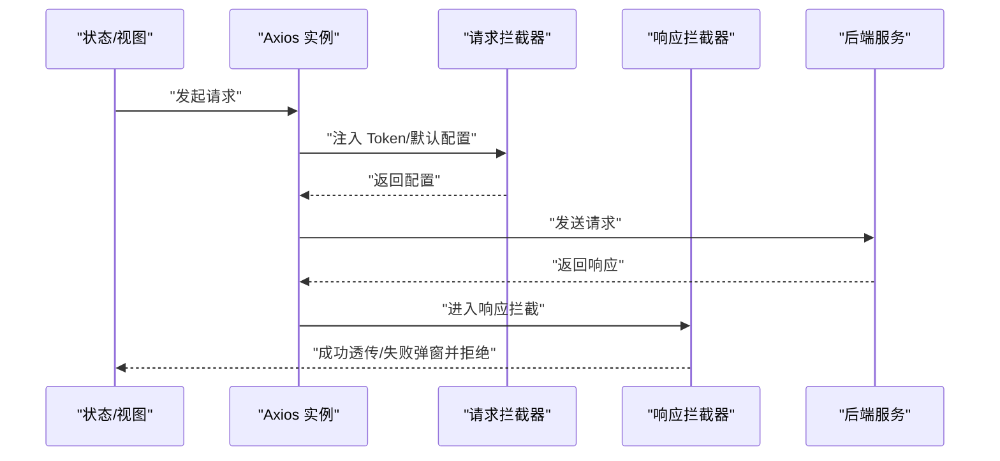
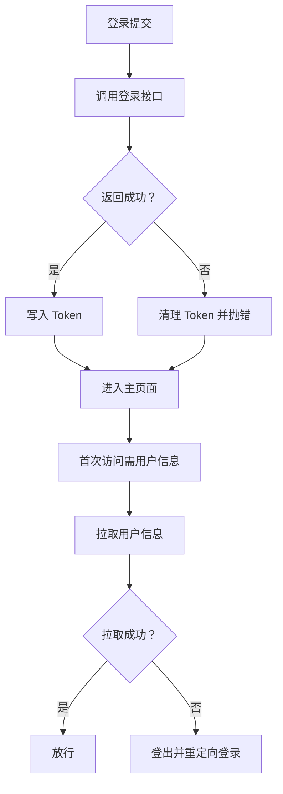
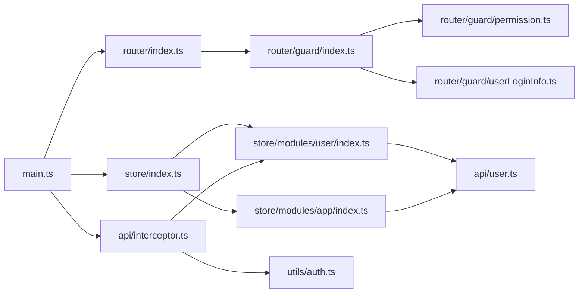

# 数据流设计

<cite>
**本文引用的文件**
- [src/main.ts](file://src/main.ts)
- [src/router/index.ts](file://src/router/index.ts)
- [src/router/guard/index.ts](file://src/router/guard/index.ts)
- [src/router/guard/userLoginInfo.ts](file://src/router/guard/userLoginInfo.ts)
- [src/router/guard/permission.ts](file://src/router/guard/permission.ts)
- [src/store/index.ts](file://src/store/index.ts)
- [src/store/modules/user/index.ts](file://src/store/modules/user/index.ts)
- [src/store/modules/app/index.ts](file://src/store/modules/app/index.ts)
- [src/api/interceptor.ts](file://src/api/interceptor.ts)
- [src/api/user.ts](file://src/api/user.ts)
- [src/utils/auth.ts](file://src/utils/auth.ts)
- [src/hooks/request.ts](file://src/hooks/request.ts)
- [src/utils/route-listener.ts](file://src/utils/route-listener.ts)
- [src/views/dashboard/workplace/index.vue](file://src/views/dashboard/workplace/index.vue)
</cite>

## 目录
1. [引言](#引言)
2. [项目结构](#项目结构)
3. [核心组件](#核心组件)
4. [架构总览](#架构总览)
5. [详细组件分析](#详细组件分析)
6. [依赖关系分析](#依赖关系分析)
7. [性能考虑](#性能考虑)
8. [故障排查指南](#故障排查指南)
9. [结论](#结论)
10. [附录](#附录)

## 引言
本文件系统化梳理该 Vue 3 + TypeScript 前端工程的数据流设计，覆盖“用户交互 → 路由守卫 → 权限检查 → 状态管理 → API 调用 → 后端响应 → 状态更新 → UI 渲染”的完整链路。重点阐述单向数据流原则、状态变更机制、异步数据处理与错误处理策略，并结合 Pinia Store 的数据流管理、API 层的数据转换与缓存策略，给出优化与性能监控实践，以及数据一致性与并发控制的实现建议。

## 项目结构
应用采用模块化组织方式，核心入口在应用启动阶段完成插件注册（路由、状态、国际化、指令、全局组件等），随后进入路由与状态管理驱动的单页应用流程。关键模块包括：
- 应用入口与插件注册：负责挂载应用、注册路由、状态、国际化、指令与全局组件
- 路由与守卫：统一处理登录态校验、权限校验、进度条与菜单动态加载
- 状态管理（Pinia）：用户信息、应用设置与标签页状态的集中管理
- API 层：基于 Axios 的请求/响应拦截器与业务接口封装
- 工具与钩子：鉴权、请求钩子、路由事件发布订阅等

图表来源
- [src/main.ts:1-29](file://src/main.ts#L1-L29)
- [src/router/index.ts:1-38](file://src/router/index.ts#L1-L38)
- [src/router/guard/index.ts:1-18](file://src/router/guard/index.ts#L1-L18)
- [src/router/guard/userLoginInfo.ts:1-44](file://src/router/guard/userLoginInfo.ts#L1-L44)
- [src/router/guard/permission.ts:1-56](file://src/router/guard/permission.ts#L1-L56)
- [src/store/index.ts:1-10](file://src/store/index.ts#L1-L10)
- [src/store/modules/user/index.ts:1-92](file://src/store/modules/user/index.ts#L1-L92)
- [src/store/modules/app/index.ts:1-78](file://src/store/modules/app/index.ts#L1-L78)
- [src/api/interceptor.ts:1-78](file://src/api/interceptor.ts#L1-L78)
- [src/api/user.ts:1-28](file://src/api/user.ts#L1-L28)
- [src/utils/auth.ts:1-20](file://src/utils/auth.ts#L1-L20)
- [src/hooks/request.ts:1-27](file://src/hooks/request.ts#L1-L27)
- [src/utils/route-listener.ts:1-32](file://src/utils/route-listener.ts#L1-L32)

章节来源
- [src/main.ts:1-29](file://src/main.ts#L1-L29)
- [src/router/index.ts:1-38](file://src/router/index.ts#L1-L38)
- [src/store/index.ts:1-10](file://src/store/index.ts#L1-L10)

## 核心组件
- 应用入口与插件注册：完成路由、状态、国际化、指令、全局组件与 Mock 的安装，同时注入 API 拦截器以统一处理请求头与响应错误。
- 路由与守卫：通过 beforeEach 完成页面级事件发布、登录态校验、权限校验与菜单动态加载；结合 NProgress 提供导航进度反馈。
- 状态管理（Pinia）：用户 Store 负责登录、登出、用户信息拉取与角色切换；应用 Store 负责主题、设备、菜单等应用级状态与服务端菜单拉取。
- API 层：统一请求头携带 Token，统一响应错误处理与登出触发；业务 API 封装登录、登出、用户信息与菜单列表。
- 工具与钩子：鉴权工具提供 Token 存取；请求钩子提供通用列表加载逻辑；路由事件采用发布订阅降低渲染开销。

章节来源
- [src/main.ts:1-29](file://src/main.ts#L1-L29)
- [src/router/guard/index.ts:1-18](file://src/router/guard/index.ts#L1-L18)
- [src/store/modules/user/index.ts:1-92](file://src/store/modules/user/index.ts#L1-L92)
- [src/store/modules/app/index.ts:1-78](file://src/store/modules/app/index.ts#L1-L78)
- [src/api/interceptor.ts:1-78](file://src/api/interceptor.ts#L1-L78)
- [src/utils/auth.ts:1-20](file://src/utils/auth.ts#L1-L20)
- [src/hooks/request.ts:1-27](file://src/hooks/request.ts#L1-L27)
- [src/utils/route-listener.ts:1-32](file://src/utils/route-listener.ts#L1-L32)

## 架构总览
下图展示从用户操作到 UI 更新的端到端数据流，强调单向数据流与各层职责边界：

图表来源
- [src/router/guard/userLoginInfo.ts:1-44](file://src/router/guard/userLoginInfo.ts#L1-L44)
- [src/router/guard/permission.ts:1-56](file://src/router/guard/permission.ts#L1-L56)
- [src/store/modules/user/index.ts:1-92](file://src/store/modules/user/index.ts#L1-L92)
- [src/store/modules/app/index.ts:1-78](file://src/store/modules/app/index.ts#L1-L78)
- [src/api/interceptor.ts:1-78](file://src/api/interceptor.ts#L1-L78)
- [src/api/user.ts:1-28](file://src/api/user.ts#L1-L28)

## 详细组件分析

### 组件一：路由守卫与权限检查
- 页面级事件发布：在 beforeEach 中通过发布订阅模型广播路由变化，避免全局监听导致的重复渲染。
- 登录态守卫：检测本地 Token，若存在则拉取用户信息；若失败则强制登出并重定向至登录页，携带目标路由参数。
- 权限守卫：支持两种菜单来源：
  - 本地静态路由：根据角色匹配 meta.roles 决定可访问性；
  - 服务端动态菜单：首次访问无菜单时拉取菜单树，再按名称与层级遍历判断是否存在目标路由，否则跳转未找到。
- 进度条：每次导航开始/结束控制 NProgress 显示。

图表来源
- [src/router/guard/userLoginInfo.ts:1-44](file://src/router/guard/userLoginInfo.ts#L1-L44)
- [src/router/guard/permission.ts:1-56](file://src/router/guard/permission.ts#L1-L56)
- [src/utils/route-listener.ts:1-32](file://src/utils/route-listener.ts#L1-L32)

章节来源
- [src/router/guard/index.ts:1-18](file://src/router/guard/index.ts#L1-L18)
- [src/router/guard/userLoginInfo.ts:1-44](file://src/router/guard/userLoginInfo.ts#L1-L44)
- [src/router/guard/permission.ts:1-56](file://src/router/guard/permission.ts#L1-L56)
- [src/utils/route-listener.ts:1-32](file://src/utils/route-listener.ts#L1-L32)

### 组件二：状态管理（Pinia）
- 用户 Store（user）：
  - 状态：用户基础资料、角色等；
  - 动作：登录（写入 Token）、登出（调用后端并清理本地状态）、拉取用户信息、切换角色、重置信息；
  - 与应用 Store（app）协作：登出时清理服务端菜单、移除路由监听。
- 应用 Store（app）：
  - 状态：主题、设备、菜单等；
  - 动作：更新设置、切换主题、切换菜单显隐、拉取服务端菜单（含通知提示与异常处理）。

图表来源
- [src/store/modules/user/index.ts:1-92](file://src/store/modules/user/index.ts#L1-L92)
- [src/store/modules/app/index.ts:1-78](file://src/store/modules/app/index.ts#L1-L78)
- [src/api/user.ts:1-28](file://src/api/user.ts#L1-L28)

章节来源
- [src/store/index.ts:1-10](file://src/store/index.ts#L1-L10)
- [src/store/modules/user/index.ts:1-92](file://src/store/modules/user/index.ts#L1-L92)
- [src/store/modules/app/index.ts:1-78](file://src/store/modules/app/index.ts#L1-L78)

### 组件三：API 层与拦截器
- 请求拦截：自动从本地存储读取 Token 并注入 Authorization 头，统一设置 baseURL（可通过环境变量配置）。
- 响应拦截：校验自定义 code 字段，非成功码统一弹窗提示；针对特定错误码触发二次确认登出流程；网络错误统一提示并拒绝 Promise。
- 业务接口：登录、登出、用户信息、菜单列表四个常用接口，返回标准化数据结构。

图表来源
- [src/api/interceptor.ts:1-78](file://src/api/interceptor.ts#L1-L78)
- [src/api/user.ts:1-28](file://src/api/user.ts#L1-L28)
- [src/utils/auth.ts:1-20](file://src/utils/auth.ts#L1-L20)

章节来源
- [src/api/interceptor.ts:1-78](file://src/api/interceptor.ts#L1-L78)
- [src/api/user.ts:1-28](file://src/api/user.ts#L1-L28)
- [src/utils/auth.ts:1-20](file://src/utils/auth.ts#L1-L20)

### 组件四：异步数据处理与错误处理
- 登录流程：提交表单 → 调用登录接口 → 成功写入 Token → 失败清理 Token 并抛错。
- 用户信息拉取：登录态有效但缺少用户信息时，拉取并写入 Store；失败触发登出与重定向。
- 权限路由：当启用服务端菜单时，首次访问拉取菜单树，再在树中查找目标路由；若不存在则跳转未找到。
- 错误处理：统一通过消息与模态框提示；特定错误码触发二次确认登出；网络错误统一提示。

图表来源
- [src/store/modules/user/index.ts:64-87](file://src/store/modules/user/index.ts#L64-L87)
- [src/router/guard/userLoginInfo.ts:14-28](file://src/router/guard/userLoginInfo.ts#L14-L28)
- [src/api/interceptor.ts:43-67](file://src/api/interceptor.ts#L43-L67)

章节来源
- [src/store/modules/user/index.ts:1-92](file://src/store/modules/user/index.ts#L1-L92)
- [src/router/guard/userLoginInfo.ts:1-44](file://src/router/guard/userLoginInfo.ts#L1-L44)
- [src/api/interceptor.ts:1-78](file://src/api/interceptor.ts#L1-L78)

### 组件五：数据一致性与并发控制
- 单向数据流：状态变更仅通过 Store 的 actions 触发，UI 通过响应式数据驱动渲染，避免直接修改共享状态。
- 并发控制：路由守卫与 Store 动作均采用同步串行流程；服务端菜单拉取通过通知提示与最终态更新，避免竞态。
- 一致性保障：登录成功后立即写入 Token；用户信息缺失时阻断后续流程；登出时统一清理 Token、菜单与路由监听，确保状态一致。

章节来源
- [src/store/modules/user/index.ts:1-92](file://src/store/modules/user/index.ts#L1-L92)
- [src/store/modules/app/index.ts:1-78](file://src/store/modules/app/index.ts#L1-L78)
- [src/router/guard/permission.ts:21-42](file://src/router/guard/permission.ts#L21-L42)

## 依赖关系分析
- 入口依赖：main.ts 依赖路由、状态、国际化、指令、全局组件与 API 拦截器。
- 路由依赖：路由守卫依赖状态 Store、鉴权工具与路由事件发布订阅。
- 状态依赖：用户与应用 Store 依赖业务 API；用户 Store 在登出时依赖应用 Store 清理菜单。
- API 依赖：业务 API 依赖 Axios 与拦截器；拦截器依赖鉴权工具与状态 Store。

图表来源
- [src/main.ts:1-29](file://src/main.ts#L1-L29)
- [src/router/index.ts:1-38](file://src/router/index.ts#L1-L38)
- [src/router/guard/index.ts:1-18](file://src/router/guard/index.ts#L1-L18)
- [src/router/guard/permission.ts:1-56](file://src/router/guard/permission.ts#L1-L56)
- [src/router/guard/userLoginInfo.ts:1-44](file://src/router/guard/userLoginInfo.ts#L1-L44)
- [src/store/index.ts:1-10](file://src/store/index.ts#L1-L10)
- [src/store/modules/user/index.ts:1-92](file://src/store/modules/user/index.ts#L1-L92)
- [src/store/modules/app/index.ts:1-78](file://src/store/modules/app/index.ts#L1-L78)
- [src/api/interceptor.ts:1-78](file://src/api/interceptor.ts#L1-L78)
- [src/api/user.ts:1-28](file://src/api/user.ts#L1-L28)
- [src/utils/auth.ts:1-20](file://src/utils/auth.ts#L1-L20)

章节来源
- [src/main.ts:1-29](file://src/main.ts#L1-L29)
- [src/router/index.ts:1-38](file://src/router/index.ts#L1-L38)
- [src/store/index.ts:1-10](file://src/store/index.ts#L1-L10)
- [src/api/interceptor.ts:1-78](file://src/api/interceptor.ts#L1-L78)

## 性能考虑
- 渲染优化
  - 路由事件采用发布订阅模型，避免全局监听带来的重复渲染，降低不必要的组件更新成本。
  - 使用 NProgress 控制导航进度，提升感知性能。
- 网络与缓存
  - 请求拦截器统一注入 Token，减少重复配置；响应拦截器集中处理错误，避免分散处理导致的重复逻辑。
  - 服务端菜单拉取采用通知提示与最终态更新，避免频繁 UI 切换。
- 可观测性
  - 建议在拦截器与 Store 动作中埋点记录请求耗时、错误率与用户行为序列，便于后续性能分析与告警。

章节来源
- [src/utils/route-listener.ts:1-32](file://src/utils/route-listener.ts#L1-L32)
- [src/api/interceptor.ts:1-78](file://src/api/interceptor.ts#L1-L78)
- [src/store/modules/app/index.ts:47-70](file://src/store/modules/app/index.ts#L47-L70)

## 故障排查指南
- 登录后无法进入主页
  - 检查 Token 是否正确写入与携带；确认用户信息拉取是否成功；若失败将触发登出并重定向登录。
- 权限不足或路由白名单问题
  - 校验 meta.roles 与用户角色匹配；若使用服务端菜单，确认菜单拉取是否完成且目标路由存在于菜单树。
- 响应错误弹窗频繁
  - 查看响应拦截器中的错误码分支与提示逻辑；确认网络请求是否超时或跨域配置是否正确。
- 登出后状态未清理
  - 确认用户 Store 的 logout 回调是否执行；检查是否调用了清理菜单与路由监听。

章节来源
- [src/router/guard/userLoginInfo.ts:14-28](file://src/router/guard/userLoginInfo.ts#L14-L28)
- [src/router/guard/permission.ts:21-42](file://src/router/guard/permission.ts#L21-L42)
- [src/api/interceptor.ts:43-67](file://src/api/interceptor.ts#L43-L67)
- [src/store/modules/user/index.ts:73-87](file://src/store/modules/user/index.ts#L73-L87)

## 结论
该工程遵循单向数据流原则，通过路由守卫与权限检查确保访问安全，借助 Pinia 实现状态集中管理，利用 Axios 拦截器与业务接口实现统一的数据转换与错误处理。配合发布订阅的路由事件模型与通知提示机制，既保证了用户体验，也提升了系统的可观测性与可维护性。建议在现有基础上进一步完善请求缓存策略、并发控制与性能监控体系，以应对更复杂的业务场景。

## 附录
- 关键流程参考路径
  - 登录流程：[src/store/modules/user/index.ts:64-87](file://src/store/modules/user/index.ts#L64-L87) → [src/api/user.ts:13-15](file://src/api/user.ts#L13-L15)
  - 用户信息拉取：[src/store/modules/user/index.ts:57-61](file://src/store/modules/user/index.ts#L57-L61) → [src/api/user.ts:21-23](file://src/api/user.ts#L21-L23)
  - 服务端菜单拉取：[src/store/modules/app/index.ts:47-70](file://src/store/modules/app/index.ts#L47-L70) → [src/api/user.ts:25-27](file://src/api/user.ts#L25-L27)
  - 权限路由判定：[src/router/guard/permission.ts:14-52](file://src/router/guard/permission.ts#L14-L52)
  - 响应拦截与登出触发：[src/api/interceptor.ts:39-67](file://src/api/interceptor.ts#L39-L67)
  - 路由事件发布订阅：[src/utils/route-listener.ts:14-27](file://src/utils/route-listener.ts#L14-L27)