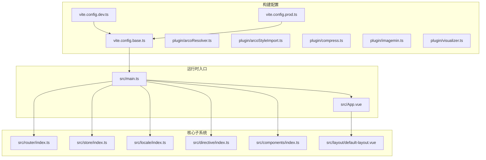
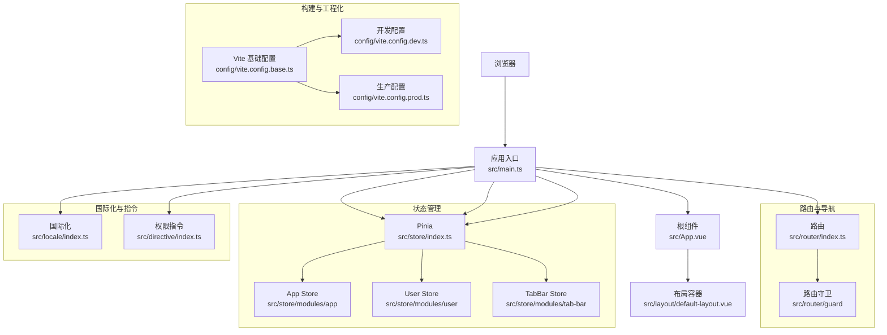
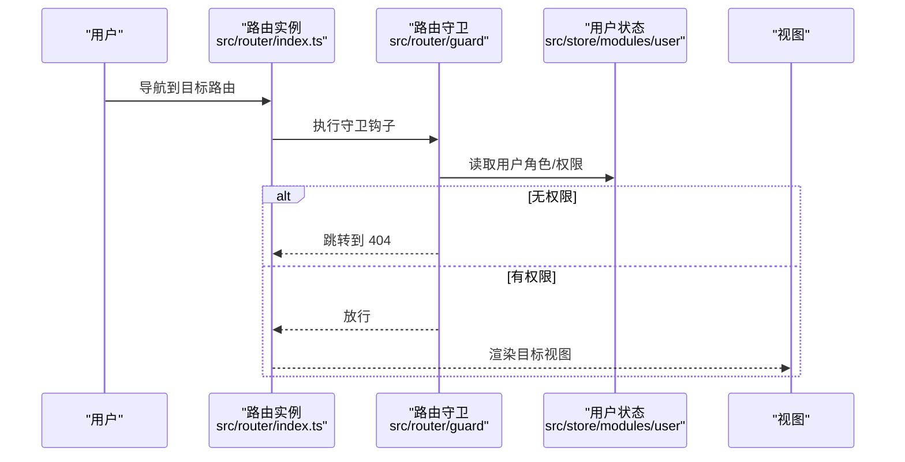
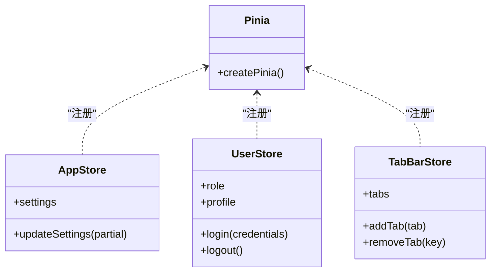
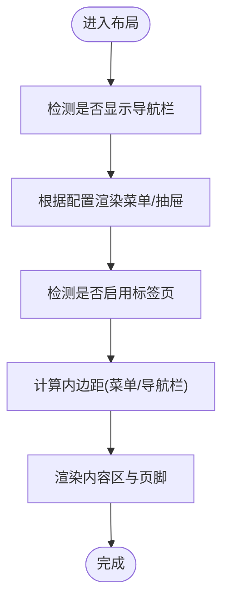
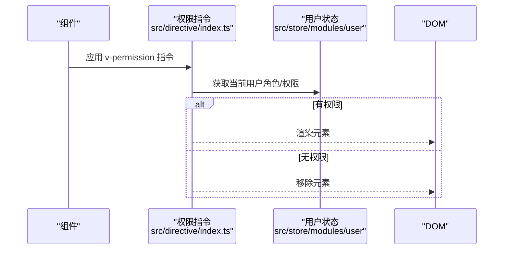
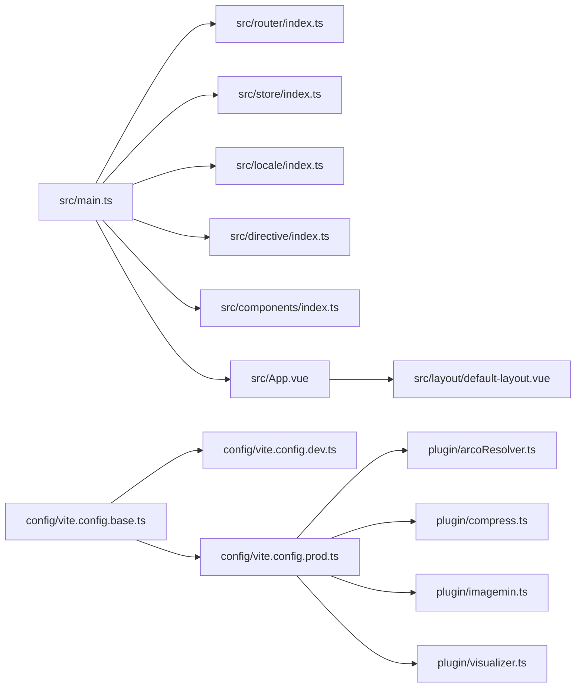

# 整体架构设计

<cite>
**本文引用的文件**
- [package.json](file://package.json)
- [tsconfig.json](file://tsconfig.json)
- [src/main.ts](file://src/main.ts)
- [src/App.vue](file://src/App.vue)
- [src/layout/default-layout.vue](file://src/layout/default-layout.vue)
- [src/router/index.ts](file://src/router/index.ts)
- [src/store/index.ts](file://src/store/index.ts)
- [src/components/index.ts](file://src/components/index.ts)
- [src/directive/index.ts](file://src/directive/index.ts)
- [src/locale/index.ts](file://src/locale/index.ts)
- [src/utils/auth.ts](file://src/utils/auth.ts)
- [src/config/settings.json](file://src/config/settings.json)
- [config/vite.config.base.ts](file://config/vite.config.base.ts)
- [config/vite.config.dev.ts](file://config/vite.config.dev.ts)
- [config/vite.config.prod.ts](file://config/vite.config.prod.ts)
- [config/plugin/arcoResolver.ts](file://config/plugin/arcoResolver.ts)
- [config/plugin/arcoStyleImport.ts](file://config/plugin/arcoStyleImport.ts)
- [config/plugin/compress.ts](file://config/plugin/compress.ts)
- [config/plugin/imagemin.ts](file://config/plugin/imagemin.ts)
- [config/plugin/visualizer.ts](file://config/plugin/visualizer.ts)
</cite>

## 目录
1. [引言](#引言)
2. [项目结构](#项目结构)
3. [核心组件](#核心组件)
4. [架构总览](#架构总览)
5. [详细组件分析](#详细组件分析)
6. [依赖分析](#依赖分析)
7. [性能考虑](#性能考虑)
8. [故障排查指南](#故障排查指南)
9. [结论](#结论)
10. [附录](#附录)

## 引言
本项目为基于 Vue 3 + TypeScript + Vite 的中后台前端工程，采用 Arco Design Pro Vue 模板进行二次开发，目标是构建一个主题可配置、国际化完备、路由与权限控制清晰、状态管理规范、工程化完善的现代化前端应用。技术选型围绕“现代浏览器生态 + 渐进式模块化 + 高效构建工具链”展开，强调可维护性、可扩展性与开发体验。

## 项目结构
项目采用按功能域划分的模块化组织方式，核心目录职责如下：
- config：构建配置与插件（Vite、Arco 主题与样式、压缩、可视化、图片处理等）
- src：源代码
  - api：接口层与拦截器
  - assets：静态资源与全局样式
  - components：通用业务与基础组件注册
  - directive：自定义指令（如权限指令）
  - hooks：组合式逻辑封装
  - layout：布局容器与页面骨架
  - locale：国际化语言包
  - mock：本地数据模拟
  - router：路由定义与守卫
  - store：Pinia 状态管理
  - types：全局类型声明
  - utils：工具函数库
  - views：页面视图
  - 入口文件：main.ts、App.vue
- 根级配置：package.json、tsconfig.json、各类 Lint 与 Husky 配置

**图表来源**
- [config/vite.config.base.ts:1-52](file://config/vite.config.base.ts#L1-L52)
- [config/vite.config.dev.ts:1-24](file://config/vite.config.dev.ts#L1-L24)
- [config/vite.config.prod.ts:1-32](file://config/vite.config.prod.ts#L1-L32)
- [src/main.ts:1-29](file://src/main.ts#L1-L29)
- [src/App.vue:1-27](file://src/App.vue#L1-L27)
- [src/router/index.ts:1-38](file://src/router/index.ts#L1-L38)
- [src/store/index.ts:1-10](file://src/store/index.ts#L1-L10)
- [src/locale/index.ts:1-23](file://src/locale/index.ts#L1-L23)
- [src/directive/index.ts:1-9](file://src/directive/index.ts#L1-L9)
- [src/components/index.ts:1-36](file://src/components/index.ts#L1-L36)
- [src/layout/default-layout.vue:1-179](file://src/layout/default-layout.vue#L1-L179)

**章节来源**
- [package.json:1-103](file://package.json#L1-L103)
- [tsconfig.json:1-21](file://tsconfig.json#L1-L21)
- [config/vite.config.base.ts:1-52](file://config/vite.config.base.ts#L1-L52)
- [config/vite.config.dev.ts:1-24](file://config/vite.config.dev.ts#L1-L24)
- [config/vite.config.prod.ts:1-32](file://config/vite.config.prod.ts#L1-L32)

## 核心组件
- 应用入口与依赖注入
  - 在入口文件中完成 Arco Design、路由、状态、国际化、全局指令与组件的安装，并挂载根组件。
- 路由与导航
  - 基于 vue-router 定义登录页与业务路由，结合 NProgress 实现加载进度条；通过路由守卫实现鉴权与访问控制。
- 状态管理
  - 使用 Pinia 进行集中式状态管理，模块化拆分 app、user、tab-bar 等领域状态。
- 国际化
  - 基于 vue-i18n 提供多语言支持，默认从本地存储读取语言偏好。
- 权限与指令
  - 自定义权限指令用于元素级权限控制，结合用户角色与路由权限表进行访问校验。
- 布局与主题
  - 布局组件负责导航栏、侧边菜单、页脚、标签页等区域的渲染与响应式适配；主题与配置项通过 JSON 与全局 Less 变量注入。
- 构建与工程化
  - Vite 基础配置统一，开发与生产环境分别叠加 ESLint、压缩、可视化、Arco 解析器、图片压缩等插件；生产环境进行手动分包以优化缓存与体积。

**章节来源**
- [src/main.ts:1-29](file://src/main.ts#L1-L29)
- [src/router/index.ts:1-38](file://src/router/index.ts#L1-L38)
- [src/store/index.ts:1-10](file://src/store/index.ts#L1-L10)
- [src/locale/index.ts:1-23](file://src/locale/index.ts#L1-L23)
- [src/directive/index.ts:1-9](file://src/directive/index.ts#L1-L9)
- [src/layout/default-layout.vue:1-179](file://src/layout/default-layout.vue#L1-L179)
- [src/config/settings.json:1-18](file://src/config/settings.json#L1-L18)
- [config/vite.config.base.ts:1-52](file://config/vite.config.base.ts#L1-L52)
- [config/vite.config.prod.ts:1-32](file://config/vite.config.prod.ts#L1-L32)

## 架构总览
系统采用“入口装配 + 分层模块 + 工程化增强”的架构模式：
- 视图层：Vue 组件树，布局容器承载业务页面
- 交互层：路由与权限守卫、国际化切换、全局指令
- 状态层：Pinia 模块化状态，集中管理用户、应用设置、标签页
- 数据层：Axios 封装与拦截器、Mock 数据（开发阶段）
- 构建层：Vite 插件体系，按环境差异化配置与产物优化

**图表来源**
- [src/main.ts:1-29](file://src/main.ts#L1-L29)
- [src/App.vue:1-27](file://src/App.vue#L1-L27)
- [src/layout/default-layout.vue:1-179](file://src/layout/default-layout.vue#L1-L179)
- [src/router/index.ts:1-38](file://src/router/index.ts#L1-L38)
- [src/store/index.ts:1-10](file://src/store/index.ts#L1-L10)
- [src/locale/index.ts:1-23](file://src/locale/index.ts#L1-L23)
- [src/directive/index.ts:1-9](file://src/directive/index.ts#L1-L9)
- [config/vite.config.base.ts:1-52](file://config/vite.config.base.ts#L1-L52)
- [config/vite.config.dev.ts:1-24](file://config/vite.config.dev.ts#L1-L24)
- [config/vite.config.prod.ts:1-32](file://config/vite.config.prod.ts#L1-L32)

## 详细组件分析

### 路由与权限控制流程
- 登录态与路由守卫：在路由初始化时配置守卫，结合用户角色与路由权限表判断访问合法性，未授权跳转至 404。
- 进度条：使用 NProgress 在路由切换时显示加载进度。
- 动态重定向：提供重定向主页面的常量，避免重复路径问题。

**图表来源**
- [src/router/index.ts:1-38](file://src/router/index.ts#L1-L38)
- [src/store/modules/user/index.ts](file://src/store/modules/user/index.ts)

**章节来源**
- [src/router/index.ts:1-38](file://src/router/index.ts#L1-L38)

### 状态管理模块
- 模块划分：app、user、tab-bar 三个核心模块，分别管理应用设置、用户信息与标签页状态。
- Pinia 集成：在入口处创建并注入 Pinia，便于全局访问与热更新。

**图表来源**
- [src/store/index.ts:1-10](file://src/store/index.ts#L1-L10)
- [src/store/modules/app/index.ts](file://src/store/modules/app/index.ts)
- [src/store/modules/user/index.ts](file://src/store/modules/user/index.ts)
- [src/store/modules/tab-bar/index.ts](file://src/store/modules/tab-bar/index.ts)

**章节来源**
- [src/store/index.ts:1-10](file://src/store/index.ts#L1-L10)

### 布局与主题配置
- 布局容器：负责导航栏、侧边菜单、页脚、内容区与标签页的组合渲染，支持移动端抽屉菜单与响应式宽度。
- 主题与配置：通过 JSON 配置项与全局 Less 变量注入，实现主题色、菜单宽度、是否显示顶部菜单等动态切换。

**图表来源**
- [src/layout/default-layout.vue:1-179](file://src/layout/default-layout.vue#L1-L179)
- [src/config/settings.json:1-18](file://src/config/settings.json#L1-L18)

**章节来源**
- [src/layout/default-layout.vue:1-179](file://src/layout/default-layout.vue#L1-L179)
- [src/config/settings.json:1-18](file://src/config/settings.json#L1-L18)

### 国际化与指令系统
- 国际化：基于 vue-i18n 创建 i18n 实例，支持中文与英文，从本地存储读取默认语言。
- 权限指令：通过自定义指令实现元素级权限控制，结合用户角色与路由权限进行渲染或隐藏。

**图表来源**
- [src/directive/index.ts:1-9](file://src/directive/index.ts#L1-L9)
- [src/store/modules/user/index.ts](file://src/store/modules/user/index.ts)

**章节来源**
- [src/locale/index.ts:1-23](file://src/locale/index.ts#L1-L23)
- [src/directive/index.ts:1-9](file://src/directive/index.ts#L1-L9)

## 依赖分析
- 技术栈构成
  - 运行时：Vue 3、Arco Design Web Vue、vue-router、pinia、vue-i18n、axios、dayjs、mitt、nprogress、sortablejs、lodash、echarts、vue-echarts
  - 开发与构建：Vite、TypeScript、ESLint、Prettier、Stylelint、Husky、lint-staged、Rollup、unplugin-vue-components、@arco-plugins/vite-vue 等
- 依赖关系
  - 入口文件依赖各子系统并统一挂载
  - 路由依赖守卫与状态模块
  - 布局依赖菜单、导航、页脚、标签页等组件
  - 构建配置通过插件扩展 Vite 能力
- 集成策略
  - Arco 主题与样式通过插件自动注入，减少手工引入
  - 组件注册集中管理，统一导出安装
  - 国际化与指令作为全局插件注入，降低耦合

**图表来源**
- [src/main.ts:1-29](file://src/main.ts#L1-L29)
- [src/App.vue:1-27](file://src/App.vue#L1-L27)
- [src/layout/default-layout.vue:1-179](file://src/layout/default-layout.vue#L1-L179)
- [src/router/index.ts:1-38](file://src/router/index.ts#L1-L38)
- [src/store/index.ts:1-10](file://src/store/index.ts#L1-L10)
- [src/locale/index.ts:1-23](file://src/locale/index.ts#L1-L23)
- [src/directive/index.ts:1-9](file://src/directive/index.ts#L1-L9)
- [src/components/index.ts:1-36](file://src/components/index.ts#L1-L36)
- [config/vite.config.base.ts:1-52](file://config/vite.config.base.ts#L1-L52)
- [config/vite.config.dev.ts:1-24](file://config/vite.config.dev.ts#L1-L24)
- [config/vite.config.prod.ts:1-32](file://config/vite.config.prod.ts#L1-L32)

**章节来源**
- [package.json:32-48](file://package.json#L32-L48)
- [package.json:49-93](file://package.json#L49-L93)
- [config/vite.config.base.ts:1-52](file://config/vite.config.base.ts#L1-L52)
- [config/vite.config.prod.ts:1-32](file://config/vite.config.prod.ts#L1-L32)

## 性能考虑
- 构建优化
  - 生产环境手动分包：将 Arco Design、图表库、Vue 生态等拆分为独立 chunk，提升缓存命中率
  - 图片压缩与 SVG Loader：减小静态资源体积
  - 压缩与可视化：开启 gzip 压缩与打包可视化，便于体积分析与回归监控
- 运行时优化
  - 按需引入 ECharts 模块，避免全量引入导致体积膨胀
  - 响应式与懒加载：布局与菜单根据设备与配置动态渲染，减少不必要节点
- 开发体验
  - ESLint 插件在开发时即时检查，配合 lint-staged 保证提交质量
  - Vite 快速冷启动与热更新，缩短迭代周期

**章节来源**
- [config/vite.config.prod.ts:17-32](file://config/vite.config.prod.ts#L17-L32)
- [config/plugin/compress.ts](file://config/plugin/compress.ts)
- [config/plugin/imagemin.ts](file://config/plugin/imagemin.ts)
- [config/plugin/visualizer.ts](file://config/plugin/visualizer.ts)
- [src/components/index.ts:15-28](file://src/components/index.ts#L15-L28)

## 故障排查指南
- 路由无法访问或白屏
  - 检查路由守卫是否正确读取用户状态与权限
  - 确认路由元信息 requiresAuth 与权限表一致
- 国际化不生效
  - 检查本地存储中的语言键值是否存在，i18n 实例 locale 是否被正确设置
- 权限指令无效
  - 确认指令已全局安装，且用户角色/权限数据已同步到状态模块
- 构建失败或体积异常
  - 查看生产配置的分包策略与插件顺序，确认插件版本兼容性
  - 使用可视化报告定位大体积模块并评估拆分策略

**章节来源**
- [src/router/index.ts:1-38](file://src/router/index.ts#L1-L38)
- [src/locale/index.ts:1-23](file://src/locale/index.ts#L1-L23)
- [src/directive/index.ts:1-9](file://src/directive/index.ts#L1-L9)
- [config/vite.config.prod.ts:1-32](file://config/vite.config.prod.ts#L1-L32)

## 结论
本项目以 Vue 3 + TypeScript + Vite 为核心技术栈，结合 Pinia、Arco Design、vue-i18n 等成熟生态，形成高内聚、低耦合的模块化架构。通过路由与权限守卫、状态模块化、主题与国际化、以及工程化插件体系，实现了可维护、可扩展、高性能的中后台前端解决方案。建议在后续演进中持续关注构建体积与运行时性能，完善 Mock 与测试体系，并探索服务端渲染或渐进式 Web 应用能力以进一步提升用户体验。

## 附录
- 关键实现参考路径
  - 应用入口与依赖注入：[src/main.ts:1-29](file://src/main.ts#L1-L29)
  - 根组件与国际化提供者：[src/App.vue:1-27](file://src/App.vue#L1-L27)
  - 路由与守卫：[src/router/index.ts:1-38](file://src/router/index.ts#L1-L38)
  - 状态管理入口：[src/store/index.ts:1-10](file://src/store/index.ts#L1-L10)
  - 布局容器：[src/layout/default-layout.vue:1-179](file://src/layout/default-layout.vue#L1-L179)
  - 国际化：[src/locale/index.ts:1-23](file://src/locale/index.ts#L1-L23)
  - 权限指令：[src/directive/index.ts:1-9](file://src/directive/index.ts#L1-L9)
  - 组件注册与 ECharts 按需引入：[src/components/index.ts:1-36](file://src/components/index.ts#L1-L36)
  - 构建基础配置：[config/vite.config.base.ts:1-52](file://config/vite.config.base.ts#L1-L52)
  - 开发配置：[config/vite.config.dev.ts:1-24](file://config/vite.config.dev.ts#L1-L24)
  - 生产配置与分包：[config/vite.config.prod.ts:1-32](file://config/vite.config.prod.ts#L1-L32)
  - Arco 插件（解析器/样式）：[config/plugin/arcoResolver.ts](file://config/plugin/arcoResolver.ts), [config/plugin/arcoStyleImport.ts](file://config/plugin/arcoStyleImport.ts)
  - 压缩与可视化：[config/plugin/compress.ts](file://config/plugin/compress.ts), [config/plugin/visualizer.ts](file://config/plugin/visualizer.ts)
  - 图片压缩：[config/plugin/imagemin.ts](file://config/plugin/imagemin.ts)
  - 登录态工具：[src/utils/auth.ts:1-20](file://src/utils/auth.ts#L1-L20)
  - 应用配置项：[src/config/settings.json:1-18](file://src/config/settings.json#L1-L18)
  - TypeScript 配置：[tsconfig.json:1-21](file://tsconfig.json#L1-L21)
  - 依赖清单：[package.json:32-93](file://package.json#L32-L93)