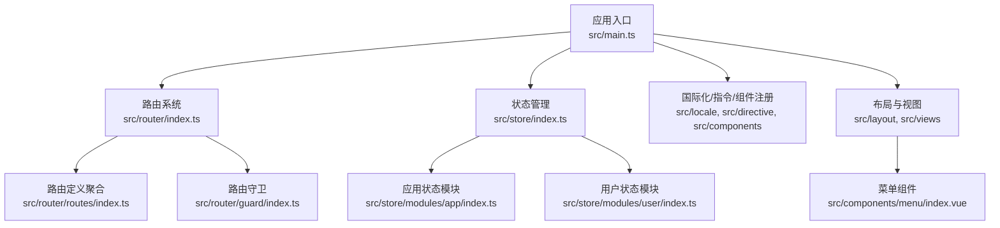
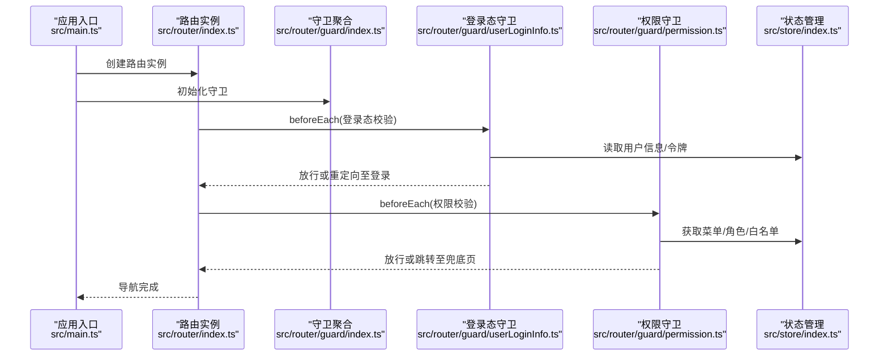
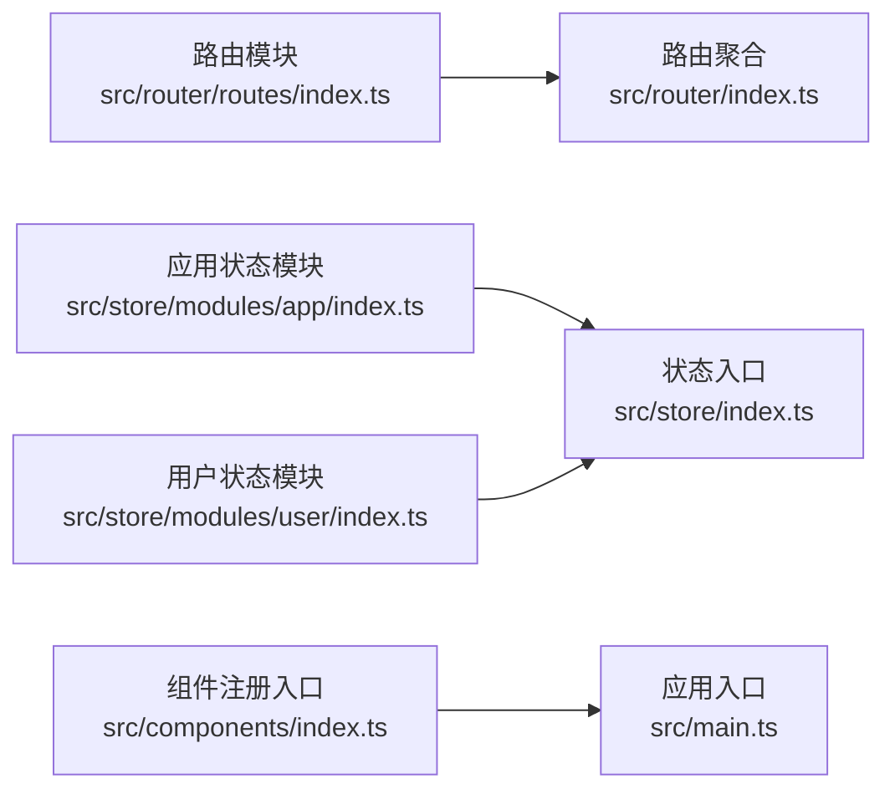
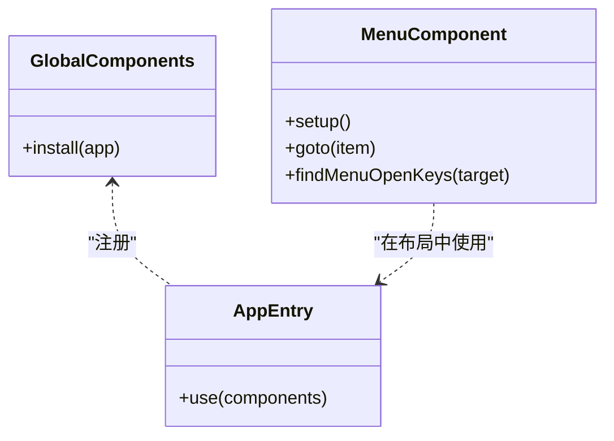
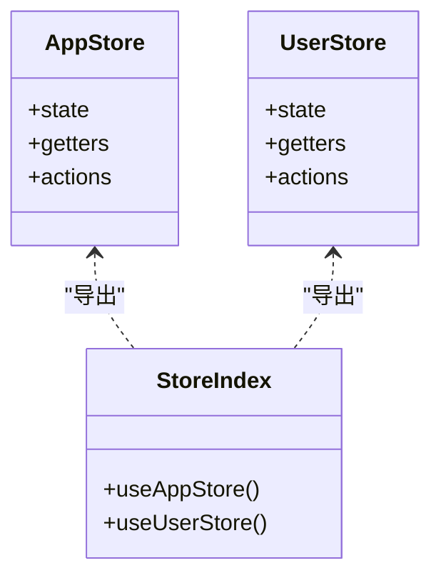
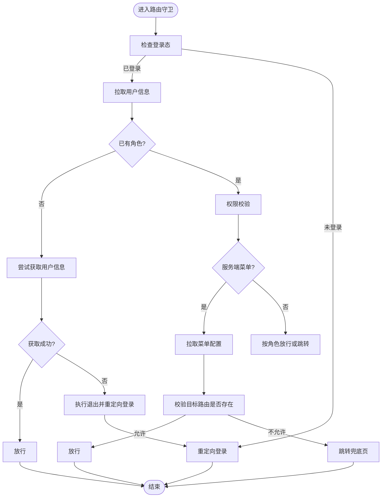
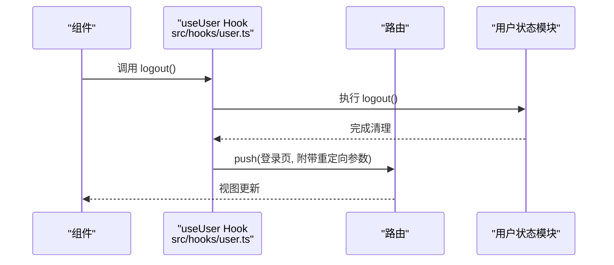
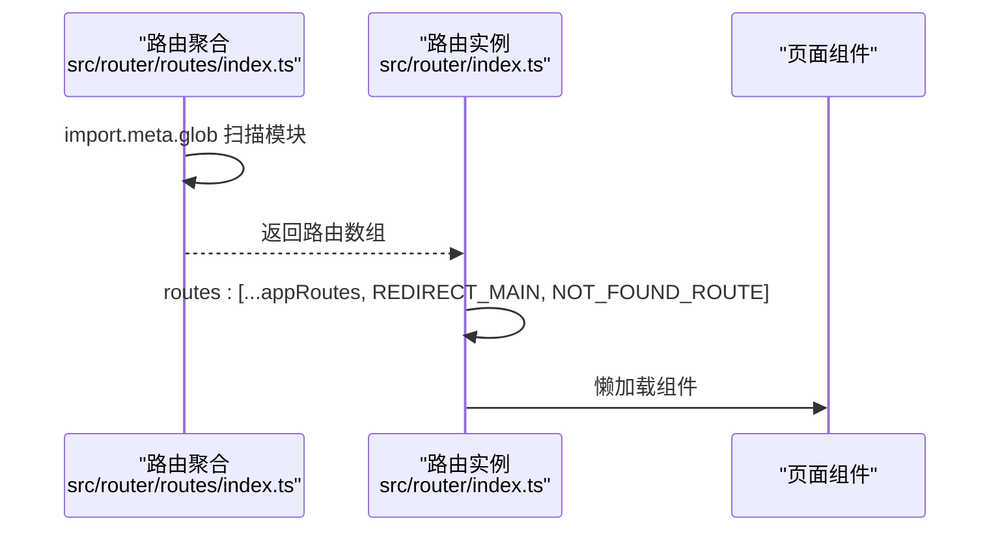
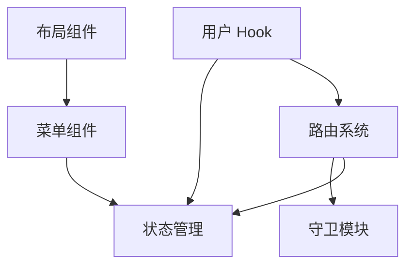

# 核心设计模式

<cite>
**本文引用的文件**
- [src/main.ts](file://src/main.ts)
- [src/store/index.ts](file://src/store/index.ts)
- [src/store/modules/app/index.ts](file://src/store/modules/app/index.ts)
- [src/store/modules/user/index.ts](file://src/store/modules/user/index.ts)
- [src/router/index.ts](file://src/router/index.ts)
- [src/router/routes/index.ts](file://src/router/routes/index.ts)
- [src/router/guard/index.ts](file://src/router/guard/index.ts)
- [src/router/guard/permission.ts](file://src/router/guard/permission.ts)
- [src/router/guard/userLoginInfo.ts](file://src/router/guard/userLoginInfo.ts)
- [src/layout/default-layout.vue](file://src/layout/default-layout.vue)
- [src/components/menu/index.vue](file://src/components/menu/index.vue)
- [src/hooks/chart-option.ts](file://src/hooks/chart-option.ts)
- [src/hooks/user.ts](file://src/hooks/user.ts)
- [src/utils/auth.ts](file://src/utils/auth.ts)
</cite>

## 目录
1. [引言](#引言)
2. [项目结构](#项目结构)
3. [核心组件](#核心组件)
4. [架构总览](#架构总览)
5. [详细组件分析](#详细组件分析)
6. [依赖分析](#依赖分析)
7. [性能考虑](#性能考虑)
8. [故障排查指南](#故障排查指南)
9. [结论](#结论)
10. [附录](#附录)

## 引言
本文件聚焦于该项目的核心设计模式与实现细节，系统解析以下模式在项目中的落地方式与价值：
- 模块化架构模式：以功能域划分 Store、路由模块与组件模块，提升可维护性与可扩展性。
- 组件化设计模式：通过全局注册与按需引入结合，统一组件生态与体积控制。
- 状态管理模式：基于 Pinia 的模块化 Store 设计，清晰分层与职责边界。
- 路由守卫模式：多级守卫串联（登录态、权限、页面变更），保障安全与一致性。

同时，文档解释了 Pinia 的模块化设计、Vue 组合式 API 的使用方式、以及路由系统的动态加载机制，并给出最佳实践与扩展建议。

## 项目结构
项目采用“功能域驱动”的模块化组织方式：
- 应用入口集中初始化插件与全局状态；路由与状态分别在独立目录下按模块拆分。
- 组件层通过统一入口导出与安装，既保证易用性又便于按需裁剪。
- 路由系统支持外部模块与内部模块的动态聚合，形成可扩展的路由体系。

图表来源
- [src/main.ts:1-29](file://src/main.ts#L1-L29)
- [src/router/index.ts:1-38](file://src/router/index.ts#L1-L38)
- [src/store/index.ts:1-10](file://src/store/index.ts#L1-L10)
- [src/router/routes/index.ts:1-26](file://src/router/routes/index.ts#L1-L26)
- [src/router/guard/index.ts:1-18](file://src/router/guard/index.ts#L1-L18)
- [src/store/modules/app/index.ts:1-78](file://src/store/modules/app/index.ts#L1-L78)
- [src/store/modules/user/index.ts:1-92](file://src/store/modules/user/index.ts#L1-L92)
- [src/layout/default-layout.vue:1-179](file://src/layout/default-layout.vue#L1-L179)
- [src/components/menu/index.vue:1-161](file://src/components/menu/index.vue#L1-L161)

章节来源
- [src/main.ts:1-29](file://src/main.ts#L1-L29)
- [src/router/index.ts:1-38](file://src/router/index.ts#L1-L38)
- [src/store/index.ts:1-10](file://src/store/index.ts#L1-L10)

## 核心组件
本节从设计模式视角，提炼关键组件与其职责边界与协作关系。

- 应用入口与插件装配
  - 在入口中集中注册路由、状态、国际化、指令与全局组件，确保启动流程一致且可追踪。
  - 关键路径参考：[src/main.ts:17-28](file://src/main.ts#L17-L28)

- 路由系统与守卫
  - 路由在入口中创建并注入守卫；守卫按功能拆分为登录态、权限与页面变更三类，职责清晰。
  - 关键路径参考：[src/router/index.ts:11-35](file://src/router/index.ts#L11-L35)、[src/router/guard/index.ts:13-17](file://src/router/guard/index.ts#L13-L17)

- 状态管理（Pinia）
  - Store 以模块化方式组织，入口仅做聚合导出，避免全局耦合；模块内定义状态、计算属性与动作。
  - 关键路径参考：[src/store/index.ts:1-9](file://src/store/index.ts#L1-L9)、[src/store/modules/app/index.ts:9-75](file://src/store/modules/app/index.ts#L9-L75)、[src/store/modules/user/index.ts:13-88](file://src/store/modules/user/index.ts#L13-L88)

- 布局与菜单
  - 布局组件负责整体结构与响应式行为，菜单组件负责根据路由生成树形结构与选中态联动。
  - 关键路径参考：[src/layout/default-layout.vue:47-105](file://src/layout/default-layout.vue#L47-L105)、[src/components/menu/index.vue:11-145](file://src/components/menu/index.vue#L11-L145)

章节来源
- [src/main.ts:17-28](file://src/main.ts#L17-L28)
- [src/router/index.ts:11-35](file://src/router/index.ts#L11-L35)
- [src/router/guard/index.ts:13-17](file://src/router/guard/index.ts#L13-L17)
- [src/store/index.ts:1-9](file://src/store/index.ts#L1-L9)
- [src/store/modules/app/index.ts:9-75](file://src/store/modules/app/index.ts#L9-L75)
- [src/store/modules/user/index.ts:13-88](file://src/store/modules/user/index.ts#L13-L88)
- [src/layout/default-layout.vue:47-105](file://src/layout/default-layout.vue#L47-L105)
- [src/components/menu/index.vue:11-145](file://src/components/menu/index.vue#L11-L145)

## 架构总览
下图展示应用启动到路由导航的关键交互，体现模块化与守卫串联的设计思路。

图表来源
- [src/main.ts:17-28](file://src/main.ts#L17-L28)
- [src/router/index.ts:35-35](file://src/router/index.ts#L35-L35)
- [src/router/guard/index.ts:13-17](file://src/router/guard/index.ts#L13-L17)
- [src/router/guard/userLoginInfo.ts:8-42](file://src/router/guard/userLoginInfo.ts#L8-L42)
- [src/router/guard/permission.ts:9-54](file://src/router/guard/permission.ts#L9-L54)
- [src/store/index.ts:1-9](file://src/store/index.ts#L1-L9)

## 详细组件分析

### 模块化架构模式
- 实现要点
  - 路由模块：通过 Vite 的 import.meta.glob 动态聚合模块文件，形成可扩展的路由表。
  - 状态模块：Store 按领域拆分，入口仅做聚合导出，降低耦合度。
  - 组件模块：全局组件注册入口统一导出，便于按需引入与体积优化。
- 应用场景
  - 新增页面时只需在对应模块目录新增路由文件，即可自动被聚合。
  - 新增业务状态时只需新增 Store 模块，入口无需改动。
- 优势
  - 可维护性强：职责单一、边界清晰。
  - 可扩展性好：新增模块无需修改既有代码。
- 最佳实践
  - 路由模块命名规范与 meta 字段约定统一。
  - Store 模块保持 state/getters/actions 分层清晰。

图表来源
- [src/router/routes/index.ts:3-25](file://src/router/routes/index.ts#L3-L25)
- [src/router/index.ts:5-33](file://src/router/index.ts#L5-L33)
- [src/store/modules/app/index.ts:1-78](file://src/store/modules/app/index.ts#L1-L78)
- [src/store/modules/user/index.ts:1-92](file://src/store/modules/user/index.ts#L1-L92)
- [src/store/index.ts:1-9](file://src/store/index.ts#L1-L9)
- [src/components/index.ts:30-35](file://src/components/index.ts#L30-L35)
- [src/main.ts:17-28](file://src/main.ts#L17-L28)

章节来源
- [src/router/routes/index.ts:3-25](file://src/router/routes/index.ts#L3-L25)
- [src/store/index.ts:1-9](file://src/store/index.ts#L1-L9)
- [src/components/index.ts:30-35](file://src/components/index.ts#L30-L35)

### 组件化设计模式
- 实现要点
  - 全局组件注册：通过统一入口导出 install 方法，集中注册常用组件。
  - 菜单组件：基于路由树渲染菜单，支持外链、选中态与展开态联动。
- 应用场景
  - 快速复用通用 UI 组件，减少重复开发。
  - 动态菜单与路由联动，提升用户体验。
- 最佳实践
  - 组件命名与目录结构规范化。
  - 对外暴露稳定 API，避免内部实现频繁变动。

图表来源
- [src/components/index.ts:30-35](file://src/components/index.ts#L30-L35)
- [src/components/menu/index.vue:11-145](file://src/components/menu/index.vue#L11-L145)
- [src/main.ts:19-25](file://src/main.ts#L19-L25)

章节来源
- [src/components/index.ts:30-35](file://src/components/index.ts#L30-L35)
- [src/components/menu/index.vue:11-145](file://src/components/menu/index.vue#L11-L145)
- [src/main.ts:19-25](file://src/main.ts#L19-L25)

### 状态管理模式（Pinia）
- 实现要点
  - 模块化 Store：应用设置与用户信息分别在不同模块中管理，职责分离。
  - 计算属性与动作：通过 getters 提供派生数据，actions 封装异步与副作用。
  - 入口聚合：在入口导出各模块 Hook，便于在组件中直接使用。
- 应用场景
  - 用户登录态与角色切换、主题切换、菜单拉取与清理。
- 最佳实践
  - 将副作用集中在 actions 中，保持 state 的纯净。
  - 使用 $patch/$reset 等 API 简化状态更新。

图表来源
- [src/store/modules/app/index.ts:9-75](file://src/store/modules/app/index.ts#L9-L75)
- [src/store/modules/user/index.ts:13-88](file://src/store/modules/user/index.ts#L13-L88)
- [src/store/index.ts:1-9](file://src/store/index.ts#L1-L9)

章节来源
- [src/store/modules/app/index.ts:9-75](file://src/store/modules/app/index.ts#L9-L75)
- [src/store/modules/user/index.ts:13-88](file://src/store/modules/user/index.ts#L13-L88)
- [src/store/index.ts:1-9](file://src/store/index.ts#L1-L9)

### 路由守卫模式
- 实现要点
  - 登录态守卫：校验令牌存在性，拉取用户信息，失败则重定向登录。
  - 权限守卫：根据菜单配置与角色判断是否放行，必要时拉取菜单。
  - 页面变更守卫：监听路由变化，同步菜单选中与展开状态。
- 应用场景
  - 保护受控页面，防止未授权访问。
  - 在服务端菜单场景下，动态拉取并校验路由权限。
- 最佳实践
  - 守卫顺序明确，避免重复请求。
  - 白名单与兜底页策略清晰。

图表来源
- [src/router/guard/userLoginInfo.ts:8-42](file://src/router/guard/userLoginInfo.ts#L8-L42)
- [src/router/guard/permission.ts:9-54](file://src/router/guard/permission.ts#L9-L54)
- [src/router/guard/index.ts:6-11](file://src/router/guard/index.ts#L6-L11)

章节来源
- [src/router/guard/userLoginInfo.ts:8-42](file://src/router/guard/userLoginInfo.ts#L8-L42)
- [src/router/guard/permission.ts:9-54](file://src/router/guard/permission.ts#L9-L54)
- [src/router/guard/index.ts:6-11](file://src/router/guard/index.ts#L6-L11)

### 组合式 API 与 Hooks 模式
- 实现要点
  - 在组件中通过组合式 API 访问 Store 与路由，封装业务逻辑为可复用的 Hook。
  - 示例：用户登出示例封装为 Hook，统一处理登出流程与路由跳转。
- 应用场景
  - 复用登录态、权限、图表主题等横切能力。
- 最佳实践
  - 将副作用与状态更新收敛到 Hook 内部，组件只关心调用。

图表来源
- [src/hooks/user.ts:6-24](file://src/hooks/user.ts#L6-L24)
- [src/store/modules/user/index.ts:81-87](file://src/store/modules/user/index.ts#L81-L87)
- [src/router/index.ts:11-33](file://src/router/index.ts#L11-L33)

章节来源
- [src/hooks/user.ts:6-24](file://src/hooks/user.ts#L6-L24)
- [src/store/modules/user/index.ts:81-87](file://src/store/modules/user/index.ts#L81-L87)
- [src/router/index.ts:11-33](file://src/router/index.ts#L11-L33)

### 路由系统的动态加载机制
- 实现要点
  - 使用 import.meta.glob 动态扫描模块文件，形成路由数组。
  - 路由在入口中以懒加载组件的方式注册，减少首屏体积。
- 应用场景
  - 按需加载页面，提升首屏性能。
- 最佳实践
  - 路由模块文件命名与导出规范，避免遗漏。

图表来源
- [src/router/routes/index.ts:3-25](file://src/router/routes/index.ts#L3-L25)
- [src/router/index.ts:5-33](file://src/router/index.ts#L5-L33)

章节来源
- [src/router/routes/index.ts:3-25](file://src/router/routes/index.ts#L3-L25)
- [src/router/index.ts:5-33](file://src/router/index.ts#L5-L33)

## 依赖分析
- 组件耦合与内聚
  - 路由与守卫解耦：守卫通过 Store 与工具函数间接依赖，避免强耦合。
  - Store 模块内聚：每个模块仅关注自身领域，入口仅做聚合。
- 外部依赖与集成点
  - 路由：vue-router、nprogress。
  - 状态：pinia。
  - UI：@arco-design/web-vue。
  - 工具：本地存储令牌、路由监听器等。
- 循环依赖风险
  - 当前结构未见明显循环依赖；若后续扩展，应避免模块间相互 import 导致的循环。

图表来源
- [src/router/index.ts:1-38](file://src/router/index.ts#L1-L38)
- [src/router/guard/index.ts:1-18](file://src/router/guard/index.ts#L1-L18)
- [src/store/index.ts:1-9](file://src/store/index.ts#L1-L9)
- [src/layout/default-layout.vue:47-105](file://src/layout/default-layout.vue#L47-L105)
- [src/components/menu/index.vue:11-145](file://src/components/menu/index.vue#L11-L145)
- [src/hooks/user.ts:6-24](file://src/hooks/user.ts#L6-L24)

章节来源
- [src/router/index.ts:1-38](file://src/router/index.ts#L1-L38)
- [src/router/guard/index.ts:1-18](file://src/router/guard/index.ts#L1-L18)
- [src/store/index.ts:1-9](file://src/store/index.ts#L1-L9)
- [src/layout/default-layout.vue:47-105](file://src/layout/default-layout.vue#L47-L105)
- [src/components/menu/index.vue:11-145](file://src/components/menu/index.vue#L11-L145)
- [src/hooks/user.ts:6-24](file://src/hooks/user.ts#L6-L24)

## 性能考虑
- 路由懒加载
  - 页面组件采用动态导入，减少首屏资源压力。
- 组件按需引入
  - 全局组件注册入口仅注册必要组件，避免全量引入。
- 状态更新粒度
  - 使用 $patch 进行局部更新，避免不必要的响应式开销。
- 主题与图表
  - 图表配置通过 computed 与 Store 主题联动，避免重复计算。

## 故障排查指南
- 登录态异常
  - 检查令牌本地存储与守卫逻辑，确认登录态守卫是否正确拉取用户信息。
  - 参考：[src/router/guard/userLoginInfo.ts:8-42](file://src/router/guard/userLoginInfo.ts#L8-L42)、[src/utils/auth.ts:1-20](file://src/utils/auth.ts#L1-L20)
- 权限拒绝
  - 检查权限守卫与菜单配置，确认目标路由是否在服务端菜单中。
  - 参考：[src/router/guard/permission.ts:9-54](file://src/router/guard/permission.ts#L9-L54)
- 菜单不联动
  - 检查菜单组件与路由监听器的联动逻辑，确认选中与展开状态更新。
  - 参考：[src/components/menu/index.vue:72-86](file://src/components/menu/index.vue#L72-L86)
- 首屏加载慢
  - 检查路由懒加载与组件注册是否生效，确认打包体积与分包策略。

章节来源
- [src/router/guard/userLoginInfo.ts:8-42](file://src/router/guard/userLoginInfo.ts#L8-L42)
- [src/utils/auth.ts:1-20](file://src/utils/auth.ts#L1-L20)
- [src/router/guard/permission.ts:9-54](file://src/router/guard/permission.ts#L9-L54)
- [src/components/menu/index.vue:72-86](file://src/components/menu/index.vue#L72-L86)

## 结论
本项目通过模块化架构、组件化设计、Pinia 状态管理与路由守卫模式，构建了高内聚、低耦合且易于扩展的前端工程骨架。路由与状态均采用模块化与动态加载机制，配合组合式 API 的 Hooks 模式，提升了开发效率与运行性能。建议在后续扩展中继续保持模块边界清晰、守卫顺序明确与状态更新粒度合理的原则。

## 附录
- 技术选型考量
  - 路由：vue-router 提供完善的导航与守卫能力，适合本项目多守卫串联需求。
  - 状态：Pinia 轻量、TypeScript 友好，适合模块化拆分与组合式 API 场景。
  - UI：Arco Design 适配后台管理场景，组件丰富且主题可控。
- 扩展性建议
  - 新增路由模块时遵循命名与导出规范，确保 import.meta.glob 正常工作。
  - 新增状态模块时保持 actions 的副作用隔离，避免跨模块强耦合。
  - 守卫逻辑持续演进：在复杂权限场景下可抽象更细粒度的权限 Hook。