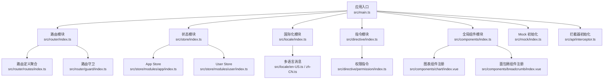
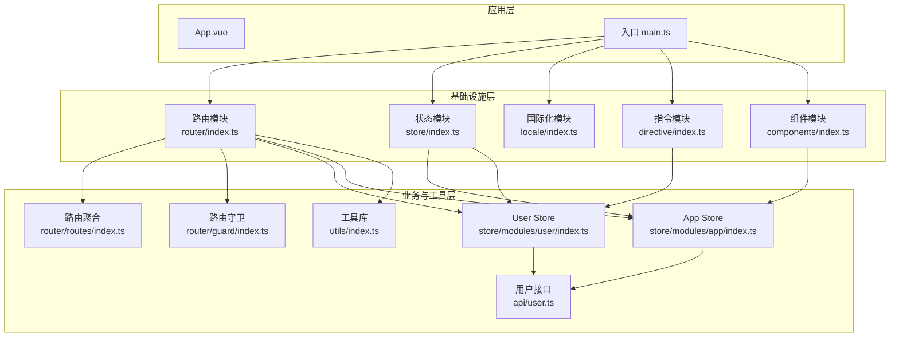
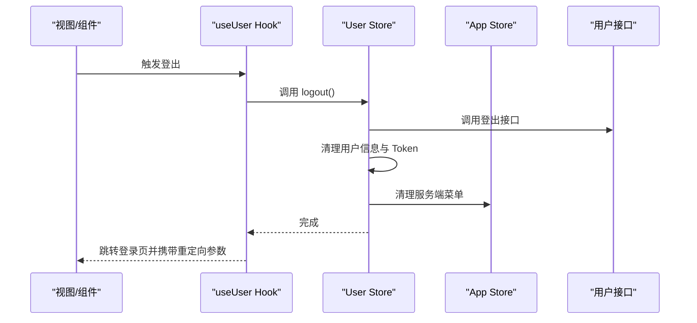
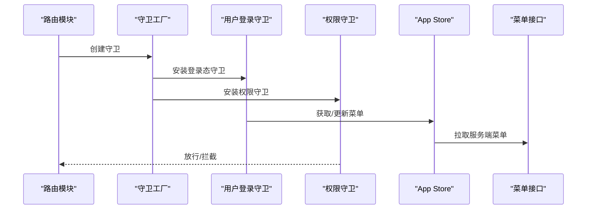
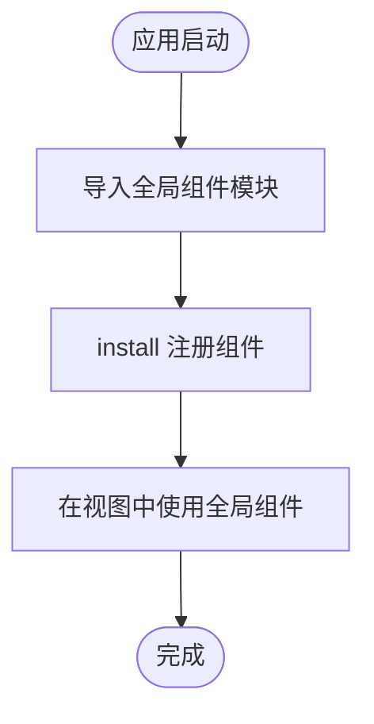
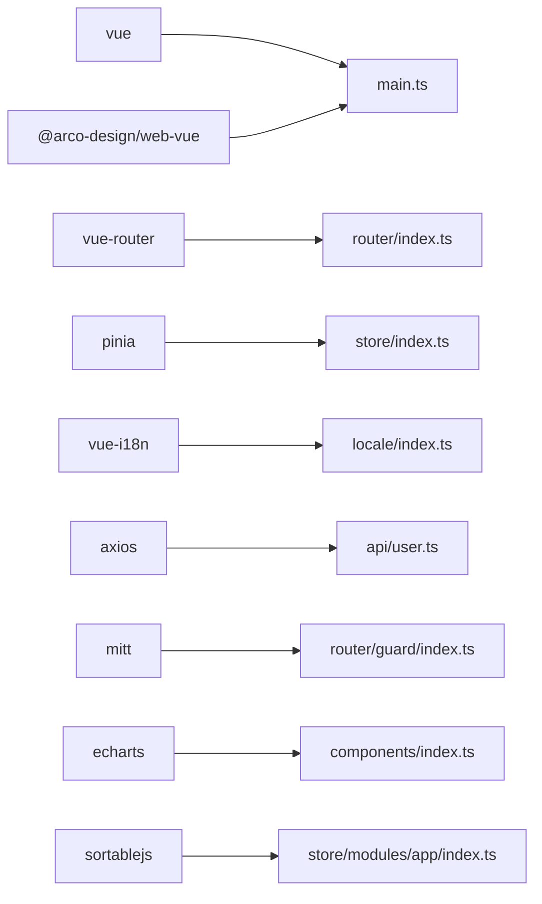

# 模块化架构模式

<cite>
**本文引用的文件**
- [src/main.ts](file://src/main.ts)
- [src/store/index.ts](file://src/store/index.ts)
- [src/router/index.ts](file://src/router/index.ts)
- [src/components/index.ts](file://src/components/index.ts)
- [src/directive/index.ts](file://src/directive/index.ts)
- [src/locale/index.ts](file://src/locale/index.ts)
- [src/store/modules/app/index.ts](file://src/store/modules/app/index.ts)
- [src/store/modules/user/index.ts](file://src/store/modules/user/index.ts)
- [src/router/routes/index.ts](file://src/router/routes/index.ts)
- [src/router/guard/index.ts](file://src/router/guard/index.ts)
- [src/hooks/user.ts](file://src/hooks/user.ts)
- [src/utils/index.ts](file://src/utils/index.ts)
- [src/api/user.ts](file://src/api/user.ts)
- [package.json](file://package.json)
</cite>

## 目录
1. [引言](#引言)
2. [项目结构](#项目结构)
3. [核心组件](#核心组件)
4. [架构总览](#架构总览)
5. [详细组件分析](#详细组件分析)
6. [依赖分析](#依赖分析)
7. [性能考虑](#性能考虑)
8. [故障排查指南](#故障排查指南)
9. [结论](#结论)
10. [附录](#附录)

## 引言
本文件系统性阐述该 Vue 3 管理后台项目的模块化架构设计与实现。重点围绕以下方面展开：功能域划分（store、router、components、hooks 等）如何定义模块边界；模块间的依赖关系与通信机制；模块化最佳实践（命名规范、导出导入策略、解耦方法）；并通过实际代码路径示例展示模块化带来的可维护性、可扩展性与可测试性优势。

## 项目结构
该项目采用“按功能域分层 + 按职责聚合”的组织方式：
- 入口层：应用启动入口集中初始化插件、路由、状态、国际化、指令与全局组件。
- 功能域层：store（状态管理）、router（路由与守卫）、components（全局组件注册）、hooks（组合式逻辑封装）、api（接口契约）、utils（工具库）、locale（国际化）、directive（指令）、views（页面视图）。
- 配置层：Vite 构建配置与插件、ESLint/Prettier/Stylelint 等开发规范配置。

**图表来源**
- [src/main.ts:1-29](file://src/main.ts#L1-L29)
- [src/router/index.ts:1-38](file://src/router/index.ts#L1-L38)
- [src/store/index.ts:1-10](file://src/store/index.ts#L1-L10)
- [src/locale/index.ts:1-23](file://src/locale/index.ts#L1-L23)
- [src/directive/index.ts:1-9](file://src/directive/index.ts#L1-L9)
- [src/components/index.ts:1-36](file://src/components/index.ts#L1-L36)
- [src/router/routes/index.ts:1-26](file://src/router/routes/index.ts#L1-L26)
- [src/router/guard/index.ts:1-18](file://src/router/guard/index.ts#L1-L18)
- [src/store/modules/app/index.ts:1-78](file://src/store/modules/app/index.ts#L1-L78)
- [src/store/modules/user/index.ts:1-92](file://src/store/modules/user/index.ts#L1-L92)

**章节来源**
- [src/main.ts:1-29](file://src/main.ts#L1-L29)
- [package.json:1-103](file://package.json#L1-L103)

## 核心组件
本节聚焦四大核心模块：store、router、components、hooks 的职责边界、导出导入策略与交互方式。

- store 模块
  - 职责：集中管理应用状态（主题、设备、菜单、用户信息等），提供 getter/action。
  - 导出策略：统一在根 index 中导出各模块 store 实例，便于全局按需引入。
  - 交互方式：模块间通过 store 内部状态共享与 action 调用实现松耦合协作。

- router 模块
  - 职责：路由定义、导航守卫、进度条控制。
  - 导出策略：集中导出路由实例，配合守卫工厂函数统一装配。
  - 交互方式：与 store（菜单、权限）、api（动态菜单）、utils（路由事件）协作。

- components 模块
  - 职责：全局组件注册与按需引入 ECharts 图表模块，减少打包体积。
  - 导出策略：安装函数 install 返回对象，供应用入口统一 app.use 注册。

- hooks 模块
  - 职责：封装可复用的组合式逻辑（如用户登出流程），降低组件复杂度。
  - 导出策略：按功能拆分文件，按需引入 store 与 router。

**章节来源**
- [src/store/index.ts:1-10](file://src/store/index.ts#L1-L10)
- [src/store/modules/app/index.ts:1-78](file://src/store/modules/app/index.ts#L1-L78)
- [src/store/modules/user/index.ts:1-92](file://src/store/modules/user/index.ts#L1-L92)
- [src/router/index.ts:1-38](file://src/router/index.ts#L1-L38)
- [src/router/guard/index.ts:1-18](file://src/router/guard/index.ts#L1-L18)
- [src/components/index.ts:1-36](file://src/components/index.ts#L1-L36)
- [src/hooks/user.ts:1-25](file://src/hooks/user.ts#L1-L25)

## 架构总览
下图展示了模块化架构中各子系统的交互关系与数据流向。

**图表来源**
- [src/main.ts:1-29](file://src/main.ts#L1-L29)
- [src/router/index.ts:1-38](file://src/router/index.ts#L1-L38)
- [src/store/index.ts:1-10](file://src/store/index.ts#L1-L10)
- [src/locale/index.ts:1-23](file://src/locale/index.ts#L1-L23)
- [src/directive/index.ts:1-9](file://src/directive/index.ts#L1-L9)
- [src/components/index.ts:1-36](file://src/components/index.ts#L1-L36)
- [src/router/routes/index.ts:1-26](file://src/router/routes/index.ts#L1-L26)
- [src/router/guard/index.ts:1-18](file://src/router/guard/index.ts#L1-L18)
- [src/store/modules/app/index.ts:1-78](file://src/store/modules/app/index.ts#L1-L78)
- [src/store/modules/user/index.ts:1-92](file://src/store/modules/user/index.ts#L1-L92)
- [src/api/user.ts:1-28](file://src/api/user.ts#L1-L28)
- [src/utils/index.ts:1-26](file://src/utils/index.ts#L1-L26)

## 详细组件分析

### Store 模块：状态域划分与交互
- 模块边界
  - app 模块：应用级设置、主题切换、设备类型、服务端菜单拉取与通知提示。
  - user 模块：用户信息、登录登出、角色切换、与路由监听移除的联动。
- 导出导入策略
  - 在根 index 统一导出各模块 store 实例，便于按需引入与避免循环依赖。
- 通信机制
  - 用户登出时，调用 app 模块清理服务端菜单，确保状态一致性。
  - 应用主题切换通过 DOM 属性同步，避免跨组件重复计算。

**图表来源**
- [src/hooks/user.ts:1-25](file://src/hooks/user.ts#L1-L25)
- [src/store/modules/user/index.ts:1-92](file://src/store/modules/user/index.ts#L1-L92)
- [src/store/modules/app/index.ts:1-78](file://src/store/modules/app/index.ts#L1-L78)
- [src/api/user.ts:1-28](file://src/api/user.ts#L1-L28)

**章节来源**
- [src/store/index.ts:1-10](file://src/store/index.ts#L1-L10)
- [src/store/modules/app/index.ts:1-78](file://src/store/modules/app/index.ts#L1-L78)
- [src/store/modules/user/index.ts:1-92](file://src/store/modules/user/index.ts#L1-L92)

### Router 模块：路由定义与守卫
- 模块边界
  - 路由定义：基础路由与动态模块路由聚合，支持外部模块扩展。
  - 路由守卫：页面级守卫、用户登录态守卫、权限守卫。
- 导出导入策略
  - 使用工厂函数装配守卫，避免在路由实例上直接写入逻辑，提升可测试性。
- 通信机制
  - 路由变化时通过事件发射器通知其他模块，实现跨模块解耦。

**图表来源**
- [src/router/index.ts:1-38](file://src/router/index.ts#L1-L38)
- [src/router/guard/index.ts:1-18](file://src/router/guard/index.ts#L1-L18)
- [src/store/modules/app/index.ts:1-78](file://src/store/modules/app/index.ts#L1-L78)
- [src/api/user.ts:1-28](file://src/api/user.ts#L1-L28)

**章节来源**
- [src/router/index.ts:1-38](file://src/router/index.ts#L1-L38)
- [src/router/routes/index.ts:1-26](file://src/router/routes/index.ts#L1-L26)
- [src/router/guard/index.ts:1-18](file://src/router/guard/index.ts#L1-L18)

### Components 模块：全局组件注册与按需引入
- 模块边界
  - 统一注册全局组件（如图表、面包屑），并按需引入 ECharts 子模块以优化包体积。
- 导出导入策略
  - 提供 install 函数，应用入口通过 app.use 注册，避免分散注册导致的遗漏。
- 通信机制
  - 通过 props/event 与父组件通信，不直接依赖 store，保持组件可复用性。

**图表来源**
- [src/components/index.ts:1-36](file://src/components/index.ts#L1-L36)

**章节来源**
- [src/components/index.ts:1-36](file://src/components/index.ts#L1-L36)

### Hooks 模块：组合式逻辑封装
- 模块边界
  - 将可复用逻辑（如用户登出）抽取为独立 hook，降低组件复杂度。
- 导出导入策略
  - 按功能拆分文件，按需引入 store 与 router，避免全局污染。
- 通信机制
  - 通过 store 与 router 的组合使用，实现跨模块协作。

**章节来源**
- [src/hooks/user.ts:1-25](file://src/hooks/user.ts#L1-L25)

### 国际化与指令模块
- 国际化模块
  - 基于 vue-i18n 创建多语言实例，支持本地存储选择语言。
- 指令模块
  - 权限指令通过 install 注册，统一在入口启用。

**章节来源**
- [src/locale/index.ts:1-23](file://src/locale/index.ts#L1-L23)
- [src/directive/index.ts:1-9](file://src/directive/index.ts#L1-L9)

## 依赖分析
- 外部依赖
  - 核心运行时：vue、vue-router、pinia、vue-i18n、@arco-design/web-vue。
  - 工具与生态：axios、mitt（事件总线）、nprogress（进度条）、echarts、sortablejs 等。
- 内部依赖
  - store 依赖 api 接口与 utils 工具。
  - router 依赖 store、api、utils，同时向 store 发送路由事件。
  - components 依赖第三方图表库，按需引入以减小体积。
  - hooks 依赖 store 与 router，提供高层抽象。

**图表来源**
- [package.json:32-48](file://package.json#L32-L48)
- [src/main.ts:1-29](file://src/main.ts#L1-L29)
- [src/router/index.ts:1-38](file://src/router/index.ts#L1-L38)
- [src/store/index.ts:1-10](file://src/store/index.ts#L1-L10)
- [src/locale/index.ts:1-23](file://src/locale/index.ts#L1-L23)
- [src/api/user.ts:1-28](file://src/api/user.ts#L1-L28)
- [src/router/guard/index.ts:1-18](file://src/router/guard/index.ts#L1-L18)
- [src/components/index.ts:1-36](file://src/components/index.ts#L1-L36)
- [src/store/modules/app/index.ts:1-78](file://src/store/modules/app/index.ts#L1-L78)

**章节来源**
- [package.json:1-103](file://package.json#L1-L103)

## 性能考虑
- 按需引入与懒加载
  - 路由组件使用异步加载，减少首屏体积。
  - ECharts 按需引入渲染器与图表组件，避免全量引入导致体积膨胀。
- 打包与构建
  - 通过 Vite 插件链路（样式导入、压缩、可视化等）优化产物体积与构建速度。
- 运行时性能
  - Pinia 状态变更粒度细，getter 缓存合理使用，避免不必要的响应式开销。
  - 路由守卫尽量轻量化，避免阻塞主流程。

## 故障排查指南
- 登录后无法进入首页或菜单为空
  - 检查用户登录成功后是否正确设置 Token 并触发菜单拉取。
  - 确认 App Store 的服务端菜单拉取 action 是否被调用且无异常。
- 权限控制失效
  - 检查路由守卫是否正确安装与执行，确认权限守卫逻辑与用户角色匹配。
- 组件未生效
  - 确认全局组件模块已通过 app.use 注册，且组件名称一致。
- 国际化不生效
  - 检查默认语言选择与本地存储键值，确认 i18n 实例创建参数正确。

**章节来源**
- [src/store/modules/user/index.ts:1-92](file://src/store/modules/user/index.ts#L1-L92)
- [src/store/modules/app/index.ts:1-78](file://src/store/modules/app/index.ts#L1-L78)
- [src/router/guard/index.ts:1-18](file://src/router/guard/index.ts#L1-L18)
- [src/components/index.ts:1-36](file://src/components/index.ts#L1-L36)
- [src/locale/index.ts:1-23](file://src/locale/index.ts#L1-L23)

## 结论
该工程通过清晰的功能域划分与模块化设计，实现了高内聚、低耦合的前端架构。store、router、components、hooks 各司其职，配合统一的导出导入策略与事件通信机制，既保证了扩展性，也提升了可维护性与可测试性。建议在后续迭代中持续完善模块边界、细化错误处理与日志埋点，并探索模块热更新与微前端集成的可能性。

## 附录
- 最佳实践清单
  - 命名规范：模块文件夹采用名词短语（如 store/modules/user），导出统一在根 index 聚合。
  - 导出导入策略：优先使用工厂函数与 install 模式，避免在模块内直接副作用。
  - 解耦方法：通过事件发射器（mitt）与 store getter/action 传递状态，避免直接互相引用。
  - 可测试性：将副作用（网络请求、DOM 操作）隔离到 api/utils，便于单元测试替换。