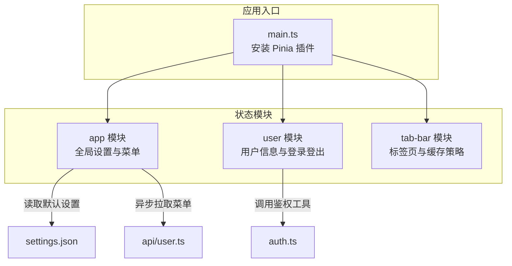
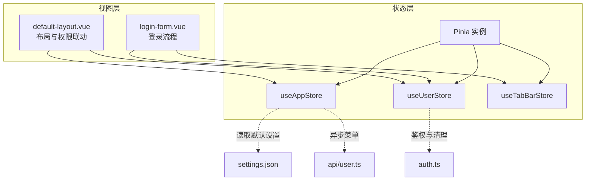
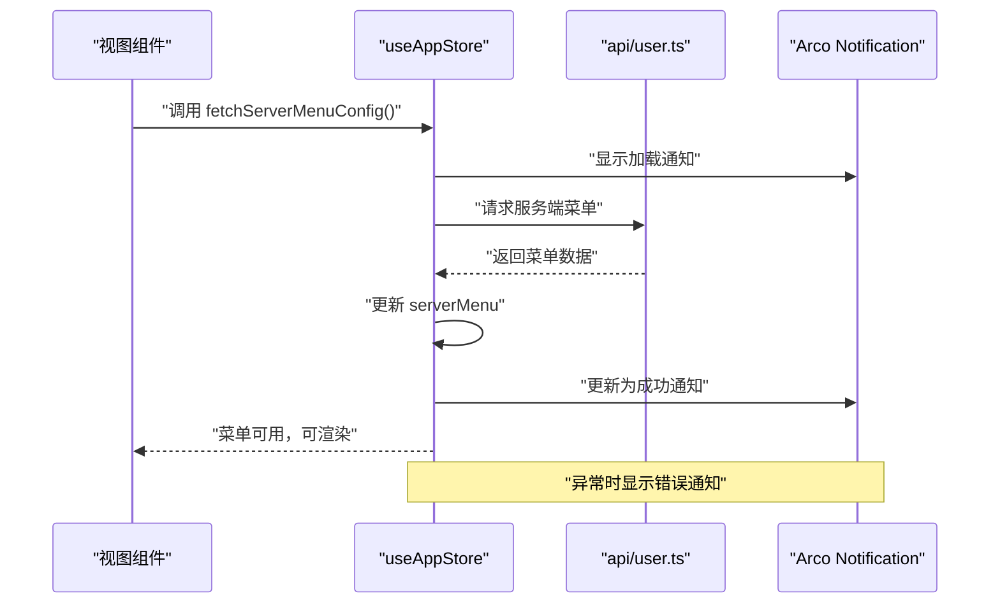
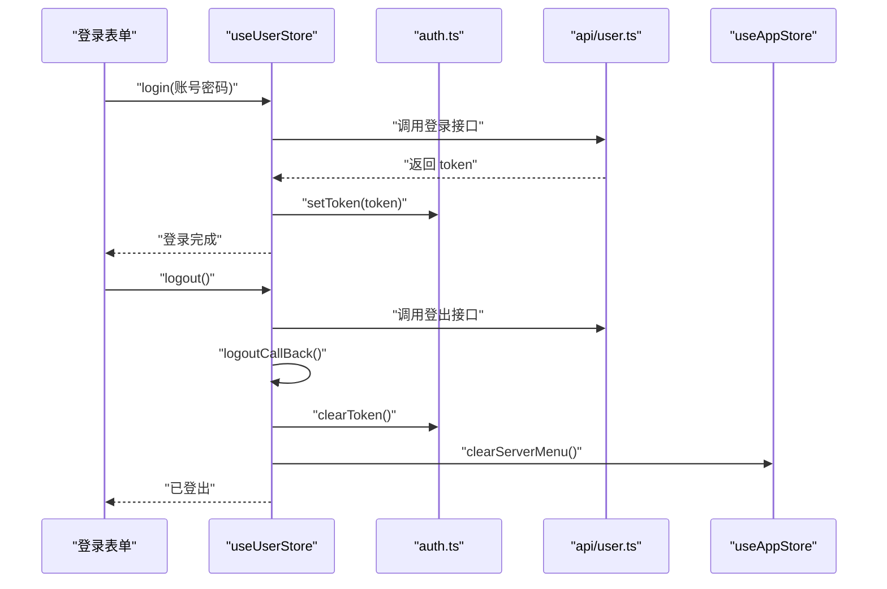
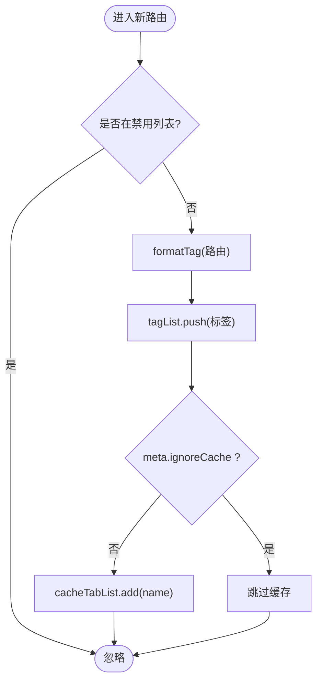
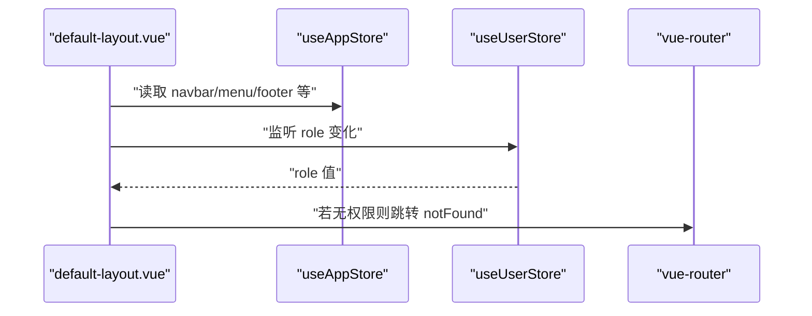
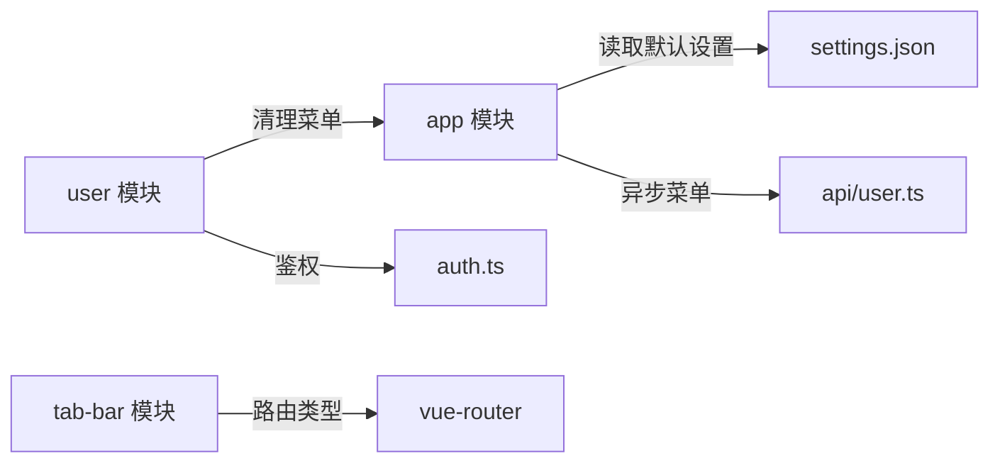

# 状态管理模式

<cite>
**本文引用的文件**
- [src/store/index.ts](file://src/store/index.ts)
- [src/store/modules/app/index.ts](file://src/store/modules/app/index.ts)
- [src/store/modules/user/index.ts](file://src/store/modules/user/index.ts)
- [src/store/modules/tab-bar/index.ts](file://src/store/modules/tab-bar/index.ts)
- [src/store/modules/app/types.ts](file://src/store/modules/app/types.ts)
- [src/store/modules/user/types.ts](file://src/store/modules/user/types.ts)
- [src/store/modules/tab-bar/types.ts](file://src/store/modules/tab-bar/types.ts)
- [src/config/settings.json](file://src/config/settings.json)
- [src/main.ts](file://src/main.ts)
- [src/utils/auth.ts](file://src/utils/auth.ts)
- [src/layout/default-layout.vue](file://src/layout/default-layout.vue)
- [src/views/login/components/login-form.vue](file://src/views/login/components/login-form.vue)
</cite>

## 目录
1. [引言](#引言)
2. [项目结构](#项目结构)
3. [核心组件](#核心组件)
4. [架构总览](#架构总览)
5. [详细组件分析](#详细组件分析)
6. [依赖关系分析](#依赖关系分析)
7. [性能考量](#性能考量)
8. [故障排查指南](#故障排查指南)
9. [结论](#结论)
10. [附录](#附录)

## 引言
本文件系统性阐述本项目的状态管理模式，基于 Pinia 的模块化状态管理架构，覆盖应用全局设置（app）、用户信息（user）、标签页缓存（tab-bar）三大模块。文档从设计模式与实现原理出发，解释响应式更新机制、action 的异步处理、getter 的计算属性模式，并总结最佳实践与调试技巧，帮助开发者以简洁、可维护的方式组织状态逻辑。

## 项目结构
本项目采用按功能模块划分的 store 组织方式：根 store 负责注册与导出各模块；每个模块独立定义 state、getters、actions，并通过类型定义约束数据结构。应用启动时在入口文件中安装 Pinia 插件，随后在组件中通过组合式 API 使用各模块的 store。

图示来源
- [src/main.ts:1-29](file://src/main.ts#L1-L29)
- [src/store/index.ts:1-10](file://src/store/index.ts#L1-L10)
- [src/store/modules/app/index.ts:1-78](file://src/store/modules/app/index.ts#L1-L78)
- [src/store/modules/user/index.ts:1-92](file://src/store/modules/user/index.ts#L1-L92)
- [src/store/modules/tab-bar/index.ts:1-75](file://src/store/modules/tab-bar/index.ts#L1-L75)
- [src/config/settings.json:1-18](file://src/config/settings.json#L1-L18)
- [src/utils/auth.ts:1-20](file://src/utils/auth.ts#L1-L20)

章节来源
- [src/main.ts:1-29](file://src/main.ts#L1-L29)
- [src/store/index.ts:1-10](file://src/store/index.ts#L1-L10)

## 核心组件
- 应用状态（app）
  - 职责：管理主题、布局、菜单、设备、服务端菜单等全局设置；提供响应式 getter 访问当前设置与设备信息；提供异步 action 拉取服务端菜单并通知用户。
  - 关键点：使用 $patch 增量更新；通过 $router 的类型断言暴露服务端菜单；切换主题时同步 DOM 属性。
- 用户状态（user）
  - 职责：维护用户资料、角色；提供登录、登出、切换角色、获取用户信息等动作；登出后清理本地 token、路由监听与服务端菜单。
  - 关键点：登录成功写入 token；登出统一回调清理状态；info 动作用于刷新用户资料。
- 标签页状态（tab-bar）
  - 职责：维护标签页列表与缓存集合；支持新增、删除、重置标签页；根据路由元信息决定是否缓存。
  - 关键点：tagList 为数组，cacheTabList 为 Set，保证去重与高效查找；支持批量刷新与重置。

章节来源
- [src/store/modules/app/index.ts:1-78](file://src/store/modules/app/index.ts#L1-L78)
- [src/store/modules/user/index.ts:1-92](file://src/store/modules/user/index.ts#L1-L92)
- [src/store/modules/tab-bar/index.ts:1-75](file://src/store/modules/tab-bar/index.ts#L1-L75)

## 架构总览
下图展示了组件如何消费 store，以及模块间的依赖关系与数据流向。

图示来源
- [src/layout/default-layout.vue:47-106](file://src/layout/default-layout.vue#L47-L106)
- [src/views/login/components/login-form.vue:66-129](file://src/views/login/components/login-form.vue#L66-L129)
- [src/store/index.ts:1-10](file://src/store/index.ts#L1-L10)
- [src/store/modules/app/index.ts:1-78](file://src/store/modules/app/index.ts#L1-L78)
- [src/store/modules/user/index.ts:1-92](file://src/store/modules/user/index.ts#L1-L92)
- [src/store/modules/tab-bar/index.ts:1-75](file://src/store/modules/tab-bar/index.ts#L1-L75)
- [src/config/settings.json:1-18](file://src/config/settings.json#L1-L18)
- [src/utils/auth.ts:1-20](file://src/utils/auth.ts#L1-L20)

## 详细组件分析

### 应用状态（app）分析
- 设计要点
  - 使用 defineStore 定义模块，state 初始化来自 settings.json 的默认配置，确保一致的初始状态。
  - getters 提供只读视图与派生数据，如当前设置副本、设备类型、服务端菜单。
  - actions 负责变更与异步操作：updateSettings 使用 $patch 增量更新；toggleTheme 切换主题并同步 DOM 属性；fetchServerMenuConfig 异步拉取菜单并以通知反馈进度与结果。
- 数据流
  - 组件通过 computed 读取 appStore 的 getter，响应式地驱动 UI 更新。
  - 登录或初始化阶段触发 fetchServerMenuConfig，将返回的菜单注入到 state 中，供路由与菜单渲染使用。

图示来源
- [src/store/modules/app/index.ts:47-70](file://src/store/modules/app/index.ts#L47-L70)

章节来源
- [src/store/modules/app/index.ts:1-78](file://src/store/modules/app/index.ts#L1-L78)
- [src/store/modules/app/types.ts:1-21](file://src/store/modules/app/types.ts#L1-L21)
- [src/config/settings.json:1-18](file://src/config/settings.json#L1-L18)

### 用户状态（user）分析
- 设计要点
  - state 定义了丰富的用户字段，便于在多处组件复用；role 字段用于权限控制。
  - getters 提供 userInfo 视图，便于组件直接消费不可变快照。
  - actions 包含同步与异步两类：switchRoles 返回 Promise 以支持切换后的后续逻辑；setInfo/resetInfo 通过 $patch/$reset 管理局部与全量重置；info/login/logout 封装业务流程。
  - logout 回调中统一清理 token、路由监听与服务端菜单，避免状态泄漏。
- 数据流
  - 登录成功后写入 token；退出登录时清理本地状态与远端资源，确保会话安全。

图示来源
- [src/store/modules/user/index.ts:64-87](file://src/store/modules/user/index.ts#L64-L87)
- [src/utils/auth.ts:11-17](file://src/utils/auth.ts#L11-L17)
- [src/store/modules/user/index.ts:73-79](file://src/store/modules/user/index.ts#L73-L79)

章节来源
- [src/store/modules/user/index.ts:1-92](file://src/store/modules/user/index.ts#L1-L92)
- [src/store/modules/user/types.ts:1-20](file://src/store/modules/user/types.ts#L1-L20)
- [src/utils/auth.ts:1-20](file://src/utils/auth.ts#L1-L20)

### 标签页状态（tab-bar）分析
- 设计要点
  - state 维护 tagList（标签列表）与 cacheTabList（缓存集合），二者保持一致性。
  - formatTag 将路由对象标准化为 TagProps，统一标题、名称、路径与缓存策略。
  - 支持增删改查：updateTabList 新增标签并按 ignoreCache 决定是否加入缓存；deleteTag 删除指定标签与缓存；freshTabList 批量刷新；resetTabList 重置为默认。
- 数据流
  - 路由变化时，组件调用 updateTabList 将新路由转换为标签并加入列表；关闭标签时通过 deleteTag 同步移除；页面刷新或权限变化时可通过 freshTabList 或 resetTabList 重建状态。

图示来源
- [src/store/modules/tab-bar/index.ts:11-20](file://src/store/modules/tab-bar/index.ts#L11-L20)
- [src/store/modules/tab-bar/index.ts:40-46](file://src/store/modules/tab-bar/index.ts#L40-L46)

章节来源
- [src/store/modules/tab-bar/index.ts:1-75](file://src/store/modules/tab-bar/index.ts#L1-L75)
- [src/store/modules/tab-bar/types.ts:1-13](file://src/store/modules/tab-bar/types.ts#L1-L13)

### 组件与 store 的交互
- 布局组件（default-layout.vue）
  - 通过 computed 读取 appStore 的布局与菜单相关状态，驱动侧边栏、底部、导航栏的显示与样式。
  - 监听 userStore.role 变化，结合权限守卫动态跳转至无权限页面，保障访问安全。
- 登录组件（login-form.vue）
  - 在提交时调用 userStore.login，成功后根据路由参数跳转首页并提示成功；失败时显示错误消息。

图示来源
- [src/layout/default-layout.vue:67-95](file://src/layout/default-layout.vue#L67-L95)

章节来源
- [src/layout/default-layout.vue:47-106](file://src/layout/default-layout.vue#L47-L106)
- [src/views/login/components/login-form.vue:66-129](file://src/views/login/components/login-form.vue#L66-L129)

## 依赖关系分析
- 模块内聚与解耦
  - app 模块与用户、路由存在弱耦合（菜单与权限），但通过 API 抽象隔离具体实现。
  - user 模块依赖鉴权工具与路由监听清理，logout 回调中再联动 app 模块清理服务端菜单，形成清晰的副作用边界。
  - tab-bar 模块仅依赖路由类型与工具函数，不引入业务 API，职责单一。
- 外部依赖
  - Arco Design 通知组件用于菜单加载反馈。
  - vue-router 类型断言用于菜单数据结构兼容。
  - localStorage 通过 auth 工具封装，避免跨模块重复实现。

图示来源
- [src/store/modules/app/index.ts:5-7](file://src/store/modules/app/index.ts#L5-L7)
- [src/store/modules/user/index.ts:7-11](file://src/store/modules/user/index.ts#L7-L11)
- [src/utils/auth.ts:1-20](file://src/utils/auth.ts#L1-L20)

章节来源
- [src/store/modules/app/index.ts:1-78](file://src/store/modules/app/index.ts#L1-L78)
- [src/store/modules/user/index.ts:1-92](file://src/store/modules/user/index.ts#L1-L92)
- [src/store/modules/tab-bar/index.ts:1-75](file://src/store/modules/tab-bar/index.ts#L1-L75)

## 性能考量
- 响应式粒度
  - 使用 getters 提供细粒度的派生数据，避免在模板中做复杂计算，降低不必要的重渲染。
- 异步处理
  - 对外暴露的异步 action（如 fetchServerMenuConfig、login、logout）集中处理错误与通知，减少组件中的分支逻辑。
- 缓存策略
  - tab-bar 使用 Set 存储缓存名，查询与去重时间复杂度低；批量刷新时先过滤再加入，避免重复遍历。
- 渲染优化
  - 布局组件通过 computed 读取 store，配合 Vue 的响应式系统，仅在依赖变化时更新对应区域。

## 故障排查指南
- 登录后无法进入页面
  - 检查 userStore.login 是否正确写入 token；确认鉴权工具 setToken 的实现与作用域。
  - 排查权限守卫逻辑，确保 role 变更后路由跳转正常。
- 主题切换无效
  - 确认 appStore.toggleTheme 是否被调用；检查 DOM 属性设置与移除逻辑。
- 服务端菜单未生效
  - 检查 fetchServerMenuConfig 的调用时机与 API 返回结构；确认 serverMenu 注入成功且类型断言有效。
- 标签页不更新
  - 确认路由变化时是否调用了 updateTabList；检查 ignoreCache 元信息与禁用列表配置。

章节来源
- [src/store/modules/user/index.ts:64-87](file://src/store/modules/user/index.ts#L64-L87)
- [src/store/modules/app/index.ts:32-40](file://src/store/modules/app/index.ts#L32-L40)
- [src/store/modules/app/index.ts:47-70](file://src/store/modules/app/index.ts#L47-L70)
- [src/store/modules/tab-bar/index.ts:40-46](file://src/store/modules/tab-bar/index.ts#L40-L46)

## 结论
本项目以 Pinia 为核心构建了清晰、可维护的状态管理体系：模块化拆分明确、响应式更新直观、异步流程集中封装、类型约束完善。通过合理的 getter 与 action 设计，既保证了数据的一致性，又提升了开发效率与可测试性。建议在后续迭代中继续坚持“单一职责”“最小暴露面”的原则，并结合持久化方案与调试工具进一步增强可观测性与稳定性。

## 附录
- 最佳实践清单
  - 状态设计原则：优先使用只读 getter 暴露派生数据；对可变状态使用 $patch 进行增量更新。
  - 模块化组织：按领域拆分 store，避免跨模块强耦合；必要时通过回调或事件解耦。
  - 异步处理：将网络请求与错误处理收敛到 action；对外暴露 Promise 以便上层等待。
  - 状态持久化：结合浏览器存储或插件实现关键状态的持久化，注意敏感信息的安全存储。
  - 调试技巧：利用浏览器的 Vue DevTools 与 Pinia 插件观察状态变更；为关键 action 添加日志或埋点。
- 示例参考路径
  - 应用设置更新：[src/store/modules/app/index.ts:26-29](file://src/store/modules/app/index.ts#L26-L29)
  - 主题切换：[src/store/modules/app/index.ts:32-40](file://src/store/modules/app/index.ts#L32-L40)
  - 服务端菜单拉取：[src/store/modules/app/index.ts:47-70](file://src/store/modules/app/index.ts#L47-L70)
  - 用户登录：[src/store/modules/user/index.ts:64-72](file://src/store/modules/user/index.ts#L64-L72)
  - 用户登出：[src/store/modules/user/index.ts:81-87](file://src/store/modules/user/index.ts#L81-L87)
  - 标签页新增：[src/store/modules/tab-bar/index.ts:40-46](file://src/store/modules/tab-bar/index.ts#L40-L46)
  - 标签页重置：[src/store/modules/tab-bar/index.ts:66-70](file://src/store/modules/tab-bar/index.ts#L66-L70)