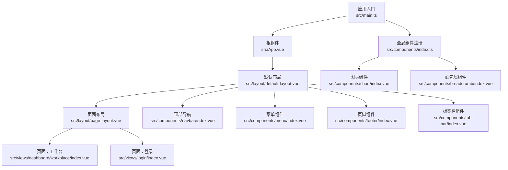
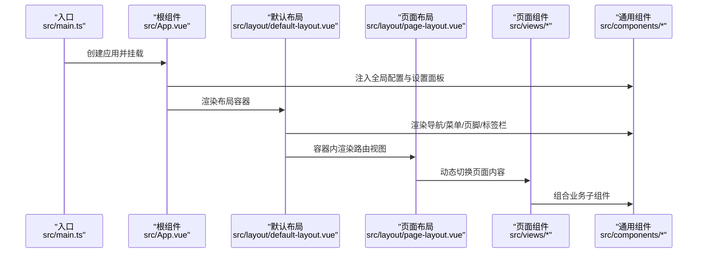
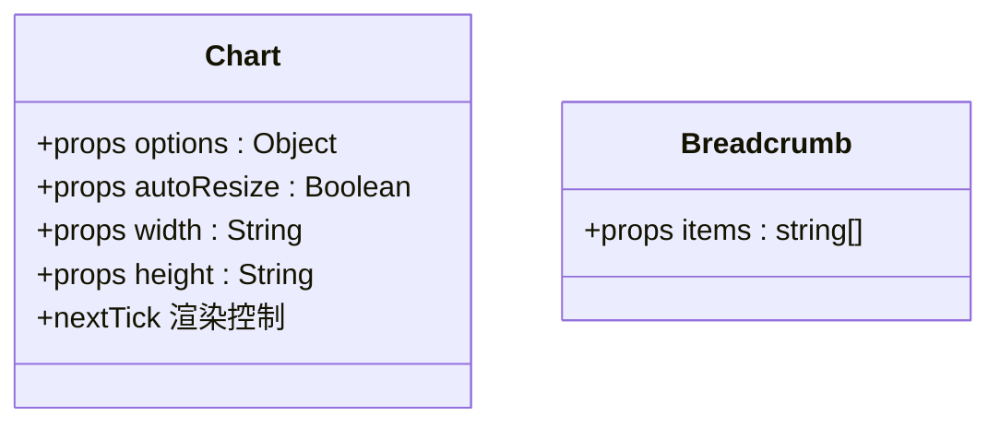
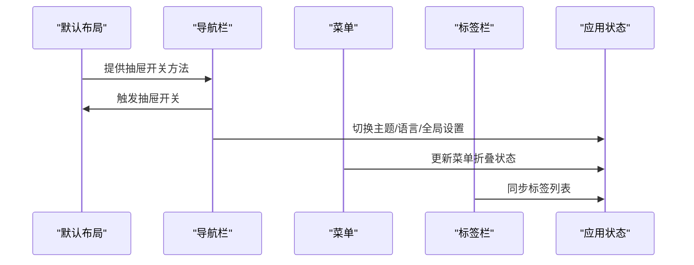
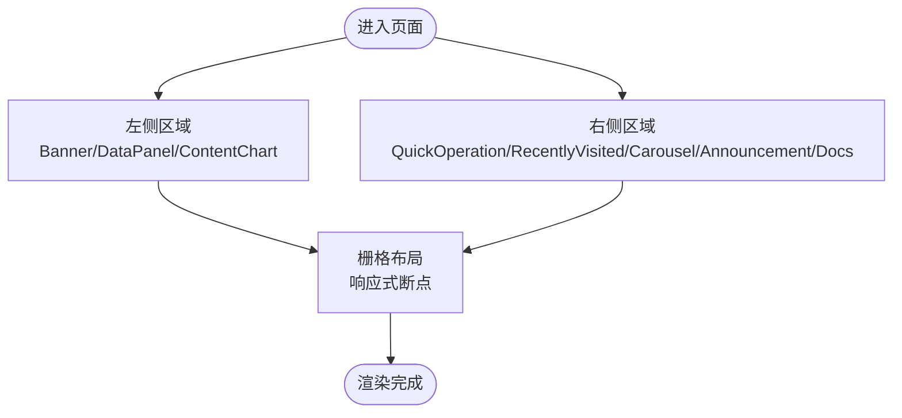
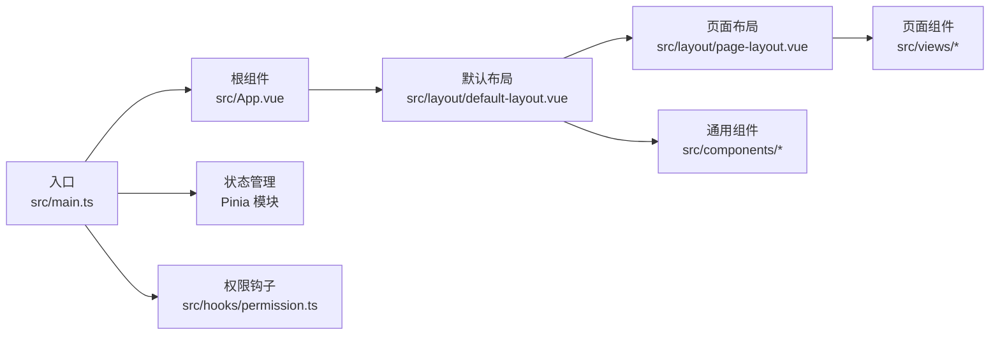

# 组件化设计模式

<cite>
**本文引用的文件**
- [src/main.ts](file://src/main.ts)
- [src/App.vue](file://src/App.vue)
- [src/layout/default-layout.vue](file://src/layout/default-layout.vue)
- [src/layout/page-layout.vue](file://src/layout/page-layout.vue)
- [src/components/index.ts](file://src/components/index.ts)
- [src/components/chart/index.vue](file://src/components/chart/index.vue)
- [src/components/breadcrumb/index.vue](file://src/components/breadcrumb/index.vue)
- [src/components/navbar/index.vue](file://src/components/navbar/index.vue)
- [src/components/menu/index.vue](file://src/components/menu/index.vue)
- [src/components/footer/index.vue](file://src/components/footer/index.vue)
- [src/components/tab-bar/index.vue](file://src/components/tab-bar/index.vue)
- [src/views/dashboard/workplace/index.vue](file://src/views/dashboard/workplace/index.vue)
- [src/views/login/index.vue](file://src/views/login/index.vue)
- [src/store/modules/app/index.ts](file://src/store/modules/app/index.ts)
- [src/hooks/permission.ts](file://src/hooks/permission.ts)
</cite>

## 目录
1. [引言](#引言)
2. [项目结构](#项目结构)
3. [核心组件](#核心组件)
4. [架构总览](#架构总览)
5. [详细组件分析](#详细组件分析)
6. [依赖关系分析](#依赖关系分析)
7. [性能考量](#性能考量)
8. [故障排查指南](#故障排查指南)
9. [结论](#结论)
10. [附录：最佳实践与规范](#附录最佳实践与规范)

## 引言
本文件系统性梳理该 Vue 3 项目的组件化设计模式，围绕“通用组件、布局组件、页面组件”的分层结构，深入解析组合式 API 的使用方式（props、事件、插槽）、组件通信与状态管理、可复用性设计原则与扩展策略。文档同时提供可视化架构图与流程图，帮助读者快速把握整体设计思路与落地实现。

## 项目结构
该项目采用“布局-页面-通用组件”三层组织方式：
- 布局层：负责全局容器、导航、侧边菜单、页脚、标签栏等横切关注点
- 页面层：按业务域拆分页面，页面内部再组合小而美的业务组件
- 通用组件层：封装可复用的 UI 与功能组件，统一注册后在全站使用

**图表来源**
- [src/main.ts:1-29](file://src/main.ts#L1-L29)
- [src/App.vue:1-27](file://src/App.vue#L1-L27)
- [src/layout/default-layout.vue:1-179](file://src/layout/default-layout.vue#L1-L179)
- [src/layout/page-layout.vue:1-26](file://src/layout/page-layout.vue#L1-L26)
- [src/components/index.ts:1-36](file://src/components/index.ts#L1-L36)
- [src/components/chart/index.vue:1-48](file://src/components/chart/index.vue#L1-L48)
- [src/components/breadcrumb/index.vue:1-36](file://src/components/breadcrumb/index.vue#L1-L36)
- [src/components/navbar/index.vue:1-324](file://src/components/navbar/index.vue#L1-L324)
- [src/components/menu/index.vue:1-161](file://src/components/menu/index.vue#L1-L161)
- [src/components/footer/index.vue:1-17](file://src/components/footer/index.vue#L1-L17)
- [src/components/tab-bar/index.vue:1-102](file://src/components/tab-bar/index.vue#L1-L102)
- [src/views/dashboard/workplace/index.vue:1-149](file://src/views/dashboard/workplace/index.vue#L1-L149)
- [src/views/login/index.vue:1-82](file://src/views/login/index.vue#L1-L82)

**章节来源**
- [src/main.ts:1-29](file://src/main.ts#L1-L29)
- [src/App.vue:1-27](file://src/App.vue#L1-L27)
- [src/layout/default-layout.vue:1-179](file://src/layout/default-layout.vue#L1-L179)
- [src/layout/page-layout.vue:1-26](file://src/layout/page-layout.vue#L1-L26)
- [src/components/index.ts:1-36](file://src/components/index.ts#L1-L36)

## 核心组件
本节聚焦三大类组件及其职责边界与协作方式：
- 通用组件：封装通用 UI 与能力，统一注册后全局可用
- 布局组件：承载页面骨架与横切行为（主题、菜单、导航、标签）
- 页面组件：业务场景的容器，组合多个业务子组件

关键要点：
- 通用组件通过安装器集中注册，避免重复引入
- 布局组件通过 provide/inject 实现抽屉菜单开关等跨层级通信
- 页面组件以组合方式引入业务子组件，形成高内聚低耦合

**章节来源**
- [src/components/index.ts:1-36](file://src/components/index.ts#L1-L36)
- [src/layout/default-layout.vue:47-105](file://src/layout/default-layout.vue#L47-L105)
- [src/views/dashboard/workplace/index.vue:44-61](file://src/views/dashboard/workplace/index.vue#L44-L61)

## 架构总览
下图展示从应用启动到页面渲染的关键路径，以及组件间的依赖与交互：

**图表来源**
- [src/main.ts:17-28](file://src/main.ts#L17-L28)
- [src/App.vue:1-27](file://src/App.vue#L1-L27)
- [src/layout/default-layout.vue:1-45](file://src/layout/default-layout.vue#L1-L45)
- [src/layout/page-layout.vue:1-14](file://src/layout/page-layout.vue#L1-L14)
- [src/views/dashboard/workplace/index.vue:1-42](file://src/views/dashboard/workplace/index.vue#L1-L42)

## 详细组件分析

### 通用组件层：图表与面包屑
- 图表组件（Chart）：基于 vue-echarts 封装，支持选项、自适应、尺寸等 props；通过延迟渲染规避容器未展开导致的渲染问题
- 面包屑组件（Breadcrumb）：接收字符串数组作为路径项，结合国际化模块进行文案翻译

**图表来源**
- [src/components/chart/index.vue:10-44](file://src/components/chart/index.vue#L10-L44)
- [src/components/breadcrumb/index.vue:12-22](file://src/components/breadcrumb/index.vue#L12-L22)

**章节来源**
- [src/components/chart/index.vue:1-48](file://src/components/chart/index.vue#L1-L48)
- [src/components/breadcrumb/index.vue:1-36](file://src/components/breadcrumb/index.vue#L1-L36)
- [src/components/index.ts:13-35](file://src/components/index.ts#L13-L35)

### 布局组件层：导航、菜单、标签栏、页脚
- 导航栏（Navbar）：集成语言切换、主题切换、消息弹窗、全屏、用户下拉菜单等；通过 provide/inject 与布局共享抽屉开关
- 菜单（Menu）：根据路由生成菜单树，支持外链打开、选中与展开状态同步
- 标签栏（TabBar）：监听路由变化，动态增删标签；支持固定位置与偏移计算
- 页脚（Footer）：简洁占位组件

**图表来源**
- [src/layout/default-layout.vue:96-102](file://src/layout/default-layout.vue#L96-L102)
- [src/components/navbar/index.vue:195-262](file://src/components/navbar/index.vue#L195-L262)
- [src/components/menu/index.vue:11-90](file://src/components/menu/index.vue#L11-L90)
- [src/components/tab-bar/index.vue:21-60](file://src/components/tab-bar/index.vue#L21-L60)
- [src/store/modules/app/index.ts:9-78](file://src/store/modules/app/index.ts#L9-L78)

**章节来源**
- [src/components/navbar/index.vue:1-324](file://src/components/navbar/index.vue#L1-L324)
- [src/components/menu/index.vue:1-161](file://src/components/menu/index.vue#L1-L161)
- [src/components/tab-bar/index.vue:1-102](file://src/components/tab-bar/index.vue#L1-L102)
- [src/components/footer/index.vue:1-17](file://src/components/footer/index.vue#L1-L17)
- [src/layout/default-layout.vue:47-105](file://src/layout/default-layout.vue#L47-L105)

### 页面组件层：工作台与登录页
- 工作台页面：左侧信息面板与右侧工具区，通过栅格布局响应式排列；内部组合多个业务组件
- 登录页面：左右分栏布局，底部页脚复用通用组件

**图表来源**
- [src/views/dashboard/workplace/index.vue:1-42](file://src/views/dashboard/workplace/index.vue#L1-L42)

**章节来源**
- [src/views/dashboard/workplace/index.vue:1-149](file://src/views/dashboard/workplace/index.vue#L1-L149)
- [src/views/login/index.vue:1-82](file://src/views/login/index.vue#L1-L82)

## 依赖关系分析
- 应用启动时在入口注册全局组件与状态管理，随后由根组件包裹路由视图
- 默认布局聚合导航、菜单、页脚、标签栏，页面布局负责路由视图的缓存与过渡
- 通用组件通过安装器集中注册，减少重复导入与打包体积
- 权限钩子用于路由守卫前的权限判定，保障访问安全

**图表来源**
- [src/main.ts:17-28](file://src/main.ts#L17-L28)
- [src/App.vue:1-27](file://src/App.vue#L1-L27)
- [src/layout/default-layout.vue:1-45](file://src/layout/default-layout.vue#L1-L45)
- [src/layout/page-layout.vue:1-14](file://src/layout/page-layout.vue#L1-L14)
- [src/components/index.ts:1-36](file://src/components/index.ts#L1-L36)
- [src/hooks/permission.ts:1-34](file://src/hooks/permission.ts#L1-L34)

**章节来源**
- [src/main.ts:1-29](file://src/main.ts#L1-L29)
- [src/hooks/permission.ts:1-34](file://src/hooks/permission.ts#L1-L34)

## 性能考量
- 图表组件采用延迟渲染策略，确保容器已展开后再初始化，降低首屏阻塞风险
- 页面布局对路由视图进行条件渲染与 keep-alive 缓存，结合标签栏缓存列表，提升切换性能
- 菜单组件在桌面端支持折叠状态持久化，减少不必要的重排
- 全局组件安装器按需引入 ECharts 子模块，优化打包体积

**章节来源**
- [src/components/chart/index.vue:40-44](file://src/components/chart/index.vue#L40-L44)
- [src/layout/page-layout.vue:16-23](file://src/layout/page-layout.vue#L16-L23)
- [src/components/menu/index.vue:19-27](file://src/components/menu/index.vue#L19-L27)
- [src/components/index.ts:15-28](file://src/components/index.ts#L15-L28)

## 故障排查指南
- 路由权限校验失败：检查权限钩子对角色与路由 meta.roles 的匹配逻辑
- 菜单选中/展开异常：确认路由变更监听是否触发，以及 activeMenu/ hideInMenu 的配置
- 抽屉菜单无法打开：确认布局层 provide 的方法是否正确注入到导航栏
- 图表不显示或尺寸异常：检查延迟渲染时机与容器尺寸是否满足要求

**章节来源**
- [src/hooks/permission.ts:7-14](file://src/hooks/permission.ts#L7-L14)
- [src/components/menu/index.vue:72-86](file://src/components/menu/index.vue#L72-L86)
- [src/layout/default-layout.vue:100-102](file://src/layout/default-layout.vue#L100-L102)
- [src/components/chart/index.vue:40-44](file://src/components/chart/index.vue#L40-L44)

## 结论
该工程以“布局-页面-通用组件”三层结构清晰划分职责，配合组合式 API 的 props/事件/插槽与 Pinia 状态管理，实现了良好的可复用性与扩展性。通过安装器统一注册通用组件、通过 provide/inject 解决跨层级通信、通过 keep-alive 与路由监听优化性能，整体架构具备较强的工程化落地能力。

## 附录：最佳实践与规范
- 组件命名规范
  - 通用组件：语义明确、无业务色彩，如 Chart、Breadcrumb、Footer
  - 页面组件：以业务域命名，如 DashboardWorkplace、Login
- 接口设计
  - props 使用类型声明与默认值，避免隐式类型错误
  - 事件命名采用动词短语，遵循“onXxx”约定
  - 插槽命名清晰，优先具名插槽，减少默认插槽的歧义
- 状态管理
  - 将跨组件共享的状态放入 Pinia 模块，避免 props 穿透
  - 使用 getters 计算派生状态，减少重复逻辑
- 生命周期管理
  - 在 onMounted 中执行副作用，确保 DOM 可用
  - 在 onUnmounted 中清理订阅与定时器，防止内存泄漏
- 组件通信
  - 父子通信：props/emit
  - 跨层级：provide/inject 或 Pinia
  - 平级通信：事件总线或 Pinia
- 扩展性设计
  - 通用组件尽量无状态或少状态，通过 props 控制行为
  - 页面组件以组合为主，便于替换与复用
  - 对外暴露稳定 API，内部实现可演进