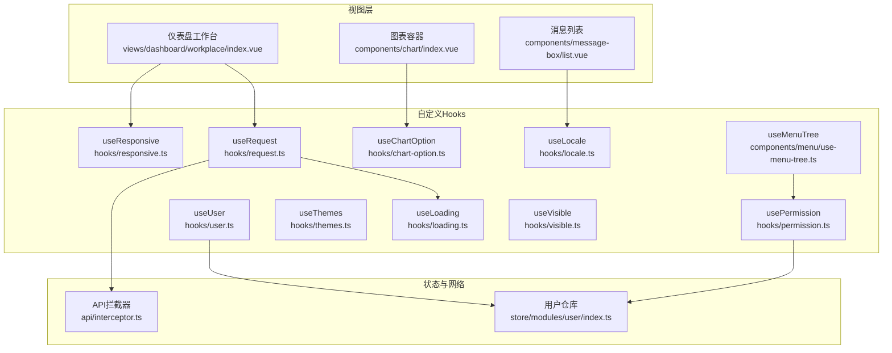
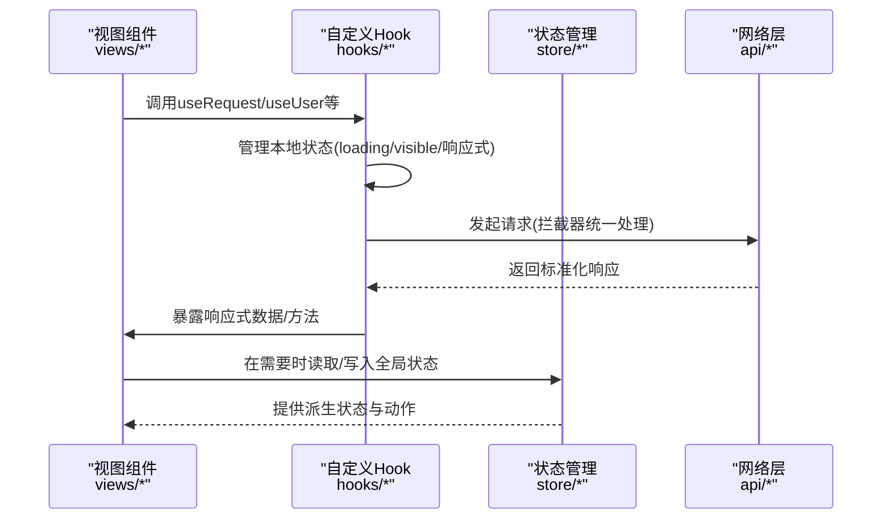
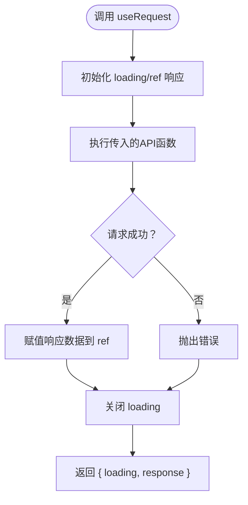
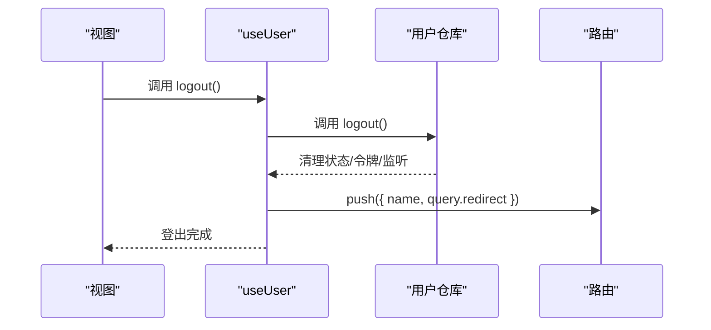
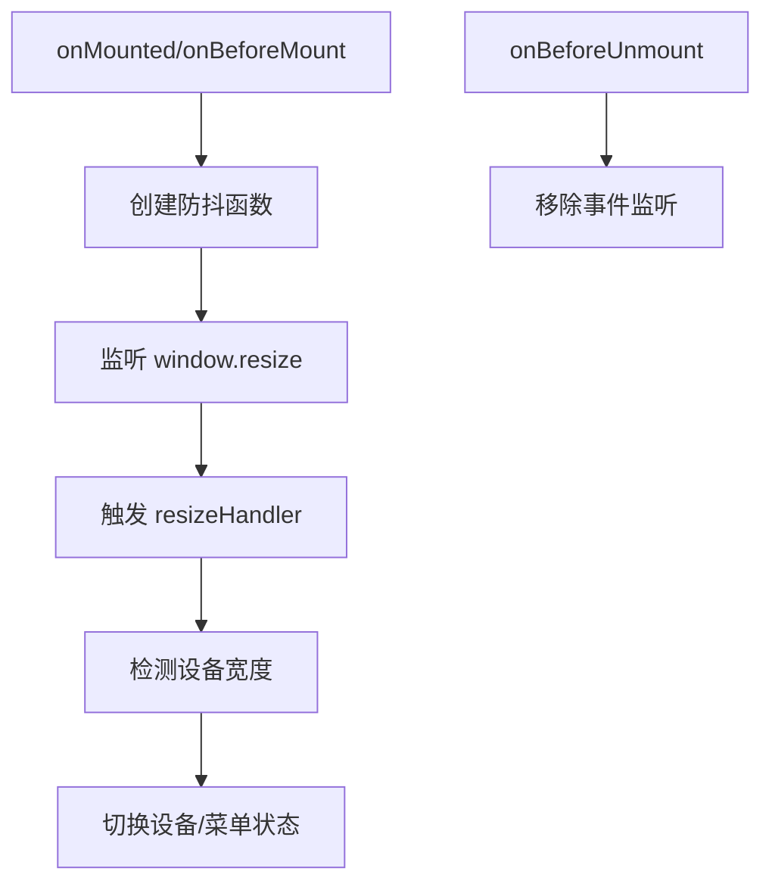
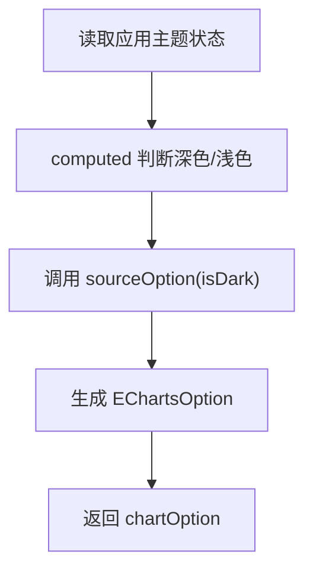
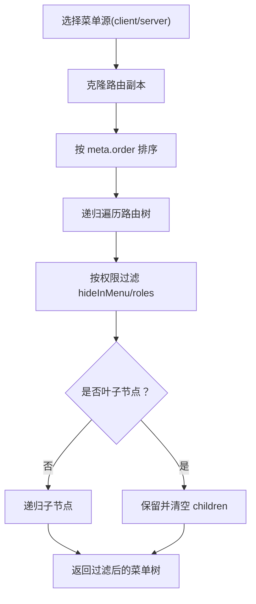
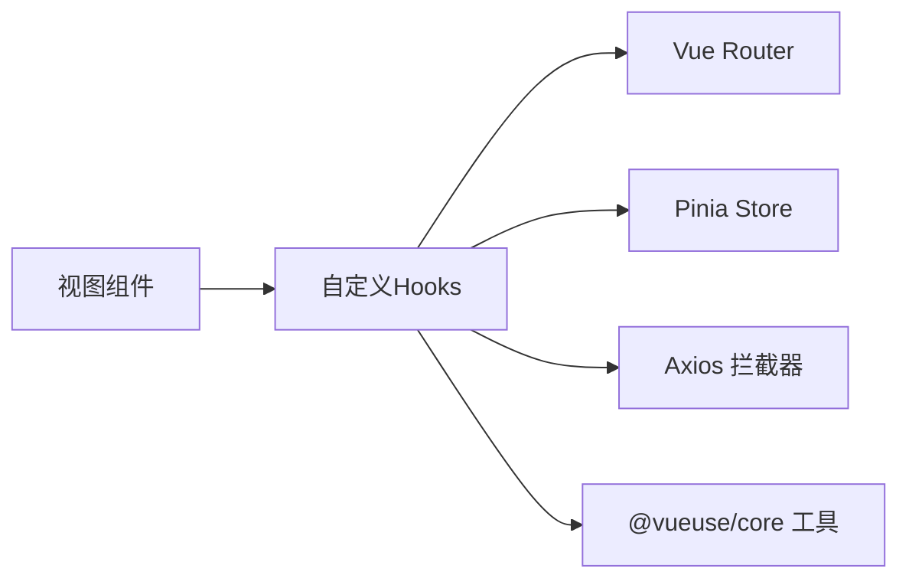

# 组合式API模式

<cite>
**本文引用的文件**
- [loading.ts](file://src/hooks/loading.ts)
- [request.ts](file://src/hooks/request.ts)
- [user.ts](file://src/hooks/user.ts)
- [responsive.ts](file://src/hooks/responsive.ts)
- [chart-option.ts](file://src/hooks/chart-option.ts)
- [locale.ts](file://src/hooks/locale.ts)
- [themes.ts](file://src/hooks/themes.ts)
- [permission.ts](file://src/hooks/permission.ts)
- [visible.ts](file://src/hooks/visible.ts)
- [use-menu-tree.ts](file://src/components/menu/use-menu-tree.ts)
- [index.vue（仪表盘工作台）](file://src/views/dashboard/workplace/index.vue)
- [index.vue（图表容器）](file://src/components/chart/index.vue)
- [list.vue（消息列表）](file://src/components/message-box/list.vue)
- [index.ts（用户仓库）](file://src/store/modules/user/index.ts)
- [interceptor.ts（API拦截器）](file://src/api/interceptor.ts)
</cite>

## 目录
1. [引言](#引言)
2. [项目结构](#项目结构)
3. [核心组件](#核心组件)
4. [架构总览](#架构总览)
5. [详细组件分析](#详细组件分析)
6. [依赖分析](#依赖分析)
7. [性能考虑](#性能考虑)
8. [故障排查指南](#故障排查指南)
9. [结论](#结论)
10. [附录：最佳实践与示例路径](#附录最佳实践与示例路径)

## 引言
本文件系统化梳理本项目中组合式API（Composition API）的应用模式与设计实践，重点覆盖以下方面：
- 自定义hooks的设计原则与实现方式：loading状态管理、请求处理、响应式设计、权限与主题切换、国际化、菜单树构建等。
- 组合式API相较选项式API的优势：逻辑复用、类型推断、副作用生命周期管理、可测试性与可维护性。
- 最佳实践：hooks命名规范、参数设计、副作用处理、与状态管理（Pinia）与路由（Vue Router）的协作。
- 实际示例路径：通过具体文件定位到可直接参考的实现片段，便于快速上手。

## 项目结构
本项目采用“按功能域分层”的组织方式，结合组合式API与TypeScript，形成清晰的模块边界：
- hooks：封装跨组件复用的业务逻辑与状态管理（如加载、请求、权限、主题、响应式布局等）
- components：UI组件与工具型hooks（如菜单树构建）
- views：页面级组件，以<script setup>形式组织逻辑
- store：状态管理（Pinia）
- api：网络请求与拦截器
- router：路由与守卫
- utils：通用工具函数

**图示来源**
- [index.vue（仪表盘工作台）:44-61](file://src/views/dashboard/workplace/index.vue#L44-L61)
- [index.vue（图表容器）:10-45](file://src/components/chart/index.vue#L10-L45)
- [list.vue（消息列表）:73-98](file://src/components/message-box/list.vue#L73-L98)
- [loading.ts:1-17](file://src/hooks/loading.ts#L1-L17)
- [request.ts:1-27](file://src/hooks/request.ts#L1-L27)
- [user.ts:1-25](file://src/hooks/user.ts#L1-L25)
- [responsive.ts:1-33](file://src/hooks/responsive.ts#L1-L33)
- [chart-option.ts:1-28](file://src/hooks/chart-option.ts#L1-L28)
- [locale.ts:1-23](file://src/hooks/locale.ts#L1-L23)
- [themes.ts:1-13](file://src/hooks/themes.ts#L1-L13)
- [permission.ts:1-34](file://src/hooks/permission.ts#L1-L34)
- [visible.ts:1-17](file://src/hooks/visible.ts#L1-L17)
- [use-menu-tree.ts:1-70](file://src/components/menu/use-menu-tree.ts#L1-L70)
- [index.ts（用户仓库）:1-92](file://src/store/modules/user/index.ts#L1-L92)
- [interceptor.ts（API拦截器）:1-78](file://src/api/interceptor.ts#L1-L78)

**章节来源**
- [index.vue（仪表盘工作台）:44-61](file://src/views/dashboard/workplace/index.vue#L44-L61)
- [index.vue（图表容器）:10-45](file://src/components/chart/index.vue#L10-L45)
- [list.vue（消息列表）:73-98](file://src/components/message-box/list.vue#L73-L98)

## 核心组件
本节聚焦于关键hooks及其职责边界，说明其如何通过组合式API实现高内聚、低耦合的逻辑复用。

- useLoading：提供基础loading状态与切换能力，返回ref与setter/toggle方法，便于在任意场景快速接入。
- useRequest：封装异步请求流程，自动绑定loading状态，统一处理响应数据与最终态关闭loading；支持默认值与是否自动加载的配置。
- useUser：封装用户登出流程，结合路由与消息提示，统一处理跳转与重定向逻辑。
- useResponsive：基于窗口尺寸变化的响应式布局控制，集成防抖与生命周期事件监听，自动切换设备类型与菜单状态。
- useChartOption：将ECharts配置与主题状态解耦，基于computed生成响应式图表配置，提升主题切换时的渲染一致性。
- useLocale：封装国际化语言切换逻辑，持久化选择并给出成功反馈。
- useThemes：暴露当前主题状态（深色/浅色），供组件按需消费。
- usePermission：权限访问判断与路由权限树遍历辅助，支持通配符角色与首次可访问路由查找。
- useVisible：提供可见性状态与切换能力，常用于弹窗、抽屉等交互控制。
- useMenuTree：根据权限过滤与排序生成菜单树，支持客户端/服务端菜单源切换。

**章节来源**
- [loading.ts:1-17](file://src/hooks/loading.ts#L1-L17)
- [request.ts:1-27](file://src/hooks/request.ts#L1-L27)
- [user.ts:1-25](file://src/hooks/user.ts#L1-L25)
- [responsive.ts:1-33](file://src/hooks/responsive.ts#L1-L33)
- [chart-option.ts:1-28](file://src/hooks/chart-option.ts#L1-L28)
- [locale.ts:1-23](file://src/hooks/locale.ts#L1-L23)
- [themes.ts:1-13](file://src/hooks/themes.ts#L1-L13)
- [permission.ts:1-34](file://src/hooks/permission.ts#L1-L34)
- [visible.ts:1-17](file://src/hooks/visible.ts#L1-L17)
- [use-menu-tree.ts:1-70](file://src/components/menu/use-menu-tree.ts#L1-L70)

## 架构总览
下图展示了从视图到hooks再到状态与网络层的数据流与调用关系，体现组合式API在逻辑复用与状态管理上的优势。

**图示来源**
- [request.ts:11-26](file://src/hooks/request.ts#L11-L26)
- [user.ts:6-23](file://src/hooks/user.ts#L6-L23)
- [index.ts（用户仓库）:13-92](file://src/store/modules/user/index.ts#L13-L92)
- [interceptor.ts（API拦截器）:18-77](file://src/api/interceptor.ts#L18-L77)

## 详细组件分析

### useRequest：请求与加载状态的统一抽象
- 设计要点
  - 接收API函数与默认值，避免空指针与类型不一致问题。
  - 内部组合useLoading，自动设置loading状态并在finally阶段关闭。
  - 使用UnwrapRef确保复杂泛型响应的类型安全。
- 典型用法
  - 将API函数bind到固定参数，避免在async函数中直接传入异步函数导致上下文丢失。
- 关键路径
  - [useRequest实现:11-26](file://src/hooks/request.ts#L11-L26)
  - [useLoading依赖:1-17](file://src/hooks/loading.ts#L1-L17)
  - [API拦截器:18-77](file://src/api/interceptor.ts#L18-L77)

**图示来源**
- [request.ts:11-26](file://src/hooks/request.ts#L11-L26)
- [loading.ts:3-15](file://src/hooks/loading.ts#L3-L15)

**章节来源**
- [request.ts:1-27](file://src/hooks/request.ts#L1-L27)
- [loading.ts:1-17](file://src/hooks/loading.ts#L1-L17)
- [interceptor.ts（API拦截器）:1-78](file://src/api/interceptor.ts#L1-L78)

### useUser：登出流程与路由跳转
- 设计要点
  - 结合Pinia用户仓库与路由，统一登出后的清理与跳转逻辑。
  - 通过Message提示与路由query传递redirect，增强用户体验。
- 关键路径
  - [useUser实现:6-23](file://src/hooks/user.ts#L6-L23)
  - [用户仓库logout动作:81-87](file://src/store/modules/user/index.ts#L81-L87)

**图示来源**
- [user.ts:9-20](file://src/hooks/user.ts#L9-L20)
- [index.ts（用户仓库）:81-87](file://src/store/modules/user/index.ts#L81-L87)

**章节来源**
- [user.ts:1-25](file://src/hooks/user.ts#L1-L25)
- [index.ts（用户仓库）:1-92](file://src/store/modules/user/index.ts#L1-L92)

### useResponsive：响应式布局与设备检测
- 设计要点
  - 基于窗口resize事件，使用debounce降低频繁计算成本。
  - 在生命周期钩子中注册/移除事件监听，避免内存泄漏。
  - 与应用仓库联动，动态切换设备类型与菜单展开状态。
- 关键路径
  - [useResponsive实现:13-32](file://src/hooks/responsive.ts#L13-L32)

**图示来源**
- [responsive.ts:13-32](file://src/hooks/responsive.ts#L13-L32)

**章节来源**
- [responsive.ts:1-33](file://src/hooks/responsive.ts#L1-L33)

### useChartOption：主题驱动的图表配置
- 设计要点
  - 将ECharts配置工厂函数与主题状态解耦，通过computed生成响应式配置。
  - 保持配置对象的类型安全与IDE提示友好。
- 关键路径
  - [useChartOption实现:13-27](file://src/hooks/chart-option.ts#L13-L27)

**图示来源**
- [chart-option.ts:13-27](file://src/hooks/chart-option.ts#L13-L27)

**章节来源**
- [chart-option.ts:1-28](file://src/hooks/chart-option.ts#L1-L28)
- [index.vue（图表容器）:1-48](file://src/components/chart/index.vue#L1-L48)

### useMenuTree：权限驱动的菜单树构建
- 设计要点
  - 支持客户端/服务端菜单源切换，统一排序与过滤逻辑。
  - 递归遍历路由树，按权限过滤隐藏节点与无权限子项。
  - 首次可访问路由查找，保障登录后导航正确性。
- 关键路径
  - [useMenuTree实现:8-68](file://src/components/menu/use-menu-tree.ts#L8-L68)
  - [权限判断:7-14](file://src/hooks/permission.ts#L7-L14)

**图示来源**
- [use-menu-tree.ts:17-64](file://src/components/menu/use-menu-tree.ts#L17-L64)
- [permission.ts:7-14](file://src/hooks/permission.ts#L7-L14)

**章节来源**
- [use-menu-tree.ts:1-70](file://src/components/menu/use-menu-tree.ts#L1-L70)
- [permission.ts:1-34](file://src/hooks/permission.ts#L1-L34)

### useLocale/useThemes：国际化与主题状态
- 设计要点
  - useLocale：读取当前语言、变更语言、持久化、提示反馈。
  - useThemes：暴露isDark状态，供组件按需消费。
- 关键路径
  - [useLocale实现:5-22](file://src/hooks/locale.ts#L5-L22)
  - [useThemes实现:4-12](file://src/hooks/themes.ts#L4-L12)

**章节来源**
- [locale.ts:1-23](file://src/hooks/locale.ts#L1-L23)
- [themes.ts:1-13](file://src/hooks/themes.ts#L1-L13)

### useLoading/useVisible：通用状态管理
- 设计要点
  - 提供set与toggle方法，简化状态切换。
  - 适用于loading、visible、disabled等常见布尔状态。
- 关键路径
  - [useLoading实现:3-15](file://src/hooks/loading.ts#L3-L15)
  - [useVisible实现:3-15](file://src/hooks/visible.ts#L3-L15)

**章节来源**
- [loading.ts:1-17](file://src/hooks/loading.ts#L1-L17)
- [visible.ts:1-17](file://src/hooks/visible.ts#L1-L17)

## 依赖分析
- 组件与hooks的耦合度
  - 视图层仅依赖hooks导出的响应式数据与方法，不直接关心内部实现细节。
  - hooks之间通过组合（如useRequest组合useLoading）实现逻辑复用，降低重复代码。
- 外部依赖与集成点
  - Vue Router：用于路由跳转与权限判断。
  - Pinia：集中管理用户与应用状态。
  - Axios拦截器：统一处理鉴权头与错误提示。
  - @vueuse/core：提供防抖等工具函数。
- 潜在循环依赖
  - hooks间尽量避免相互依赖；若出现，优先通过store或工具函数解耦。

**图示来源**
- [user.ts:1-25](file://src/hooks/user.ts#L1-L25)
- [request.ts:1-27](file://src/hooks/request.ts#L1-L27)
- [responsive.ts:1-33](file://src/hooks/responsive.ts#L1-L33)
- [interceptor.ts（API拦截器）:1-78](file://src/api/interceptor.ts#L1-L78)

**章节来源**
- [user.ts:1-25](file://src/hooks/user.ts#L1-L25)
- [request.ts:1-27](file://src/hooks/request.ts#L1-L27)
- [responsive.ts:1-33](file://src/hooks/responsive.ts#L1-L33)
- [interceptor.ts（API拦截器）:1-78](file://src/api/interceptor.ts#L1-L78)

## 性能考虑
- 防抖与节流
  - 响应式布局使用防抖降低resize事件对渲染的影响。
- 计算属性与懒执行
  - useChartOption与useThemes通过computed实现按需计算，减少不必要更新。
- 生命周期管理
  - 在onBeforeUnmount中移除事件监听，避免内存泄漏与重复绑定。
- 请求与状态
  - useRequest统一处理loading与finally关闭，避免重复逻辑与遗漏清理。

[本节为通用指导，无需特定文件引用]

## 故障排查指南
- 请求失败与错误提示
  - 检查API拦截器是否正确处理code非20000的情况，并给出用户提示。
  - 参考：[API拦截器:39-77](file://src/api/interceptor.ts#L39-L77)
- 登出后仍显示旧数据
  - 确认用户仓库logout回调是否清理了token、路由监听与菜单缓存。
  - 参考：[用户仓库logout回调:73-87](file://src/store/modules/user/index.ts#L73-L87)
- 菜单权限不生效
  - 检查路由meta.roles配置与用户角色匹配逻辑。
  - 参考：[权限判断:7-14](file://src/hooks/permission.ts#L7-L14)
- 主题切换无效
  - 确认useChartOption是否正确读取应用主题状态并重新计算配置。
  - 参考：[useChartOption:15-23](file://src/hooks/chart-option.ts#L15-L23)

**章节来源**
- [interceptor.ts（API拦截器）:39-77](file://src/api/interceptor.ts#L39-L77)
- [index.ts（用户仓库）:73-87](file://src/store/modules/user/index.ts#L73-L87)
- [permission.ts:7-14](file://src/hooks/permission.ts#L7-L14)
- [chart-option.ts:15-23](file://src/hooks/chart-option.ts#L15-L23)

## 结论
本项目通过组合式API与自定义hooks实现了高内聚、可复用、可维护的前端架构：
- 逻辑复用：useRequest、useLoading等将通用模式抽象为可插拔的hooks。
- 类型安全：泛型与computed确保复杂数据结构的类型推断与IDE提示。
- 生命周期与副作用：在合适的生命周期钩子中注册/移除事件，保证资源释放。
- 与状态管理与路由的协作：通过Pinia与Vue Router实现全局状态与导航控制的一致性。

[本节为总结，无需特定文件引用]

## 附录：最佳实践与示例路径
- 命名规范
  - hooks以use前缀命名，如useRequest、useLoading、useUser等。
  - 返回值以语义化命名，如loading、response、logout等。
- 参数设计
  - 默认值与可选参数明确，避免undefined带来的运行时风险。
  - 对外暴露的方法与响应式数据分离，便于按需消费。
- 副作用处理
  - 在onBeforeUnmount中清理事件监听与定时器。
  - 使用防抖/节流降低高频事件对性能的影响。
- 示例路径
  - [useRequest实现:11-26](file://src/hooks/request.ts#L11-L26)
  - [useLoading实现:3-15](file://src/hooks/loading.ts#L3-L15)
  - [useUser实现:6-23](file://src/hooks/user.ts#L6-L23)
  - [useResponsive实现:13-32](file://src/hooks/responsive.ts#L13-L32)
  - [useChartOption实现:13-27](file://src/hooks/chart-option.ts#L13-L27)
  - [useMenuTree实现:8-68](file://src/components/menu/use-menu-tree.ts#L8-L68)
  - [useLocale实现:5-22](file://src/hooks/locale.ts#L5-L22)
  - [useThemes实现:4-12](file://src/hooks/themes.ts#L4-L12)
  - [useVisible实现:3-15](file://src/hooks/visible.ts#L3-L15)
  - [用户仓库logout动作:81-87](file://src/store/modules/user/index.ts#L81-L87)
  - [API拦截器:18-77](file://src/api/interceptor.ts#L18-L77)

**章节来源**
- [request.ts:1-27](file://src/hooks/request.ts#L1-L27)
- [loading.ts:1-17](file://src/hooks/loading.ts#L1-L17)
- [user.ts:1-25](file://src/hooks/user.ts#L1-L25)
- [responsive.ts:1-33](file://src/hooks/responsive.ts#L1-L33)
- [chart-option.ts:1-28](file://src/hooks/chart-option.ts#L1-L28)
- [use-menu-tree.ts:1-70](file://src/components/menu/use-menu-tree.ts#L1-L70)
- [locale.ts:1-23](file://src/hooks/locale.ts#L1-L23)
- [themes.ts:1-13](file://src/hooks/themes.ts#L1-L13)
- [visible.ts:1-17](file://src/hooks/visible.ts#L1-L17)
- [index.ts（用户仓库）:81-87](file://src/store/modules/user/index.ts#L81-L87)
- [interceptor.ts（API拦截器）:1-78](file://src/api/interceptor.ts#L1-L78)