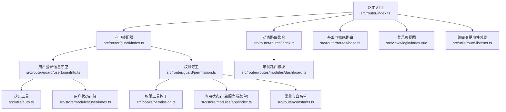
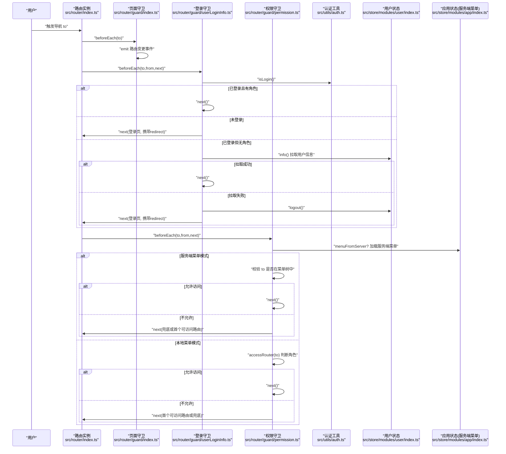
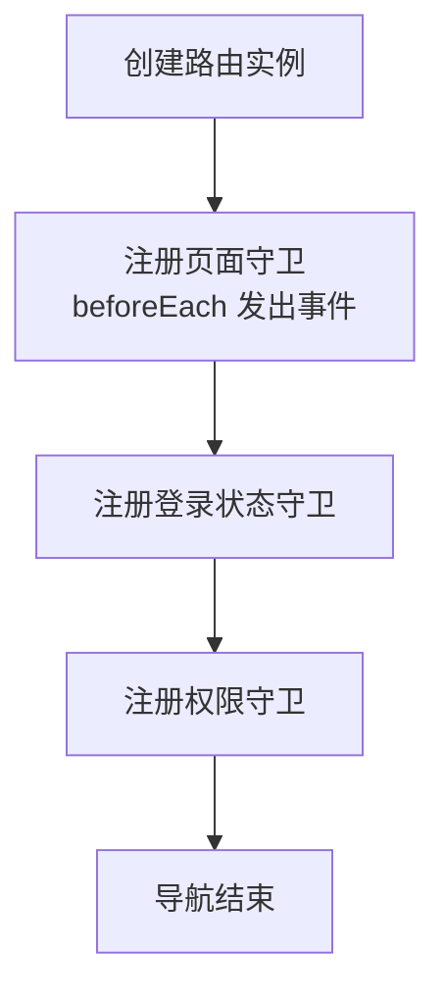
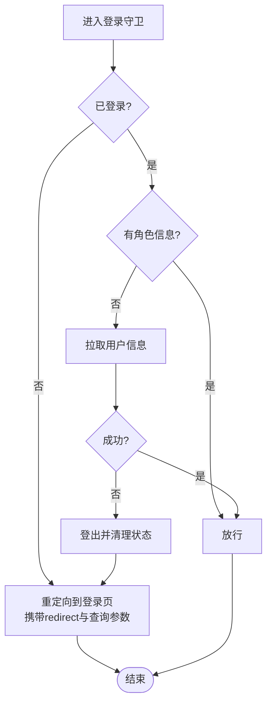
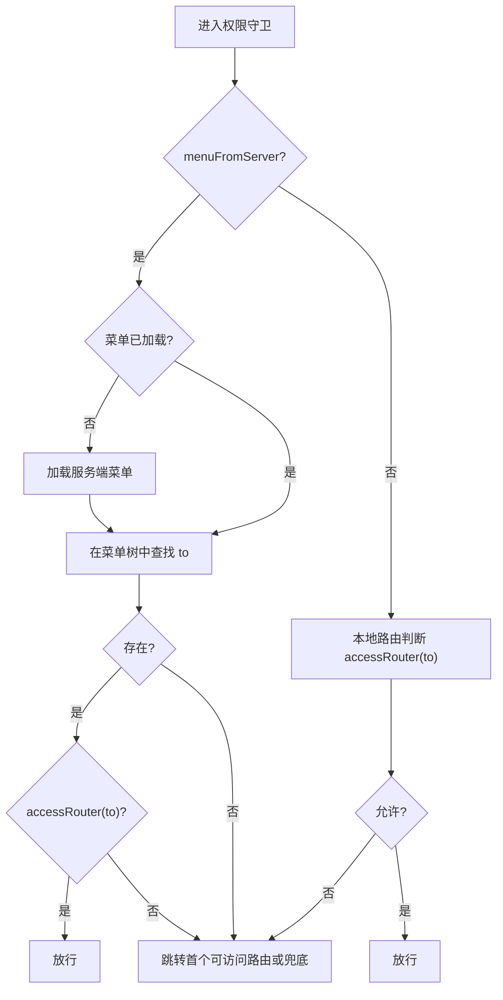
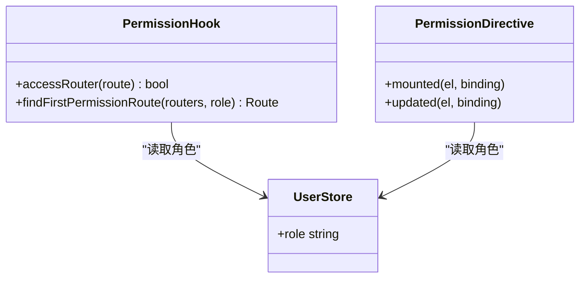
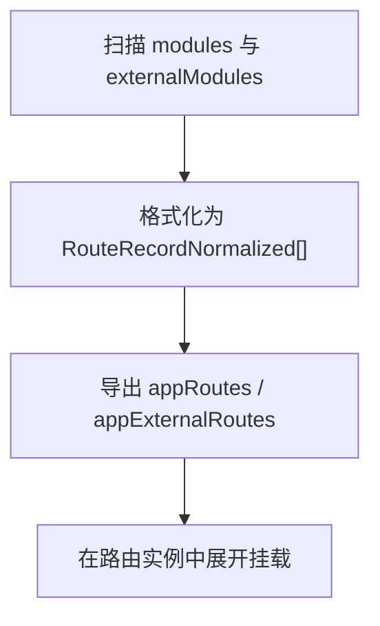
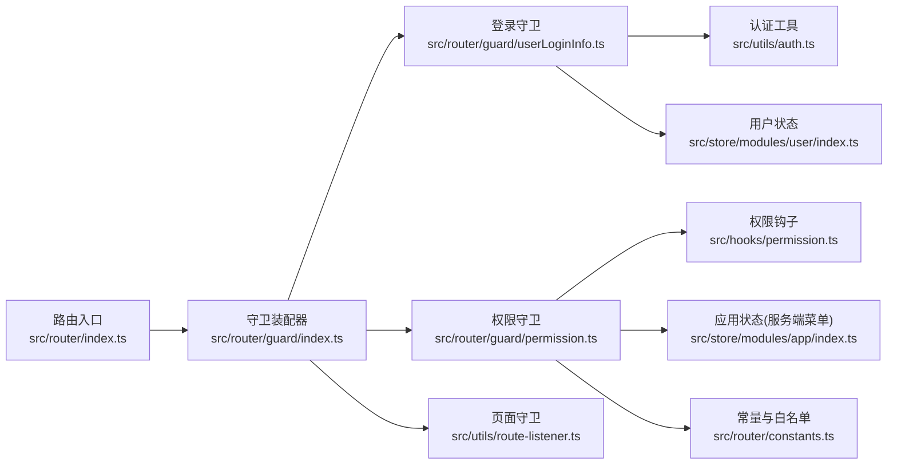

# 路由守卫模式

<cite>
**本文引用的文件**
- [src/router/guard/index.ts](file://src/router/guard/index.ts)
- [src/router/guard/permission.ts](file://src/router/guard/permission.ts)
- [src/router/guard/userLoginInfo.ts](file://src/router/guard/userLoginInfo.ts)
- [src/router/index.ts](file://src/router/index.ts)
- [src/hooks/permission.ts](file://src/hooks/permission.ts)
- [src/store/modules/user/index.ts](file://src/store/modules/user/index.ts)
- [src/store/modules/app/index.ts](file://src/store/modules/app/index.ts)
- [src/utils/auth.ts](file://src/utils/auth.ts)
- [src/utils/route-listener.ts](file://src/utils/route-listener.ts)
- [src/directive/permission/index.ts](file://src/directive/permission/index.ts)
- [src/router/constants.ts](file://src/router/constants.ts)
- [src/router/routes/index.ts](file://src/router/routes/index.ts)
- [src/router/routes/modules/dashboard.ts](file://src/router/routes/modules/dashboard.ts)
- [src/router/routes/base.ts](file://src/router/routes/base.ts)
- [src/views/login/index.vue](file://src/views/login/index.vue)
</cite>

## 目录
1. [引言](#引言)
2. [项目结构](#项目结构)
3. [核心组件](#核心组件)
4. [架构总览](#架构总览)
5. [详细组件分析](#详细组件分析)
6. [依赖关系分析](#依赖关系分析)
7. [性能考量](#性能考量)
8. [故障排查指南](#故障排查指南)
9. [结论](#结论)
10. [附录](#附录)

## 引言
本文件系统性阐述本项目的路由守卫模式与权限控制设计，覆盖导航守卫、登录状态守卫、权限守卫的实现原理与协作流程；解释动态路由加载机制、权限验证流程与路由拦截策略；给出最佳实践（守卫顺序、错误处理、用户体验优化），并通过实际代码路径示例展示安全与灵活的路由控制。

## 项目结构
围绕路由守卫的关键目录与文件：
- 路由定义与入口：src/router/index.ts
- 守卫装配：src/router/guard/index.ts
- 登录状态守卫：src/router/guard/userLoginInfo.ts
- 权限守卫：src/router/guard/permission.ts
- 权限工具钩子：src/hooks/permission.ts
- 用户状态存储：src/store/modules/user/index.ts
- 应用状态存储（含服务端菜单）：src/store/modules/app/index.ts
- 认证工具：src/utils/auth.ts
- 路由变更事件总线：src/utils/route-listener.ts
- 常量与白名单：src/router/constants.ts
- 动态路由模块聚合：src/router/routes/index.ts
- 示例路由模块：src/router/routes/modules/dashboard.ts
- 基础路由与兜底页面：src/router/routes/base.ts
- 登录页视图：src/views/login/index.vue

图表来源
- [src/router/index.ts:1-38](file://src/router/index.ts#L1-L38)
- [src/router/guard/index.ts:1-18](file://src/router/guard/index.ts#L1-L18)
- [src/router/guard/userLoginInfo.ts:1-44](file://src/router/guard/userLoginInfo.ts#L1-L44)
- [src/router/guard/permission.ts:1-56](file://src/router/guard/permission.ts#L1-L56)
- [src/utils/auth.ts:1-20](file://src/utils/auth.ts#L1-L20)
- [src/store/modules/user/index.ts:1-92](file://src/store/modules/user/index.ts#L1-L92)
- [src/store/modules/app/index.ts:1-78](file://src/store/modules/app/index.ts#L1-L78)
- [src/hooks/permission.ts:1-34](file://src/hooks/permission.ts#L1-L34)
- [src/router/constants.ts:1-19](file://src/router/constants.ts#L1-L19)
- [src/router/routes/index.ts:1-26](file://src/router/routes/index.ts#L1-L26)
- [src/router/routes/modules/dashboard.ts:1-29](file://src/router/routes/modules/dashboard.ts#L1-L29)
- [src/router/routes/base.ts:1-32](file://src/router/routes/base.ts#L1-L32)
- [src/views/login/index.vue:1-82](file://src/views/login/index.vue#L1-L82)
- [src/utils/route-listener.ts:1-32](file://src/utils/route-listener.ts#L1-L32)

章节来源
- [src/router/index.ts:1-38](file://src/router/index.ts#L1-L38)
- [src/router/guard/index.ts:1-18](file://src/router/guard/index.ts#L1-L18)

## 核心组件
- 路由守卫装配器：在路由实例上注册多个前置守卫，统一编排导航流程。
- 登录状态守卫：校验登录态与用户角色信息，必要时拉取用户信息或重定向至登录页。
- 权限守卫：基于路由元信息与用户角色判断访问许可，支持服务端动态菜单与白名单。
- 权限工具钩子：提供“可访问路由”判定与“首个可访问路由”查找能力。
- 用户与应用状态存储：维护用户角色、令牌与服务端菜单配置。
- 认证工具：封装本地令牌读写与登录态判断。
- 路由变更事件总线：以发布订阅方式通知路由变化，避免全局监听导致的性能问题。
- 动态路由模块：通过 Vite 的 import.meta.glob 按模块聚合路由，支持外部模块扩展。

章节来源
- [src/router/guard/index.ts:13-17](file://src/router/guard/index.ts#L13-L17)
- [src/router/guard/userLoginInfo.ts:7-42](file://src/router/guard/userLoginInfo.ts#L7-L42)
- [src/router/guard/permission.ts:9-54](file://src/router/guard/permission.ts#L9-L54)
- [src/hooks/permission.ts:4-33](file://src/hooks/permission.ts#L4-L33)
- [src/store/modules/user/index.ts:56-61](file://src/store/modules/user/index.ts#L56-L61)
- [src/store/modules/app/index.ts:47-70](file://src/store/modules/app/index.ts#L47-L70)
- [src/utils/auth.ts:3-5](file://src/utils/auth.ts#L3-L5)
- [src/utils/route-listener.ts:14-27](file://src/utils/route-listener.ts#L14-L27)
- [src/router/routes/index.ts:3-25](file://src/router/routes/index.ts#L3-L25)

## 架构总览
路由守卫采用“多层前置守卫”的流水线式设计，按以下顺序执行：
1) 页面级守卫：在每次导航前发出路由变更事件，便于组件订阅更新。
2) 登录状态守卫：校验是否已登录，若未登录则重定向到登录页并携带目标路由参数；若已登录但缺少角色信息，则尝试拉取用户信息。
3) 权限守卫：根据路由元信息与用户角色判断访问权限；当启用服务端菜单时，先确保菜单加载完成，再校验目标路由是否存在于菜单树中；若无权限，跳转到首个可访问路由或兜底页面。

图表来源
- [src/router/index.ts:35](file://src/router/index.ts#L35)
- [src/router/guard/index.ts:6-11](file://src/router/guard/index.ts#L6-L11)
- [src/router/guard/userLoginInfo.ts:8-42](file://src/router/guard/userLoginInfo.ts#L8-L42)
- [src/router/guard/permission.ts:10-54](file://src/router/guard/permission.ts#L10-L54)
- [src/utils/auth.ts:3-5](file://src/utils/auth.ts#L3-L5)
- [src/store/modules/user/index.ts:56-61](file://src/store/modules/user/index.ts#L56-L61)
- [src/store/modules/app/index.ts:47-70](file://src/store/modules/app/index.ts#L47-L70)

## 详细组件分析

### 组件一：守卫装配器与页面守卫
- 职责：在路由实例上注册页面级守卫与业务守卫，保证导航链路完整。
- 页面守卫：在每次导航前发出“路由变更事件”，供组件订阅，避免直接监听路由导致的性能损耗。
- 守卫装配顺序：页面守卫 → 登录状态守卫 → 权限守卫。

图表来源
- [src/router/guard/index.ts:6-17](file://src/router/guard/index.ts#L6-L17)
- [src/utils/route-listener.ts:14-17](file://src/utils/route-listener.ts#L14-L17)

章节来源
- [src/router/guard/index.ts:13-17](file://src/router/guard/index.ts#L13-L17)
- [src/router/guard/index.ts:6-11](file://src/router/guard/index.ts#L6-L11)
- [src/utils/route-listener.ts:14-27](file://src/utils/route-listener.ts#L14-L27)

### 组件二：登录状态守卫
- 核心逻辑：
  - 若已登录且已有角色，直接放行。
  - 若已登录但无角色，调用用户信息接口拉取并缓存，成功后放行；失败则登出并重定向到登录页，携带目标路由名称与查询参数。
  - 若未登录，重定向到登录页，同样携带目标路由信息以便登录后自动跳转。
- 关键点：
  - 使用认证工具判断登录态。
  - 用户状态存储负责拉取用户信息与登出清理。
  - 登录页路由在路由表中声明，且要求认证为 false。

图表来源
- [src/router/guard/userLoginInfo.ts:8-42](file://src/router/guard/userLoginInfo.ts#L8-L42)
- [src/utils/auth.ts:3-5](file://src/utils/auth.ts#L3-L5)
- [src/store/modules/user/index.ts:56-61](file://src/store/modules/user/index.ts#L56-L61)
- [src/router/index.ts:19-25](file://src/router/index.ts#L19-L25)

章节来源
- [src/router/guard/userLoginInfo.ts:7-42](file://src/router/guard/userLoginInfo.ts#L7-L42)
- [src/utils/auth.ts:3-5](file://src/utils/auth.ts#L3-L5)
- [src/store/modules/user/index.ts:56-61](file://src/store/modules/user/index.ts#L56-L61)
- [src/router/index.ts:19-25](file://src/router/index.ts#L19-L25)

### 组件三：权限守卫
- 角色访问判定：通过权限工具钩子判断当前路由是否对用户角色开放。
- 服务端菜单模式：
  - 当开启从服务端加载菜单时，若菜单尚未加载且目标路由不在白名单内，则优先加载菜单。
  - 在菜单树中查找目标路由，存在且具备访问权限才放行，否则跳转兜底或首个可访问路由。
- 本地菜单模式：
  - 直接基于本地路由与角色判断，若无权限则跳转到首个可访问路由或兜底页面。
- 白名单与兜底路由：登录页与兜底页始终受控于常量定义。

图表来源
- [src/router/guard/permission.ts:9-54](file://src/router/guard/permission.ts#L9-L54)
- [src/hooks/permission.ts:7-14](file://src/hooks/permission.ts#L7-L14)
- [src/store/modules/app/index.ts:47-70](file://src/store/modules/app/index.ts#L47-L70)
- [src/router/constants.ts:1-19](file://src/router/constants.ts#L1-L19)

章节来源
- [src/router/guard/permission.ts:9-54](file://src/router/guard/permission.ts#L9-L54)
- [src/hooks/permission.ts:4-33](file://src/hooks/permission.ts#L4-L33)
- [src/store/modules/app/index.ts:47-70](file://src/store/modules/app/index.ts#L47-L70)
- [src/router/constants.ts:1-19](file://src/router/constants.ts#L1-L19)

### 组件四：权限工具钩子与指令
- 权限工具钩子：
  - accessRouter：依据路由元信息中的 requiresAuth 与 roles 字段，结合用户角色判断是否可访问。
  - findFirstPermissionRoute：在路由树中查找首个对当前角色开放的路由，用于无权限时的跳转目标。
- 权限指令：
  - 在组件层面基于角色隐藏/显示元素，提升前端体验一致性。

图表来源
- [src/hooks/permission.ts:4-33](file://src/hooks/permission.ts#L4-L33)
- [src/directive/permission/index.ts:23-30](file://src/directive/permission/index.ts#L23-L30)
- [src/store/modules/user/index.ts:30](file://src/store/modules/user/index.ts#L30)

章节来源
- [src/hooks/permission.ts:4-33](file://src/hooks/permission.ts#L4-L33)
- [src/directive/permission/index.ts:1-31](file://src/directive/permission/index.ts#L1-L31)
- [src/store/modules/user/index.ts:30](file://src/store/modules/user/index.ts#L30)

### 组件五：动态路由加载机制
- 动态聚合：通过 import.meta.glob 将 modules 与 externalModules 下的路由模块聚合为 appRoutes。
- 路由挂载：在路由实例中将 appRoutes 展开加入路由表，配合守卫实现权限控制。
- 外部模块：支持将第三方模块路由注入，增强灵活性。

图表来源
- [src/router/routes/index.ts:3-25](file://src/router/routes/index.ts#L3-L25)
- [src/router/index.ts:26](file://src/router/index.ts#L26)

章节来源
- [src/router/routes/index.ts:3-25](file://src/router/routes/index.ts#L3-L25)
- [src/router/index.ts:26](file://src/router/index.ts#L26)

### 组件六：路由拦截策略与用户体验
- 白名单策略：登录页与兜底页不受权限限制，保障基本可用性。
- 自动跳转：登录守卫在重定向时携带目标路由名称与查询参数，登录后可自动回到原页面。
- 进度条与事件：守卫中使用进度条与路由变更事件，提升交互反馈。
- 服务端菜单加载提示：应用状态存储在加载菜单时提供通知，改善等待体验。

章节来源
- [src/router/constants.ts:1-19](file://src/router/constants.ts#L1-L19)
- [src/router/guard/userLoginInfo.ts:20-26](file://src/router/guard/userLoginInfo.ts#L20-L26)
- [src/store/modules/app/index.ts:47-70](file://src/store/modules/app/index.ts#L47-L70)
- [src/utils/route-listener.ts:14-17](file://src/utils/route-listener.ts#L14-L17)

## 依赖关系分析
- 路由入口依赖守卫装配器与动态路由模块。
- 登录状态守卫依赖认证工具与用户状态存储。
- 权限守卫依赖权限工具钩子、应用状态存储（服务端菜单）、常量与白名单。
- 页面守卫依赖路由变更事件总线。
- 权限指令依赖用户状态存储。

图表来源
- [src/router/index.ts:7](file://src/router/index.ts#L7)
- [src/router/guard/index.ts:3-4](file://src/router/guard/index.ts#L3-L4)
- [src/router/guard/userLoginInfo.ts:4-5](file://src/router/guard/userLoginInfo.ts#L4-L5)
- [src/router/guard/permission.ts:4-7](file://src/router/guard/permission.ts#L4-L7)
- [src/hooks/permission.ts:2](file://src/hooks/permission.ts#L2)
- [src/store/modules/app/index.ts:6](file://src/store/modules/app/index.ts#L6)
- [src/router/constants.ts:1-4](file://src/router/constants.ts#L1-L4)
- [src/utils/route-listener.ts:5](file://src/utils/route-listener.ts#L5)

章节来源
- [src/router/index.ts:7](file://src/router/index.ts#L7)
- [src/router/guard/index.ts:3-4](file://src/router/guard/index.ts#L3-L4)

## 性能考量
- 路由变更事件总线：采用发布订阅模式，避免全局路由监听带来的重复渲染与性能损耗。
- 动态路由模块：使用 import.meta.glob 按需加载，减少初始包体与首屏压力。
- 服务端菜单加载：在需要时才发起请求并提供加载提示，避免阻塞主流程。
- 进度条与滚动行为：统一配置进度条与滚动回顶，减少额外计算。

章节来源
- [src/utils/route-listener.ts:14-27](file://src/utils/route-listener.ts#L14-L27)
- [src/router/routes/index.ts:3-6](file://src/router/routes/index.ts#L3-L6)
- [src/store/modules/app/index.ts:47-70](file://src/store/modules/app/index.ts#L47-L70)
- [src/router/index.ts:9](file://src/router/index.ts#L9)
- [src/router/index.ts:30-32](file://src/router/index.ts#L30-L32)

## 故障排查指南
- 登录后仍被重定向到登录页
  - 检查认证工具是否正确设置令牌与读取逻辑。
  - 确认用户状态存储的 info 接口返回值与字段一致。
  - 参考路径：[src/utils/auth.ts:11-13](file://src/utils/auth.ts#L11-L13)、[src/store/modules/user/index.ts:56-61](file://src/store/modules/user/index.ts#L56-L61)
- 无权限时无法跳转到首个可访问路由
  - 检查权限工具钩子的 findFirstPermissionRoute 实现与路由元信息 roles 配置。
  - 参考路径：[src/hooks/permission.ts:15-29](file://src/hooks/permission.ts#L15-L29)
- 服务端菜单模式下访问不存在的路由
  - 确认应用状态存储已加载菜单，且目标路由存在于菜单树中。
  - 参考路径：[src/store/modules/app/index.ts:47-70](file://src/store/modules/app/index.ts#L47-L70)、[src/router/guard/permission.ts:21-42](file://src/router/guard/permission.ts#L21-L42)
- 路由变更未触发组件更新
  - 确认页面守卫已发出事件，组件是否正确订阅路由变更。
  - 参考路径：[src/router/guard/index.ts:6-11](file://src/router/guard/index.ts#L6-L11)、[src/utils/route-listener.ts:19-27](file://src/utils/route-listener.ts#L19-L27)

章节来源
- [src/utils/auth.ts:11-13](file://src/utils/auth.ts#L11-L13)
- [src/store/modules/user/index.ts:56-61](file://src/store/modules/user/index.ts#L56-L61)
- [src/hooks/permission.ts:15-29](file://src/hooks/permission.ts#L15-L29)
- [src/store/modules/app/index.ts:47-70](file://src/store/modules/app/index.ts#L47-L70)
- [src/router/guard/permission.ts:21-42](file://src/router/guard/permission.ts#L21-L42)
- [src/router/guard/index.ts:6-11](file://src/router/guard/index.ts#L6-L11)
- [src/utils/route-listener.ts:19-27](file://src/utils/route-listener.ts#L19-L27)

## 结论
本项目通过“页面守卫 + 登录状态守卫 + 权限守卫”的组合拳，实现了高安全性的导航控制与良好的用户体验。登录态与角色信息的前置校验、服务端菜单的动态加载、以及白名单与兜底路由的策略，共同构成了灵活而稳健的路由权限体系。建议在实际工程中遵循本文档的守卫顺序与最佳实践，持续优化权限判定与加载提示，以获得更佳的稳定性与性能表现。

## 附录
- 示例路由模块与元信息
  - 示例模块：src/router/routes/modules/dashboard.ts
  - 元信息要点：requiresAuth、roles、locale、icon、order 等
  - 参考路径：[src/router/routes/modules/dashboard.ts:8-24](file://src/router/routes/modules/dashboard.ts#L8-L24)
- 基础与兜底路由
  - 包含重定向包装与兜底页面，确保异常路径可恢复
  - 参考路径：[src/router/routes/base.ts:6-31](file://src/router/routes/base.ts#L6-L31)
- 登录页视图
  - 登录页路由声明与组件结构
  - 参考路径：[src/router/index.ts:19-25](file://src/router/index.ts#L19-L25)、[src/views/login/index.vue:1-82](file://src/views/login/index.vue#L1-L82)