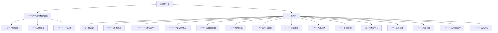
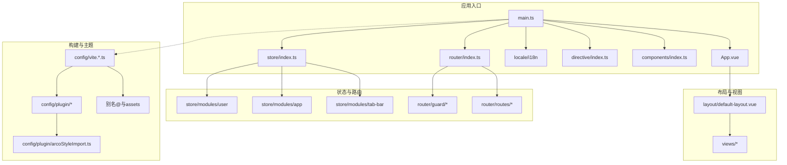
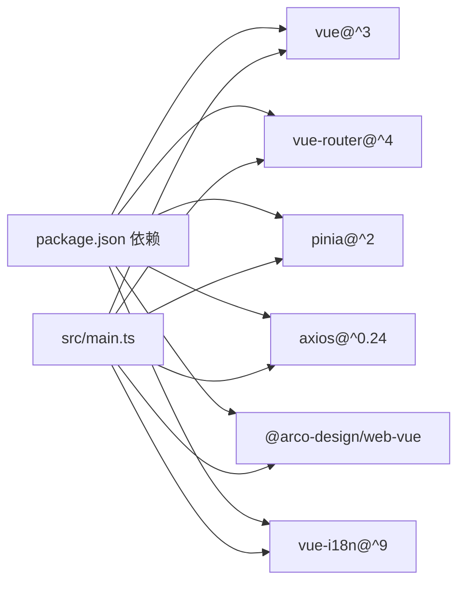

# 目录结构详解

<cite>
**本文档引用的文件**
- [package.json](file://package.json)
- [main.ts](file://src/main.ts)
- [vite.config.base.ts](file://config/vite.config.base.ts)
- [App.vue](file://src/App.vue)
- [settings.json](file://src/config/settings.json)
- [router/index.ts](file://src/router/index.ts)
- [store/index.ts](file://src/store/index.ts)
- [default-layout.vue](file://src/layout/default-layout.vue)
- [components/index.ts](file://src/components/index.ts)
- [directive/index.ts](file://src/directive/index.ts)
- [views/dashboard/workplace/index.vue](file://src/views/dashboard/workplace/index.vue)
- [store/modules/user/index.ts](file://src/store/modules/user/index.ts)
- [hooks/request.ts](file://src/hooks/request.ts)
- [arcoStyleImport.ts](file://config/plugin/arcoStyleImport.ts)
- [utils/auth.ts](file://src/utils/auth.ts)
</cite>

## 目录结构总览

本项目采用基于功能域的模块化组织方式，遵循“前端工程化最佳实践”，通过明确的目录边界与职责划分，确保代码可维护性与可扩展性。

**图表来源**
- [package.json:1-103](file://package.json#L1-L103)
- [main.ts:1-29](file://src/main.ts#L1-L29)
- [vite.config.base.ts:1-52](file://config/vite.config.base.ts#L1-L52)

**章节来源**
- [package.json:1-103](file://package.json#L1-L103)
- [main.ts:1-29](file://src/main.ts#L1-L29)
- [vite.config.base.ts:1-52](file://config/vite.config.base.ts#L1-L52)

## 顶级目录功能与组织原则

- config/
  - 职责：集中管理构建工具配置、插件与工具函数，支持开发、生产环境差异化配置。
  - 组织原则：按“功能域+环境”拆分，避免在业务代码中耦合构建细节。
  - 关键点：Vite基础配置、Arco主题按需加载插件、路径别名与CSS预处理器配置。

- src/
  - 职责：应用源代码的主战场，按“关注点分离”划分为多个子域。
  - 组织原则：以功能域为核心，每个域内自包含接口、组件、视图、类型、工具等。
  - 关键点：入口文件统一注册全局依赖；布局与路由解耦；状态与权限分离。

**章节来源**
- [vite.config.base.ts:1-52](file://config/vite.config.base.ts#L1-L52)
- [main.ts:1-29](file://src/main.ts#L1-L29)

## 子目录详解

### src/api 接口层
- 功能定位：封装HTTP请求、拦截器与业务API。
- 典型内容：
  - 接口定义：如用户登录、登出、信息获取等。
  - 请求拦截器：统一注入认证头、错误处理、进度提示。
- 设计要点：
  - 将Axios实例与拦截器抽象为独立模块，便于复用与测试。
  - 与store/actions配合，实现“数据流闭环”。

**章节来源**
- [main.ts:15-15](file://src/main.ts#L15-L15)
- [store/modules/user/index.ts:1-92](file://src/store/modules/user/index.ts#L1-L92)

### src/components 通用组件库
- 功能定位：可复用UI与业务组件，统一风格与交互。
- 典型内容：
  - 布局组件：面包屑、导航栏、页脚、菜单、标签页。
  - 业务组件：图表容器、消息框列表等。
  - 组件注册：集中导出，按需安装到应用。
- 设计要点：
  - 单文件组件（SFC）内聚，props/事件/插槽设计清晰。
  - 通过全局注册减少重复导入，提升开发效率。

**章节来源**
- [components/index.ts:1-36](file://src/components/index.ts#L1-L36)
- [default-layout.vue:1-179](file://src/layout/default-layout.vue#L1-L179)

### src/views 页面视图
- 功能定位：页面级视图，组合业务组件完成具体页面。
- 典型内容：
  - 登录页、工作台仪表盘、404重定向等。
  - 页面内部使用局部组件进行模块化拆分。
- 设计要点：
  - 页面组件保持简洁，逻辑下沉至store与hooks。
  - 支持国际化与响应式布局。

**章节来源**
- [views/dashboard/workplace/index.vue:1-149](file://src/views/dashboard/workplace/index.vue#L1-L149)

### src/store 状态管理
- 功能定位：集中管理应用状态，支持多模块拆分。
- 典型内容：
  - app：应用设置、主题、菜单状态。
  - user：用户信息、登录态、角色。
  - tab-bar：标签页状态。
- 设计要点：
  - 使用Pinia模块化管理，类型安全。
  - 与API交互解耦，通过actions触发异步流程。

**章节来源**
- [store/index.ts:1-10](file://src/store/index.ts#L1-L10)
- [store/modules/user/index.ts:1-92](file://src/store/modules/user/index.ts#L1-L92)

### src/router 路由系统
- 功能定位：页面路由编排、守卫与导航控制。
- 典型内容：
  - 路由表：基础路由、外部模块路由、业务模块路由。
  - 守卫：鉴权、登录态校验、动态菜单注入。
- 设计要点：
  - 路由与菜单解耦，支持从服务端拉取菜单。
  - 进度条与滚动行为统一配置。

**章节来源**
- [router/index.ts:1-38](file://src/router/index.ts#L1-L38)

### src/layout 布局模板
- 功能定位：应用整体布局骨架，承载导航、菜单、内容区与页脚。
- 典型内容：
  - 默认布局：响应式侧边栏、顶部导航、标签页、内容区。
  - 移动端抽屉菜单适配。
- 设计要点：
  - 通过store控制布局开关与尺寸。
  - 与组件库结合，实现主题与断点适配。

**章节来源**
- [default-layout.vue:1-179](file://src/layout/default-layout.vue#L1-L179)

### src/directive 自定义指令
- 功能定位：权限指令等横切能力，减少重复逻辑。
- 典型内容：
  - 权限指令：根据用户角色控制元素显示/操作。
- 设计要点：
  - 指令注册集中化，按需启用。

**章节来源**
- [directive/index.ts:1-9](file://src/directive/index.ts#L1-L9)

### src/hooks 组合式函数
- 功能定位：跨组件复用的逻辑单元，如请求、加载、主题、响应式等。
- 典型内容：
  - useRequest：统一请求封装与loading状态。
  - useLoading/useTheme/useLocale/usePermission等。
- 设计要点：
  - 无副作用或最小化副作用，便于测试与复用。

**章节来源**
- [hooks/request.ts:1-27](file://src/hooks/request.ts#L1-L27)

### src/utils 工具函数
- 功能定位：纯函数与工具方法集合，如鉴权、环境判断、事件总线等。
- 典型内容：
  - auth：token存取与登录态判断。
  - env/is/event/monitor/route-listener等。
- 设计要点：
  - 函数单一职责，参数与返回值类型明确。

**章节.sources**
- [utils/auth.ts:1-20](file://src/utils/auth.ts#L1-L20)

### src/locale 国际化
- 功能定位：多语言文案与i18n配置。
- 典型内容：
  - 语言包：中文/英文文案。
  - i18n初始化与切换。
- 设计要点：
  - 文案与组件解耦，便于扩展新语言。

**章节来源**
- [App.vue:1-27](file://src/App.vue#L1-L27)

### src/assets 静态资源
- 功能定位：样式、图片等静态资源。
- 典型内容：
  - style：全局样式与断点变量。
  - images：图标与背景图。
- 设计要点：
  - 全局样式集中管理，按需引入。

**章节来源**
- [vite.config.base.ts:39-50](file://config/vite.config.base.ts#L39-L50)

### src/config 应用配置
- 功能定位：运行时配置项，如主题、菜单、标签页等。
- 典型内容：
  - settings.json：主题、颜色、布局、菜单宽度等。
- 设计要点：
  - 配置与组件解耦，支持热更新与全局设置面板。

**章节来源**
- [settings.json:1-18](file://src/config/settings.json#L1-L18)

### src/types 类型声明
- 功能定位：全局与模块类型定义，增强TypeScript体验。
- 典型内容：
  - 全局类型、Mock类型、ECharts类型等。
- 设计要点：
  - 与业务模型对齐，避免any泛滥。

**章节来源**
- [hooks/request.ts:11-15](file://src/hooks/request.ts#L11-L15)

### src/mock 模拟数据
- 功能定位：开发阶段的模拟接口，加速前后端并行。
- 典型内容：
  - 用户、消息框等模拟数据。
- 设计要点：
  - 与真实API签名一致，便于切换。

**章节来源**
- [main.ts:9-9](file://src/main.ts#L9-L9)

## 文件命名规范与模块划分原则

- 文件命名规范
  - 组件：PascalCase.vue（如 Workbench.vue），避免连字符。
  - 模块：index.ts（默认导出模块），子模块同名目录下index.ts。
  - 国际化：语言目录下settings.ts或按领域拆分。
  - 类型：*.ts，语义化命名（如 user.types.ts）。
  - 插件与工具：功能语义命名（如 arcoStyleImport.ts）。

- 模块划分原则
  - 单一职责：每个模块聚焦一个业务域或基础设施能力。
  - 内聚高、耦合低：模块内部紧密协作，跨模块通过明确接口交互。
  - 可测试性：函数与store actions尽量无副作用或易mock。
  - 可扩展性：通过插件与配置中心（如settings.json）支持扩展。

- 代码组织策略
  - 入口文件集中注册：main.ts统一挂载路由、store、i18n、全局组件与指令。
  - 路由与菜单解耦：路由负责导航，菜单负责渲染与权限控制。
  - 状态与UI解耦：store只存状态，UI通过computed与事件驱动更新。
  - 构建与业务分离：config目录隔离构建配置，避免污染业务代码。

**章节来源**
- [main.ts:1-29](file://src/main.ts#L1-L29)
- [router/index.ts:1-38](file://src/router/index.ts#L1-L38)
- [store/index.ts:1-10](file://src/store/index.ts#L1-L10)

## 开发流程中的文件放置规范与团队协作约定

- 新增页面
  - 在views下创建页面目录，页面组件放在该目录下，局部组件放入components子目录。
  - 如需国际化，在locale对应语言目录新增文案文件。
  - 如需权限控制，在路由守卫中添加访问规则。

- 新增通用组件
  - 在components下创建组件目录，提供index.vue与必要的类型声明。
  - 在components/index.ts中注册组件，确保全局可用。
  - 提供最小可运行示例与README说明。

- 新增API接口
  - 在api下新增模块文件，封装请求与拦截器。
  - 在store中新增对应actions，调用API并更新状态。
  - 如需Mock，补充mock目录下的模拟数据。

- 新增状态模块
  - 在store/modules下创建模块目录，提供index.ts与types.ts。
  - 在store/index.ts中注册模块，确保类型正确。
  - 通过actions触发异步流程，避免直接修改state。

- 新增路由
  - 在router/routes下新增模块或基础路由，确保meta字段完整。
  - 如需动态菜单，补充app-menus与guard逻辑。
  - 更新constants.ts中的常量路由。

- 新增指令
  - 在directive下新增指令文件，按需注册到directive/index.ts。
  - 编写单元测试与使用示例。

- 团队协作约定
  - 提交前执行lint-staged，确保代码风格与格式统一。
  - 分支命名：feat/fix/docs/chore，配合commitlint校验。
  - 代码审查：PR必须包含变更说明与测试覆盖。

**章节来源**
- [package.json:17-31](file://package.json#L17-L31)
- [router/index.ts:1-38](file://src/router/index.ts#L1-L38)
- [store/index.ts:1-10](file://src/store/index.ts#L1-L10)
- [components/index.ts:1-36](file://src/components/index.ts#L1-L36)

## 架构概览

**图表来源**
- [main.ts:1-29](file://src/main.ts#L1-L29)
- [router/index.ts:1-38](file://src/router/index.ts#L1-L38)
- [store/index.ts:1-10](file://src/store/index.ts#L1-L10)
- [default-layout.vue:1-179](file://src/layout/default-layout.vue#L1-L179)
- [arcoStyleImport.ts:1-13](file://config/plugin/arcoStyleImport.ts#L1-L13)

## 依赖关系分析

**图表来源**
- [package.json:32-47](file://package.json#L32-L47)
- [main.ts:1-29](file://src/main.ts#L1-L29)

## 性能与可维护性建议

- 代码分割与懒加载
  - 路由组件使用动态导入，减少首屏体积。
  - 图表组件按需引入渲染器与图表类型，降低打包体积。

- 主题与样式
  - 通过Arco主题插件按需引入样式，避免全量引入。
  - 全局样式集中管理，使用Less变量与断点配置。

- 状态管理
  - Pinia模块化拆分，避免单模块臃肿。
  - 使用getter派生状态，减少重复计算。

- 构建优化
  - Vite基础配置已开启Vue与JSX插件，结合压缩与可视化插件优化产物。
  - SVG按需加载，减少静态资源体积。

**章节来源**
- [vite.config.base.ts:1-52](file://config/vite.config.base.ts#L1-L52)
- [arcoStyleImport.ts:1-13](file://config/plugin/arcoStyleImport.ts#L1-L13)
- [components/index.ts:15-28](file://src/components/index.ts#L15-L28)

## 故障排查指南

- 登录后无法进入首页
  - 检查路由守卫是否正确跳转与权限校验。
  - 确认用户store是否成功设置token与用户信息。

- 图表不显示或空白
  - 确认组件是否正确引入渲染器与图表类型。
  - 检查数据格式与尺寸变化导致的重绘问题。

- 国际化文案未生效
  - 确认当前语言与i18n配置一致。
  - 检查App.vue中locale提供者与useLocale钩子。

- 构建报错或样式异常
  - 检查Vite别名配置与Less变量引用。
  - 确认Arco样式插件是否正确注册。

**章节来源**
- [router/index.ts:1-38](file://src/router/index.ts#L1-L38)
- [store/modules/user/index.ts:1-92](file://src/store/modules/user/index.ts#L1-L92)
- [components/index.ts:15-28](file://src/components/index.ts#L15-L28)
- [App.vue:1-27](file://src/App.vue#L1-L27)
- [vite.config.base.ts:15-34](file://config/vite.config.base.ts#L15-L34)

## 结论

本项目通过清晰的目录结构与模块化设计，实现了“构建与业务分离、路由与菜单解耦、状态与UI解耦”的工程化目标。遵循本文档的命名规范、模块划分原则与开发流程约定，可有效提升团队协作效率与代码质量，并为后续扩展提供稳定基础。