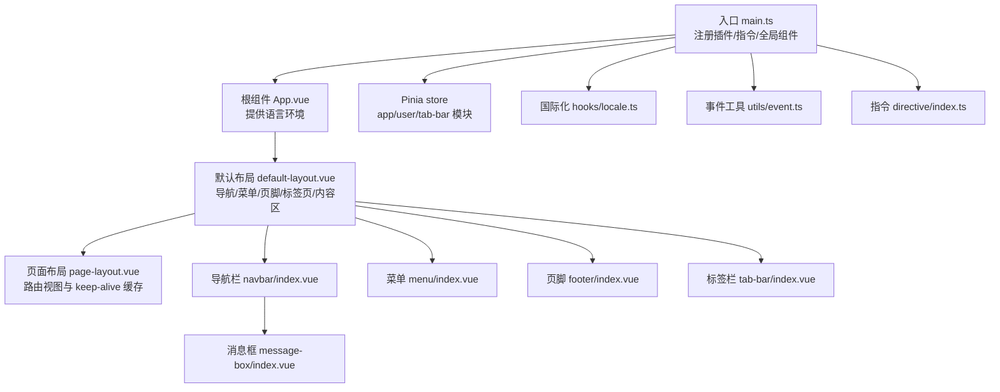
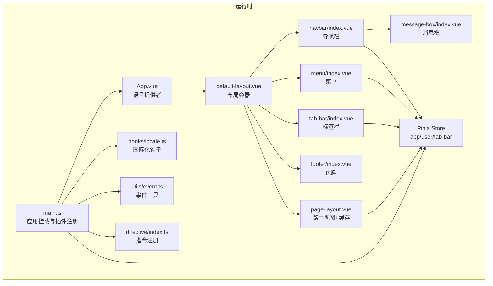
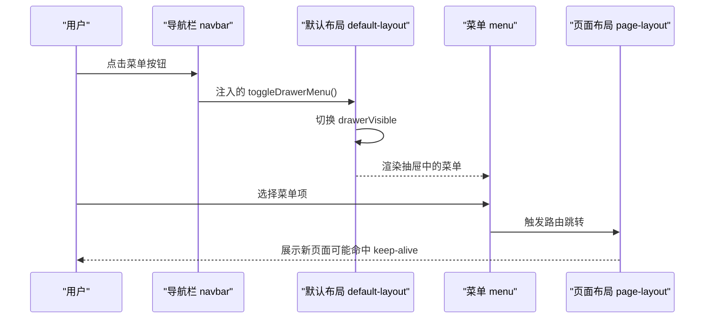
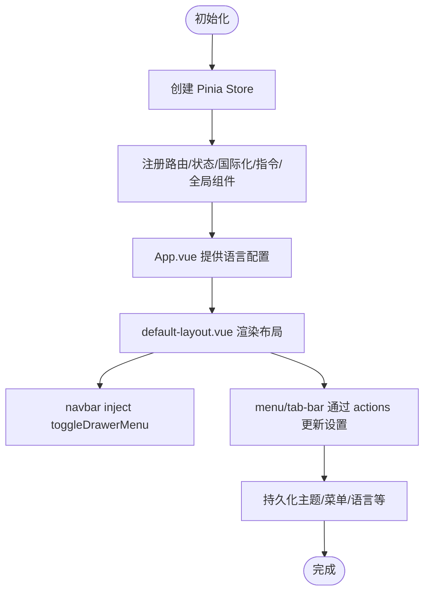
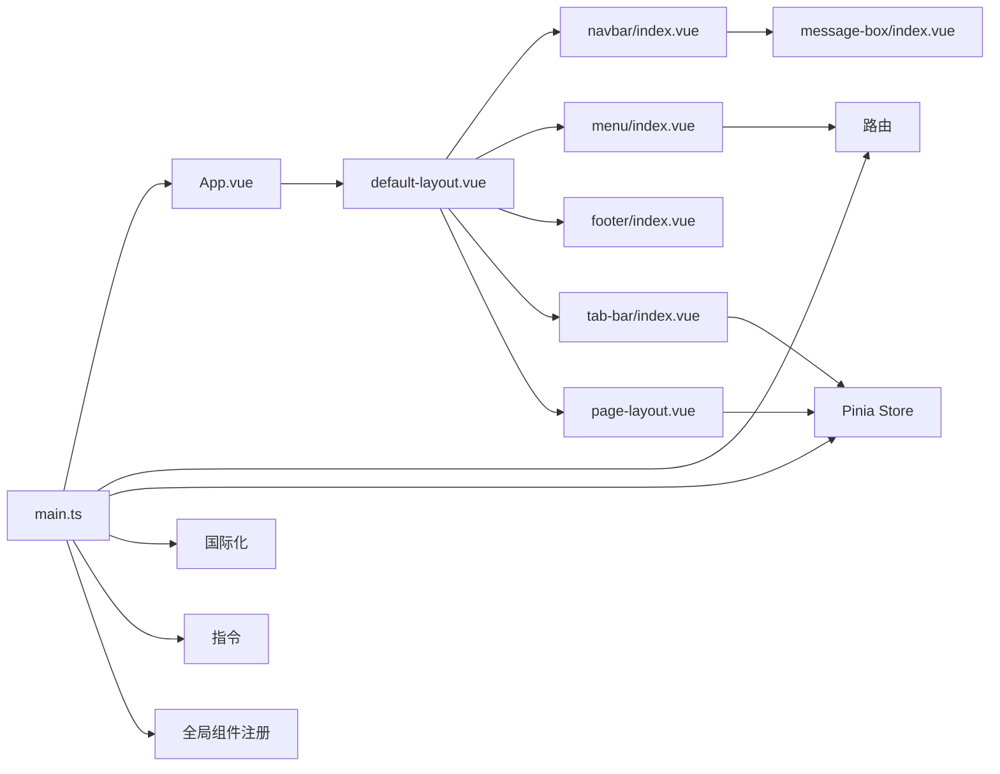

# 组件交互机制

<cite>
**本文引用的文件**
- [src/main.ts](file://src/main.ts)
- [src/App.vue](file://src/App.vue)
- [src/layout/default-layout.vue](file://src/layout/default-layout.vue)
- [src/layout/page-layout.vue](file://src/layout/page-layout.vue)
- [src/components/index.ts](file://src/components/index.ts)
- [src/components/navbar/index.vue](file://src/components/navbar/index.vue)
- [src/components/menu/index.vue](file://src/components/menu/index.vue)
- [src/components/footer/index.vue](file://src/components/footer/index.vue)
- [src/components/tab-bar/index.vue](file://src/components/tab-bar/index.vue)
- [src/store/index.ts](file://src/store/index.ts)
- [src/store/modules/app/index.ts](file://src/store/modules/app/index.ts)
- [src/hooks/locale.ts](file://src/hooks/locale.ts)
- [src/utils/event.ts](file://src/utils/event.ts)
- [src/directive/index.ts](file://src/directive/index.ts)
- [src/components/message-box/index.vue](file://src/components/message-box/index.vue)
</cite>

## 目录
1. [引言](#引言)
2. [项目结构](#项目结构)
3. [核心组件](#核心组件)
4. [架构总览](#架构总览)
5. [详细组件分析](#详细组件分析)
6. [依赖关系分析](#依赖关系分析)
7. [性能考虑](#性能考虑)
8. [故障排查指南](#故障排查指南)
9. [结论](#结论)
10. [附录](#附录)

## 引言
本文件系统性梳理该 Vue 3 应用的组件交互机制，覆盖 props 传递、事件触发、provide/inject 依赖注入、全局状态共享（Pinia）、布局与业务组件交互模式、通用组件复用策略、组件生命周期管理、父子/兄弟/跨层级通信方案，并给出解耦设计与高内聚低耦合的实践建议，以及性能优化与内存管理最佳实践。

## 项目结构
应用采用“布局-页面-业务组件”分层组织：
- 入口与全局配置：在入口文件中注册路由、状态、国际化、指令与全局组件。
- 布局层：默认布局负责导航栏、菜单、页脚、标签页与内容区的编排；页面布局负责路由视图与缓存控制。
- 业务组件：如消息框、面包屑、图表等，按功能模块化封装。
- 状态层：Pinia Store 提供全局状态与动作，模块化管理应用设置、用户信息、标签页等。
- 工具与钩子：事件监听工具、国际化钩子、响应式与主题钩子等。

**图表来源**
- [src/main.ts:1-29](file://src/main.ts#L1-L29)
- [src/App.vue:1-27](file://src/App.vue#L1-L27)
- [src/layout/default-layout.vue:1-179](file://src/layout/default-layout.vue#L1-L179)
- [src/layout/page-layout.vue:1-26](file://src/layout/page-layout.vue#L1-L26)
- [src/components/navbar/index.vue:1-324](file://src/components/navbar/index.vue#L1-L324)
- [src/components/menu/index.vue:1-161](file://src/components/menu/index.vue#L1-L161)
- [src/components/footer/index.vue:1-17](file://src/components/footer/index.vue#L1-L17)
- [src/components/tab-bar/index.vue:1-102](file://src/components/tab-bar/index.vue#L1-L102)
- [src/store/index.ts:1-10](file://src/store/index.ts#L1-L10)
- [src/hooks/locale.ts:1-23](file://src/hooks/locale.ts#L1-L23)
- [src/utils/event.ts:1-28](file://src/utils/event.ts#L1-L28)
- [src/directive/index.ts:1-9](file://src/directive/index.ts#L1-L9)

**章节来源**
- [src/main.ts:1-29](file://src/main.ts#L1-L29)
- [src/App.vue:1-27](file://src/App.vue#L1-L27)
- [src/layout/default-layout.vue:1-179](file://src/layout/default-layout.vue#L1-L179)
- [src/layout/page-layout.vue:1-26](file://src/layout/page-layout.vue#L1-L26)

## 核心组件
- 默认布局 default-layout.vue：负责整体布局、响应式控制、菜单折叠状态同步、抽屉开关、全局样式与权限校验。
- 页面布局 page-layout.vue：基于路由视图渲染页面，结合标签页缓存列表使用 keep-alive 控制缓存。
- 导航栏 navbar/index.vue：提供语言切换、主题切换、通知弹窗、全屏切换、用户下拉菜单等能力；通过 inject 获取来自父级的抽屉开关回调。
- 菜单 menu/index.vue：根据路由生成菜单树，处理选中态、展开态、外部链接跳转与路由变更联动。
- 标签栏 tab-bar/index.vue：监听路由变化，动态增删标签，支持固定标签与滚动展示。
- 页脚 footer/index.vue：基础页脚展示。
- 消息框 message-box/index.vue：异步加载消息列表，按类型分页签展示，点击标记已读并刷新。
- 全局组件注册 components/index.ts：集中注册通用组件（如图表、面包屑）。
- Pinia Store：app 模块管理主题、设备、菜单、服务端菜单等；tab-bar 模块管理标签页集合；user 模块管理用户信息。
- 国际化 hooks/locale.ts：统一管理当前语言与切换逻辑。
- 事件工具 utils/event.ts：标准化 DOM 事件监听与移除。
- 指令 directive/index.ts：全局指令注册入口。

**章节来源**
- [src/layout/default-layout.vue:1-179](file://src/layout/default-layout.vue#L1-L179)
- [src/layout/page-layout.vue:1-26](file://src/layout/page-layout.vue#L1-L26)
- [src/components/navbar/index.vue:1-324](file://src/components/navbar/index.vue#L1-L324)
- [src/components/menu/index.vue:1-161](file://src/components/menu/index.vue#L1-L161)
- [src/components/tab-bar/index.vue:1-102](file://src/components/tab-bar/index.vue#L1-L102)
- [src/components/footer/index.vue:1-17](file://src/components/footer/index.vue#L1-L17)
- [src/components/message-box/index.vue:1-130](file://src/components/message-box/index.vue#L1-L130)
- [src/components/index.ts:1-36](file://src/components/index.ts#L1-L36)
- [src/store/modules/app/index.ts:1-78](file://src/store/modules/app/index.ts#L1-L78)
- [src/hooks/locale.ts:1-23](file://src/hooks/locale.ts#L1-L23)
- [src/utils/event.ts:1-28](file://src/utils/event.ts#L1-L28)
- [src/directive/index.ts:1-9](file://src/directive/index.ts#L1-L9)

## 架构总览
应用采用“布局-页面-组件-状态-工具”的分层架构，组件间通过 props、事件、provide/inject、Pinia 共享状态进行交互，路由驱动页面切换与缓存策略。

**图表来源**
- [src/main.ts:1-29](file://src/main.ts#L1-L29)
- [src/App.vue:1-27](file://src/App.vue#L1-L27)
- [src/layout/default-layout.vue:1-179](file://src/layout/default-layout.vue#L1-L179)
- [src/layout/page-layout.vue:1-26](file://src/layout/page-layout.vue#L1-L26)
- [src/components/navbar/index.vue:1-324](file://src/components/navbar/index.vue#L1-L324)
- [src/components/menu/index.vue:1-161](file://src/components/menu/index.vue#L1-L161)
- [src/components/footer/index.vue:1-17](file://src/components/footer/index.vue#L1-L17)
- [src/components/tab-bar/index.vue:1-102](file://src/components/tab-bar/index.vue#L1-L102)
- [src/components/message-box/index.vue:1-130](file://src/components/message-box/index.vue#L1-L130)
- [src/store/index.ts:1-10](file://src/store/index.ts#L1-L10)
- [src/hooks/locale.ts:1-23](file://src/hooks/locale.ts#L1-L23)
- [src/utils/event.ts:1-28](file://src/utils/event.ts#L1-L28)
- [src/directive/index.ts:1-9](file://src/directive/index.ts#L1-L9)

## 详细组件分析

### 布局组件与业务组件交互模式
- 布局容器 default-layout.vue 作为枢纽，通过计算属性与状态驱动子组件显示/隐藏与尺寸调整；通过 provide 向子组件暴露抽屉开关方法，实现跨层级通信。
- 页面布局 page-layout.vue 依据标签页缓存列表对路由组件进行 keep-alive 缓存，减少重复渲染与请求开销。
- 导航栏 navbar/index.vue 通过 inject 获取抽屉开关回调，在移动端触发侧边菜单抽屉；同时通过 Pinia 更新主题、语言等全局设置。
- 菜单 menu/index.vue 根据路由生成菜单树，处理外部链接与内部路由跳转，监听路由变化自动更新选中与展开状态。
- 标签栏 tab-bar/index.vue 监听路由变化，动态增删标签，支持固定标签与滚动展示，提升多页面体验。
- 页脚 footer/index.vue 作为纯展示组件，无复杂交互。

**图表来源**
- [src/components/navbar/index.vue:262](file://src/components/navbar/index.vue#L262)
- [src/layout/default-layout.vue:100-102](file://src/layout/default-layout.vue#L100-L102)
- [src/components/menu/index.vue:33-50](file://src/components/menu/index.vue#L33-L50)
- [src/layout/page-layout.vue:9-11](file://src/layout/page-layout.vue#L9-L11)

**章节来源**
- [src/layout/default-layout.vue:1-179](file://src/layout/default-layout.vue#L1-L179)
- [src/layout/page-layout.vue:1-26](file://src/layout/page-layout.vue#L1-L26)
- [src/components/navbar/index.vue:1-324](file://src/components/navbar/index.vue#L1-L324)
- [src/components/menu/index.vue:1-161](file://src/components/menu/index.vue#L1-L161)
- [src/components/tab-bar/index.vue:1-102](file://src/components/tab-bar/index.vue#L1-L102)
- [src/components/footer/index.vue:1-17](file://src/components/footer/index.vue#L1-L17)

### 通用组件复用策略
- 全局组件注册：components/index.ts 中集中注册通用组件（如图表、面包屑），在入口 main.ts 中统一安装，便于各处直接使用。
- 图表组件：通过 ECharts 按需引入渲染器与组件，减小打包体积，提高加载效率。
- 消息框组件：以 popover 内容形式复用，支持多类型消息切换与已读标记，避免重复开发。

**章节来源**
- [src/components/index.ts:1-36](file://src/components/index.ts#L1-L36)
- [src/main.ts:4](file://src/main.ts#L4)

### 组件生命周期管理
- 页面布局 page-layout.vue 在 mounted 时通过 keep-alive 包裹路由组件，结合标签页缓存列表控制缓存白名单，减少重复实例化。
- 标签栏 tab-bar/index.vue 在 onUnmounted 阶段移除路由监听，防止内存泄漏。
- default-layout.vue 使用 watch 监听用户角色变化，配合权限守卫跳转至兜底页面，确保安全与一致性。

**章节来源**
- [src/layout/page-layout.vue:16-23](file://src/layout/page-layout.vue#L16-L23)
- [src/components/tab-bar/index.vue:57-59](file://src/components/tab-bar/index.vue#L57-L59)
- [src/layout/default-layout.vue:89-95](file://src/layout/default-layout.vue#L89-L95)

### 父子组件通信
- props 传递：菜单组件通过 v-model 绑定折叠状态，实现父子双向数据流；标签栏向标签项传递索引与数据。
- 事件触发：菜单组件通过 collapse 事件向上汇报折叠状态变化；消息框组件通过 item-click 事件向下广播点击行为。
- 示例路径：
  - [src/components/menu/index.vue:12](file://src/components/menu/index.vue#L12)
  - [src/components/menu/index.vue:139](file://src/components/menu/index.vue#L139)
  - [src/components/tab-bar/index.vue:7-12](file://src/components/tab-bar/index.vue#L7-L12)
  - [src/components/message-box/index.vue:14](file://src/components/message-box/index.vue#L14)

**章节来源**
- [src/components/menu/index.vue:1-161](file://src/components/menu/index.vue#L1-L161)
- [src/components/tab-bar/index.vue:1-102](file://src/components/tab-bar/index.vue#L1-L102)
- [src/components/message-box/index.vue:1-130](file://src/components/message-box/index.vue#L1-L130)

### 兄弟组件通信
- 通过全局状态共享：导航栏与菜单、标签栏之间通过 Pinia 的 app 与 tab-bar 模块共享状态，实现主题、菜单、标签等跨组件同步。
- 示例路径：
  - [src/store/modules/app/index.ts:24-74](file://src/store/modules/app/index.ts#L24-L74)
  - [src/store/index.ts:1-10](file://src/store/index.ts#L1-L10)

**章节来源**
- [src/store/modules/app/index.ts:1-78](file://src/store/modules/app/index.ts#L1-L78)
- [src/store/index.ts:1-10](file://src/store/index.ts#L1-L10)

### 跨层级组件通信
- provide/inject：默认布局通过 provide 向深层子组件注入 toggleDrawerMenu 方法，导航栏通过 inject 获取并调用，实现跨层级控制。
- 示例路径：
  - [src/layout/default-layout.vue:100-102](file://src/layout/default-layout.vue#L100-L102)
  - [src/components/navbar/index.vue:262](file://src/components/navbar/index.vue#L262)

**章节来源**
- [src/layout/default-layout.vue:1-179](file://src/layout/default-layout.vue#L1-L179)
- [src/components/navbar/index.vue:1-324](file://src/components/navbar/index.vue#L1-L324)

### 依赖注入与全局状态共享
- Pinia Store：app 模块管理主题、设备、菜单、服务端菜单；tab-bar 模块管理标签页集合；user 模块管理用户信息。
- 国际化：hooks/locale.ts 统一管理语言切换与本地存储，App.vue 将当前语言注入到配置提供者。
- 权限与路由：默认布局监听用户角色变化，结合权限守卫跳转至兜底页面，保证访问安全。

**图表来源**
- [src/main.ts:1-29](file://src/main.ts#L1-L29)
- [src/App.vue:8-26](file://src/App.vue#L8-L26)
- [src/layout/default-layout.vue:100-102](file://src/layout/default-layout.vue#L100-L102)
- [src/store/modules/app/index.ts:24-74](file://src/store/modules/app/index.ts#L24-L74)

**章节来源**
- [src/store/index.ts:1-10](file://src/store/index.ts#L1-L10)
- [src/store/modules/app/index.ts:1-78](file://src/store/modules/app/index.ts#L1-L78)
- [src/hooks/locale.ts:1-23](file://src/hooks/locale.ts#L1-L23)
- [src/App.vue:1-27](file://src/App.vue#L1-L27)

## 依赖关系分析
- 组件依赖：导航栏依赖菜单、消息框；菜单依赖路由与状态；标签栏依赖路由监听与状态；页面布局依赖标签页缓存列表。
- 外部依赖：Arco Design、ECharts、@vueuse/core、Pinia、vue-i18n。
- 入口依赖：main.ts 作为唯一挂载点，串联所有插件与全局配置。

**图表来源**
- [src/main.ts:1-29](file://src/main.ts#L1-L29)
- [src/App.vue:1-27](file://src/App.vue#L1-L27)
- [src/layout/default-layout.vue:1-179](file://src/layout/default-layout.vue#L1-L179)
- [src/layout/page-layout.vue:1-26](file://src/layout/page-layout.vue#L1-L26)
- [src/components/navbar/index.vue:1-324](file://src/components/navbar/index.vue#L1-L324)
- [src/components/menu/index.vue:1-161](file://src/components/menu/index.vue#L1-L161)
- [src/components/footer/index.vue:1-17](file://src/components/footer/index.vue#L1-L17)
- [src/components/tab-bar/index.vue:1-102](file://src/components/tab-bar/index.vue#L1-L102)
- [src/components/message-box/index.vue:1-130](file://src/components/message-box/index.vue#L1-L130)
- [src/store/index.ts:1-10](file://src/store/index.ts#L1-L10)

**章节来源**
- [src/main.ts:1-29](file://src/main.ts#L1-L29)
- [src/layout/default-layout.vue:1-179](file://src/layout/default-layout.vue#L1-L179)

## 性能考虑
- 路由缓存：page-layout.vue 使用 keep-alive 结合标签页缓存列表，避免频繁销毁重建，降低首屏与二次进入成本。
- 按需引入：components/index.ts 对 ECharts 进行手动模块引入，减少打包体积，提升加载速度。
- 主题与语言：hooks/locale.ts 将语言切换结果写入本地存储，避免每次刷新重新计算。
- 事件监听：utils/event.ts 提供统一的 add/remove 监听接口，避免重复绑定与内存泄漏。
- 响应式与防抖：default-layout.vue 在初始化后才允许菜单折叠状态生效，避免初始化抖动。

**章节来源**
- [src/layout/page-layout.vue:16-23](file://src/layout/page-layout.vue#L16-L23)
- [src/components/index.ts:15-28](file://src/components/index.ts#L15-L28)
- [src/hooks/locale.ts:10-17](file://src/hooks/locale.ts#L10-L17)
- [src/utils/event.ts:1-28](file://src/utils/event.ts#L1-L28)
- [src/layout/default-layout.vue:85-88](file://src/layout/default-layout.vue#L85-L88)

## 故障排查指南
- 路由监听未清理：若出现内存泄漏或状态异常，检查标签栏是否正确移除了路由监听。
  - 参考路径：[src/components/tab-bar/index.vue:57-59](file://src/components/tab-bar/index.vue#L57-L59)
- 抽屉开关无效：确认父级是否正确 provide 了 toggleDrawerMenu，子组件是否正确 inject。
  - 参考路径：[src/layout/default-layout.vue:100-102](file://src/layout/default-layout.vue#L100-L102), [src/components/navbar/index.vue:262](file://src/components/navbar/index.vue#L262)
- 菜单选中/展开异常：检查菜单组件是否正确监听路由变化并更新 open-keys 与 selected-key。
  - 参考路径：[src/components/menu/index.vue:72-86](file://src/components/menu/index.vue#L72-L86)
- 主题切换不生效：确认 app 模块的 toggleTheme 动作是否正确设置 body 属性。
  - 参考路径：[src/store/modules/app/index.ts:32-40](file://src/store/modules/app/index.ts#L32-L40)
- 语言切换未持久化：确认 hooks/locale.ts 是否正确写入本地存储。
  - 参考路径：[src/hooks/locale.ts:15](file://src/hooks/locale.ts#L15)

**章节来源**
- [src/components/tab-bar/index.vue:57-59](file://src/components/tab-bar/index.vue#L57-L59)
- [src/layout/default-layout.vue:100-102](file://src/layout/default-layout.vue#L100-L102)
- [src/components/navbar/index.vue:262](file://src/components/navbar/index.vue#L262)
- [src/components/menu/index.vue:72-86](file://src/components/menu/index.vue#L72-L86)
- [src/store/modules/app/index.ts:32-40](file://src/store/modules/app/index.ts#L32-L40)
- [src/hooks/locale.ts:15](file://src/hooks/locale.ts#L15)

## 结论
该应用通过明确的分层与清晰的职责划分，实现了布局组件与业务组件的高效协作。借助 Pinia 全局状态、provide/inject 跨层级通信、路由驱动的页面缓存与按需资源加载，系统在可维护性与性能上取得良好平衡。遵循本文的解耦与优化建议，可进一步提升组件复用度与运行效率。

## 附录
- 组件交互最佳实践
  - 明确单向数据流：优先使用 props 下发，事件向上汇报，避免跨层级直接修改。
  - 合理使用 provide/inject：仅在必要时跨越多层，保持注入粒度最小化。
  - 全局状态聚合：将跨组件共享的状态收敛到 Pinia，避免分散在多处。
  - 生命周期清理：在 onUnmounted 中移除监听与定时器，防止内存泄漏。
  - 缓存策略：结合 keep-alive 与路由元信息，合理控制缓存范围与失效时机。
  - 事件工具：统一事件绑定与解绑，避免重复监听与性能损耗。