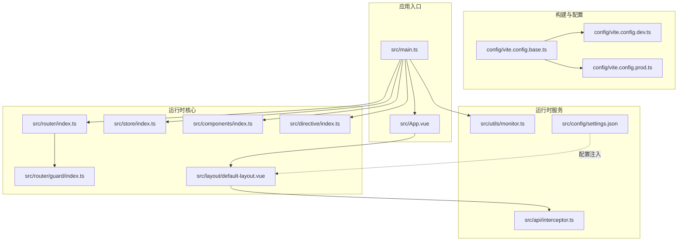
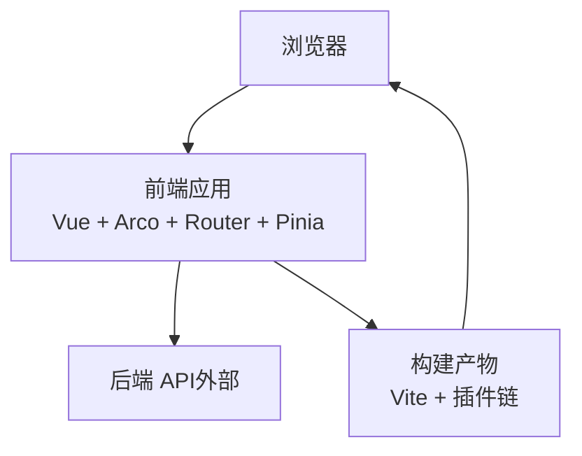
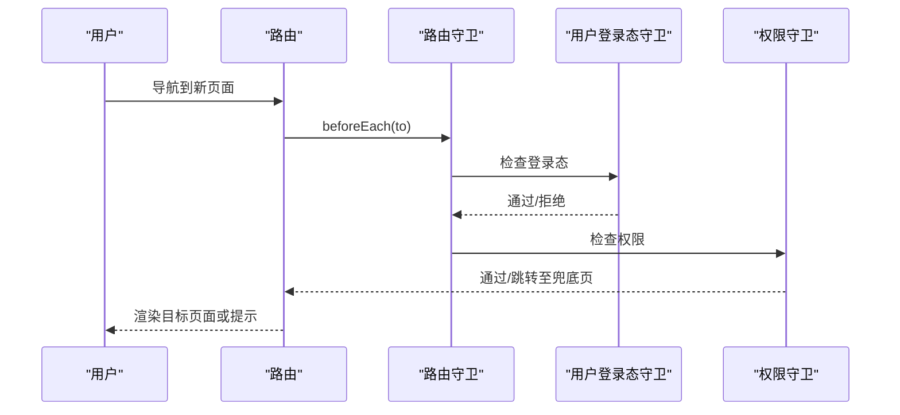
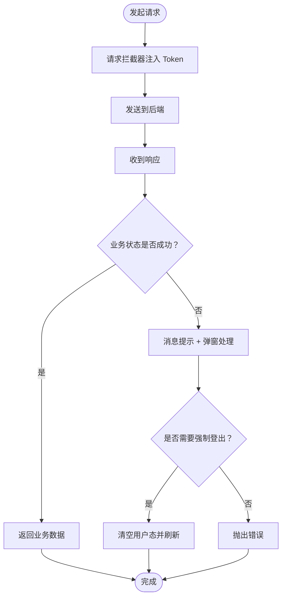
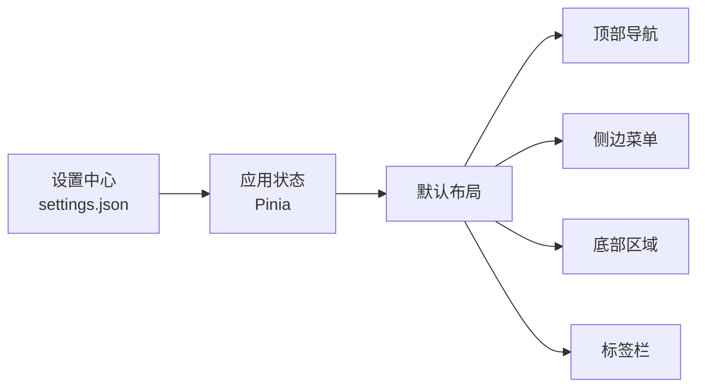
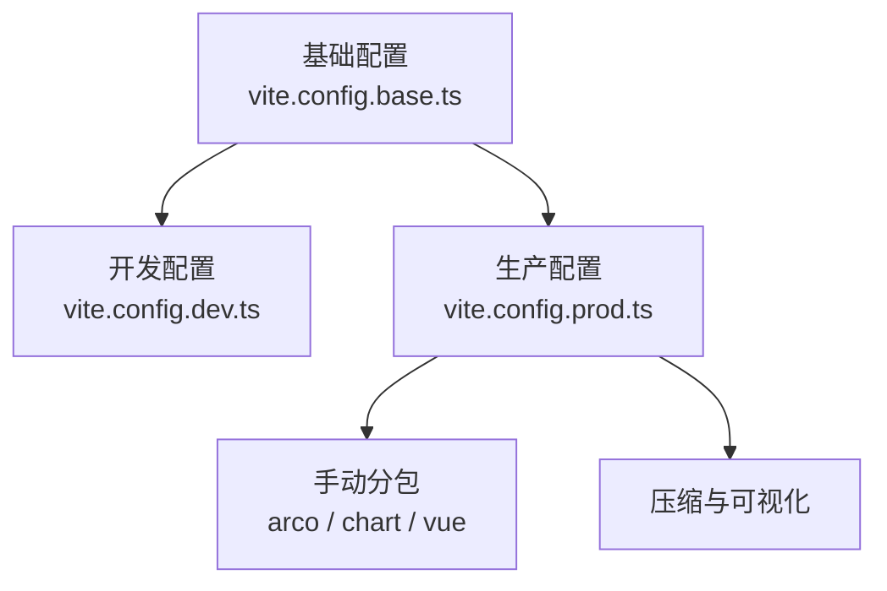
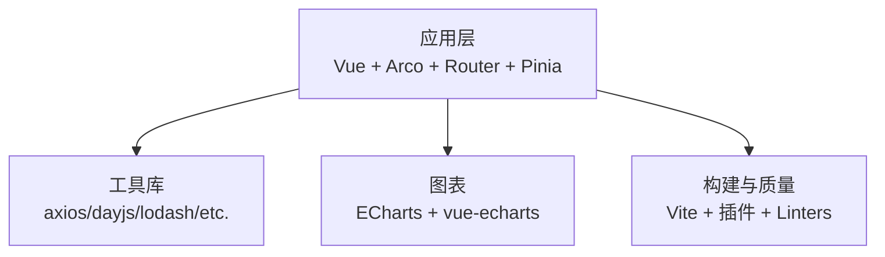
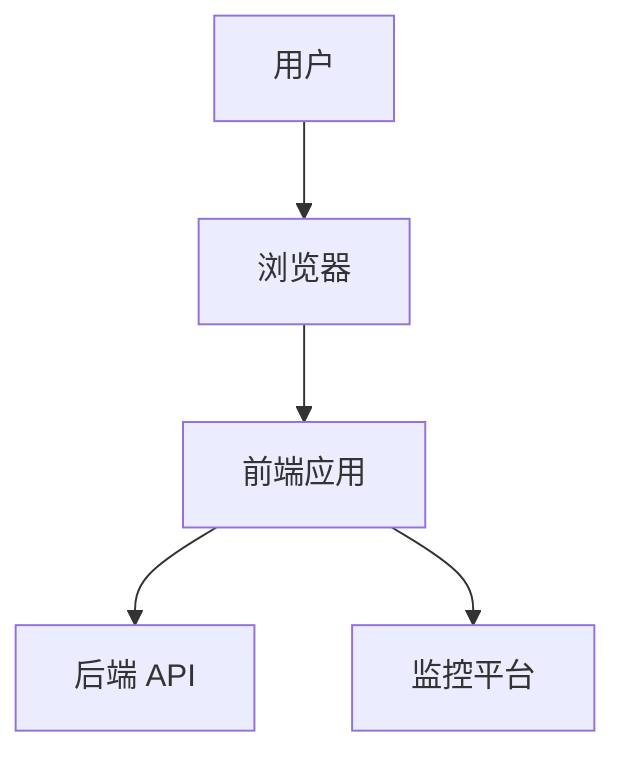

# 项目架构

<cite>
**本文引用的文件**
- [package.json](file://package.json)
- [main.ts](file://src/main.ts)
- [App.vue](file://src/App.vue)
- [default-layout.vue](file://src/layout/default-layout.vue)
- [index.ts（路由）](file://src/router/index.ts)
- [index.ts（路由守卫）](file://src/router/guard/index.ts)
- [index.ts（状态管理）](file://src/store/index.ts)
- [index.ts（全局组件注册）](file://src/components/index.ts)
- [index.ts（指令注册）](file://src/directive/index.ts)
- [vite.config.base.ts](file://config/vite.config.base.ts)
- [vite.config.dev.ts](file://config/vite.config.dev.ts)
- [vite.config.prod.ts](file://config/vite.config.prod.ts)
- [settings.json](file://src/config/settings.json)
- [interceptor.ts](file://src/api/interceptor.ts)
- [monitor.ts](file://src/utils/monitor.ts)
</cite>

## 目录
1. [引言](#引言)
2. [项目结构](#项目结构)
3. [核心组件](#核心组件)
4. [架构总览](#架构总览)
5. [详细组件分析](#详细组件分析)
6. [依赖分析](#依赖分析)
7. [性能考量](#性能考量)
8. [故障排查指南](#故障排查指南)
9. [结论](#结论)
10. [附录](#附录)

## 引言
本文件面向 Arco Design Pro Vue 管理端前端工程，提供整体架构说明与设计文档。内容涵盖高层设计、架构模式、系统边界、组件交互、数据流、集成方式、技术决策与权衡、基础设施与部署拓扑、安全与监控、以及技术栈与版本兼容性。目标是帮助开发者与运维人员快速理解系统结构，并为后续扩展与维护提供依据。

## 项目结构
项目采用“按功能域分层 + 组件化”的组织方式，核心目录职责如下：
- config：构建与插件配置（Vite 基础、开发、生产）
- src：源码
  - api：接口与请求拦截器
  - components：全局组件与图表注册
  - directive：自定义指令（权限控制）
  - hooks：组合式工具函数
  - layout：布局容器与页面骨架
  - locale：国际化资源与配置
  - mock：本地 Mock 数据
  - router：路由定义与守卫
  - store：状态管理（Pinia）
  - types/utils/views：类型声明、工具函数与视图页面
- 根目录：包管理与脚本、样式与主题、提交规范与质量工具

**图表来源**
- [vite.config.base.ts:1-52](file://config/vite.config.base.ts#L1-L52)
- [vite.config.dev.ts:1-24](file://config/vite.config.dev.ts#L1-L24)
- [vite.config.prod.ts:1-32](file://config/vite.config.prod.ts#L1-L32)
- [main.ts:1-29](file://src/main.ts#L1-L29)
- [App.vue:1-27](file://src/App.vue#L1-L27)
- [index.ts（路由）:1-38](file://src/router/index.ts#L1-L38)
- [index.ts（路由守卫）:1-18](file://src/router/guard/index.ts#L1-L18)
- [index.ts（状态管理）:1-10](file://src/store/index.ts#L1-L10)
- [default-layout.vue:1-179](file://src/layout/default-layout.vue#L1-L179)
- [index.ts（全局组件注册）:1-36](file://src/components/index.ts#L1-L36)
- [index.ts（指令注册）:1-9](file://src/directive/index.ts#L1-L9)
- [interceptor.ts:1-78](file://src/api/interceptor.ts#L1-L78)
- [monitor.ts:1-29](file://src/utils/monitor.ts#L1-L29)
- [settings.json:1-18](file://src/config/settings.json#L1-L18)

**章节来源**
- [package.json:1-103](file://package.json#L1-L103)
- [vite.config.base.ts:1-52](file://config/vite.config.base.ts#L1-L52)
- [main.ts:1-29](file://src/main.ts#L1-L29)

## 核心组件
- 应用入口与初始化
  - 入口文件负责创建应用实例、安装插件（路由、状态、国际化、全局组件、指令）、挂载根组件。
  - 参考路径：[入口文件:1-29](file://src/main.ts#L1-L29)
- 根组件与主题/语言环境
  - 根组件包裹 ConfigProvider 并根据当前语言动态切换 Arco 语言包；全局引入通用样式。
  - 参考路径：[根组件:1-27](file://src/App.vue#L1-L27)
- 路由与导航
  - 使用 Vue Router 定义登录页、重定向与兜底路由；集成进度条与路由守卫。
  - 参考路径：[路由定义:1-38](file://src/router/index.ts#L1-L38)，[路由守卫:1-18](file://src/router/guard/index.ts#L1-L18)
- 状态管理
  - 使用 Pinia 创建仓库，集中管理应用设置、用户信息与标签页状态。
  - 参考路径：[状态管理入口:1-10](file://src/store/index.ts#L1-L10)
- 布局与页面骨架
  - 默认布局支持顶部导航、侧边菜单、移动端抽屉、页脚与标签栏；响应式与主题配置由设置中心驱动。
  - 参考路径：[默认布局:1-179](file://src/layout/default-layout.vue#L1-L179)，[设置项:1-18](file://src/config/settings.json#L1-L18)
- 全局组件与指令
  - 注册图表组件与面包屑等通用组件；注册权限指令以实现元素级权限控制。
  - 参考路径：[组件注册:1-36](file://src/components/index.ts#L1-L36)，[指令注册:1-9](file://src/directive/index.ts#L1-L9)
- 请求拦截与错误上报
  - Axios 请求拦截统一注入 Token；响应拦截处理业务态与异常弹窗；错误处理器可上报前端错误到后端。
  - 参考路径：[请求拦截器:1-78](file://src/api/interceptor.ts#L1-L78)，[错误上报:1-29](file://src/utils/monitor.ts#L1-L29)

**章节来源**
- [main.ts:1-29](file://src/main.ts#L1-L29)
- [App.vue:1-27](file://src/App.vue#L1-L27)
- [index.ts（路由）:1-38](file://src/router/index.ts#L1-L38)
- [index.ts（路由守卫）:1-18](file://src/router/guard/index.ts#L1-L18)
- [index.ts（状态管理）:1-10](file://src/store/index.ts#L1-L10)
- [default-layout.vue:1-179](file://src/layout/default-layout.vue#L1-L179)
- [index.ts（全局组件注册）:1-36](file://src/components/index.ts#L1-L36)
- [index.ts（指令注册）:1-9](file://src/directive/index.ts#L1-L9)
- [interceptor.ts:1-78](file://src/api/interceptor.ts#L1-L78)
- [monitor.ts:1-29](file://src/utils/monitor.ts#L1-L29)
- [settings.json:1-18](file://src/config/settings.json#L1-L18)

## 架构总览
系统采用“前端单页应用 + 后端 API”模式，前端通过路由与状态管理协调页面与数据，通过拦截器与错误处理器保障通信与可观测性。构建阶段使用 Vite，结合多环境配置与插件体系优化体积与开发体验。

**图表来源**
- [main.ts:1-29](file://src/main.ts#L1-L29)
- [index.ts（路由）:1-38](file://src/router/index.ts#L1-L38)
- [index.ts（状态管理）:1-10](file://src/store/index.ts#L1-L10)
- [interceptor.ts:1-78](file://src/api/interceptor.ts#L1-L78)
- [vite.config.base.ts:1-52](file://config/vite.config.base.ts#L1-L52)

## 详细组件分析

### 路由与权限守卫流程
路由在进入前会触发页面级守卫，随后依次执行用户登录态与权限守卫，确保访问安全与一致性。

**图表来源**
- [index.ts（路由）:1-38](file://src/router/index.ts#L1-L38)
- [index.ts（路由守卫）:1-18](file://src/router/guard/index.ts#L1-L18)

**章节来源**
- [index.ts（路由）:1-38](file://src/router/index.ts#L1-L38)
- [index.ts（路由守卫）:1-18](file://src/router/guard/index.ts#L1-L18)

### 请求拦截与错误处理流程
请求拦截器统一注入认证头；响应拦截器解析业务状态并处理异常；全局错误处理器可上报前端错误。

**图表来源**
- [interceptor.ts:1-78](file://src/api/interceptor.ts#L1-L78)

**章节来源**
- [interceptor.ts:1-78](file://src/api/interceptor.ts#L1-L78)

### 布局与主题配置联动
布局组件读取应用设置，动态控制菜单、导航、页脚与标签栏显示；主题色与弱视模式等来自设置中心。

**图表来源**
- [settings.json:1-18](file://src/config/settings.json#L1-L18)
- [index.ts（状态管理）:1-10](file://src/store/index.ts#L1-L10)
- [default-layout.vue:1-179](file://src/layout/default-layout.vue#L1-L179)

**章节来源**
- [settings.json:1-18](file://src/config/settings.json#L1-L18)
- [default-layout.vue:1-179](file://src/layout/default-layout.vue#L1-L179)

### 构建与打包策略
- 基础配置：统一插件、别名、CSS 预处理与编译参数。
- 开发配置：启用 ESLint、自动打开浏览器、严格文件系统。
- 生产配置：开启压缩、可视化、组件库解析与图片压缩；Rollup 分包策略按框架/库/图表进行拆分。

**图表来源**
- [vite.config.base.ts:1-52](file://config/vite.config.base.ts#L1-L52)
- [vite.config.dev.ts:1-24](file://config/vite.config.dev.ts#L1-L24)
- [vite.config.prod.ts:1-32](file://config/vite.config.prod.ts#L1-L32)

**章节来源**
- [vite.config.base.ts:1-52](file://config/vite.config.base.ts#L1-L52)
- [vite.config.dev.ts:1-24](file://config/vite.config.dev.ts#L1-L24)
- [vite.config.prod.ts:1-32](file://config/vite.config.prod.ts#L1-L32)

## 依赖分析
- 运行时依赖
  - 视图框架与 UI：Vue 3、Arco Design Web Vue
  - 路由与状态：Vue Router、Pinia
  - 国际化与日期：vue-i18n、dayjs
  - 图表：ECharts、vue-echarts
  - 工具库：axios、lodash、mitt、nprogress、sortablejs、query-string
  - 组合式能力：@vueuse/core
- 开发依赖
  - 构建与插件：Vite、@arco-plugins/vite-vue、unplugin-vue-components、rollup 插件生态
  - 质量工具：ESLint、Stylelint、Prettier、lint-staged、husky、commitlint
  - 类型与测试：TypeScript、vue-tsc
- 版本与引擎
  - Node >= 14
  - TypeScript 4.x
  - Vue 3.x 与相关配套库版本保持兼容

**图表来源**
- [package.json:32-93](file://package.json#L32-L93)

**章节来源**
- [package.json:1-103](file://package.json#L1-L103)

## 性能考量
- 代码分割与懒加载
  - 路由级异步组件加载，减少首屏体积。
  - 生产环境 Rollup 手动分包，分离框架、UI 组件库与图表库。
- 资源优化
  - 图片压缩、SVG 加载器、CSS 压缩与 Tree-shaking。
- 开发体验
  - ESLint 实时检查、自动修复与格式化；自动打开浏览器提升迭代效率。
- 监控与告警
  - 错误上报机制可将前端异常上报至后端，便于追踪与恢复。

**章节来源**
- [vite.config.prod.ts:1-32](file://config/vite.config.prod.ts#L1-L32)
- [vite.config.dev.ts:1-24](file://config/vite.config.dev.ts#L1-L24)
- [interceptor.ts:1-78](file://src/api/interceptor.ts#L1-L78)
- [monitor.ts:1-29](file://src/utils/monitor.ts#L1-L29)

## 故障排查指南
- 登录态与权限问题
  - 检查路由守卫链路与用户状态变更；确认 Token 注入与后端返回的业务状态码。
  - 参考路径：[路由守卫:1-18](file://src/router/guard/index.ts#L1-L18)，[请求拦截器:1-78](file://src/api/interceptor.ts#L1-L78)
- 页面无内容或空白
  - 排查布局组件中菜单/导航/标签栏的渲染条件与设置中心配置。
  - 参考路径：[默认布局:1-179](file://src/layout/default-layout.vue#L1-L179)，[设置中心:1-18](file://src/config/settings.json#L1-L18)
- 构建失败或模块解析错误
  - 检查别名与插件配置；确认 Node 版本满足引擎要求。
  - 参考路径：[基础配置:1-52](file://config/vite.config.base.ts#L1-L52)，[package.json 引擎:94-102](file://package.json#L94-L102)
- 前端错误未上报
  - 确认错误处理器已安装且上报地址有效。
  - 参考路径：[错误上报:1-29](file://src/utils/monitor.ts#L1-L29)

**章节来源**
- [index.ts（路由守卫）:1-18](file://src/router/guard/index.ts#L1-L18)
- [interceptor.ts:1-78](file://src/api/interceptor.ts#L1-L78)
- [default-layout.vue:1-179](file://src/layout/default-layout.vue#L1-L179)
- [settings.json:1-18](file://src/config/settings.json#L1-L18)
- [vite.config.base.ts:1-52](file://config/vite.config.base.ts#L1-L52)
- [package.json:94-102](file://package.json#L94-L102)
- [monitor.ts:1-29](file://src/utils/monitor.ts#L1-L29)

## 结论
本项目以 Vue 3 为核心，结合 Arco Design UI、Pinia 与 Vue Router，形成清晰的路由-状态-布局三层架构；通过 Axios 拦截器与错误上报机制保障通信与可观测性；借助 Vite 多环境配置与插件体系实现高效开发与高质量构建。整体设计强调模块解耦、可配置与可扩展，适合在企业级后台管理系统中持续演进。

## 附录

### 系统上下文图

[此图为概念性上下文图，不直接映射具体源码文件]

### 技术栈与版本兼容性
- 前端框架与 UI：Vue 3、@arco-design/web-vue
- 路由与状态：vue-router、pinia
- 国际化与日期：vue-i18n、dayjs
- 图表：echarts、vue-echarts
- 工具库：axios、lodash、mitt、nprogress、sortablejs、query-string
- 构建与质量：vite、@arco-plugins/vite-vue、unplugin-vue-components、ESLint/Stylelint/Prettier、husky/commitlint
- 引擎与类型：Node >= 14、TypeScript 4.x

**章节来源**
- [package.json:32-93](file://package.json#L32-L93)